# IBM《生成式人工智能工程｜Falsk、生成式AI应用、数据分析、机器学习、Keras、架构和数据、NLP基础、transformer、微调、高级微调、RAG》 p128 12_为BERT准备数据.zh_en -BV1NAq6Y9E7z_p128-

Welcome to the data preparation for Bert with Pytorrch video After watching this video。

 you will be able to prepare data for preprocess using tokenization and masking。

You will also create training ready input for BERT's specific training tasks such as MLM and NSP。

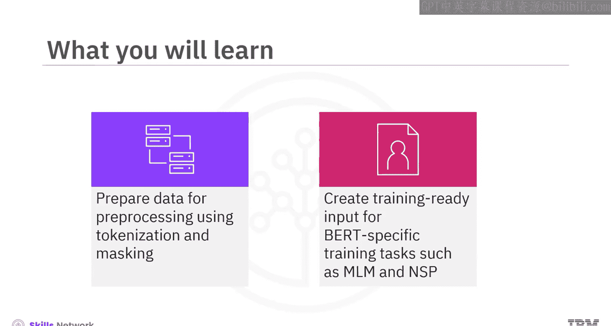

For data preparation， the initial steps involve tokenization and constructing a vocabulary you can follow the standard Pitorrch pipeline with two notes。

First initialize the tokenizer using the get tokenizer function In this case the tokenizer is set to tokenize text using the basic English model；

 please note that actual Bt uses wordpiece tokenization。Following that。

 you'll define special symbols in their corresponding indices， Pa I X， CS， I X， SP I X， maskask I X。

 and UNK I X Pa is used to represent padding tokens。 CS represents the start of a sequence。

 Cep is used as a separator between sequences。 Maask is used for masked language modeling or MLlM and UNK represents unknown tokens。

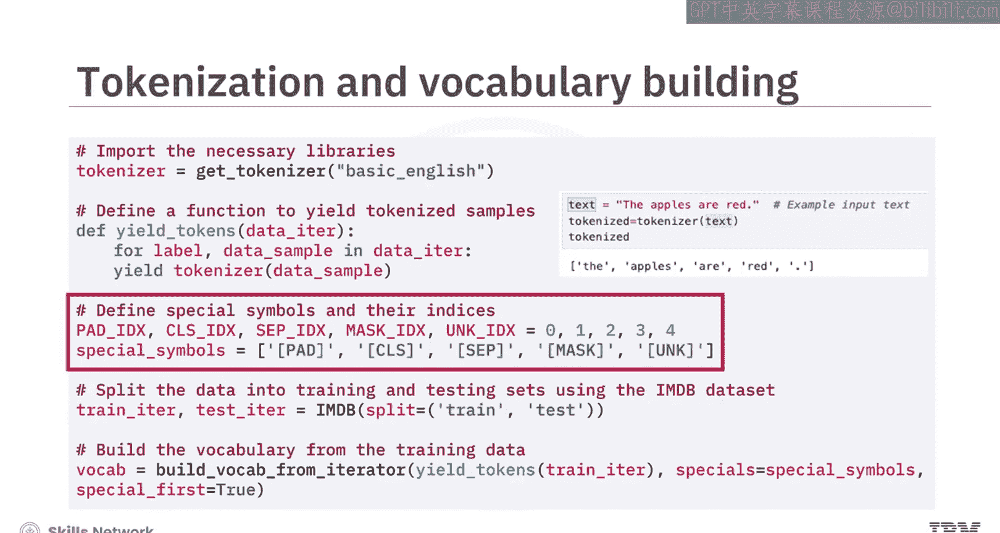

The masking function is used to perform masking operations on tokens。

 It takes a token as input and decides whether to mask it。 If the mask is false。

 the function immediately returns the original token with a pad label。 If the mask is true。

 the function randomly selects an operation with a 50% chance for each option。

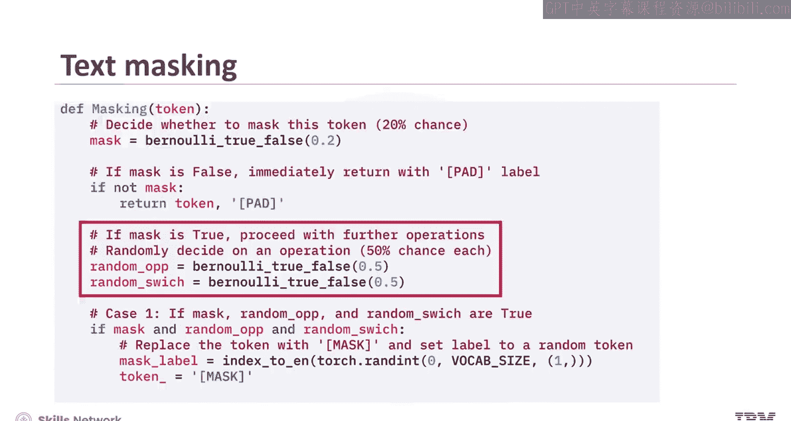

In case1， the token is replaced with mask and the label is set to a random token from the vocabulary。

In case 2， the token remains unchanged， and the label is set to the same token。 In case 3。

 the token is replaced with mask， and the label is set to the original token。

 The function then returns the modified token and its label。

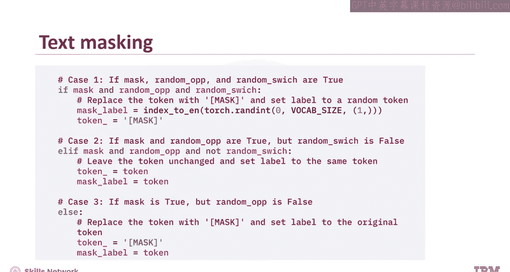

The preparepare for MLM function is used to prepare tokenized text for Bt's MLM training。

 the function takes a list of tokens as input and initializes lists to store the process sentences。

 labels for each token and raw tokens if needed。It applies Bert's MLM masking strategy to each token。

 replacing it with a mask token and assigning a label indicating whether the token was masked or left unchanged。

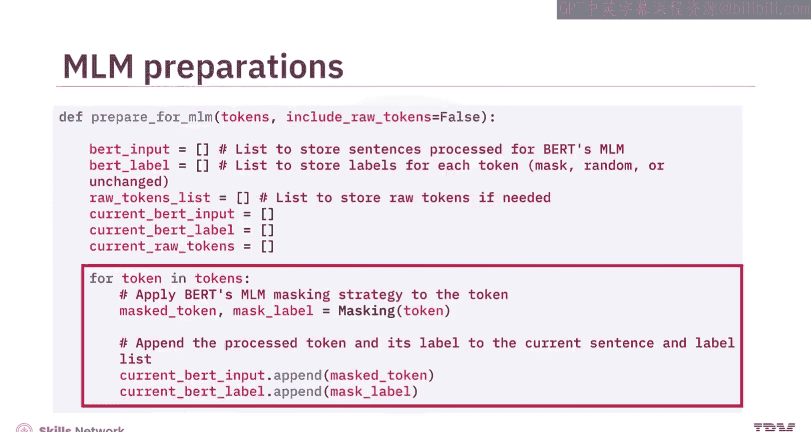

The function checks if the token is a sentence delimiter。

 If a valid sentence is found with more than two tokens。

 it adds the current sentence and its labels to the respective lists。 If raw tokens are included。

 the original tokens are stored as well。 The function continues this process until all tokens are processed。

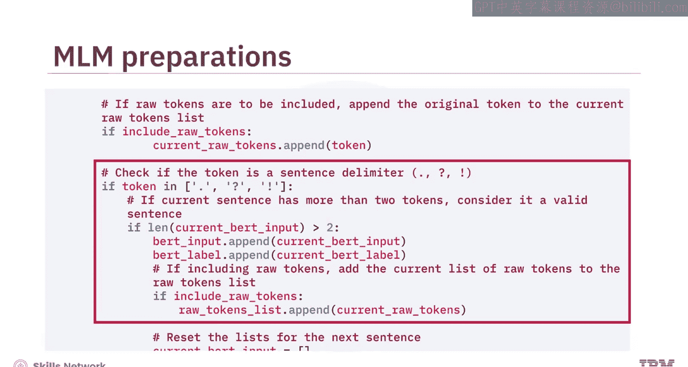

Any remaining tokens are added as a sentence， If present。 Finally。

 the function returns the prepared lists for Bert's M L M training。

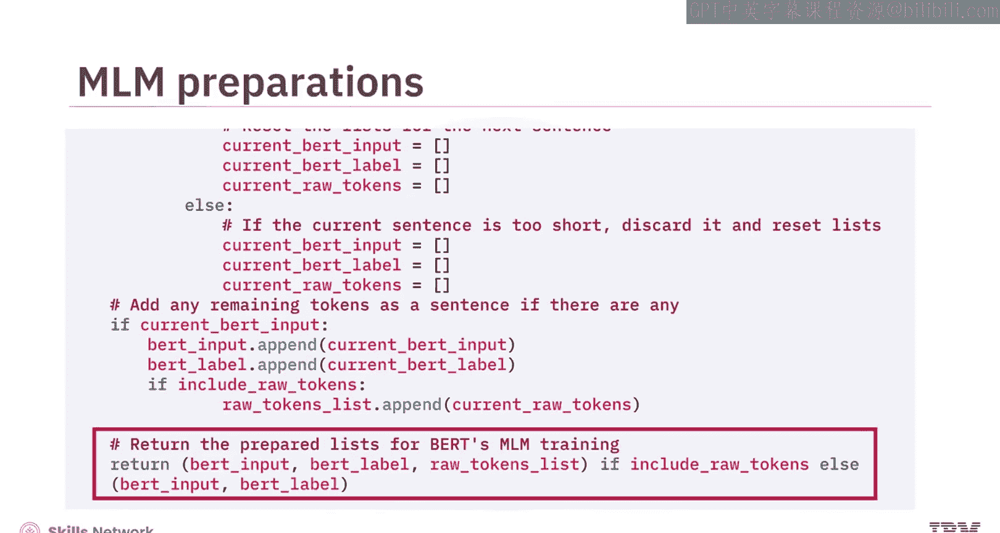

Let's check a sample MLlM output。 Each token in a sentence is labeled depending on the masking operation that's applied to that token。

 In this example， the first the is masked。 Therefore， Bt input is masked and its Bt label is the。

Token's sun sets behind， and the last， the are not changed。 So their corresponding labels are pad。

 Dis is masked and replaced with a random token。 Therefore。

 Bt input is masked and its burnt label is human scaled。 Finally， mountains and period are unchanged。

 so their corresponding labels are pad。

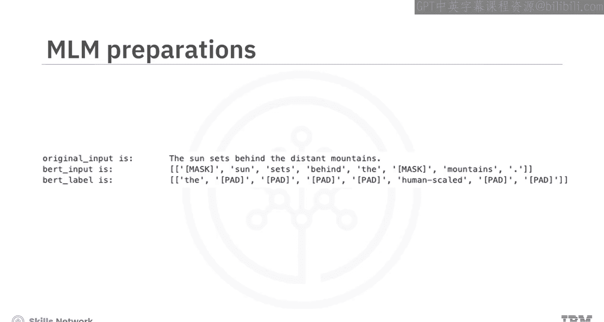

The process for NSP function is used to prepare data for the next sentence prediction or NSP task in BERT training。

This function takes a list of tokenized sentences and a corresponding list of masked labels as inputs。

 It verifies that both lists have the same length in enough sentences。

 The function initializes lists to store the sentence pairs for burnt input。

 The masked labels for the sentence pairs and binary labels indicating whether the sentences are consecutive or not。

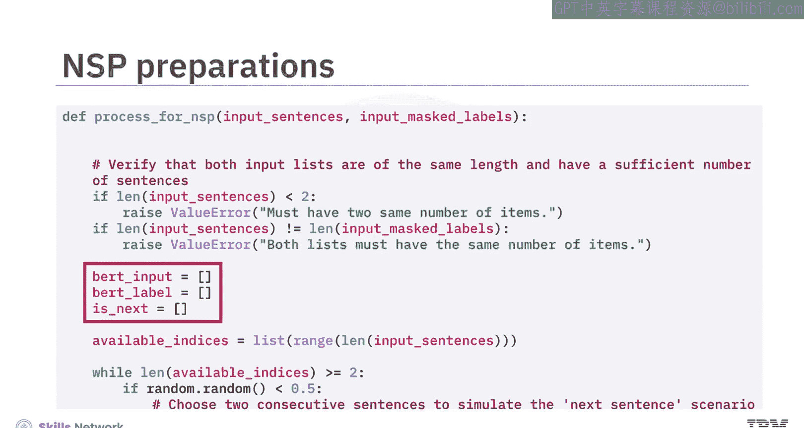

Using a while loop， the function generates sentence pairs until there are at least two available indices remaining。

 it randomly selects whether to create a next sentence scenario or a not next sentence scenario。

For the next sentence scenario， it selects two consecutive sentences。

 appends them as CLS and sep tokens， and assigns the corresponding labels and a one as the is next label。

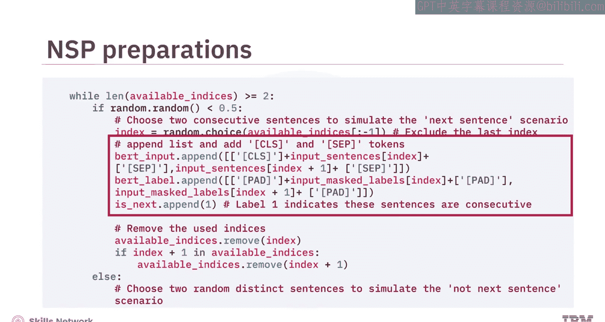

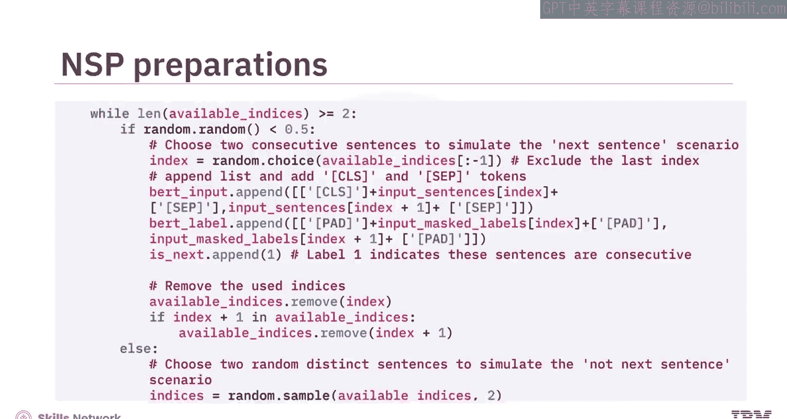

For the not next sentence scenario， it selects two random distinct sentences。

 appends them with CLS and Sep tokens， and assigns the corresponding labels and is0 as the iss next label。

After processing each pair， the used indices are removed from the available indices list。

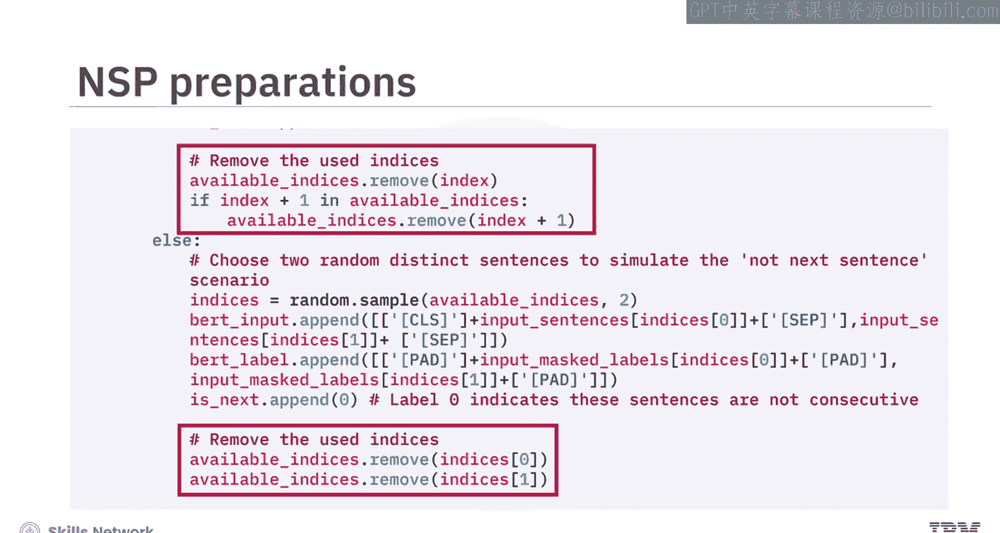

Finally， the function returns the prepared lists for Bt's NSP task， the sentence pairs。

 the masked labels， and the IZ next labels。

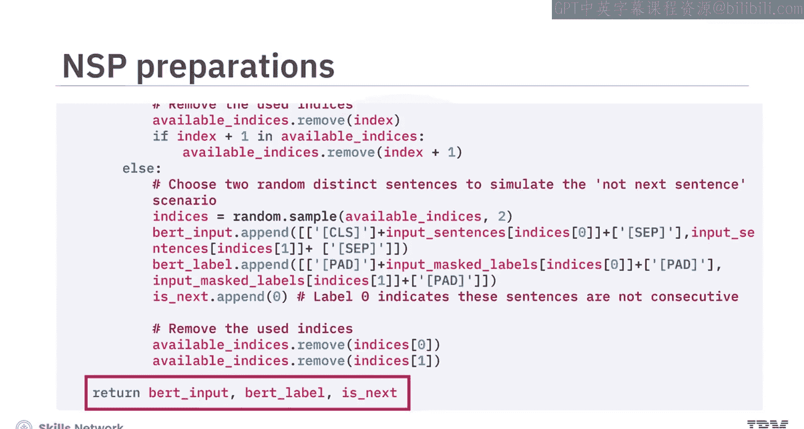

Let's check a sample output。 Special symbols， CS and CP are first added to the input sentences。

 Bt label is created using the preparepa for MLlM function。 In the first example。

 the second sentence follows the first sentence。 Therefore is next is one， and the second example。

 The second sentence does not follow the first sentence， So is next is 0。

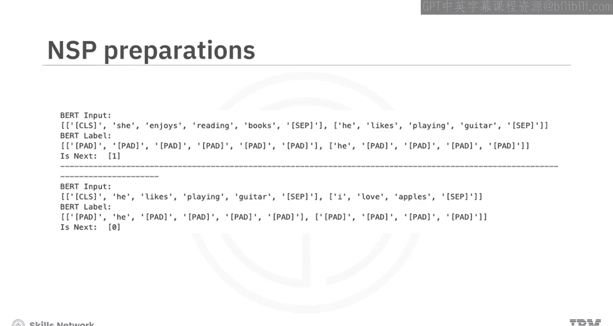

The Prepare Bt final inputs function is used to prepare the final input lists for Bt training。

 It takes the Bt inputs， Bt labels and is next lists as inputs， and pads are reformatted。

 reshaped and converted into a tensor。Inside the function there is a nested function called0pa list pair that is used to zero pad the input pairs with pad tokens to ensure they have the same length。

 this is important for maintaining consistent input shapes during training。

The function also includes lambda functions flattened and tokens to index for flattening nested lists and transforming tokens to their corresponding vocabulary indices respectively。

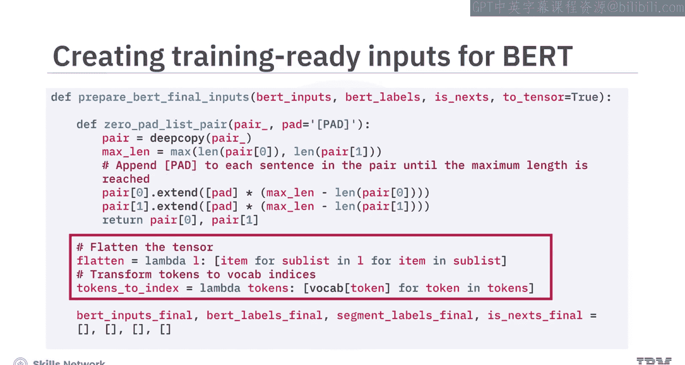

The function iterates over each input pair， creates segment labels for each pair of sentences。

 and apply zero padding to the input pairs and segment labels using the zero pad list pair function in Bt segment embeddings are used to differentiate between the two input sentences。

 This is necessary because Bert's input consists of a pair of sentences for NSP or question answering type tasks。

 and the model needs to understand which tokens belong to which sentence。

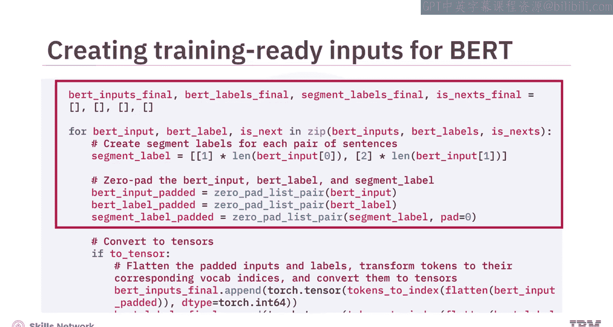

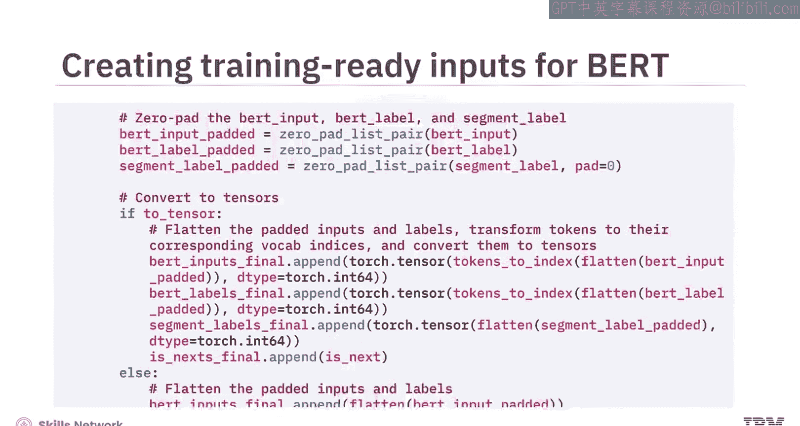

If the two tensor flag is set to true， the function flattens the padded inputs and labels。

 transforms the tokens to indices and converts them to pi torch sensors。 Otherwise。

 if two tensor is false， the flattened padded inputs and labels。

 segment labels and is next values are appended directly to the final output lists。

 Let's check a sample output。 Ses are0 padded and each token is mapped to its vocab index Cs to1 he to 33 Se to 2 pad to0。

 Maed labels are also padded and mapped to vocab indices。 In this case， all tokens are unchanged。

 except the token he， which is masked Next segment labels are created。

 where tokens of the first sentence are labeled with one。

 Tokens of the second sentence are labeled with  two and0 paddings are labeled with0。 Finally。

 is next is returned to indicate that the second sentence does not follow the first one。

 This code writes the processed Internet movie database or IMDB data to a CV file。

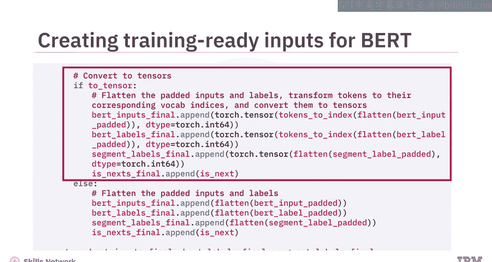

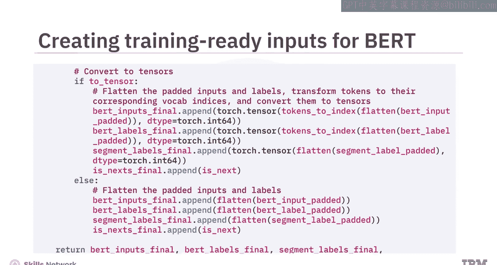

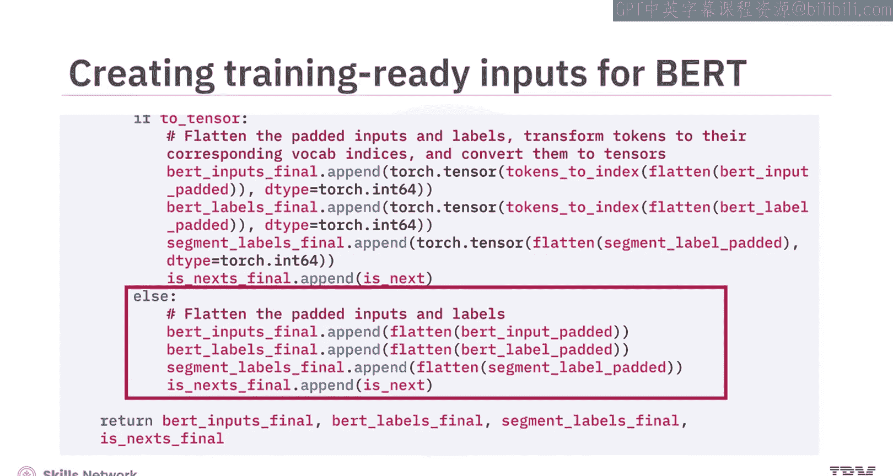

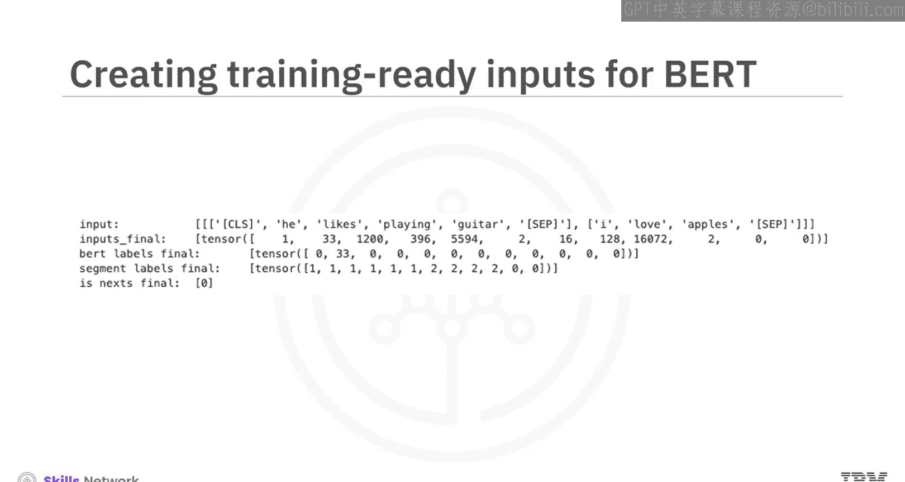

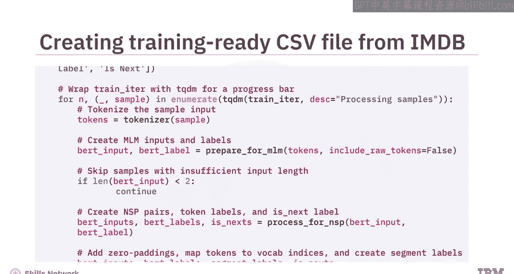

The output will be as shown here。

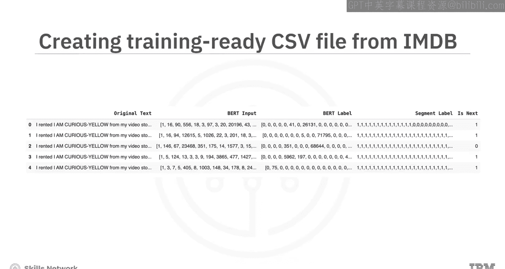

Let's check an example of the outputs of data preparations。 Given a corpus。

 pairs of sentences are created as input。 input is tokenized and numericalized， Special tokens。

 Cs and s are added。 Then itll be0 padded。 Next， the masking strategy is applied。

 According to the masking strategy。 Bt labels are created where every token has a label 0 except for mask tokens。

 segmentment labels are also created that show a which sentence each token belongs。 Finally。

 the is next label shows whether the second sentence follows the first one。

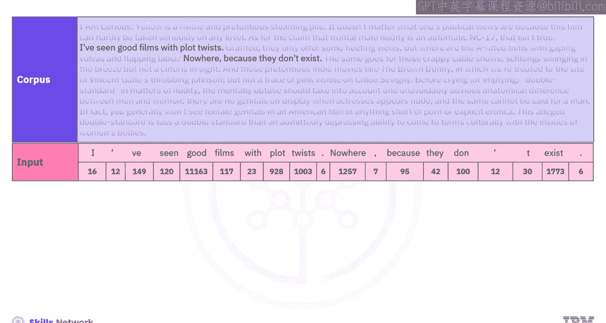

Let's not recap what you learned in this video you learned that for data preparation first you must initialize a tokenizer using get tokenizer function and then define special symbols with their corresponding indices The masking function is used to perform masking operations on tokens where it takes a token as input and decides whether to mask it。

The preparepare for MLM function takes a list of tokens as input and initializes lists to store the process sentences。

 labels for each token， and raw tokens if needed。It applies Bert's MLM masking strategy to each token。

 replacing it with a mask token and assigning a label indicating whether the token was masked or left unchanged。

The process for NSP function takes a list of tokenized sentences and a corresponding list of masked labels as inputs。

 It verifies that both lists have the same length and enough sentences。

 It initializes lists to store the sentence pairs for burnt input。

 the masked labels for the sentence pairs and binary labels indicating whether the sentences are consecutive or not。

 The prepare Bt final inputs function is used to prepare the final input lists for Bt training。

 It takes the Bt inputs， Bt labels and is next lists as inputs。

