# IBM《生成式人工智能工程｜Falsk、生成式AI应用、数据分析、机器学习、Keras、架构和数据、NLP基础、transformer、微调、高级微调、RAG》 p129 13_使用PyTorch预训练BERT模型.zh_en -BV1NAq6Y9E7z_p129-

Welcome to pretraining BRT models with Pyetorrch。

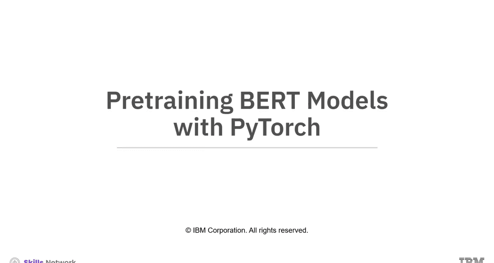

After watching this video， you will be able to describe how to create data loaders and PyTtororch for BertRT's specific training tasks。

 you'll also be able to explain the steps to creating a BRT model in PyTtororch and describe how to train the BRT model using PyTtororch。

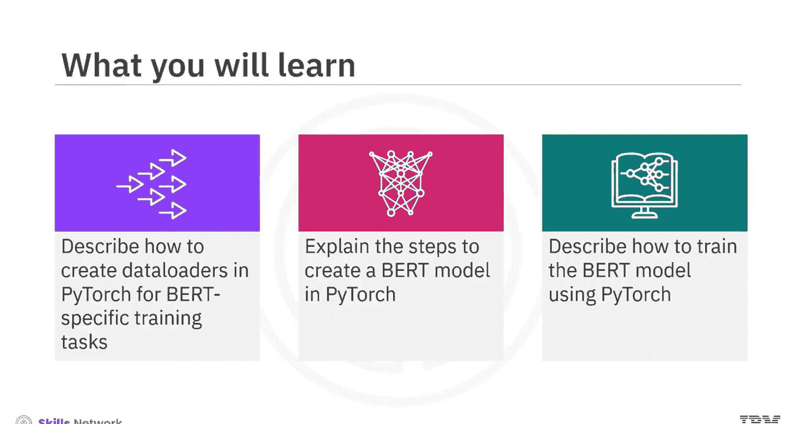

First， create a custom data class called BRT's CSV data set to load data from the CSV file into a PTrch dataset。

The Get item method retrieves an individual item from the data set based on the index IDX。

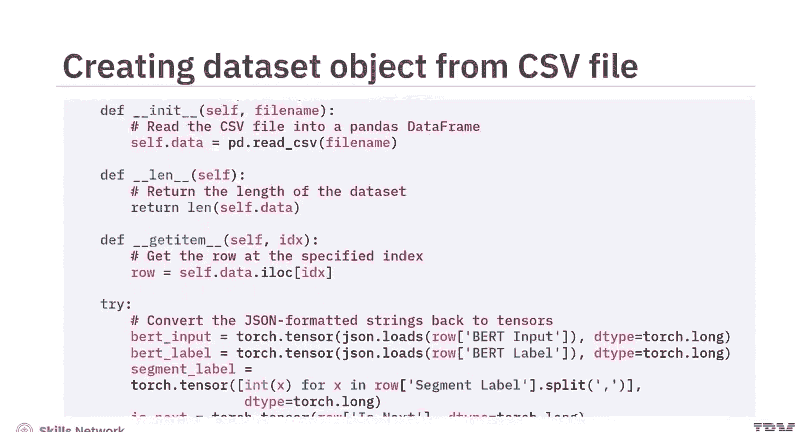

It accesses the corresponding row from the data frame and converts the JSUN formatted strings back to tensors。

 including Bt input， Bt label， segment label， and I Next。

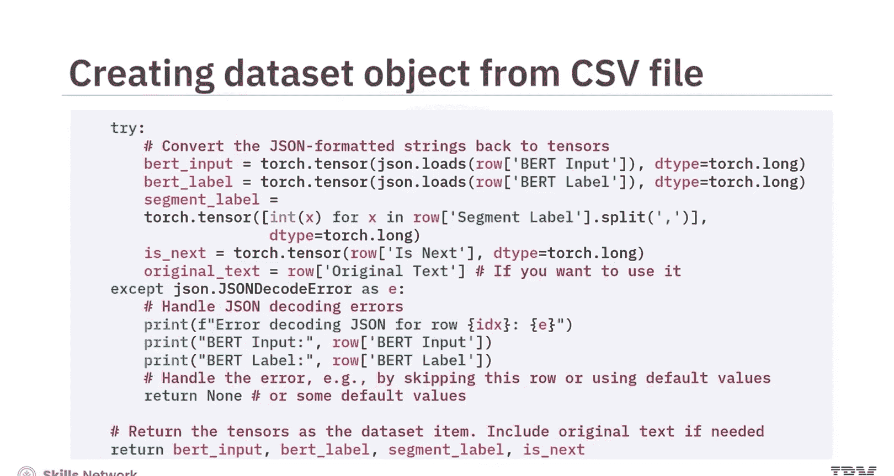

The collate function， collate batch， is used for batching and padding sequences in a Pytorrch data loader。

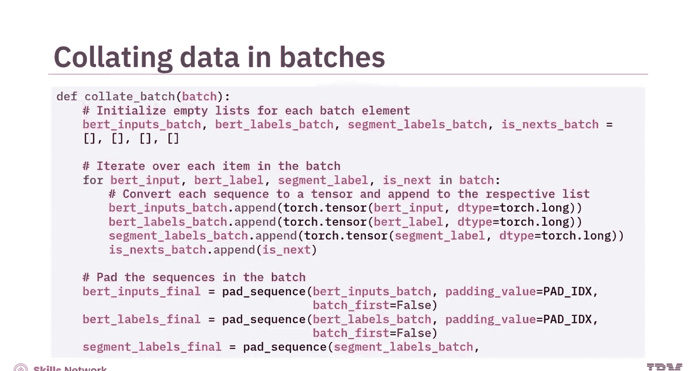

Now you can create data loaders for the train and test data sets using Pytorrch's data loader class you start by defining the batch size Next you specify the file paths for the train and test data sets。

 you can then create instances of the Bt CSV dataset set class for the train and test data sets using the specified file paths Finally create the corresponding data loaders。

The Bert embedding class is a module used for embedding operations and positional encodings in a Bt model。

 The main difference from other models is that you add segment embeddings。

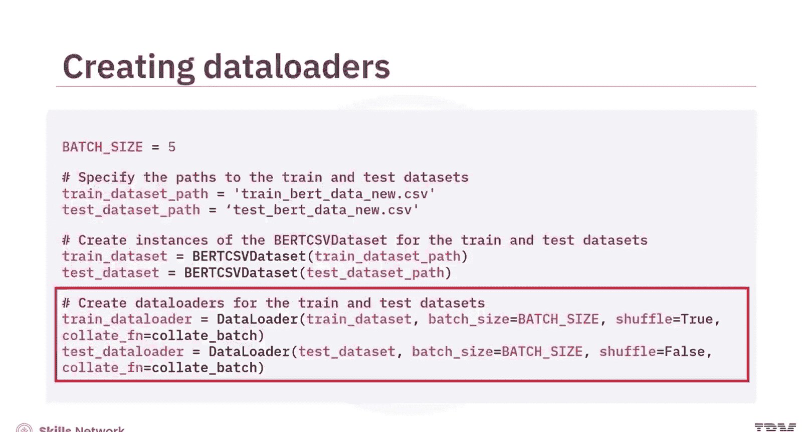

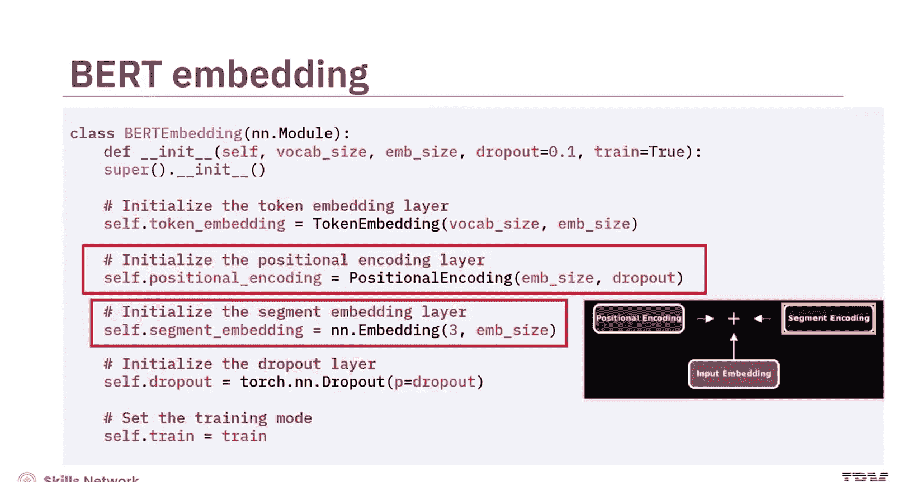

Let's now define the complete Bt model。 Def a Bt class a subclass of torch do N N dot module。

 The init method initializes the Bt model by specifying the vocabulary size， model dimension。

 D model number of layers and layers， number of attention heads， heads and dropout rate， dropout。

 The Bt model includes an embedding layer that combines token embeddings and segment embeddings。

 This is achieved with the Bt embedding class defined earlier。

 You can use transformer encoder layers to encode the input embeddings。

 The number of transformer layers and the specified configurations are determined by the N layers。

 heads， dropout and de model parameters。 The model has a linear layer for next sentence prediction or NSP。

 which predicts the relationship between two consecutive sentences。

 It takes the output from the transformer encoder with a shape of sequence length， batch size。

 embedding dimension。 The input is the CS embedding for each sequence。  Similarlyly。

 a linear layer for massed language modeling or M LM。

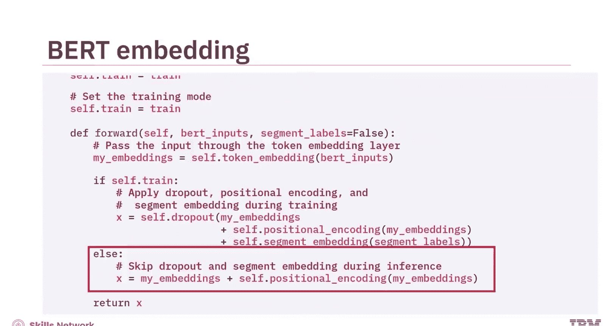

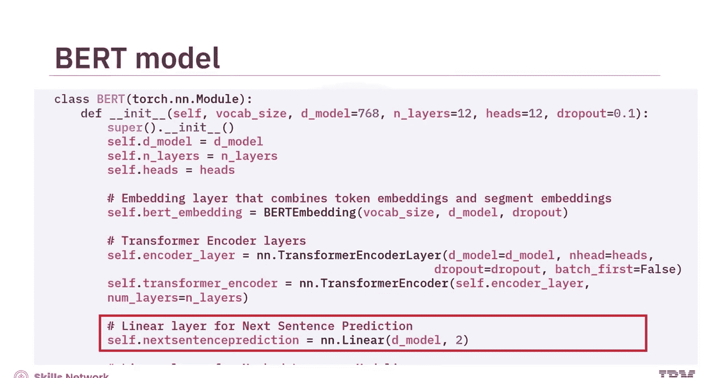

Pdts the mask tokens in the input sequence。 It takes the output from the transformer encoder and produces predictions across the vocabulary。

 The expected shape of the output is sequence length， batch size， vocab size。

 The forward method defines the forward pass of the Bt model。 It takes Bt inputs。

 the input tokens and segment labels as inputs and returns the predictions for NSP and MlM。

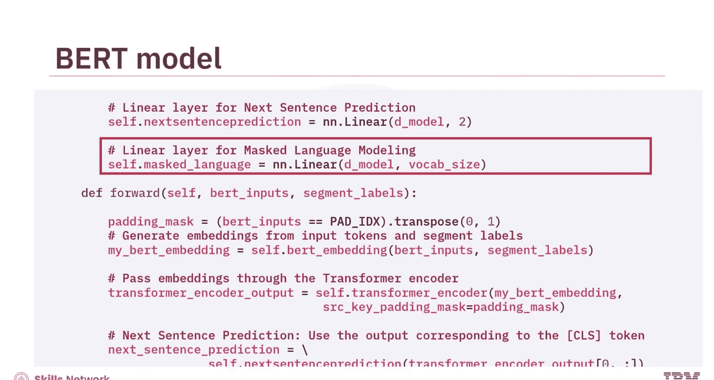

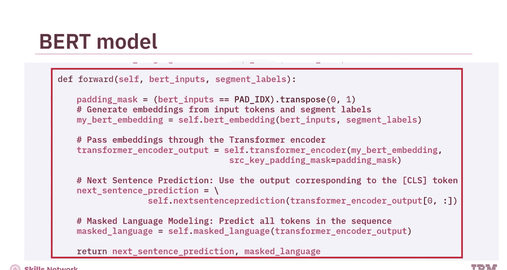

Let's now see how to set up the parameters and create an instance of the Bt model。

 The embedding dimension is 10， and the vocabulary size is determined based on the length of vocab。

 This mini Bt model has two transformer layers and an initial number of attention heads set to 2。

 The drop out rate is 0。1。 With these parameters， you can create the Bt model instance for further use。

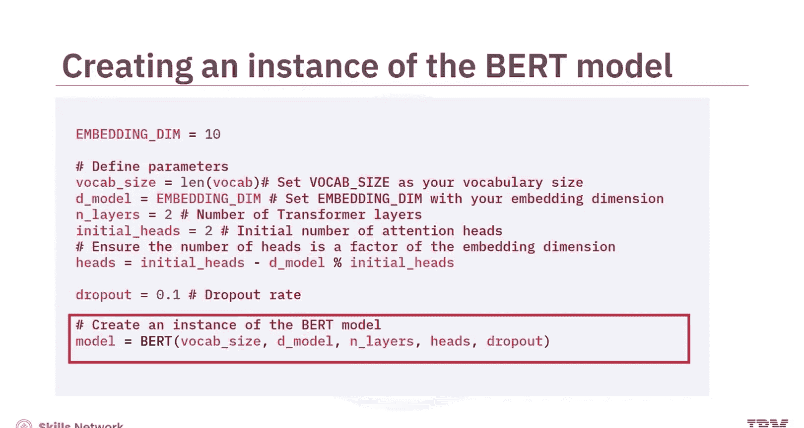

Now that the model is created， the next step is to train it on the data and assess its performance to facilitate this process。

 you can define an evaluate function。 This function will be used to evaluate the Bt model's performance and to assess the model's progress during the training phase。

 First， the loss function is defined。 The loss function is cross entropy loss。

 which you can use to calculate the gloss between the predicted and the actual values。

The evaluate function takes several arguments， data loader， model， loss。

 Fn and device within the function， the Bt model is put into evaluation mode using model dot eval open in closed brackets。

 This disables drop out and other training specific behaviors。

 Vas are initialized to keep track of the total loss， total next sentence loss。

 total mass loss and total number of batches。 The evaluation is performed with gradients turned off using torch dot no grad open and closed brackets。

 This saves memory and computations since gradients are not needed for validation。

 The function iterates through the batches in the provided data loader。

 A forward pass is performed with the Bt model to obtain predictions for the next sentence and masked language tasks。

 The two losses are then calculated and summed up to obtain the total loss for the batch。

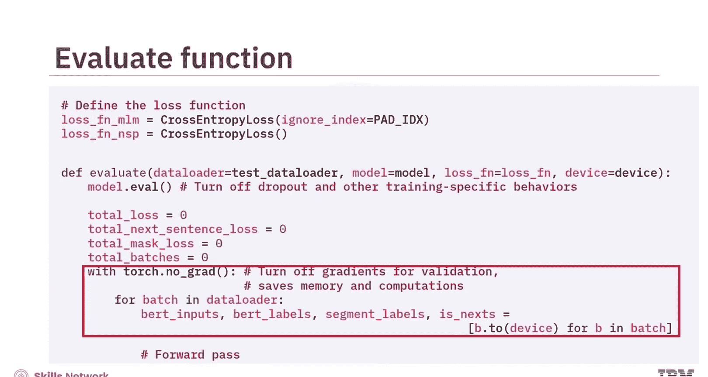

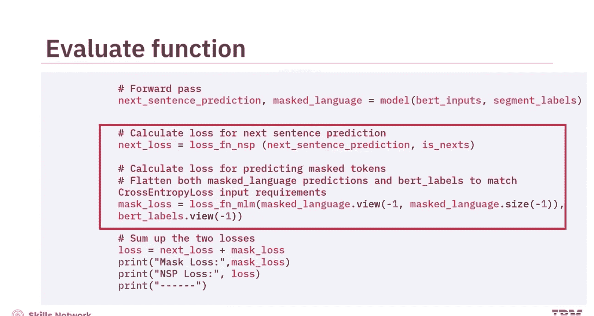

You can calculate the average loss， average next sentence loss and average mass loss by dividing the total losses by the total number of batches。

 The average losses are printed and returned from the function Before the training starts。

 Def the optimizer for training the Bt model。 The optimizer is atom。

 Let's look at the training loop within each epoch。

 you can iterate through the training data in batches。 for each batch， perform the forward pass。

 calculate the loss and update the model's parameters through back propagation and gradient clipping。

 After each epoch， you can print the average training loss and evaluate the model's performance on the test set。

 you can also save the model after each epoch。

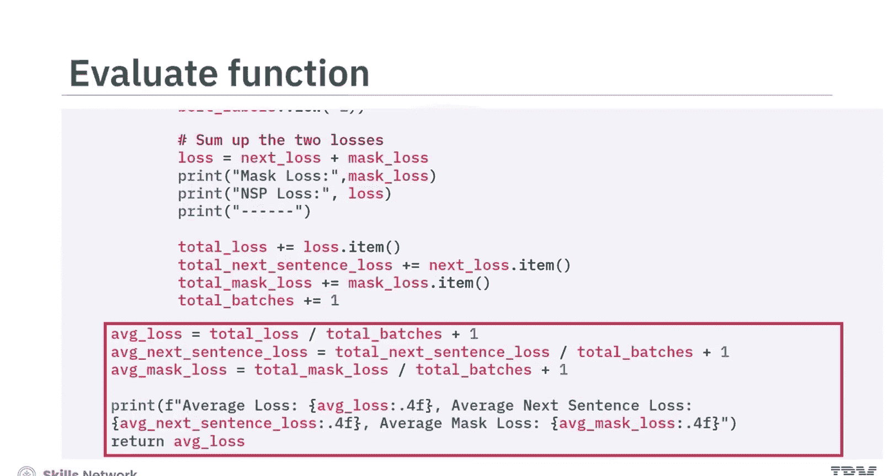

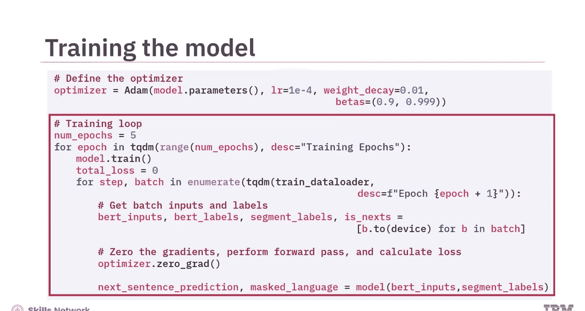

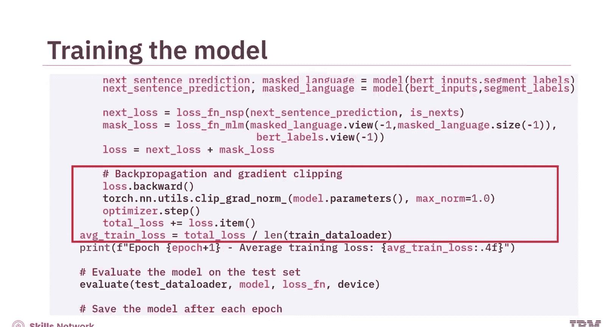

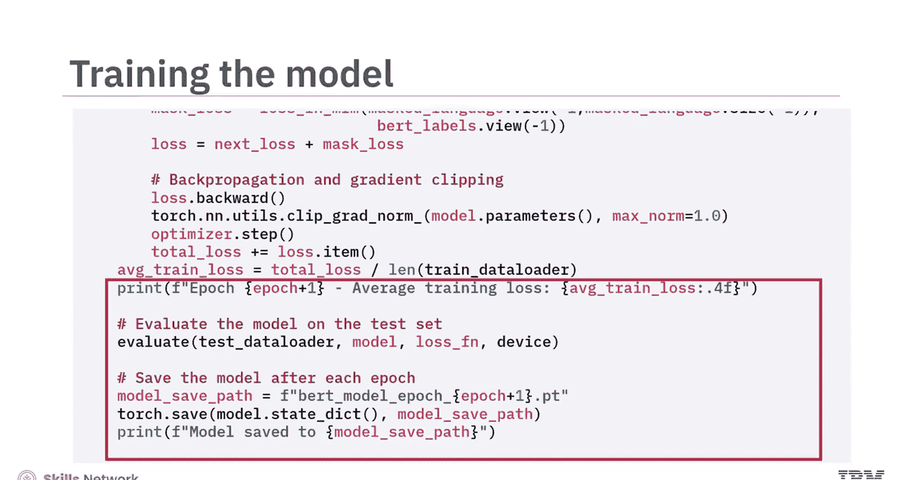

Now， let's check how the models perform for this to find a function called Predict NSP。

 which predicts whether a second sentence follows the first sentence using a pre traineded Bt model。

 The function takes two sentences， a Bt model and a tokenizer as inputs。

The function tokenizes the input sentences using the tokenizer dot encode code plus method。

 which returns a dictionary of tokenized inputs。 The tokenized inputs are then converted into tensors and moved to the appropriate device for processing。

 The Bt model is used to make predictions by passing the token and segment tensors as input。

 The first element of the logict's tensor is selected and unsqueezed to add an extra dimension。

 Ma its shape one comma 2。 The lots are passed through a soft max function to obtain probabilities。

 and the prediction is obtained by taking the arc max。 Finally。

 the prediction is interpreted and returned as a string。

 indicating whether or not the second sentence follows the first。 For example。

 two sentences are passed to the predict NSP function along with a Bt model and tokenizer。

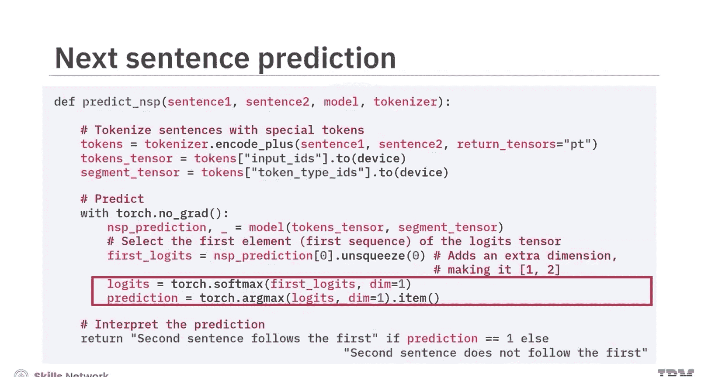

The result is printed， indicating whether the second sentence follows the first or not based on the model's prediction。

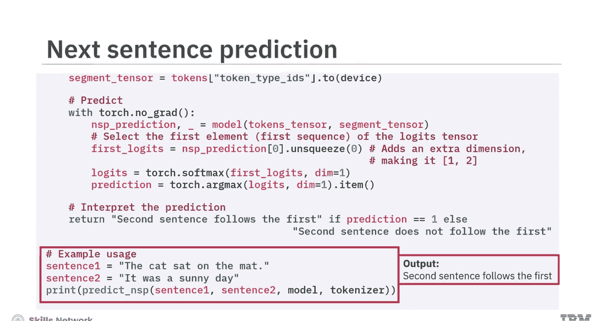

Next， you can define a function to perform MLM using the pre-trained BRT model。

 The function takes a sentence， a Bt model and a tokenizer is inputs。

 the function tokenizes the input sentence using the tokenizer and converts it into token IDs。

 including the special tokens The result is stored in the tokens tensor variable Dmmy segment labels filled with zeros are created as segment labels。

The Bt model is used to make predictions by passing the token tensor and segment labels as input。

 The MM logicts is extracted as predictions。 The position of the mask token is identified using the nonzero method and stored in the mask token index variable。

 Remember that all tokens， except the mask token are0 padded。

 The predicted index for the mask token is obtained by taking the argm of the MlM logicts at the corresponding position。

 which is of the shape batch size sequence length of vocab size。

 The predicted index is converted back to a token using the convert Is to tokens。

 method of the tokenizer。 The original sentence is then replaced with the predicted token at the position of the mask token。

 resulting in the predicted sentence。 The predicted MlM function is called with an example sentence。

 A Bt model and a tokenizer， The predicted sentence is printed with the mask token replaced by the predicted token。

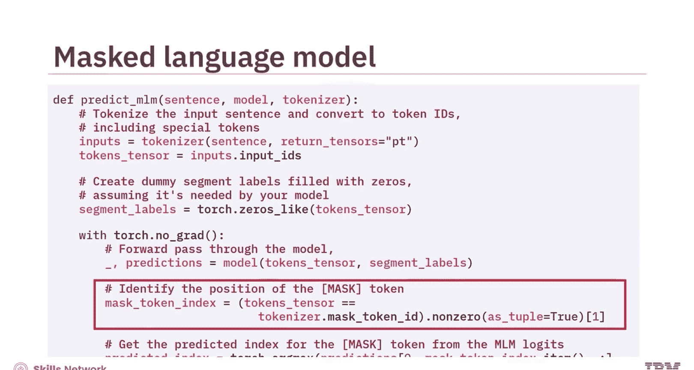

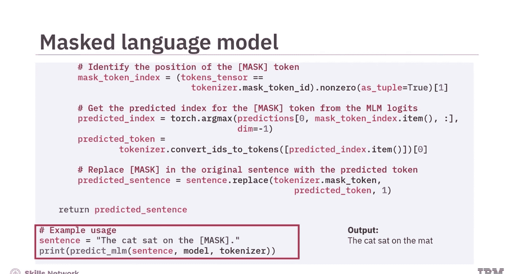

Let's now recap what you learn in this video you learned that to create a data loader。

 you will create a custom data set class to load data from a CSv file into a pitorrch data You a collate function and create corresponding data loaders for the training and test datasets to create a BRT model。

 you'll define a class for embedding operations and positional encodings and a Bt model class。

 both subclasses of torch do NN dot module in the BRT model class。

 you will define the embedding layer， transformformer encoder layers。

 linear layers for NSP and MLlm and the forward pass of the BRTt model as part of Bt model training。

 you'll define a function to evaluate the Bt model's performance define the optimizer for training the BRT model define the training loop and view the loss。

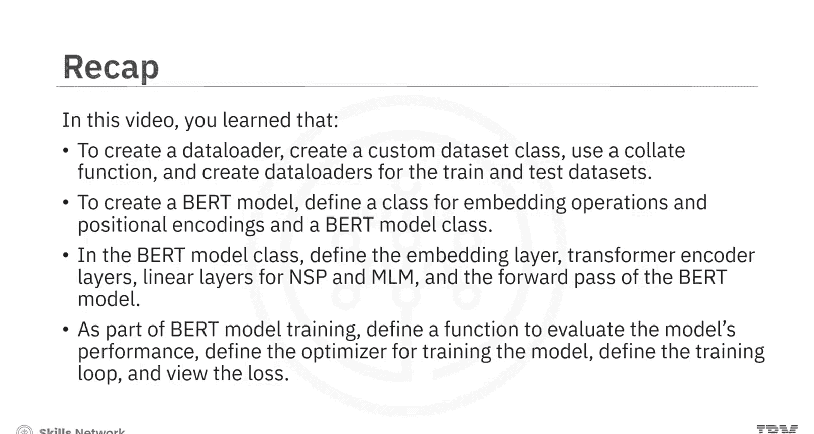

。

