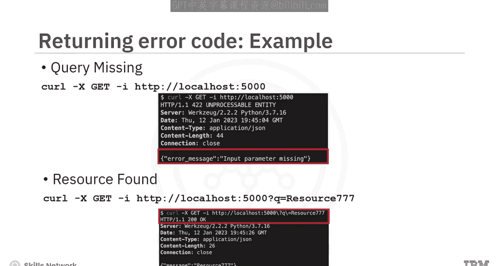
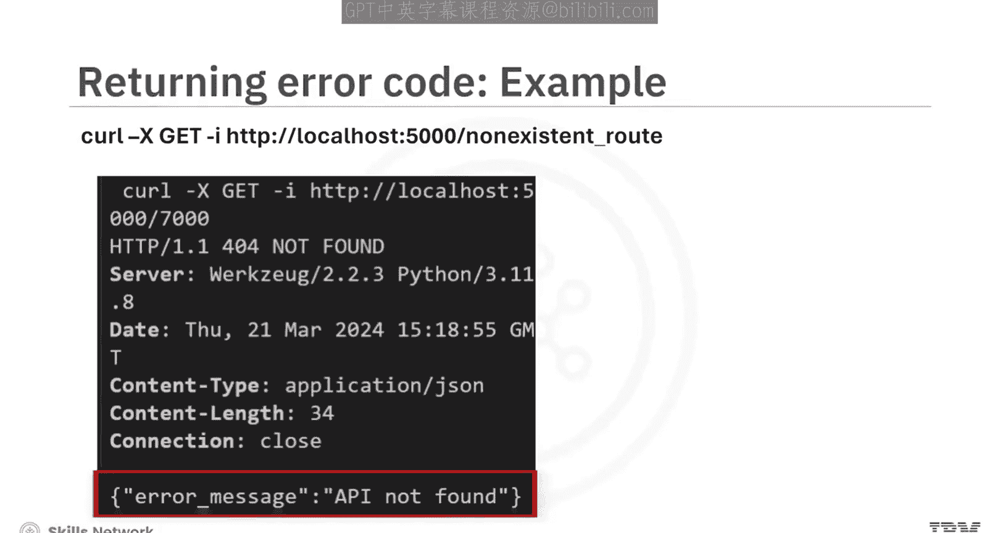
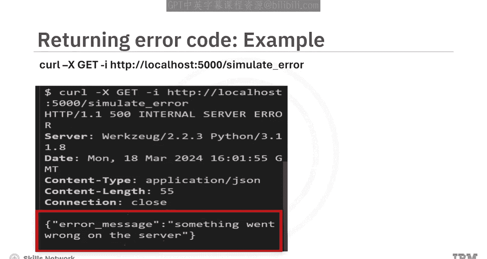
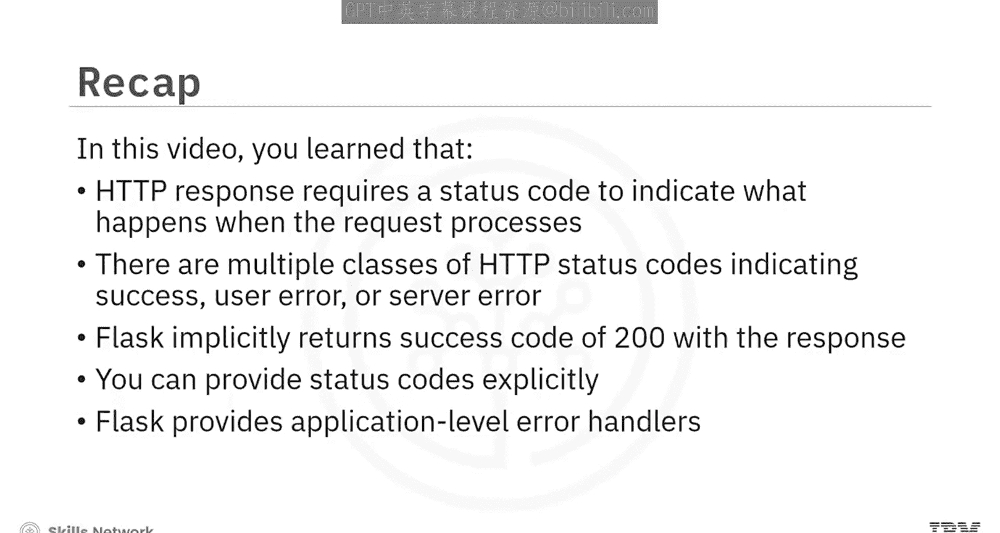

# IBM《生成式人工智能工程｜Falsk、生成式AI应用、数据分析、机器学习、Keras、架构和数据、NLP基础、transformer、微调、高级微调、RAG》 p13 12_错误处理.zh_en -BV1NAq6Y9E7z_p13-

Welcome to erroror Handing。After watching this video。

 you will be able to describe different HTTP status that API services can return。

 explain how error handling works in Flask， and explain how to return errors from your API endpoints。

Every HtTP response contains a three digit code indicating different error and success status。

 and the client is responsible for consuming this error code validid response code ranges from 100 to 599。

 The error codes are organized in categories of 100 each error codes from 100 to 199 indicate the request has been received and are informational error codes from 200 to 299。

 indicate the request has been received and the requested operation is successful。

 error codes in the 300s indicate there is a redirection on the server。

 error codes in the range from 400 to 499， show an error in the request。 and finally。

 error codes from 500 to 599 indicate an error on the server side。

The APIs you will write in this course will follow this nomenclature。 For example。

 if the client sends a get request for an unavailable resource， you can send a 404 response back。

 and you can respond with a Sta 404 incorrect requests。

Fask server automatically returns a 200 O status when you return from the at app dot route method。

200 is also returned by default when you use the Jsonify method to respond to a request。

 A successful response with the status code of 200 will be sent back when the given code executes。

Now， your code can return a different code than the default one。

Flaask allows you to send the status code in a tuple， along with the response in the code。

 you send back an H response of my first application in action with the status code of 200。

 You can also use the make response method to explicitly set the status code。

 This code returns the same Hm message and H TtP status code of 200 as the previous code。

 But here you use the make response method。Let's look at a few more examples of codes you might use in this course。

 The status of 200 is returned by default。 It indicates that the request is successful。

201 tells the client that the server has successfully created the resource。

202 indicates that the request is accepted and is in the process and is common for batch processing operations。

 The server returns 204 after completing a request successfully。 No content is returned。

 and the status is useful in cases where you don't want the browser to take any action。 For example。

 the user stays on the current page。40 indicates an invalid request。

 The status could imply the parameters are missing or improper or the request is invalid in another way。

401 indicates the credentials are missing or invalid 403 implies that the client credentials are not sufficient to fulfill the request。

And if the server is unable to find the resource， it returns a 404 status。

405 indicates that the requested operation is not supported and 500 is used when there is an error on the server。

So now that you know the different HTTP codes， you as a developer。

 need to return the right code from the service。 Let's look at an example。

 This search response method looks for the database's query parameter Q。

 the service calls the mock fetch from database method after parsing your query。

 the code returns the resource to the client If the resource exists。

 Ser returns a code of 200 implicitly and returns 404 if the resource is not found。Now。

 let's call this endpoint using the curl program。 Call the route without a query parameter。

 The curl program returns a message of input parameter missing with a return status of 422。 Next。

 call the route with the correct resource Id。 The curl command returns the resource as the body and the status of 200。

 Finally， call the route with a resource that does not exist。

 The curl command returns a message of resource not found with a status of 404。

Fask provides a way to handle error messages at the application level here we see a method that processes the 404 error and returns a message API not found with a status code of 404。

 Similarlyly， this snippet creates an error handler for 500 errors and returns a message of something went wrong on the server。

In this video， you learned that H TTP response requires a status code to indicate what happens when the request processes。

 There are multiple classes of HTTP status codes showing success， Use error or server error。

 Flask implicitly returns a success code of 200 with the response。

 You can provides status codes explicitly， and Flask provides application level error handlers。

。