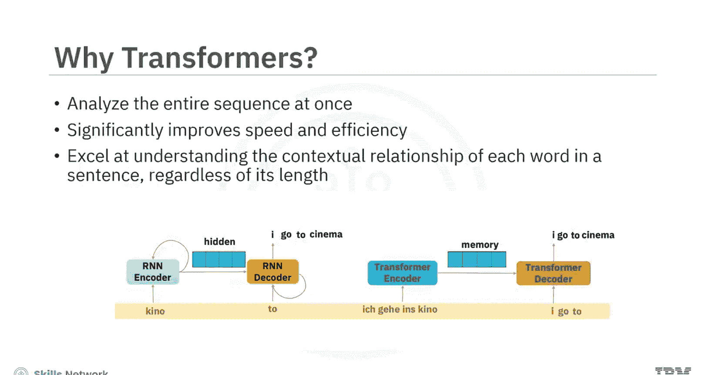
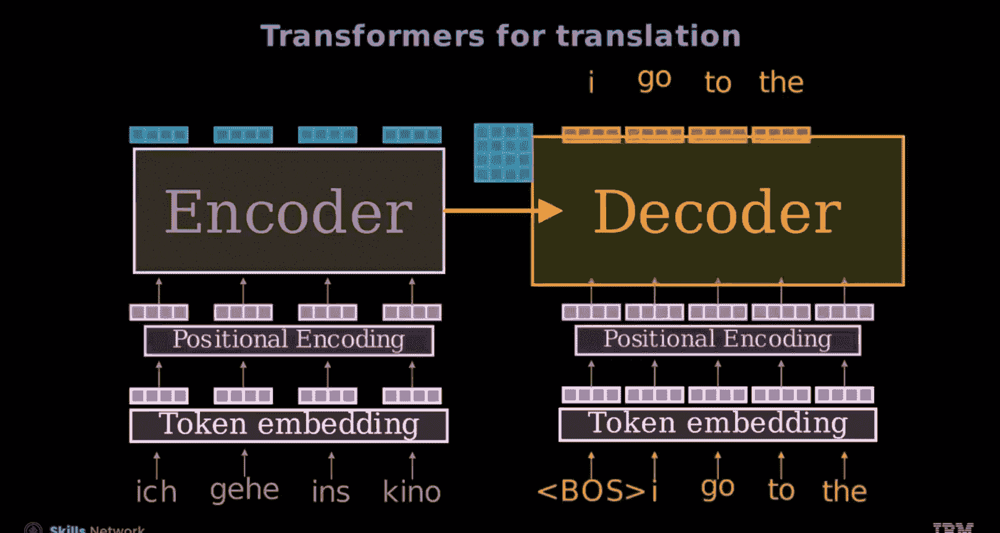
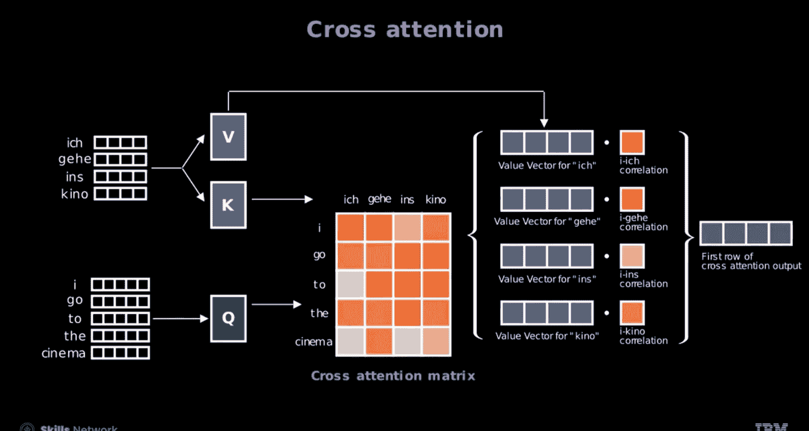

# IBM《生成式人工智能工程｜Falsk、生成式AI应用、数据分析、机器学习、Keras、架构和数据、NLP基础、transformer、微调、高级微调、RAG》 p130 14_用于语言翻译的Transformer架构.zh_en -BV1NAq6Y9E7z_p130-

Welcome to Transformer architecture for La Trans After watching this video。

 you'll be able to describe the encoder and decoder transformer architecture and explain how the model can be used to generate translations。

 His， language translation models like R andNs and LSTms processed text sequentially word by word。

 This method was slow and ineffective for long text sequences as retaining context over large spans of text to prove challenging。

 Transformers have revolutionized language translation by processing entire text sequences simultaneously。

 This approach greatly accelerates translation tasks and enhances the handling of extended text sequences。

 enabling a deeper and more coherent understanding of context。

 While transformformers boast several other advantages。

 These are particularly pivotal in improving language translation outcomes。

 Let's explore the architecture of a sequence to sequence transformer model widely used in machine translation。

 I， the source text is tokenized。 Each token is mapped to its corresponding index in the vocabulary and converted。

😊。

Into word embeddings， positional encodings are added with these embeddings to maintain the words order。

 The encoder processes the embeddings， outputting contextual embeddings， referred to as memory。

 which encapsulates all the information needed to translate the phrase in the decoding phase。

 translationlation unfolds one word at a time。 starting with the beginning of sentence。 B S token。

Every newly generated token is then embedded and positionally encoded。

 leveragingveraging the memory from the encoder。 The decoder predicts the next token。 In this case。

 I， which then becomes the input for subsequent decoding steps。

It's then converted into word embeddings and positionally encoded using the memory。

 The next token is generated。 in this case， go and is passed to the decoder。

 This recursive process is repeated until the full sequence is translated。

 ensuringuring a translation that is both coherent and contextually precise。

Let's delve into the encoder's inner workings and trace the data flow within it。

 A source sentence enters the embedding layer where each token is converted into a d dimensionmensal embedding vector。

 Poal encoding is then applied。 Following this， the vectors pass through multihead attention。

 allowing the model to focus on different parts of the sentence simultaneously。

 and then through a normalization layer， subsequently。

 a feed forward network processes the vectors to produce outputs of the same dimensionality。 D。

 A final normalization layer completes the encodeder's operations。

 The resulting memory is a tensor with dimensions equal to the sequence length times the embedding size D。

 The decoder architecture mirrors the decoder only model with a few key distinctions。

 One significant variation is the addition of a cross attention layer。

 which hones in on the encodeder's memory output。 This crucial layer enables the decoder to reference the full context of the input sequence。

 Masing is another vital component of the decoder's mechanism。

 It ensures the model sequentially predicts each word。

Considering only the preceding tokens in the target sequence。

 which is essential for the auto regressive generation process。

 The transformation of contextual embeddings into logicits is performed by a linear layer。

 mapping the vector to the vocabulary's dimensionality。 These logics score all possible words。

 guiding the model to predict the subsequent word。 For instance。

 the process begins with the B O S token。 The decoder then utilizes the memory to produce the token I。

 This token is fed back into the decoder combined with the memory to generate the next word go。

 This procedure repeats until the E O S token signals the end of the sequence or a predetermined length is achieved。

The decoder uses cross attention to attend to the encodeder's hidden representations。

 It computes attention scores between each target position and the decoder and all source positions in the encodeder。

 These attention scores reflect the relevance or importance of each source position to the current target position by incorporating cross attention。

 the decoder can attend to different parts of the input sequence based on their relevance to the current decoding step。

 This mechanism helps the model capture long range dependencies and align the input and output sequences effectively。

 which is crucial for accurate translation。

Let's now recap what you learned in this video， you learned that unlike R NNs。

 transformers process the entire text sequences simultaneously for language translation in an encoder。

 a source sentence enters the embedding layer and then positional encoding is applied。

 Following this， the vectors pass through the multihead attention and normalization layer。 Subent。

 a feed forward network processes the vectors and a final normalization layer completes the encodeder's operations in a decoder。

 the cross attention layer enables the decoder to reference the full context of the input sequence。

 Maing ensures the model sequentially predicts each word。

 considering only the preceding tokens in the target sequence。

 the linear layer transforms the contextual embeddings into logics。

 mappingapp the vector to the vocabulary dimensionality。

 Cross attention computes attention scores between each target position and the decoder and all source positions in the encoder。

