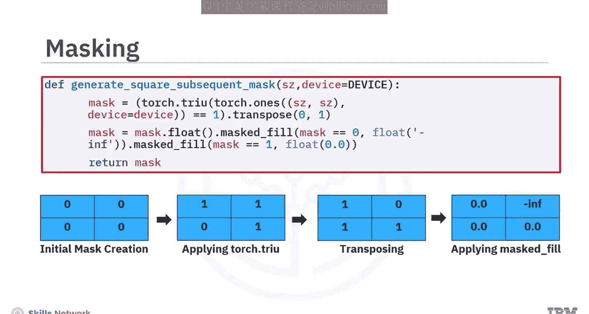
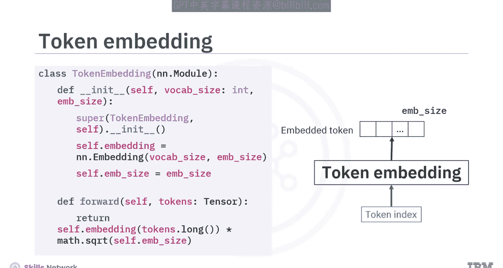
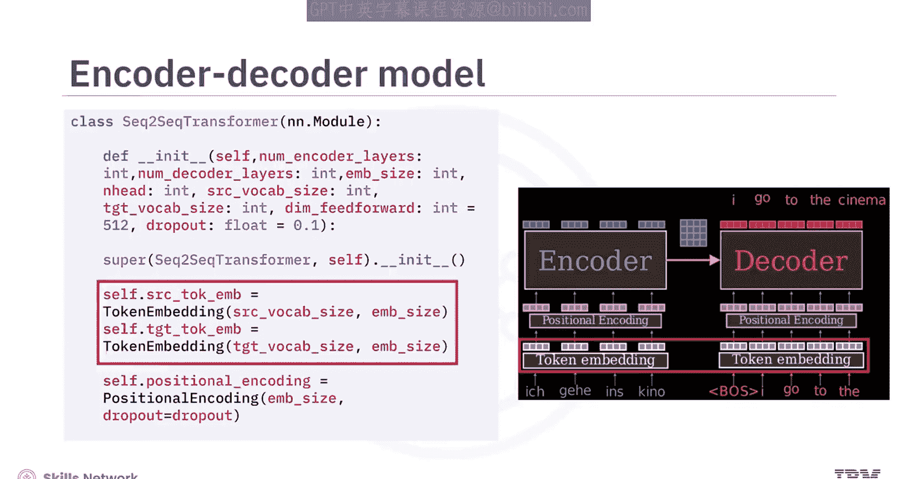
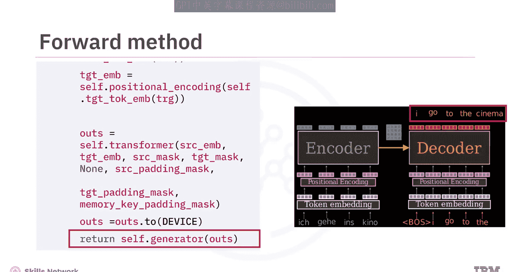
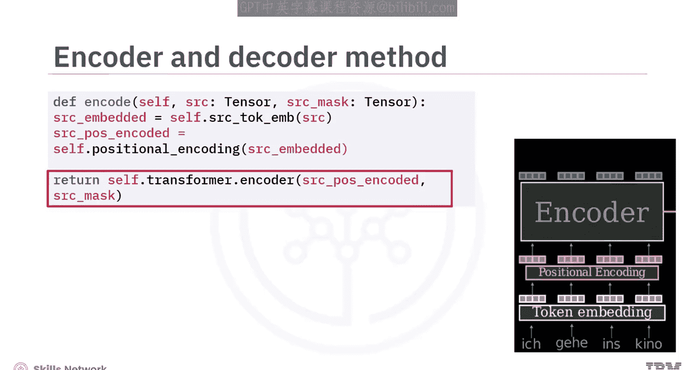
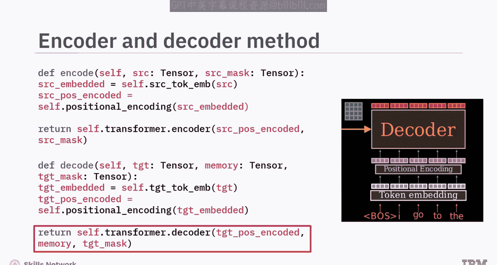
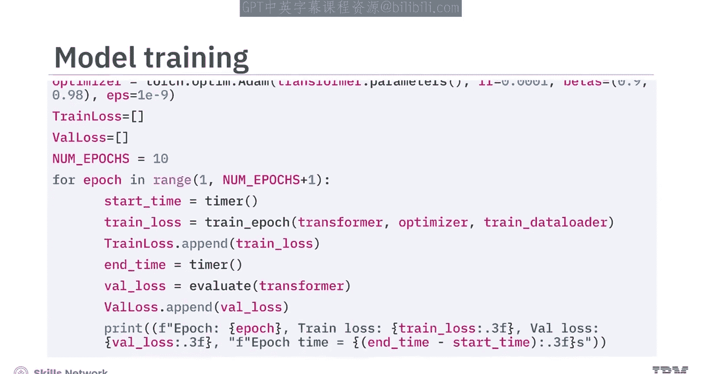
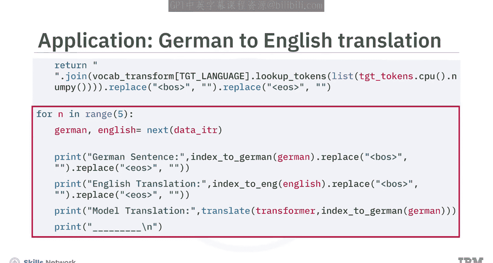
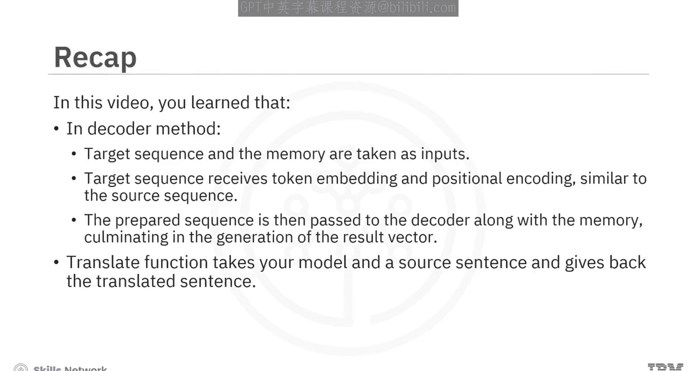

# IBM《生成式人工智能工程｜Falsk、生成式AI应用、数据分析、机器学习、Keras、架构和数据、NLP基础、transformer、微调、高级微调、RAG》 p131 15_用于翻译的Transformer架构的PyTorch实现.zh_en -BV1NAq6Y9E7z_p131-

Welcome to Transformer Architecture for Translation， Pytororch Implement After watching this video。

 you will be able to create an encoder decor model for translation tasks using PyTorch and then train the model to generate German to English translations。

To begin with， let's load the dataset set using a batch size of 100。

 a hyperparameter that can be tuned during the training process。

 the output from the dataset loading process consists of pairs of sentences in German and English。

 representing the source and target languages for the translation task these are denoted as SRC for the source。

 German sentences and TGT for the target English sentences， just like training a decoder model。

 it's important to ensure that the model isn't influenced by future words for the target。

 so you should generate a causal mask。The image here shows the functions composition。

The CreateMask function is designed to construct masks for the source and target sequences within a transformer model。

 first invoke the square mask from before。For the source sequence。

 the mask is typically an array of boolean values initialized to false there's no need to mask future tokens since the entire source sequence should be visible at once during the encoding process Finally this function also produces padding masks for both the target and source sequences these masks flag the position of padding tokens commonly marked with zeros in the input tensors as true here you have a positional encoding module that injects some information about the relative or absolute position of the tokens in the sequence This is a token embedding module for generating text embeddings in the form of a vector Let's now put all the components together to create an encoder decoder model for translation First create the embedding layers for the source and target Next create the positional encoding layer then create the transformer Finally。

 create a generator layer similar to the output layer on a neural network There are several methods in this class。

In the forward method， you'll first generate the token embeddings and positional encodings for both the source and target sequences。

These embeddings are then provided as input to the transformer model。

 which comprises both the encoder and decor components。 simultaneously。

 you'll apply the appropriate masks instructing the transformer to selectively ignore certain parts of the input sequence during processing Finally。

 the output from the transformer passes through a linear layer which is not shown here。

 This layer is responsible for generating the output vectors which are the predictions returned by the model。

 Now， let's define the encoder method It's important to note that this method is created for learning purposes only In practice。

 the transformer layer itself handles both encoding and decoding processes within the encoder method。

 the source sequence undergoes token embedding and positional encoding subsequently the sequence is processed by the actual encoder resulting in an encoded vector often referred to as the memory。

Next， you'll define the decoder method， which takes the target sequence and the memory as inputs。

The target sequence receives token embedding and positional encoding similar to the source sequence。

 this prepared sequence is then passed to the decoder along with the memory。

 culminating in the generation of the result vector。

The training process for transformers has some similarities to other methods。

 but let's focus on the key distinctions。Iterate over the source。

 SRC and target TGT sequences provided in each batch。

 the target input is essentially the sequence with the last token removed。

 then generate the necessary masks。 A forward pass through the model generates the predictions。

 During this phase， you'll also input the target input。

 This procedure is similar to what happens during inference or prediction。

 where the transformer relies on its own previous outputs to make future predictions。

The target output is essentially the target input shifted forward in time internally。

 the transformer employs the mask to recursively make predictions。

 building upon its previous outputs， the loss is computed using the target output and the output logics。

Similarly， you can evaluate the loss on the training data using the validation data。

 the decoding process or inference begins by preparing the inputs。

 you'll start by constructing the memory Tensor， which is derived by passing the source input and its corresponding mask through the model dot and code function。

Here， the German source text is encoded， as illustrated。Next， initialize a tensor named YS。

 setting its dimensions to1 comma 1， and filling it with the start symbol。

 this symbol serves as the initial token for the decoding process。

Now let's concentrate on the actual decod text in the decoder， you'll input the mask。

 ensuring attention is given only to the tokens already predicted alongside past the memory tensor。

 which contains the encoded context from the source input。

The output of the decoder behaves similarly to that of a neural network。

 identify the maximum value corresponding to the predicted words index in the probability distribution generated by the model This index is then used to retrieve the predicted word from the vocabulary Now add the output token index and show the output token here This is used as input to the decoder for the next iteration repeat the process of getting the output token index This is used as input to the decoder for the next iteration you'll repeat the process。

You'll stop if you see the EOS tag。Or when you reach maximum iterations。As you can see here。

 the hyperparameters and other essential settings for the training process have been meticulously configured。

Now let's train the model， first initialize the data loaders。

 train data loader and validation data loader。Next。

 the transformer model is instantiated with parameters。For optimization。

 you can choose the atom Opr while defining learning rates and momentums。

 then train the model using the train and evaluate the function here you have a function called translatelate。

 it takes your model and a source sentence and gives back the translated sentence。

In the loop， you can draw sentences from your dataset set and print the original German sentence alongside its ground truth English translation。

 and the Models translation。

Since the primitive model was used， you can see that the model translation is very similar to the actual English translation。

Let's now recap what you learned In this video you learned that the createate mask function is designed to construct masks for the source and target sequences within a transformer model the linear layer is responsible for generating the output vectors which are the predictions returned by the model In practice the transformer layer handles both encoding and decoding processes within the encoder method。

 the source sequence undergoes token embedding and positional encoding Sub the sequence is processed by the actual encoder resulting in an encoded vector often referred to as the memory the decoder method takes the target sequence and the memory as inputs the target sequence receives token embedding and positional encoding similar to the source sequence This prepared sequence is then passed to the decoder along with the memory culminating in the generation of the result vector the Trans function takes your model and a source sentence and gives back the translated sentence。

