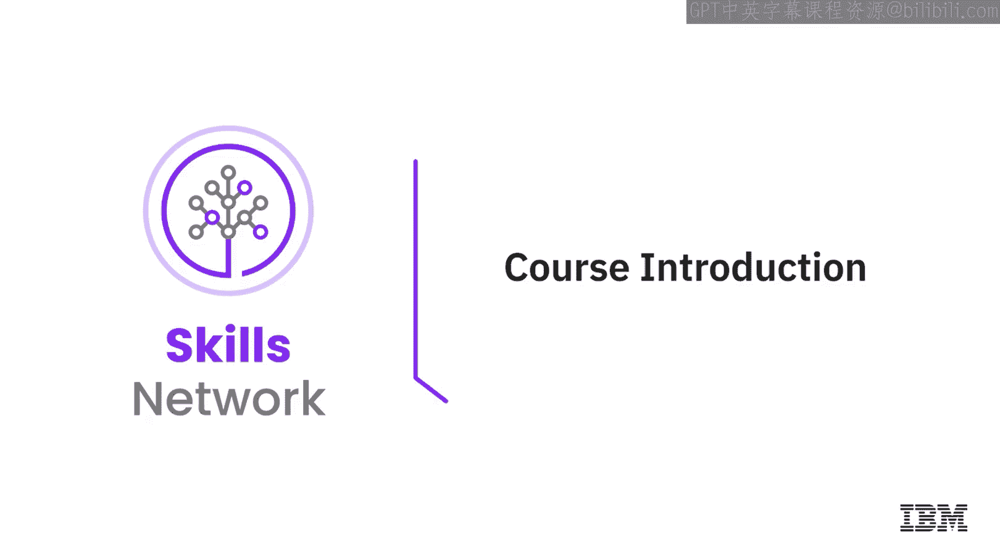
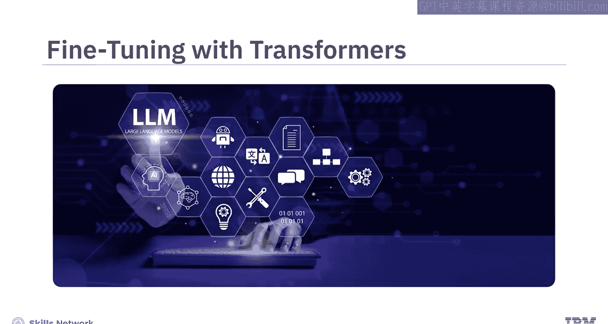
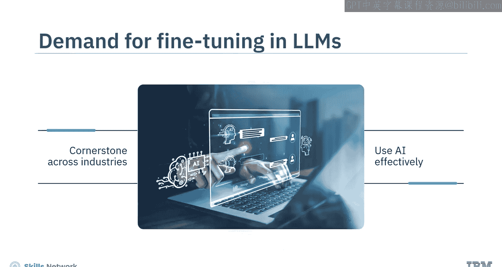
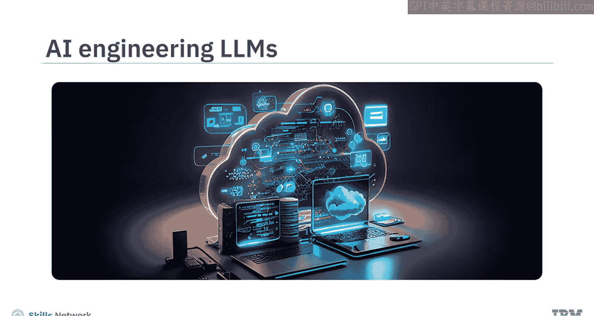
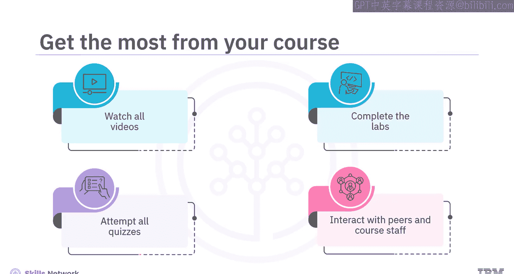
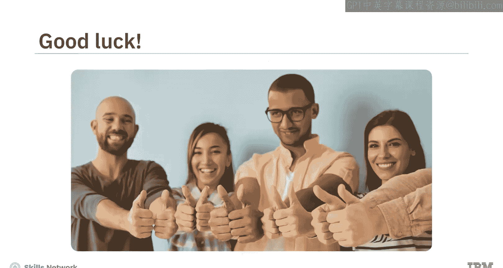
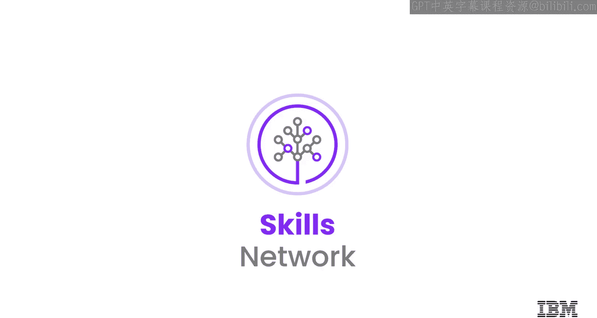

# IBM《生成式人工智能工程｜Falsk、生成式AI应用、数据分析、机器学习、Keras、架构和数据、NLP基础、transformer、微调、高级微调、RAG》 p132 0_课程介绍.zh_en -BV1NAq6Y9E7z_p132-

Welcome to this course about fine tuning with Transformers。

Driven by several key trends in AI and natural language processing or NLP。

 fine tuning with transformers is becoming a cornerstone of AI strategies across industries。

Companies seek to use AI effectively in specialized contexts as large language models or LLMs continue evolving and spreading their hands across domains。

Here you will learn about AI engineering concepts by working with In demandmand LLMs and building job ready skills to advance your AI career This course will focus on encoder models for simplicity。

 but you can apply these methods to decoder models too。😡。

This course is suitable for existing and aspiring data scientists， machine learning engineers。

 deep learning engineers， AI engineers， and developers who want to excel in working with LLMs For this course。

 a basic knowledge of Python and Pytorrch and awareness of transformers fine tuning and how to load a model will be an advantage。

After completing this course， you will be able to apply skills you have gained in working with Transer based LLMs for generative AI engineering。

 you'll learn to use pretrained transformers for language tasks and then fine tune them for specific tasks。

😡，You'll also gain insights into parameter efficient fine tuning or Pft using low rank adaptation or LoRA。

 and quantize low rank adaptation or Q LoRA。You will begin the course with transformers and major language models where you will learn about generative models and fine tuning techniques。

 you'll review advanced training methods and identify differences between the two powerful frameworks。

 Huging face and pytorch。 You'll also learn how to load a model and its inference and train or pretrain the model using hugging face。

😡，You'll also understand the importance of fine tuning models using hugging face and Pytororch。

That's not all further you will explore Pft and adapters such as Lora and Klora。

 you'll gain insights into soft prompts and rank， Additionally。

 you'll define model quantization using natural language processing or NLP and its unique methods however。

 this course won't train on the causal LLMs， but these methods are easily transferable。

This course consists of labs that reinforce the learning from the instructional videos the hands on exercises are based on the Jupiter labs to practice。

 learn concepts and technology。The labs reflect the learning of pretraining and fine tuning LLMs using hugging face and Pytorrch。

The course has the right mix of content to facilitate learning。

 Videos are short and focused on the main topic。 Readings provide detailed content primarily in text format。

 The labs provide the technical environment， detailed instructions and code snippets that you can use to complete hands on exercises。

 The practice and graded quizzes will help you apply what you learned and assess your knowledge。

To get the most of your course， watch all videos， complete the labs to practice your new skills and attempt all quizzes you can also interact with peers and get help from course staff using the course discussion forums。

😡。

Let's get started on this exciting journey， good luck！

。

