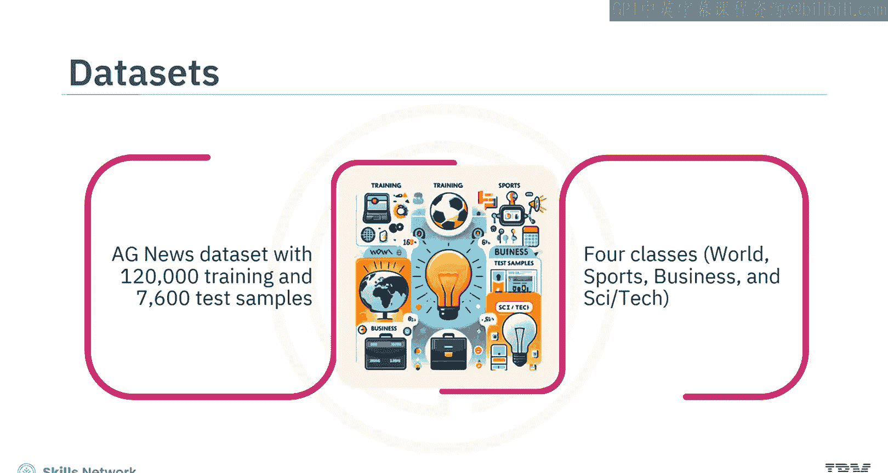
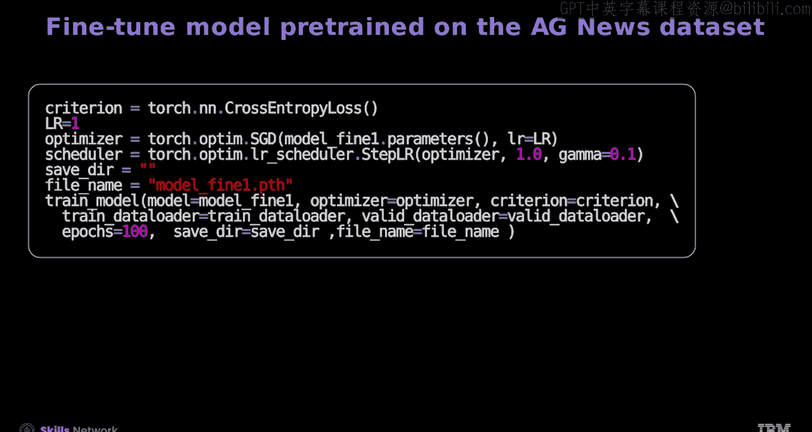
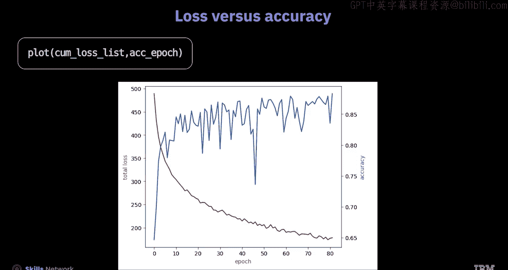
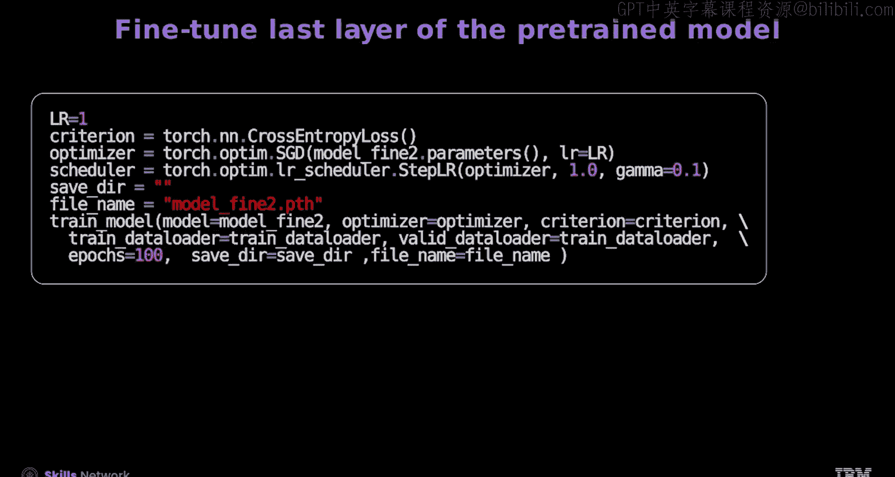
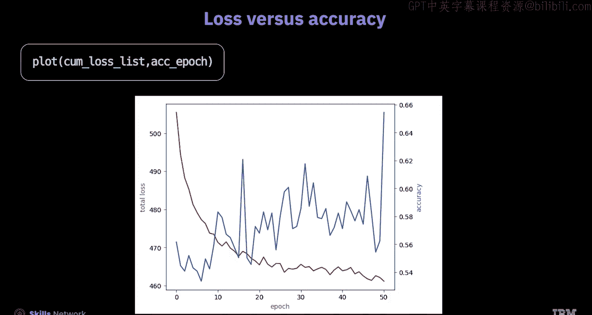

# IBM《生成式人工智能工程｜Falsk、生成式AI应用、数据分析、机器学习、Keras、架构和数据、NLP基础、transformer、微调、高级微调、RAG》 p135 3_使用PyTorch进行微调.zh_en -BV1NAq6Y9E7z_p135-

Welcome to fine tuning with Pytorch。 After watching this video。

 you'll be able to prepare the data set for loading and model definition and describe how to fine tune to complete model and its final layer。

 fine tuning in machine learning is the process of adapting a pretrain model for specific tasks or use cases。

 It has become a fundamental deep learning technique。

 particularly in the training process of foundation models used for generative AI。

Let's look at the data sets you'll be working with。First is the IMDB dataset set。

 which contains details of 50，000 samples of movie reviews The data set is rather small and includes two classes。

 positive and negative。The second is the AG New data set with the details of 120。

000 training samples， 7，600 test samples， and four classes， world， sports， business。

 and science and technology。The goal is to pretrain the model on the AG News dataset set to build a robust understanding of language and context from diverse topics。

 and then fine tune the IMDB dataset to specialize the model for sentiment analysis and movie reviews。

Let's first define the class that you're going to use to load the IMDB data。

 now load the IMDB data set into your test and train iterators below are a few examples of the dataset。

😡，Z indicates a bad review and one indicates a good review。Next。

 define the tokenizer and load the glove and beddings。Now。

 build a vocabulary object from a pre traineded glove word embedding model。

 assigning index values from G and setting the default index to the token。

You can use this code to convert the data into map style dataset sets you can then perform a random split to create separate training and validation data sets and check the device let's create the colate function that tokenizes the data set converts the tokens to sequences of token indices and transforms these sequences and class labels into tensors。

 the training validation and test sets are then converted into data loader objects which are processed by the collate function here is an example from the created validation data loader object。

Now you are going to define the transformer based model class。

 that is the encoder model class for classification in PyTtorch。

This constructor initializes the test classifier with configurations such as the number of classes。

 vocabulary size， and transformer settings， like the number of heads and layers。

It also sets up the essential components， embeddings， positional encoding， transformer enr。

 and a linear classifier for output。 The pretrained word embeddings model glove is used for the embedding layer。

 The forward method applies embeddings to the input adds positional encoding passes the data through the transformer encoder averagevers the data along the first dimension。

 and finally classifies the data using the classifier。

 The trained model function trains a transformer model using the provided optimizer and loss criteria。

 Iterating through the specified number of epochs。It evaluates model performance on a validation data set。

 prints the loss per epoch， and optionally saves the model and performance metrics if the validation accuracy improves。

The function predict takes in the text and a text pipeline。

 which prepro the text for machine learning， it uses a pretrained model to predict the label of the text for text classification on a dataset。

Here you are going to create a function to evaluate the model's accuracy on a data。😡。

Now let's fine tune to complete model， first， create a model object in pi torch with four neurons in the output layer。

😡，Then using the load state D method， load the parameters from a pretrained model on the AG New dataset。

 this method loads the parameters into the model object。

 allowing you to fine tune it with any dataset set you choose。😡，As you know。

 the AG New dataset set has four classes since you're fine tuning the pretrain model on the IMDB dataset set。

 which has two classes， you need to change the number of neurons in the final layer from 4 to2。

 It is important to note that you should always adjust the neurons in the final layer according to the number of categories in the dataset set you're fine tuning on。

 Now， let's define the loss function， Opimrs and scheduler for fine tuning the model with the IMDB data set。

 then called the train model to finish the model。 This step is essentially identical to training a model from scratch。

Here you can see the loss versus accuracy of the model。

 which achieves approximately 90% accuracy on the validation data。

Now let's see what happens if you only finet the final layer of the model for this。

 you're going to use the same pretrain model on the AG New data set as before。

 freeze all layers of the model as you only need to fine tune the final layer。😡。

This is done by selecting the layer parameters and setting the requires grad attribute to false freezing all layers except the final one speeds up training by reducing the computation and focusing optimization on fewer parameters。

 The number of neurons in the output layer has also been changed from 4 to2 since the IMDB dataset set has two categories in the predicted class Let's define the parameters to retrain the model and fine tune it just for the final layer In this case。

 training the model is much quicker here is the loss versus accuracy plot of the model you fine tuned only on the final layer。

While training is much faster， the performance is significantly worse， therefore。

 you must trade off between fine tuning the entire model and certain key parameters。

Let's now recap what you've learned In this video， you learned that fine tuning in machine learning is the process of adapting a pre trained model for specific tasks or use cases。

The collate function tokenizes the dataset， converts the tokens to sequences of token indices。

 and transforms these sequences and class labels into tensors。

While defining the transformer based model class for classification in pieytorch。

 the constructor initializes the text classifier with configurations such as the number of classes。

 vocabulary size， and transformer settings， like the number of heads and layers。

The forward method applies embeddings to the input， adds positional encoding。

 passes the data through the transformer encoder， averages the data along the first dimension。

 and finally classifies the data using the classifier。

The train model function trains a transformer model using the provided optimizer and loss criterion。

 iterating through the specified number of epochs。 If you fine tune to complete model。

 the model achieves approximately 90% accuracy on the validation data。

 If you only fine tune the final layer of the model， training is much faster。

 but the performance is significantly worse。

