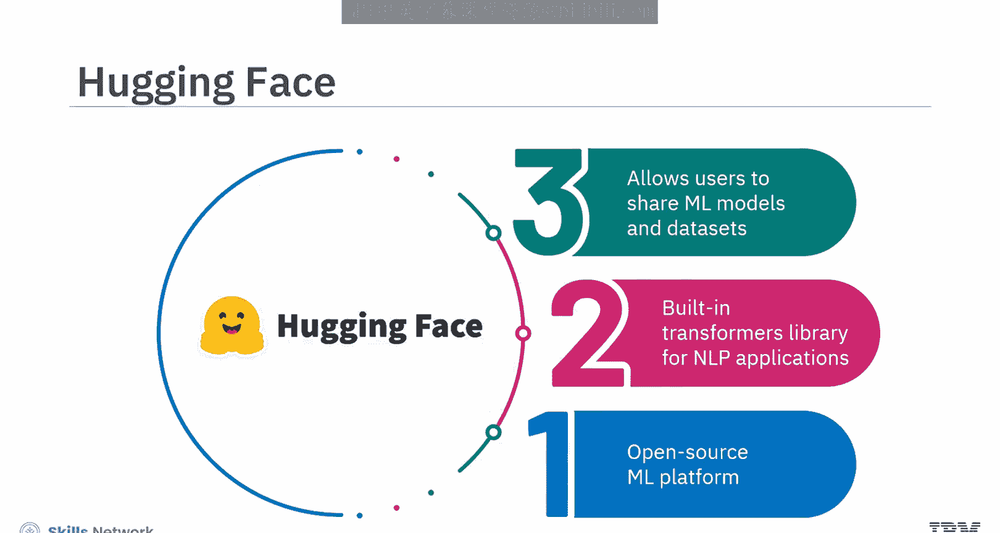
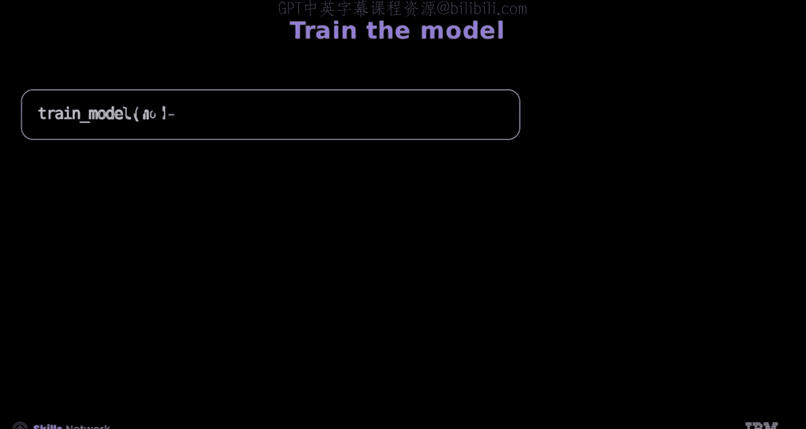
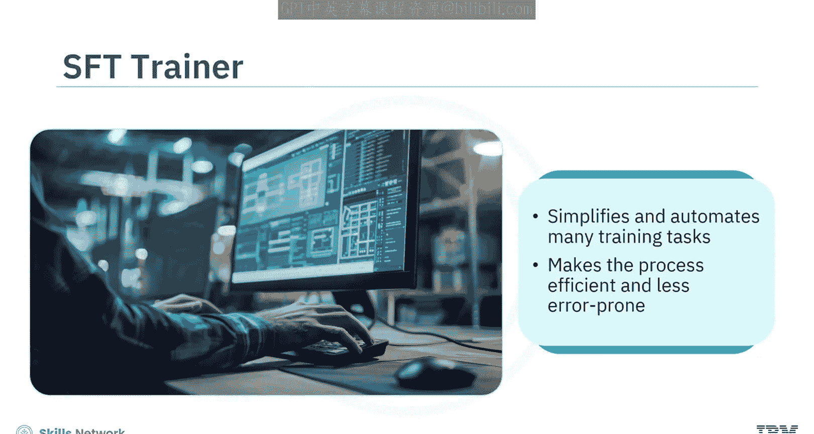
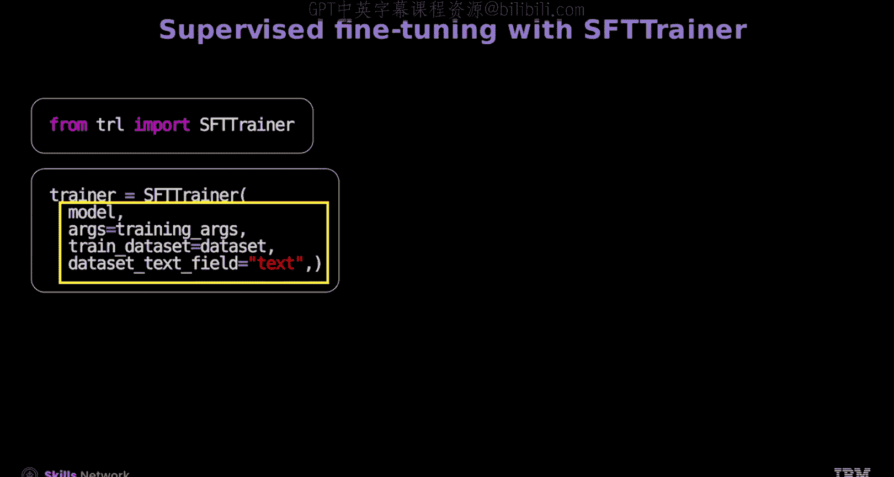
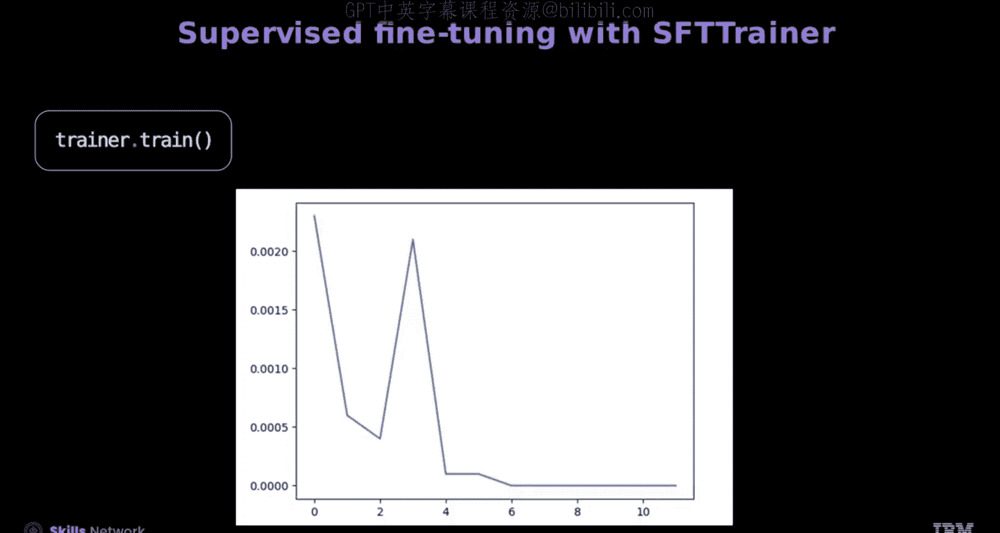
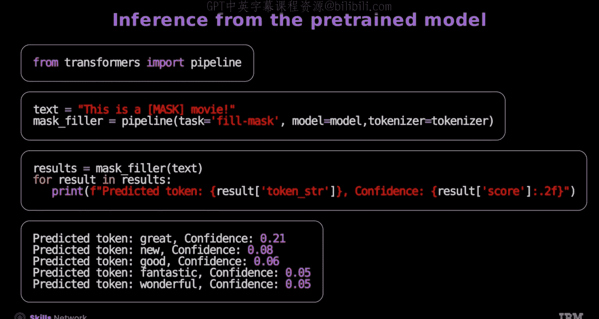
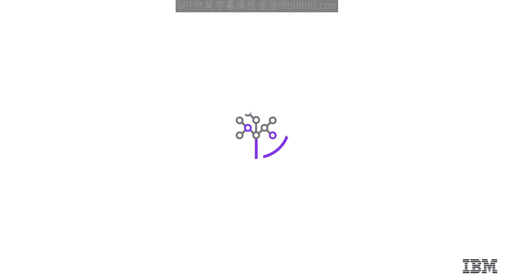

# IBM《生成式人工智能工程｜Falsk、生成式AI应用、数据分析、机器学习、Keras、架构和数据、NLP基础、transformer、微调、高级微调、RAG》 p136 4_使用Hugging Face进行微调.zh_en -BV1NAq6Y9E7z_p136-

Welcome to Fine tuning with Huging Face After watching this video。

 you'll be able to describe how to fine tune your model with Huging F and Pytorch。

You'll also be able to use the supervised fine tuning trainer or SFT trainer to fine tune your model Huging face is an open source machine learning or ML platform with a built-in transformformers' library for natural language processing or NLP applications The platform allows users to share machine learning models and data sets and showcase their work。

Hugging faces built in datasets can be loaded using the load dataset set function Let's load the Yelp review dataset set。

 which is a list like object consisting of user reviews and accompanying metadata from the Yelp platform。

 each review is a dictionary typically containing the text of the review itself。

 with the key text and the star rating given by the user。

 which ranges from one to five with the key label。You can load a birdt tokenizer object to tokenize pad and trunnccate reviews。

 which helps handle variable length sequences efficiently。

 The tokenizer function extracts the text from the dataset set example and applies the tokenizer。

 You can then map this method to the dataset。 The result is that each sample text in the dataset set has been tokenized converting the text to token indices with the dictionary key input IDS。

 Additionally， other parameters associated with the Bt model such as attention masks have been generated for each sample。

As the model does not need text information， you can remove the text and rename the label key the data is then converted into Pytororch tensors The result is a set of tensors with the keys。

 labels， input IDS， token type IDS， and attention mask。

 just like Pytororch in Huging face you can create a data loader object for train and test data sets this allows you to iterate over batches。

Now you are going to load a pre trained BRT classification model with five classes from the Transformers's library。

 The module is designed for sequence classification。

The nu labels parameter specifies the numbers of classes and determines the number of neurons in the final layer。

Let's create an optimizer and learning rate scheduler to fine tune the model。😡。

You can use the atom W optimizeizer from Pytorrch and set the device accordingly Now let's create a training function to fine tune the model。

😡，Here， the evaluation function has been defined to evaluate the model's performance after fine tu it you can now train the model and observe the loss reduction after each epoch。

SFT trainer or supervised fine tuning trainer simplifies and automates many training tasks。

 making the process more efficient and less errorprone compared to training with Pytorrch directly for the masked language model task your aim should be to predict a masked word using a transformer model let's load a masked language model and finet it using SFT trainer as shown here here you will load the IMDB data。

 which will be used to finet the model。

Next， you are going to define the training arguments object。

The training parameters object includes key parameters such as the learning rate and the number of epochs。

Finally， you will define the SFT Traer object。The SFT trainer parameters include the model。

 training arguments， data set， and the specific field key you would like to train on Let's train the model and see the loss for every epoC。

You can create a pipeline object mask filler to make predictions。

 The parameter task specifies the problem type。 The input includes the model and the tokenizer。

 which allows you to tokenize the data and make a prediction in one step。To make a prediction。

 simply input the text。 this is a mask movie。 The output result will be an iterable object。

 The key token STR will contain the predicted token value for the mask。

 and the key score will indicate the likelihood。The samples will be ordered based on the order of likelihood。

 observing the output， you can see that great is the most likely token。

Let's now recap what you learned in this video you learned that Huging face is an open source machine learning or ML platform with the built in Transformers library for natural languagegu processing or NLP applications。

Hugging faces built in dataset sets can be loaded using the load dataset set function The tokenizer function extracts the text from the dataset set example and applies the tokenizer The nu label's parameter specifies the number of classes and determines the number of neurons in the final layer。

The evaluation function evaluates the model's performance after fine tuning it。

SFT trainer or supervised fine tuning trainer simplifies and automates many training tasks。

 making the process more efficient and less errorprone compared to training with PyTtorch directly。

 the SFT trainer parameters include the model， training arguments， data sets。

 and the specific field key you would like to train on。

