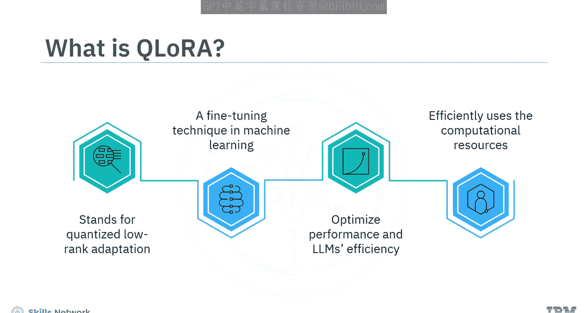
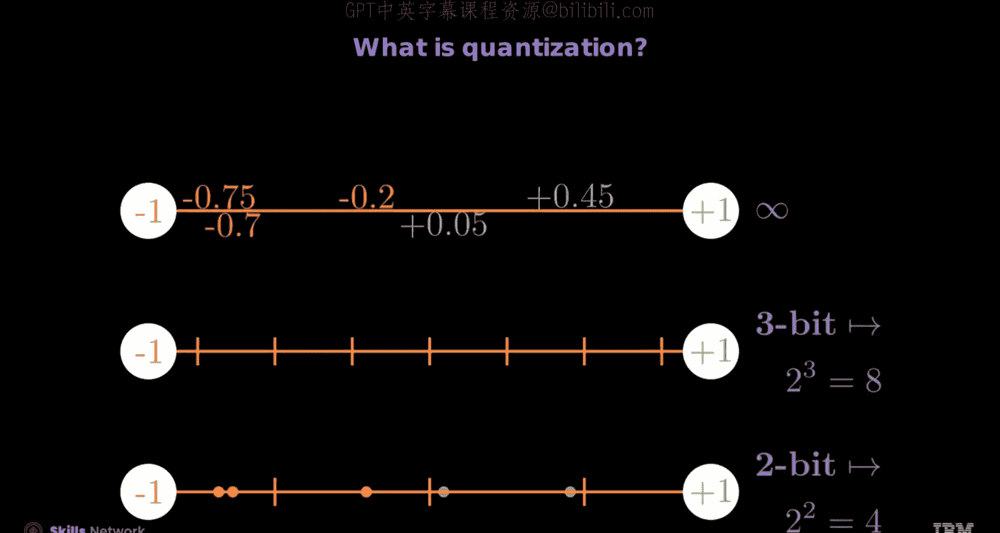
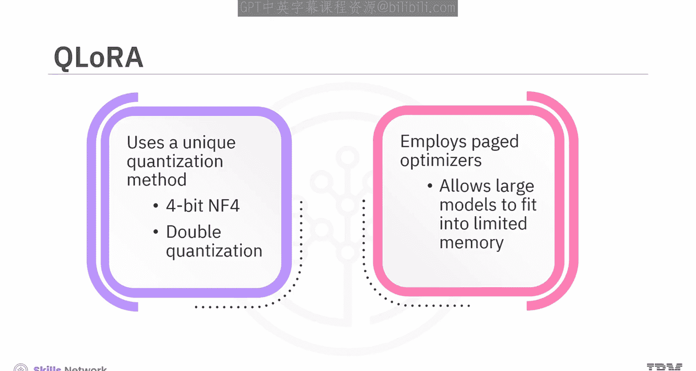
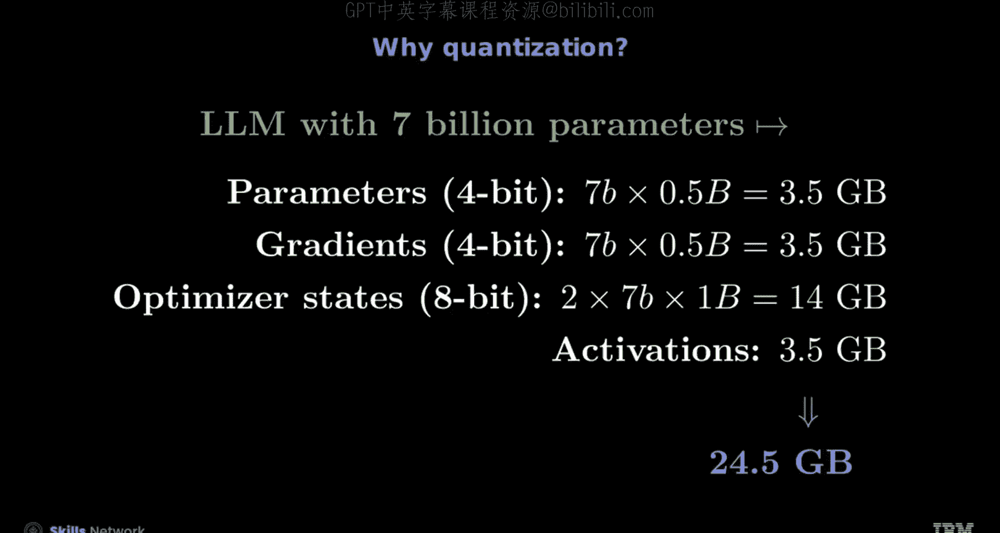
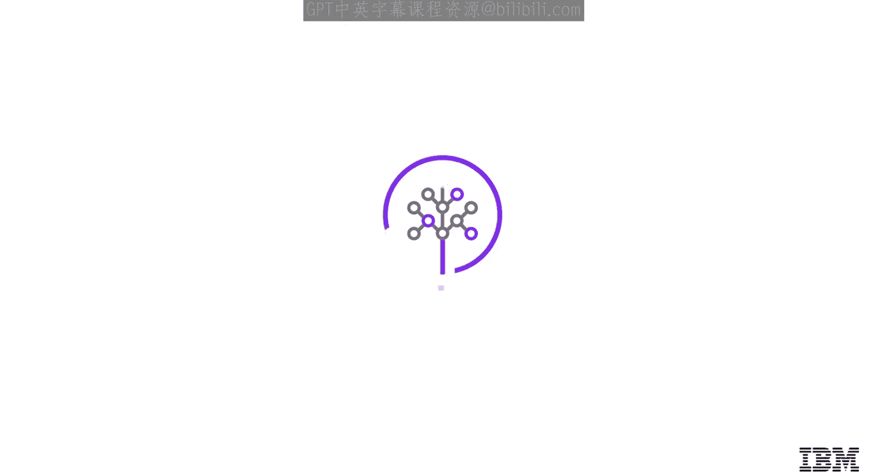

# IBM《生成式人工智能工程｜Falsk、生成式AI应用、数据分析、机器学习、Keras、架构和数据、NLP基础、transformer、微调、高级微调、RAG》 p140 8_从量化到QLoRA.zh_en -BV1NAq6Y9E7z_p140-

Welcome to Form Quaization to Korra。After watching this video。

 you'll be able to define quantization and Klora。You'll also explain the importance of Klora。

Let's first understand what Klora is Klora stands for quantized low rank adaptation。

It is a fine tuning technique in machine learning designed to optimize the performance and efficiency of large language models or LLMs。

You can achieve this by combining quantization in LoRA。

 allowing efficient use of computational resources without significantly sacrificing the model's accuracy。

Quantization reduces the precision of numerical values to a finite set of discrete levels。

 decreasing memory usage and enabling efficient computation on hardware with limited precision。

 for example， to convert the image's color to 256 shades of gray Quaantization reduces the number of gray color levels from 256 to 1684 and 2。

These levels show a decrease in the image details by applying certain color levels。

This means that with the increasing quantization， the image looks less vibrant and remains recognizable with less memory。

 let's define the quantization range and levels using the number range。In Q Lora。

 the quantization range lies between minus1 and1， the number of bits used to represent values determines the quantization levels。

For example，3 bit quantization represents eight discrete levels such as minus1 minus 0。75 minus 0。5。

Mineus 0。25， 。25， 。5， 0。75 and1。Therefore， the quantized value for the numbers could be minus 0。

75 to minus 0。75 minus 0。7 to 0。75 minus 0。2 to minus 2。5 0。05 to 0。25 and 0。45 to 0。5。Similarly。

2 bit quantization represents four discrete levels such as 1， minus half， half1。

 therefore the quantized value for the example numbers could be minus 0。75 to minus1， minus 0。

7 to minus1， minus 0。2 to minus half。0。05 to2。

And 。45 to half。Q Lora uses a unique quantization method，4 bit Nor floatat。

 or NF4 and double quantization。It employs page optimizers， not a quantization technique。

 but a memory management trick， Additionally， the paged optimizers allow large models to fit into limited memory by dynamically loading and unloading model parameters as per the requirements。

😡。

Let's understand how quantization can reduce the memory footprint in a 7 billion parameter model。

 considering model parameters， gradients， to optimizer states， and activations。

 let's review each of them。In model parameters， quantization uses the FP16 model。

 which uses 16 bits to represent each parameter， therefore the total memory footprint for 7 billion parameters is 7 billion multiplied by2 bytes。

 which equals 14 gigabytes， on the other hand， quantization uses FP16 gradients。

 which uses 16 bits to represent each gradient。The total memory footprint for 7 billion gradients is 7 billion multiplied by 2。

 which equals 14 gigab， Quaization uses FP32 optimizer states to reduce memory footprint using 32 bits for each optimizer state there are two states which leads to a total memory footprint of 2 times 7 billion multiplied by 4 bytes。

 which equals 56 gigabtes。Let's assume FP16 activations are the same size as the model parameters to reduce memory footprint quantitization。

This means that the memory footprint for the activations is 7 billion multiplied by 2。

 which equals 14 gigab， therefore the total reduction in the memory footprint for FP16 is 98 gigab In contrast a 4 bit model quantization uses 4 bits to represent each parameter the total memory footprint for the 7 billion parameters is 7 billion multiplied by 。

5 equals 3。5 gigab the 4 bit quantized gradients use 4 bit to represent each gradient which leads to the total memory footprint for the 7 billion gradients being 7 billion multiplied by 。

5， which equals 3。5 gig In contrast the 8 bit quantized optimizer states use 8 bits for each optimizer state In this case there are two In this case the total memory footprint for two states is 2 times 7 billion multiplied by 1 byte which equals 14 gig。

Lastly， in4 bit quantized activation， assume that the activations are the same size as the model parameters。

 the total memory footprint for the activations is 7 billion multiplied by4 bits， which equals 3。

5 gigabs， therefore the total reduction in memory footprint for 4 bit quantization is 24。5 gigabtes。

The table on the screen represents the comparison of the memory footprint before and after4 bit quantization therefore the memory footprint reduces from 98 gig FP16 to 24。

5 gigs4 bit quantization with a reduction of around 75% it is important to note that the reduction in the memory footprint leads to run models on less powerful hardware let's recap in this video you learned about quantization and Klora understanding quantization and Kra techniques is crucial for developing efficient and scalable machine learning models。

Klora is a fine tuning technique in machine learning for optimizing performance Klora uses a unique quantization method。

 NF4 and double quantization to reduce memory footprints Klora reduces memory footprint up to 75%。

Quantization reduces the precision of numerical values to a finite set of discrete levels by defining the quantization range and levels。

