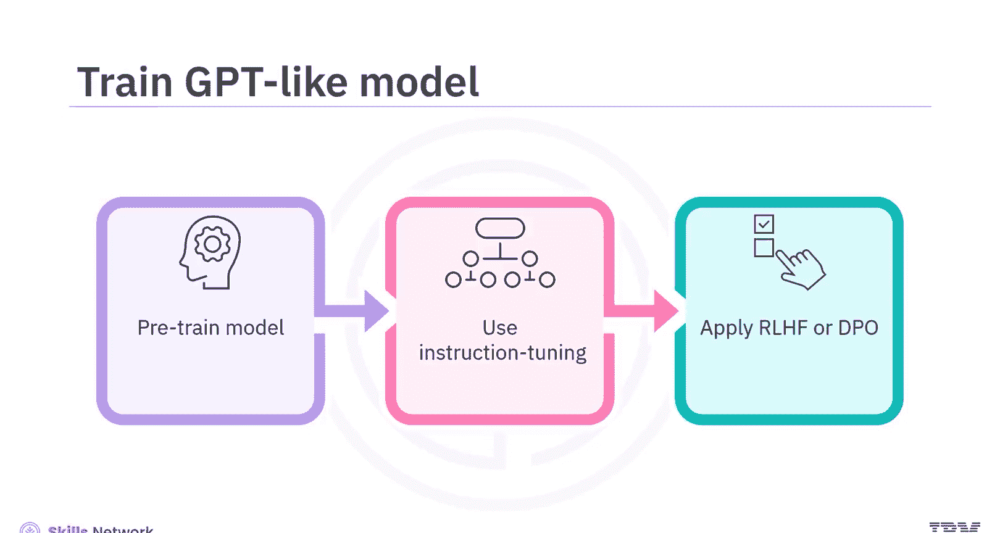
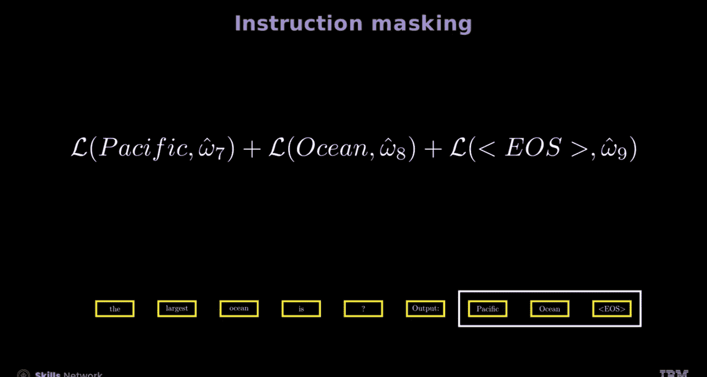

# IBM《生成式人工智能工程｜Falsk、生成式AI应用、数据分析、机器学习、Keras、架构和数据、NLP基础、transformer、微调、高级微调、RAG》 p142 1_指令调优基础.zh_en -BV1NAq6Y9E7z_p142-

。Welcome to basics of instruction tuning After watching this video you'll be able to define instruction tuning and describe its process You'll also explore special symbols and prompts format and describe instruction masking Let's first understand what instruction tuning is instruction tuning is also known as supervised fine tuning or SFT It trains models with expert data sets instruction tuning enhances the model's performance by providing specific instruction and context and ensures that the tasks are handled accurately instruction tuning is generally used before performing direct preference optimization or DO and reinforcement learning from human feedback or LHF It establishes a strong foundational understanding leading to precise and reliable model outputs。

Next， let's understand how to train a GPT like model。

 first pretrain the model by predicting the next word in the sequence in GPT。

 next use instruction tuning with expert labeled examples， and lastly， apply RLHF or GPO。

Let's delve into instruction tuning with an example。

 consider a causal language model in a large language model or LLM trained using instruction tuning for educational purposes。

 this model is designed to answer questions such as which is the largest ocean。

 the key difference between the causal language model and the GPT like model depends on its specialized training and educational content。

Instruction tuning has several key considerations。 The model requires instructions and answers。

 One counterintuitive aspect is that the model will generate the instruction as well as the response as it generates the likelihood of the whole sequence。

 including the response。 For example， when you have an input the largest ocean is the model generates the instruction and the response as displayed on the screen。

 This processes relatively simple to manage。 using instructions tuning models。

 perform various tasks by interpreting and executing instructions more effectively。

 It uses data sets with templates and three components， instructions， input and output。

 Let's review each of them。 The instructions provide directions or commands to the user to specify what the user wants the model to do。

 It also defines tasks or actions that the model should perform。

 you can provide instructions to the model for generating text。

 translating languages summarizing content answering questions or performing specific computations。😡。

Input in the model is the data or context that should be processed to fulfill the instruction。

 The input data can be a text passage， a list of items。

 a question or any other data that the model requires to perform the ined task。

 It is important to note that not all data sets include the input。

 meaning they only include instruction and output。 Lastly。

 the output defines the expected result or responses。

Now let's learn about the role of special symbols in instruction tuning。

 Consider the example instruction， create a Python function that applies a linear function。

 followed by the output defined function of X returns a linear function This is difficult for humans to read you can see that the output is adjusted to defined function of X and return x to the power of 2 plus 3 x Iustrating the importance of special symbols like back/lash n and formatting This approach ensures that the model correctly interprets and processes the structured data note that this example does not include input。

Additionally， it's vital to adjust the prompt format to maintain compatibility with the different model's tokenizers using special tokens to format prompts This approach helps in correct interpretation of certain parts of the input for example。

 using triple hashtag instruction and triple hashtag response ensures that the model's tokenizer has assigned appropriate token indices or IDs which help the model process correctly。

 this model's tokenizer is important for models such as Facebook's open pretrain transformformer language models however other models or datas may use different tokens for the instruction and response for example。

 triple hashtag human and triple hashtag assistant。

Let's explore instruction masking In instruction masking。

 the goal is to focus the loss calculation on specific critical tokens rather than all output tokens。

 similar to generative pretraining， the objective is to predict the input shifted one time step forward。

 but the loss is slightly modified， given the sequence。

 the special token instruction proceeds the prompt the largest ocean is。

 and the special token output precedes the Pacific Ocean response。

 The model then learns to predict the shifted sequence。

 The largest ocean is output Pacific Ocean EOS To understand how the loss is modified。

 let's break down the output logics after passing through the final linear layer。

Consider the input tokens denoted by omega at timestamp T and the corresponding output logics for the timestamp shown in red in ptorrch cross entropy loss is typically computed between the model's output logics and the next token in the sequence Shi at one point in time for clarity。

 write the loss as the actual predicted token omega hat in the loss calculation at the time index T that you would like to predict in generative pretraining。

 you can sum the loss over tokens in a batch。 However。

 instruction masking restrict the loss calculations to key tokens。 For example。

 the input instruction the largest ocean is The predicted output would be the shift sequence displayed in yellow boxes in regular fine tuning。

 However， the model learns to predict the Pacific ocean and Eos in instruction tuning。

 This targeted approach ensures that the model focuses on the important parts of the sequence。

Lastly， let's look at some considerations for instruction masking。

 Re studies show that the unmasked instructions sometimes show better performance for smaller data sets。

 In contrast， some libraries mask the instructions by default In hugging face。

 you should specify if the instructions are masked using a function called data collateder for completion only LM。

 However， special tokens are typically masked。 Let's recap in this video。

 you learned the basics of instruction tuning In tuning involves training models with expert curated data sets。

 for instruction tuning， the model requires instructions and answers。

 In tuning helps perform a wide variety of tasks by interpreting and executing instructions more effectively to generate a response。

 instruction tuning uses instructions input and output。

 You can adjust the prompt format to maintain compatibility with the different models tokenizers。

 Lastly， the instruction masking focuses on the loss calculation of specific tokens。

