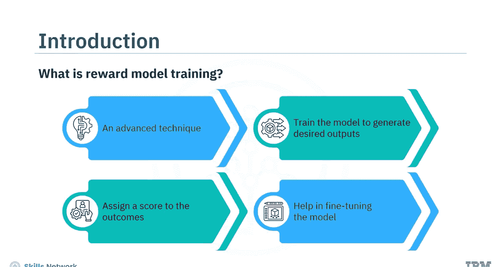
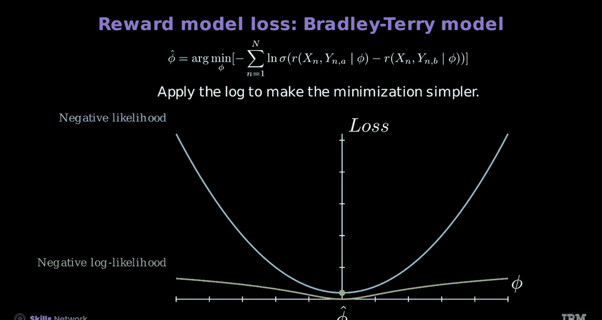

# IBM《生成式人工智能工程｜Falsk、生成式AI应用、数据分析、机器学习、Keras、架构和数据、NLP基础、transformer、微调、高级微调、RAG》 p145 4_奖励模型训练.zh_en -BV1NAq6Y9E7z_p145-

welcomele to reward model training After watching this video。

 you'll be able to explain the reward model loss and demonstrate how to create and train a reward model。

 The reward model loss is a discrepancy between the predicted responses and their scores generated by a model and the actual response and the score received from the modeled environment or system。

 This is where reward model training has come in place。

 Re model training is an advanced technique that trains a model to identify desired outputs generated by another model and assign scores to the outcome based on its relevance and accuracy。

 This score helps fine tune the generative model to produce more accurate outputs。

 Let's understand how to train a language model to generate rewards effectively To do so。

 first train the scoring function。 Here， human evaluators assign scores to the responses。 However。

 it is challenging for humans to provide precise numerical scores。

 The table displays that the first in second columns represent the queries and responses。

 while the third。😊。

Represents the assigned scores。Now if you look at the rows， the pattern is consistent。

 the first row represents the query， the second represents the higher scoring response。

 that is response A， and the third represents the low scoring response that is response B。However。

 it is much easier for humans to rank responses instead of assigning them to specific scores the second table shows that the responses are arranged based on scores without assigning them numerical scores。

This ranking approach simplifies the evaluation process and makes it easy for human evaluators to provide accurate feedback。

 The pairwise ranking method leverages ranking multiple samples。 However， in this video。

 let's focus on two samples here， the goal is to develop a reward function that holds the inequality such that the reward for the better response is higher than the reward for the bad response。

Now adopt an open AI notation where R is a function of x and y here x is a query Y a is the chatbot's output。

 the positive response and yb is the negative response。

 it is important to note that the hat notation on y is deleted from here because y is a random variable sampled from the decoder model or a person used to generate it。

 the parameter phi represents the learnable parameters of the transformformer model。

 a decoder model like the bidirectional representation of transformers or bird model and generative pre-train transformformers or G。

😡，Let's understand how to generate reward model loss To understand this。

 let's take an example where x is a query， YA is a good response and Yb is a bad response to generate a reward insert x and YA in the model。

😡，The encoder model generates responses as contextual embeddings represented in blue。

Similar to the classification， pass the classification token output through a linear layer with 768 inputs and one output numerical value denotated as Z represented as blue This represents that the estimated reward is a good example Now repeat the process for the bad sample where the output embeddings are shown in red here the goal is to ensure that the reward for YA that is Z is higher than the reward for YB that is ZB Next。

 use the Bradley Terry model to understand the reward loss model by generating the cost or loss function。

First， find the parameters that ensure a good response receives a higher reward than a bad response。

 let's understand this better using a geometric argument similar to the support vector machines rather than a purely probabilistic one。

For example， consider a data set。 First， convert the comparison inequality into a difference。

 emphasizing maximizing the gap between the rewards of the good and bad responses。 Next。

 apply the sigmoid function to interpret the difference as a probability that response A is better than response B。

 Lastly， transform this into a minimization problem by multiplying a negative one。

 This approach simplifies the parameter optimization。

 meaning that finding the optimal parameter value。 phi minimizes the difference。 However。

 reducing the negative sigmoid function helps achieve maximum rewards for a good response over a bad response。

 based on the parameter phi， the delta represents the difference between rewards for a good and bad response。

 Additionally， delta measures the reward quality for a good response compared to a bad response for phi。

 It means that as delta increases， the law should decrease since the reward function difference is increasing。

 This approach is represented in tabular form。 The table displays the impact of different phi values on the reward difference。

elta and the corresponding loss function， the negative sigmoid of delta The first column in the table represents different five values。

 The second column shows delta values， the difference in rewards between the good and bad responses the positive values in the table represent the preference for a good response The third column shows the loss as a function of the delta As the delta increases。

 the loss decreases Let's look at the graph where the x represents the delta and the y shows the value of loss as a function to the delta to evaluate the loss for different five values use the values from the table and plot a graph the graph shows that as delta increases。

 the loss decreases indicating that when the loss is minimized the delta has a higher value as expected to estimate the parameter use the maximum likelihood estimation by multiplying each samples sigmoid output independently。

If you multiply this output by a negative one， it converts the problem into a minimization represented by plotting a graph with phi on the x axis and the loss on the y axis to simplify this optimization。

 apply a log function directly to the likelihood and scale it using a negative one。

 resulting in a negative log likelihood。 The log function is monotonically increasing and does not affect the location of the minimum。

 The graph shows that both approaches have the same minimum。

 The log function transforms the product into sums。

 simplifying the differentiation process and gradient descent can help find the optimal parameters。

 Let's recap In this video， you learned about reward modeling and how to create or train the reward model。

😡。

Reward model training is an advanced technique that trains a model to identify desired outputs generated by another model and assign scores to the outcome based on its relevance and accuracy traininging the scoring function helps generate rewards effectively generating reward model loss。

 the encoder model generates responses as contextual embeddings。

Using the Bradley Terium reward Los model， you can understand their reward loss model by generating the cost or loss function。

