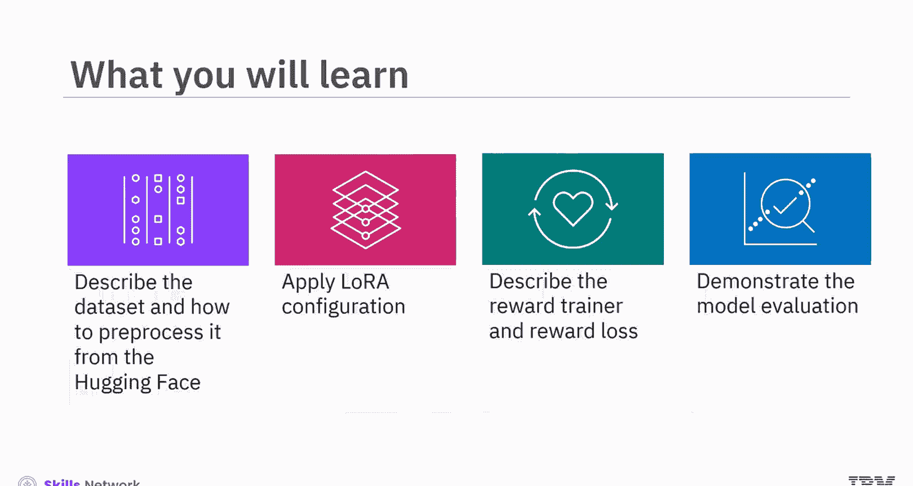
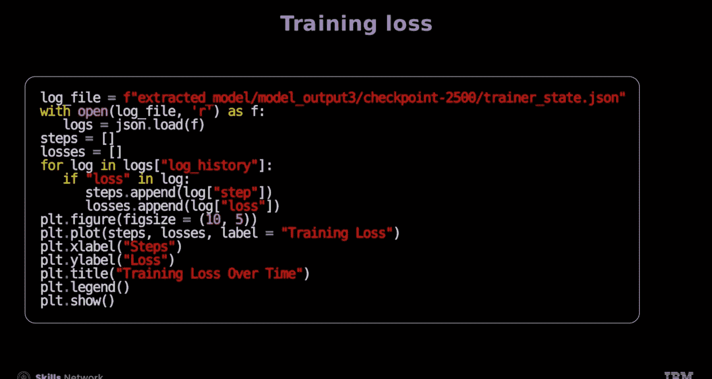
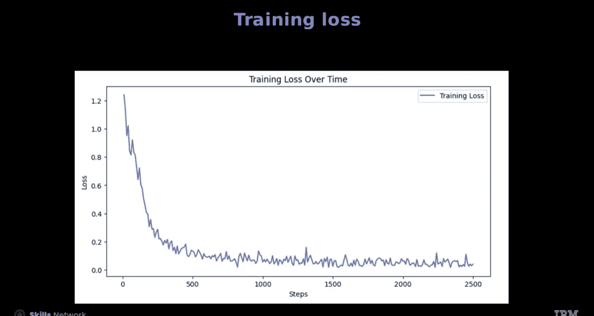
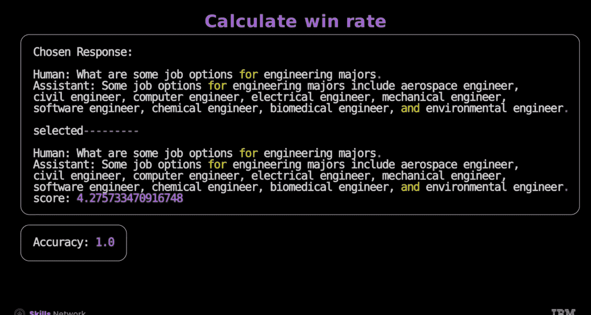
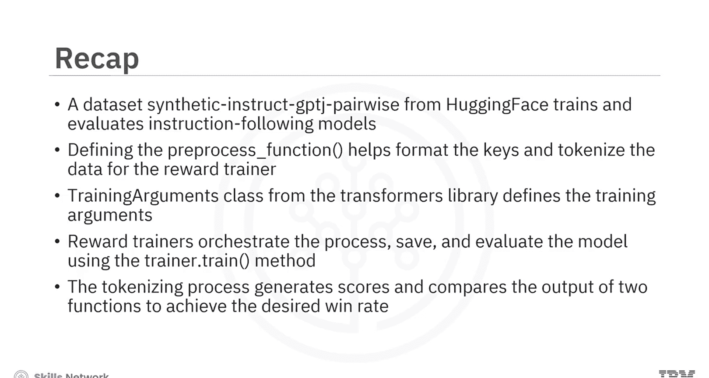

# IBM《生成式人工智能工程｜Falsk、生成式AI应用、数据分析、机器学习、Keras、架构和数据、NLP基础、transformer、微调、高级微调、RAG》 p146 5_使用Hugging Face进行奖励建模.zh_en -BV1NAq6Y9E7z_p146-

Welcome to rewardward Modeling with Hugingfaceace In this video。

 you'll be able to describe the dataset set from the Huging face。

 explain how to preprocess the data set in reward modeling。

 and apply the low rank adaptation or lower configurationfiration in reward modeling。

You'll also be able to describe their reward trainer， explain reward loss。

 and demonstrate the model evaluation in reward modeling。

Let's begin by understanding the data set。Consider a data set de haos/ syntheticyntic instructionGT J pairwise from HugingF。

 usually designed for training and evaluating instruction following models。

This data set trains models to understand and follow robust instructions by learning from pairs of good and bad responses Here is a sample data point from the data you can see that every data point consists of prompt a text prompt that the model should respond to the preferred response to the prompt called chosen and the disliked response to the prompt called rejected Next。

 for the training process to define the score function set up the tokenizer and the model for example。

 train the GPT2 model for sequence classification as a score function This model helps to determine the quality of responses。

The model output is a single class or one neuron at the output layer。

 which produces a scalar value output representing the score。

 The get response function prepares data by structuring it as a query and response pair。

 Ma it easy to read and test。 Next， apply this function to the dataset。

The screen displays the data set after applying the get responsese function。Defining a function。

 add combined columns takes a single data point as an example and adds two new columns。

 prompts chosen and prompt rejected。 The prompt chosen column combines the prompt with the chosen response。

 labeling the dialogue parts human and assistant。 however。

 prompt rejected column combined the prompt with the rejected response in the same labeled format。

 Next， the MA method applies the function to each example in the training。

 The screen displays the result in data。😡，Next， filter the samples shorter than the specified max length to ensure that the data set meets the required length criteria。

 Let's define the pre process function and call this function a single data point to observe its newly formatted keys。

 The pre process function tokenizes the prompt chosen and prompt rejected keys for the reward trainer。

The chosen key represents the preferred responses， however。

 the rejected key represents the dislike responses。

Tokenizing these keys enables the model to process and understand the differences between high and low quality responses。

By providing chosen and rejected inputs， the reward trainer can differentiate and prioritize better responses。

 which helps in training models to follow instructions。

The field input IDs chosen and input IDs rejected represent the token IDs for the chosen and rejected responses。

These IDs are the numerical representation of the text used by the model。

The attention mask chosen and attention mask rejected fields also contain attention masks for the chosen and rejected responses。

Upon calling the function for a single data point of the data set。

 you will get the return keys from the function。😡，At this stage。

 the data point contains the text tokens for every label。In the training dataset。

 apply the preprocess function to each sample using the map method and tokenize the prompt chosen and prompt rejected text。

 considering the batch equals true parameter enables the function to process multiple samples and improves efficiency It is important to note that this is not part of the training process however。

 it just explains the workings of the scoring function Finally。

 let's split the data into training and testing you can use lowerra to train the model by initiating the lower config configuration for a sequence classification task。

 This configuration specifies several parameters and is created using the lower config class from the parameter efficient fine tuning or PAft library Let's use the training arguments class from the transformer's library to define the training arguments to configure various parameters for the training process The part devicetrain batch size equals3 which sets the batch size per device GPU or CPU to3 however。

 you can try a larger batch depending on the size of GPU。The nu train epoch equals 3。

 which specifies the number of training epochs to 3。 Next， the gradient accumulation steps equals 8。

 accumulates gradients over8 steps before performing a backward or update pass。

 It also increases the batch size。 Finally， the learning rate equals 1。41 times E-5。

 sets the learning rate for the optimizer to 1。41 times e-5。Next is a reward trainer。

 a specialized trainer designed to train the reward function。First。

 train the process using their reward trainer orchestrate， then handle tasks such as batching。

 optimization， evaluation and saving model checkpoints it trains the model to learn from the feedback signals and improve their ability to generate high quality responses。

You can modify them using various parameters such as model to train the model AGs represents the training arguments。

 typically an instance of training arguments。😡，Tokenizer， use it to process the text inputs。😡。

Train data set for training the model。Eval data set for evaluating the model。

 and PEF Config to configure Lo。Next， use award Traer to train， save。

 and evaluate the model by leveraging the Traer。train method to initiate the training process。😡。

The model learns from the training dataset set， optimizes its parameters to improve performance。

 and stores the variable metrics using the evaluate method。Using the given code。

 let's plot the training loss。

The screen displays proper convergence of the loss。

Now convert the tokenizing process， generate a score。

 and compare the outputs in two separate functions。

The first function tokenizes the text and generates the model's output scores。 However。

 the second function performs the pairwise comparison of these scores。Finally。

 evaluate the model's performance by calculating the win rate。 For example。

 if the model assigns a higher score for better response and accuracy， market is1。

 otherwise market is0。 The model evaluation process starts by defining N。

 the number of samples to be evaluated。 Next， initialize a countercorr selections to track the number of correct identifications of the preferred response。

 The code then iterates over the first and pairs of chosen and rejected responses from the training data set。

 The screen displays the output with 100 percent win rate。

 It's important to note that this data is based on the synthetic data。 However。

 the top models achieve win rates between 60 and 70%。

 Let's recap in this video you've learned about reward modeling using hugging face。

 A data synthetic in GTJ pairwise from hugging face is usually designed for training and evaluating instruction following models。

Defining the pre processcess function helps format the keys and tokenize the data for the reward trainer Train arguments class from the Transformers library defines the training arguments to configure various parameters for the training process。

 Reward trainers orchestrate the process， save and evaluate the model using the trainer do train method The tokenizing process generates scores and compares the output of two functions to achieve the desired win rate。

