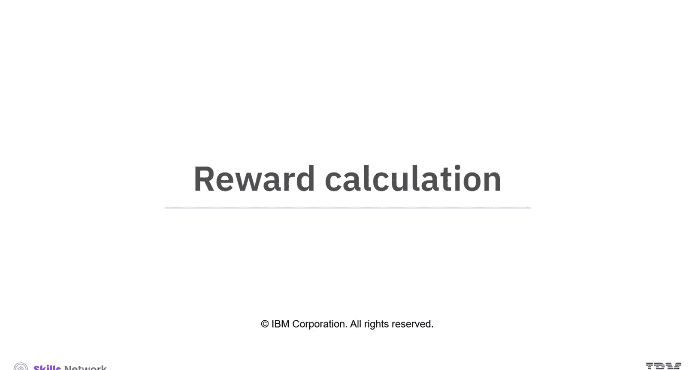
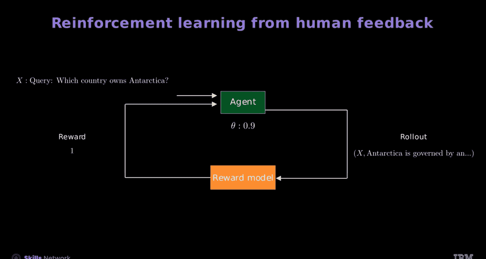

# IBM《生成式人工智能工程｜Falsk、生成式AI应用、数据分析、机器学习、Keras、架构和数据、NLP基础、transformer、微调、高级微调、RAG》 p149 8_从人类反馈中进行强化学习（RLHF）.zh_en -BV1NAq6Y9E7z_p149-

Welcome to reinforceforcement Learning from Human Feedback or RLHF。After watching this video。

 you'll be able to calculate rewards using a reward function。

You'll also be able to demonstrate how the model incorporates human feedback and fine tuning the language models。

Imagine a large number of monkeys randomly pressing keys on typewriter for an infinite amount of time。

 Eventually， they will produce any given text， such as the complete works of Shakespeare。

 But what if you incorporate a reward for them， such as a banana。

 Would you need fewer monkeys or less time。 Let's understand this with reinforcement learning from human feedback or R L HF using a monkey example。

First， a monkey begins typing to generate a relevant word。 Once a monkey types a relevant word。

 the document is submitted for review and undergoes a review process。

 If the document is satisfactory， the monkey receives a banana as a reward。

 The monkey will repeat this action， but eventually type random words。

 A subset of these random words may also earn a reward。 and the process is repeated。 Eventually。

 the monkey will create Shakespeare。Let's understand reward calculation using RLHF。

To do so， Use award function represented as R XY。Next。

 insert the query which country owns Antarctica。The reward function provides human feedback for the inserted query。

The first response is question mark 9 DFSA。This response is irrelevant and gets a zero score。Next。

 repeat the process for different responses。The received response says no country owns Antarctica。

This response is accurate and gets a score of 0。9。 Finally。

 the ideal response is Antarctica is governed by an international treaty。

 This response is the most accurate and gets a satisfactory score of one。Similarly。

 you should have various queries and responses to train a sample。For reviewing the sampling process。

 focus on rollouts of queries and responses to do so。

 consider a table of queries displayed on a screen。

 the first column and index n represents the query number。

The second column represents queries such as the largest ocean is。 Can you give me some Python code。

 Is it a kids book and so on， The equation X approximate D represents a random use of the sample from this table。

 For example， select query number one as the random sample。

 the largest ocean is Next represents the language model as a table。

 the first row represents a query， which is the largest ocean， where n equals1。

 in each row below shows the possible response， including the Pacific Ocean。

 the Atlantic Ocean and so on。Y approximate D1 indicates that y is randomly sampled from the table with K as the index of each response。

Let's take another query。 Can you give me some Python code where n equals 2。

 You can see a different table for this query， where each row has a different response indexed by K and Y sampled from D2。

 You can repeat this process for each query question， including is it a kid's book。

 which country owns Antarctica and so on。😡，This process is known as rollout。

Now let's understand the concept of expected reward using a table before a language model is used for this。

 look at the empirical formula。It approximates the expected reward by averaging the rewards over multiple queries and their respective responses In this formula。

 Capital n represents the total number of queries。 Small n represents an individual query。

 Capital K denotes the number of responses per query and small K represents an individual response。

 Transforming the empirical formula will help to determine the actual expected value formula。

 This actual value formula represents the expectation over the data distribution and the model's response distribution for the given response。

Using the expected reward for a single query by incorporating the probability of each response for the given input。

Thus， the expected reward is summarized as PY by x， the probability of response Y given input X。

Let's learn how to incorporate human feedback。For example。

 take a pre trained large language model or LLM that needs to be fine tuned。

This model is represented as a policy， showing the model's response distribution provided as an input query。

 a box labeled model Next， introduce a query who made this course represented as a blue box。😡。

You can see a response he looks like Brad Pitt represented in a blue box。

 and the input to the reward model will be queryery plus response。

To evaluate and generate a reward for Queery Plus Re， let's use a pretrain reward model。😡。

The input query is who made this course and the related response is he looks like Brad Pitt。

 based on the query and response， the reward model generates a reward value of minus 10，000。Now。

 let's see how this is useful in fine tuning the policy。 First。

 create an agent or LLM represented as green with a set of learnable parameters。

 Theta and the reward model represented in orange。 Next。

 introduce a query X as an input to the agent to generate a response Y。Here。

 query and response are known as rollout。 The reward function processes X and Y and uses the reward for training the LLM and updating the。

This example shows a set of rollouts for the given query， which country owns Antarctica。

 The query is introduced as the input to the agent。

 You can see this query on the left side of the reward model indicating that the agent is processing the query。

Here， Asian generates several responses followed by rewards for each query。

This reward updates the model parameters the for each response for example。

 the first response is question mark 9 DFSA with a reward of zero。

The second response is Antarctica is。With a reward of 0。0021。The third response is Penguin overlords。

 with a reward of 0。09。The fourth response is Antarctica is a country with a reward of 0。02。

The fifth response is no country owns Antarctica with a reward of 0。09。

 and the final response Antarctica is governed by an international treaty， with a reward of one。

These generated responses are random from the policy distribution。

The awards help in optimizing the learnable parameters of policy distribution。

Let's recap in this video you've learned to calculate rewards and how to incorporate human feedback and fine tuning language models。

The reward function provides human feedback for the inserted query to receive relevant responses and provide scores。

Use the rollouts of queries and responses to review the sampling process。

 The expected rewards help understand how an agent performs in the language model。

 using an empirical formula and averaging the rewards over multiple queries and responses。

RLHF uses response distribution as an input query to fine tune the pretrained LLMs。

You can use a pretrained reward model to evaluate and generate a reward for the query Plus response。

You can update the model parameters data for each response generated by the agents。😡。

