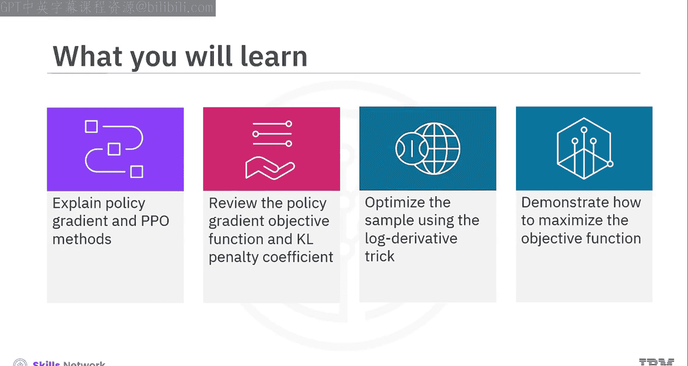
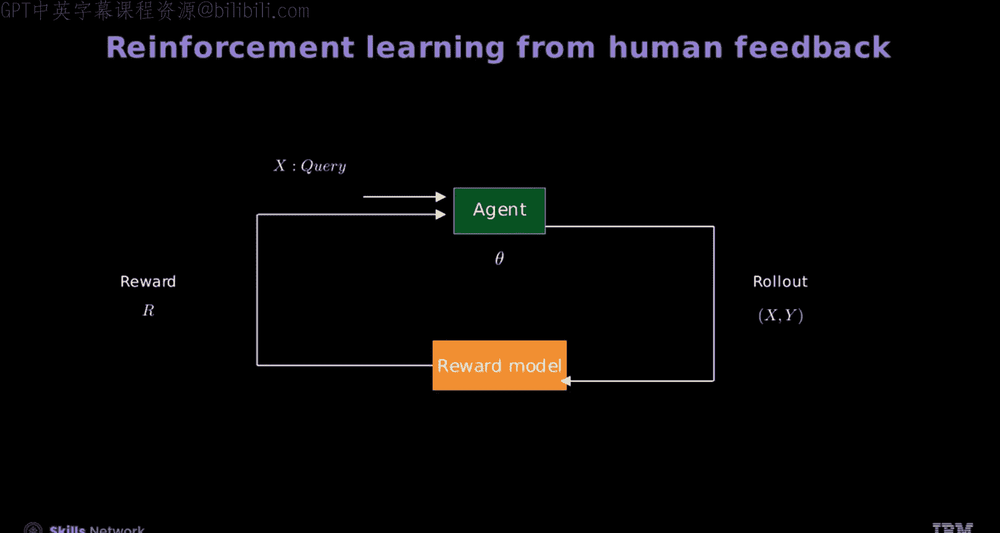
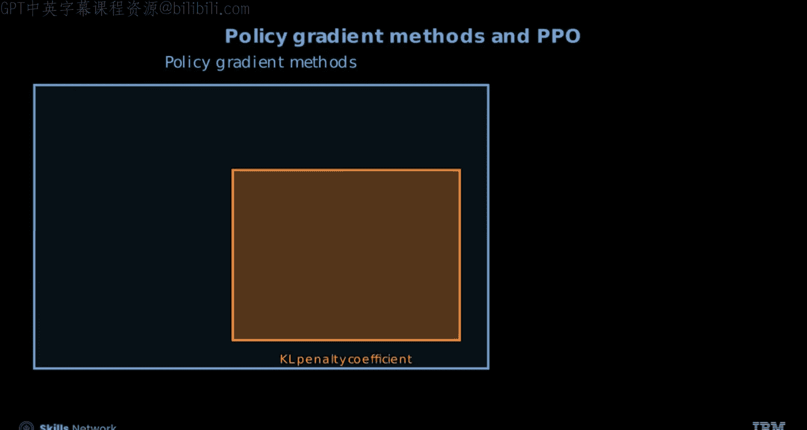
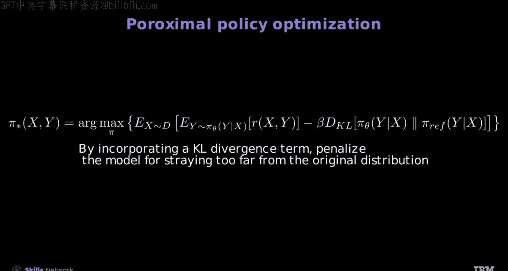
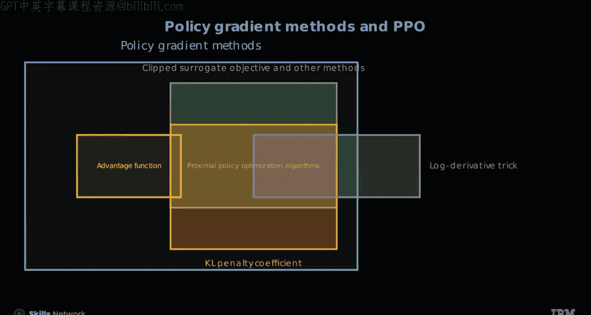
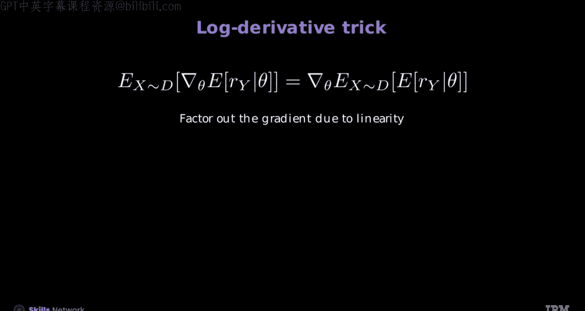
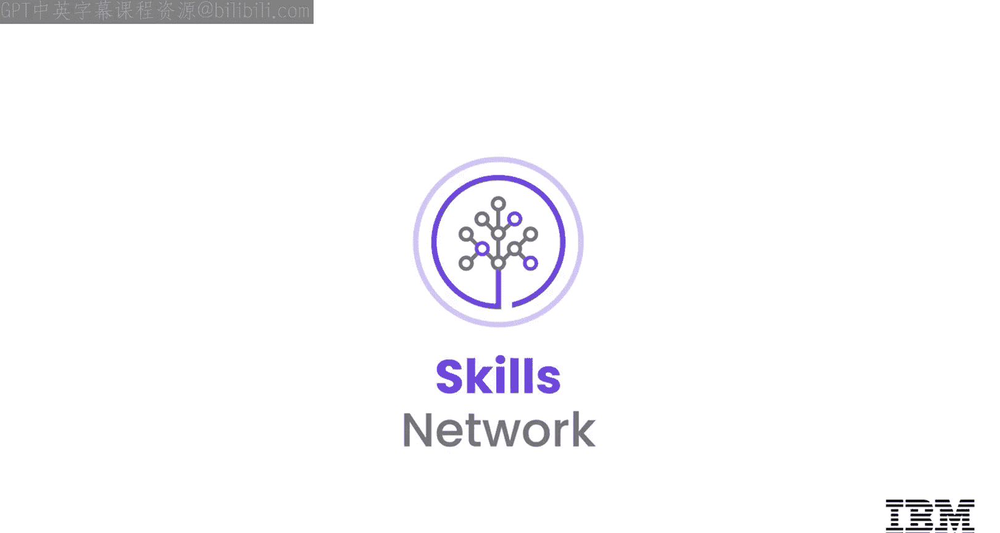

# IBM《生成式人工智能工程｜Falsk、生成式AI应用、数据分析、机器学习、Keras、架构和数据、NLP基础、transformer、微调、高级微调、RAG》 p150 9_近端策略优化（PPO）.zh_en -BV1NAq6Y9E7z_p150-

Welcome to Proximal Policy Optimization or PPO。After watching this video。

 you'll be able to explain policy gradient and PPO methods。

You'll also be able to review the policy gradient objective function and callback Lebler or KL penalty coefficient。

Further， you'll optimize the sample using the log derivative trick and demonstrate how to maximize the objective function using the gradient ascent to example。

Let's begin by creating an agent or large language model， LLM， with a set of learnable parameters。

 theta， and the reward model。Next， let's introduce a query X as the input to the agent to generate a response Y。

The query and response that is rollout where the reward function processes the X and Y。

 the generated reward trains the LLM and updates the learnable parameter data。 Now。

 let's understand the policy gradient and PPO methods。

Policy gradient methods objective function is what you want to maximize and proximal policy optimization is one method to achieve this。

These methods comprise different aspects as illustrated in the Venn diagram。First。

 you have policy gradient methods forming the foundation of various reinforcement learning algorithms。

Next， clip surrogate objectives and other methods stabilize training by ensuring updates to the policy that are not too drastic。

 the KL penalty coefficient regulates the divergence between old and new policies。

 maintaining stability during training。Another important aspect is the advantage function。

 which estimates the reward in this video， you will only review the general policy gradient objective function and the KL penalty coefficient。

The objective function of the policy gradient methods is similar to the score。

 which needs to be maximized。To do so， start with the reward function encoder。

 which estimates the reward for the pairs of inputs x and Y。Next。

 introduce the model that needs to be fine tuned。 The model is represented as the policy Pi or LLM such as a GPT like model that can be instruction fine tuned。

Let's look at the first step in the optimization process。For the given data query X。

 derive the sample response Y from the given data set and estimate the reward。

The estimated reward is represented as the expected reward sample for the policy pi to find the parameter theta。

In the second step， extend the entire data set and estimate the expected reward over all thequeries。

However， your goal is to find the optimal policy that maximizes the expected reward。 Additionally。

 introduce a reference model as a regularizing term to ensure that the model does not stay too far from the original。

 Next， control the hyperparameter beta。It is challenging to solve this problem because you're trying to find data from sampling。

To address this， even basic policy gradient methods require a foundational understanding of reinforcement learning statistics。

The log derivative trick， akin to techniques used in Monte Carlo methods。

 provides insight into optimizing this problem。 Both methods involve estimating gradients to optimize a function based on sampled data。

It's important to note that the log derivative trick addresses only one aspect of the PPO problem。

Let's look at the log derivative trick。

To calculate the derivative， find the policy that maximizes the objective function。

 the expected rewards。Here to make this process easy， ignore the regulation term。First。

 simplify the expression by focusing on the expected reward for the individual queries。

 noting that the derivative cannot be directly computed in this form。Next。

 convert the individual queries or expressions to an analytical distribution。

 allowing direct optimization of the parameters with respect to theta。To find the best parameter。

 take the gradient and highlight the gradient of the log transformation。Next。

 rearrange the expression into traceable form and substitute the gradient back into the expression。

 This converts the sampling and expression， allowing gradient calculations using samples。Finally。

 factor out the gradient to complete the transformation。

Let's review certain tips to train a model。When training a model regularly evaluate it using human feedback。

 start training a model with a moderate beta value and increase the temperature to explore more options。

Let's recap in this video you've learned to train a model using the policy gradient methods and KL penalty coefficient。

The policy gradient method maximizes the objective function。

 and PPO helps to achieve this maximization。To optimize the policy， derive the sample response。

 estimate the reward， and extend the data set。You can calculate the log derivative by identifying a policy that maximizes the objective function by simplifying the expression and converting it into analytical distributions。

 to train the model， regularly evaluate the model using human feedback， use the moderate beta value。

 and increase the temperature。

