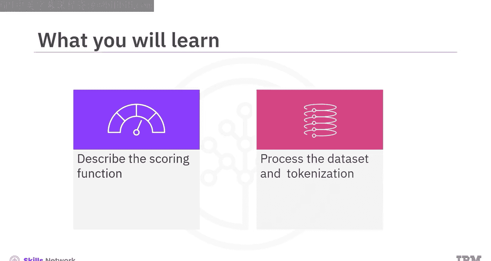
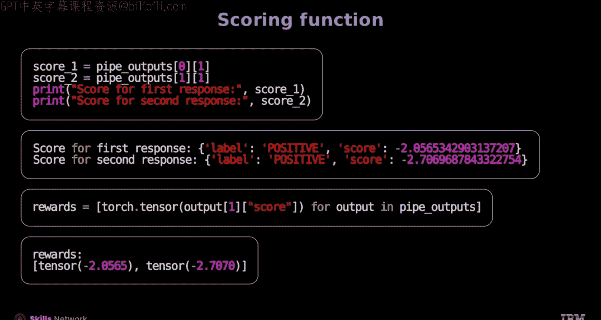
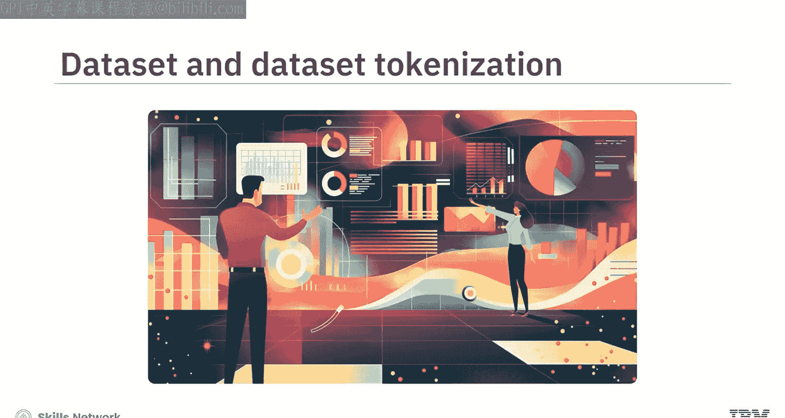
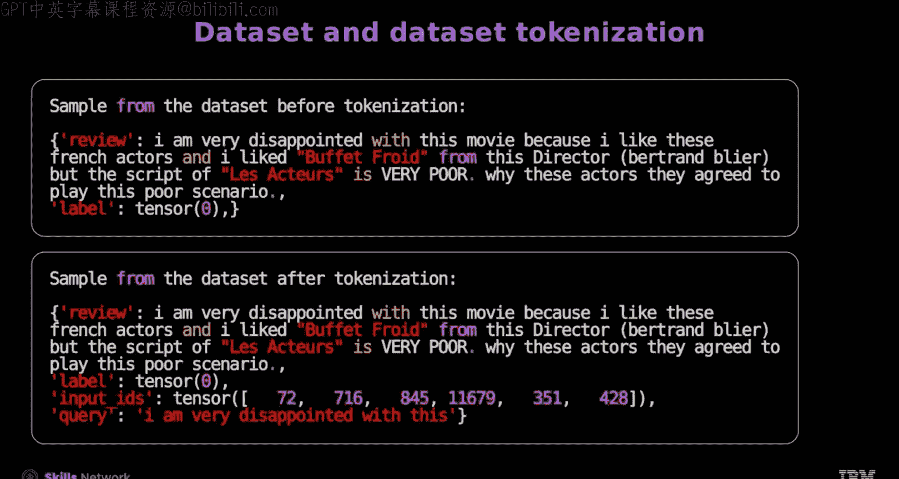

# IBM《生成式人工智能工程｜Falsk、生成式AI应用、数据分析、机器学习、Keras、架构和数据、NLP基础、transformer、微调、高级微调、RAG》 p151 10_使用Hugging Face进行PPO.zh_en -BV1NAq6Y9E7z_p151-

Welcome to PPO with Hugingface After watching this video。

 you'll be able to describe a scoring function for sentiment analysis and explain the data set and its tokenization using Huging face。

Let's first learn about the scoring function。 The sentiment analysis for responses is useful as a scoring function。

 rewarding positive responses over negative ones。 A reward function in reinforcement learning with proximal policy optimization or PPO provides feedback on the quality of the policy's actions。

😊，It also evaluates the quality of generated responses from a generative model such as a chatbot。

Let's initialize a sentiment analysis pipeline using a pretrain model。

 fine tuned in the internet movie database， or IMDB reviews。Now。

 apply the sentiment pipeline to show the results on two texts。

 The S Wgs dictionary contains parameters for the sentiment analysis pipeline。

 This dictionary specifies that all the four should be returned。 The applied function is none。

 and the badge size is 2。Now run the pipeline object for the defined texts。

 you can see the output as two corresponding negative and positive sentiment values for each text。

The scores from the sentiment analysis pipeline evaluate the quality or relevance of generated responses。

 indicating the model's confidence in the likelihood of generating positive responses Now iterating over the pipe outputs list。

 extracttracting the score from each output， converting the output into a tensor and storing it in the rewards list would represent the model's confidence in the likelihood of generating positive responses to use them as rewards Next is data set and data tokenization The IMDB data set contains 50000 movie reviews however。

 let's only use the review text for analysis El from Ds with a length of 200 or less are filtered out keeping only those DSs with a length greater than 200 from the sequences。

 the length sampler helps to vary the text length for data processing enhances model robustness and simulates realistic training conditions It also ensures efficient training by managing text input lengths and maintaining performance The length sampler ranges。

Between input minimum text length and input maximum text length。Next。

 loader pretrained tokenizer associated with the causal LLM model and set the padding token as the end of sentence or EOS token Now tokenize the review text into the input IDs。

 truncate the tokenize sequence to the desired length and assign it to the input IDs After tokenization。

 you can see the sample text where input IDs and queries are created you can use this as the input to the model。

Let's combine all the steps discussed until now into a single function to build a data set。

The screen displays two differences in the data set before and after processing it。

Two keys are added and the number of rows has decreased since the text shorter than 200 characters is removed。

Here is an example from the data set before and after cleaning and tokenizing it。

Let's recap in this video， you learned about the PPO and its process of generating responses and scores using hugging face In the reward function。

 PO provides feedback on the quality of actions taken by the policy。

 The sentiment analysis pipeline scores evaluate the generated responses quality。

The scores for the generated responses are extracted from the pipe outputs list。

The length sampler various text lengths for data processing。

 enhances model robustness and simulates realistic training conditions。

