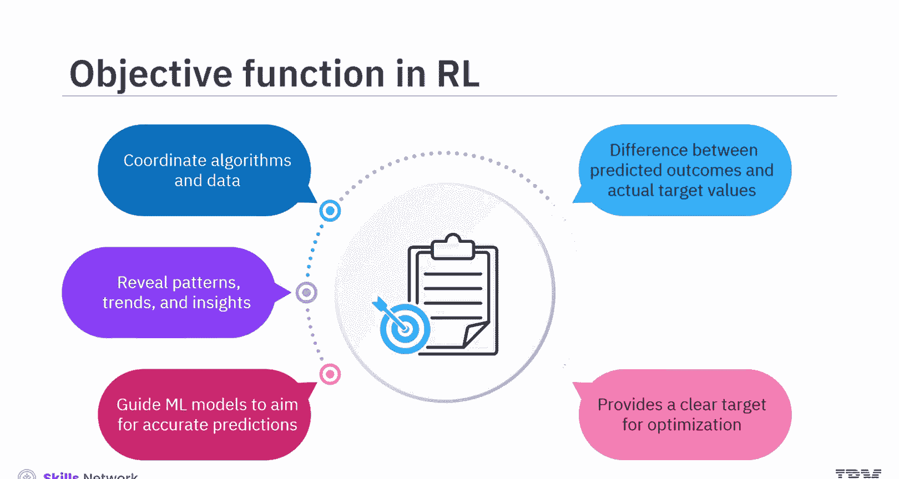
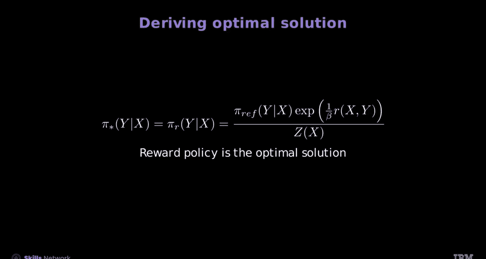
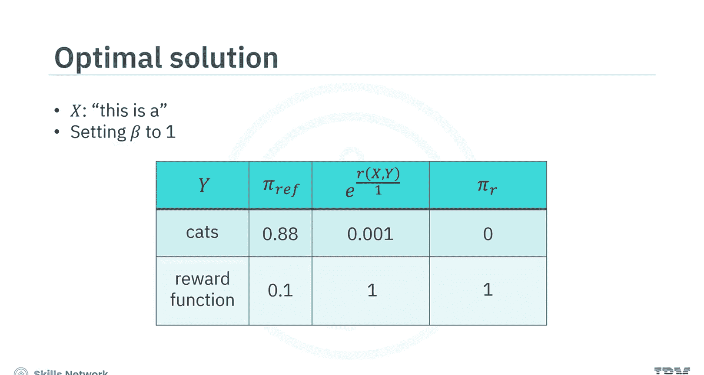
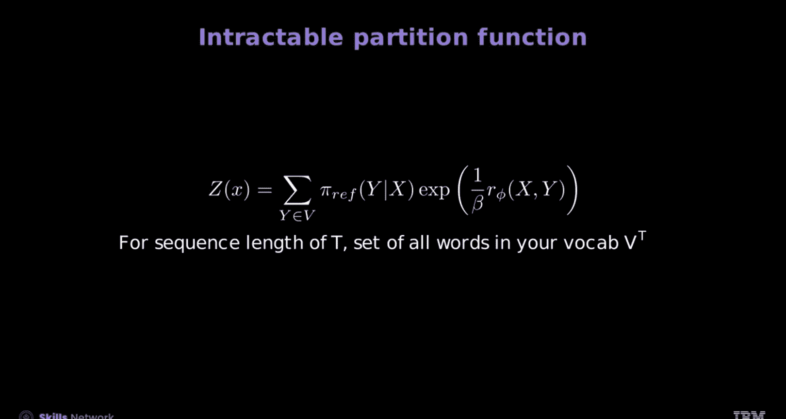
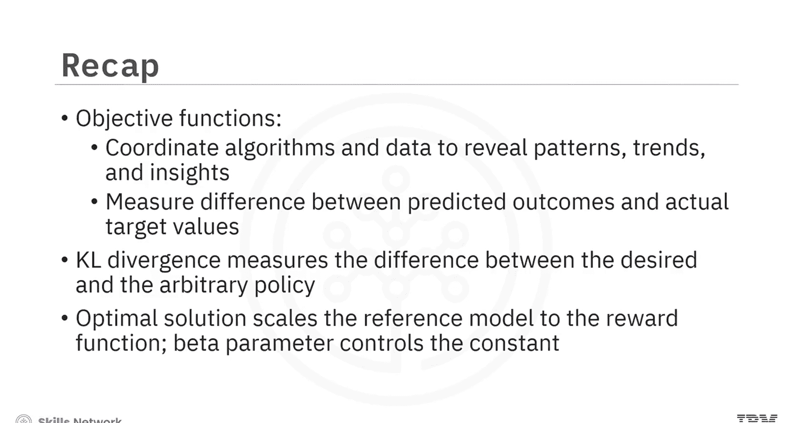

# IBM《生成式人工智能工程｜Falsk、生成式AI应用、数据分析、机器学习、Keras、架构和数据、NLP基础、transformer、微调、高级微调、RAG》 p154 13_DPO最优解.zh_en -BV1NAq6Y9E7z_p154-

。Welcome to DPO， Optimal Solution。After watching this video。

 you'll be able to find a closed form solution RL objective function， derive the DPO objective。

 and derive the optimal solution to a DPO problem。😡。

Objective functions are fundamental to machine learning or ML。

 They coordinate algorithms and data to reveal patterns， trends and insights。

 These mathematical tools guide ML models through the learning process。

 aiming for accurate predictions。Essentially， an objective function measures the difference between an ML model's predicted outcomes and the actual target values。

This performance metric is crucial， providing a clear target for optimization。

 Let's learn to find a closed form solution RL objective function。

 Let pi star be the desired policy and pi Ref and arbitrary policy。

 both representing the probability of Y given X， the Koak labeller or KL divergence measures the difference between these two probability distributions shown here as a distribution and obtained via sampling。

It is minimized to0 if and only if the pi star and P Ref are identical to better understand。

 let's visualize this with a one dimensional example using two Gaussian distributions on the y axis you have the possible values of y。

The green Gaussian centered at0 represents pi star while the red Gausian initially centered at negative4 represents pi Ref As they overlap。

 the Kl divergence reaches 0 By manipulating the equations。

 you can formulate the RL objective function problem to minimize the KL divergence aligning the pi star with pi f and ensuring your learned policy matches the desired behavior with some clever yet simple math。

 The first trick is converting a maximum to a minimum Here you have a function F of w plotted on the graph。

 The red dot marks the point where F of w reaches its maximum value denotated as W hat。

 which is found by taking the arg max of f of w。😡，Next。

 you'll transform this function to find its minimum by negating the function。

 The red dot now moves to the point where the negated function reaches its minimum value。

 effectively turning the arg max into an ag min。 This simple transformation allows you to switch between finding maximum and minimum values of a function efficiently。

In the same manner， multiplying a function by a scalar does not change the location of the minimum here。

 the function G of W is plotted on the graph。The location of the minimum is along the horizontal axis。

 multiplying the function by a scalar C does not change this location。The function is scaled by C。

 resulting in a new function， C times F of w。Notice that although the shape of the function changes。

 the minimum remains in the same location， let's now reformulate the RL objective using the last two examples。

First， start with the initial equation to make the optimization easier。

 multiply the entire expression by a negative one， transforming the maximization problem into a minimization problem。

 Not how the terms are now inverted。 then multiply the expression by one over beta。

 None of the operations affect the location of the optimum。 Finally。

 express everything as an expectation value。😡，This helps to simplify the optimization process。

Let's focus on the objective and simplify the equation further。

Here you can see the logarithm of the ratio between your policy and the Reverence policy minus a term involving the reward。

Now let's reformulate the DPO objective with some simple algebra。Starting from the initial objective。

 you have the log ratio of your policy and reverence policy minus the reward term scaled by beta。

Next， express the reward term as a logarithm， allowing us to combine the logarithms in a subsequent step by combining the logarithms。

 simplify the equation to show the log of the ratio divided by the exponential of the reward term。

To normalize， add and subtract a normalization term z of x， ensuring the distribution sums to1。

Combining this normalization， adjust your equation to include z of x explicitly。

 the denominator contains a distribution， their award weighted distribution。

 which will be shown as the reward policy pi R。For the KL divergence。

 the extra log of Z must be eliminated。Here， the function F of W is plotted in the graph。

The red dot marks the location of the minimum value of this function。Next。

 show that subtracting a constant C does not change the location of the minimum。

The function is adjusted by subtracting the constant C， resulting in a new function， f of w minus C。

Notice that although the vertical position of the function changes。

 the x value of the minimum does not change。Starting from the simplified expression。

 you'll formulate the objective function。 Now， minimize the expected value and simplify by noting that the constant term Z of x is not a parameter of interest。

This leads to a cleaner formulation of your objective。Next。

 express the objective as minimizing the KL divergence between the policy and the reward policy over the data。

 which was the initial goal。Therefore， the policy that minimizes this expression is simply the reward policy and the optimal solution to the problem。

The optimal solution scales the reference model to the reward function with the beta parameter controlling the constant consider the input token x being this is a。

 setting beta to1。In the following table， the first column shows two outputs of the LLM。

 and the second column shows the probability of those outputs。 The first output is cats。

Since this is not unusual， the reference model assigns it a probability of 0。8。

The second output is the reward function， as this is less likely。

 the Reverence model assigns it a probability of 0。1。

If the reward model shown in the third column is optimized for questions related to LLMs。

 cats would receive a lower score than the reward function。

 and the probability for the reward function would increase。

By taking the product of these probabilities and normalizing。

 the new model would assign a higher probability of approximately  one to reward function and0 over cats。

 changing Beto will change how the model weighs the reference model to the reward function。

 Calalculating this partition function is essentially impractical。

 Let's illustrate this with specific examples。😡。

First， for a sequence length of 1 z of x sums over all words in your vocabulary， V， such as UBA。

 Aaron， and Zziva。Next， for a sequence length of 2。

 Z of x sums over all possible pairs of words in your vocabulary。

 creating a much larger set v squared。 Finally， Generalizing for a sequence length of T。

 Z of x sums over all possible sequences of length T in your vocabulary V to the power of T。

 This exponential growth in the number of terms makes the partition function increasingly difficult to compute as T increases。

 However， with the reward policy， you can now tackle this complexity。 Let's recap in this video。

 you learned that objective functions， coordinate algorithms and data to reveal patterns。

 trends and insights to produce accurate predictions。

They measure the difference between an ML model's predicted outcomes and the actual target values。

The Koak Lebler or KL divergence measures the difference between two probability distributions。

 the desired and the arbitrary policy。The optimal solution scales the reference model to the reward function with the beta parameter controlling the constant。

