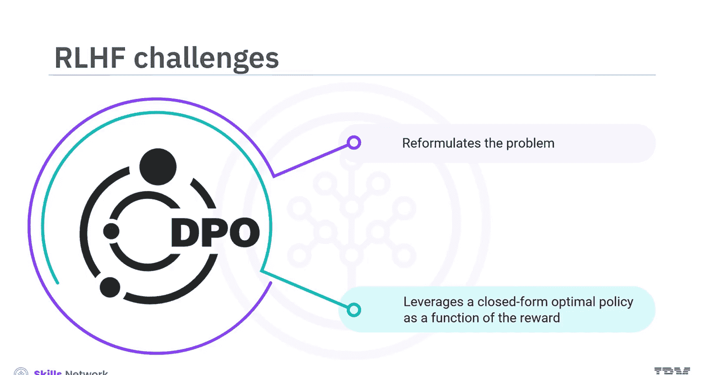
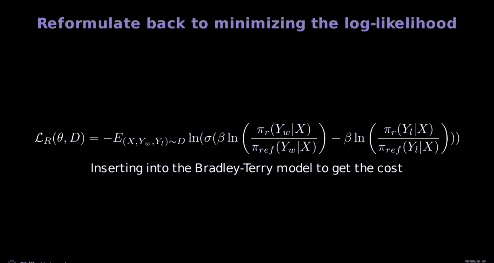
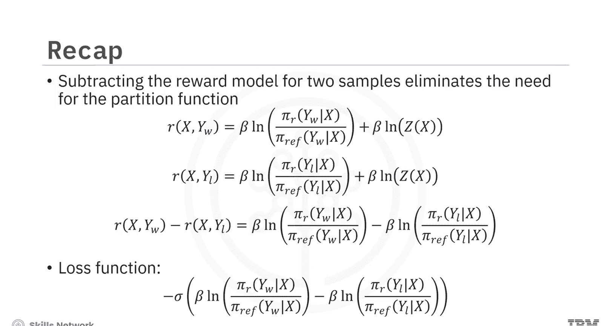

# IBM《生成式人工智能工程｜Falsk、生成式AI应用、数据分析、机器学习、Keras、架构和数据、NLP基础、transformer、微调、高级微调、RAG》 p155 14_从最优策略到DPO.zh_en -BV1NAq6Y9E7z_p155-

。Welcome to from Opti policy to DPO After watching this video you'll be able to train a generative causal LLM using direct preference optimization or DPO derive the DPO objective and find an expression to maximize it you'll also use the Bradley Terry model to understand loss and convert it to cost reinforceforcement learning from human feedback or RLHF is an effective technique to optimize LLMs but it poses challenges such as computational complexity。

 non-differentiability and instability DPO reformulates the problem to address these issues by leveraging a closed form Op policy as a function of the reward To begin with。

 let's use a scoring function data set to train the generative causal LLM using DPO Human evaluators assign scores to responses but assigning precise numerical scores as challenging The table shows queries and responses in the first two columns and scores in the third The first row is the query the second row as the higher scoring。

Response responseponse A in the third row is the lower scoring response response B ranking response is is easier than assigning scores The second table arranges responses by popularity without numerical scores simplifying evaluation for human evaluators your focus will be on pairwise ranking of two samples。

 but the method can extend to multiple samples for consistency。

 let's follow the same notion as the DPO literature W win represents response A and L lose represents response B using sampling notation where D is the data set and the tilde That is the Waavy line represents sampling values X Y W and Y L are drawn from the data set as shown in the table's example。

In the original Bradley Terry model， the loss is the log of the sigmoid functions's difference between the scores of the winning response and the losing response。

Using the sampling notation， transform this summation into an expected value over the data set D。

 Now let's focus on the argument within the log and sigmoid functions。

 which essentially represent the loss function。 The difference between the scores of the winning and losing responses to solve the given direct preference optimization or DPO problem you'll need to find the reward policy where pi or policy R is the optimal solution Here。

 X is the query Y is the response and z is the partition function。

 pi ref is the reference model R is the reward function and beta is the regularization parameter。😡。

The main issue is that you can't solve the partition function Z as it involves summing over every possible combination。

 However， with some clever yet simple math， you can eliminate the need to calculate the partition function and find a formulated cost function for your causal LLM。

 This allows you to directly train your model based on the Bradley Terry model foregoing the difficult training process of PPO。

Now you'll derive the DPO objective starting with the optimal solution。 First。

 isolate the exponential term and multiply both sides by the partition function。

 Then take the natural logarithm of both sides to linearize the exponential term and solve for the reward function。

 Now you have the reward model in terms of the optimal solution。

 plug in the values of the equations for the positive and the negative samples。

 representing the winning responses in blue when the losing responses in red。

 recall the loss function for the Bradley Terry model。

 Subtracting the reward model for two samples by substituting these expressions into the equation not only eliminates the need for the partition function。

 but the new loss function shown here is now the function of the LLM and its reference model。

 This eliminates the need for a separate reward function。

 giving an expression to maximize the DPO objective。

Let's simplify the expression step by step to better understand it。 First。

 start with the initial equation for the loss function for one sample output。 Next。

 set the beta to one， simplifyimpling the equation by removing the beta scaling factor to further simplify。

 replace the reference model with the constant C， which means you are randomly selecting any word in the vocabulary with equal probability。

 using the laws of logarithms。 You can combine the terms inside the logarithm。 Finally。

 set the argument of the logarithm to a single variable。

 U representing the ratio of probabilitybabilities of the positive samples and the negative sample。

 This final form shows the loss as a function of the logarithm of U。Now。

 let's plot the loss as a function of U。 starting with the initial equation。

 let's consider when the policy of the winning response。

 given the query is less than the policy of the losing response。

 If the policy of the winning response increases， but remains smaller than the losing response。

 this corresponds to the range from 0 to1。 Therefore， as U increases， the model gets better。

 Ploting the loss as a function of U， you can see that as the probability of the winning response increases。

 the loss decreases。When the policy of the winning response is larger than the policy of the losing response。

 U ranges from1 to infinity， representing a higher policy of preferred completions。

 as U increases indicating a higher positive policy， the loss continues to decrease。

 as shown in the corresponding section of the graph。In a similar manner to the Bradley Terry model。

 you can convert the loss to a cost。 Let's start with the initial equation Here。

 the loss function is expressed with the negative of the sigmoid of the logarithms of the ratios of the winning and losing policies scaled by beta Next。

 insert this expression into the Bradley Terry model。

 This reformulates the equation to minimize the log likelihood transforming the loss into a cost to implement this in ptorrch。

 you can write a loss function and calculate the loss。

 or you can use hugging faces built in DpoO trainer。 Let's recap in this video。

 you learned that DpoO leverages a closed form optimal policy as a function of the reward to reformulate the problem。

 to solve the given DpoO problem。 You'll need to find the reward policy。

 which is given by the following expression。 Subtracting the reward model for two samples Elis the need for the partition function。

 and the new loss function becomes a function of the LLM and its reference model。

 The loss function is expressed with the negative of the。

Of the logarithms of the ratios of the winning and losing policies scaled by beta。

