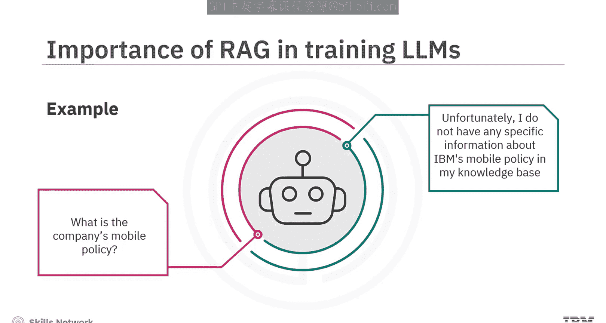
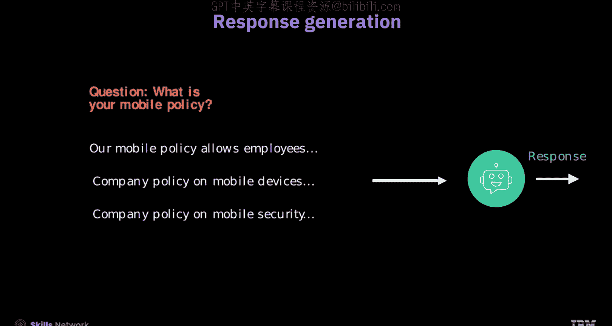
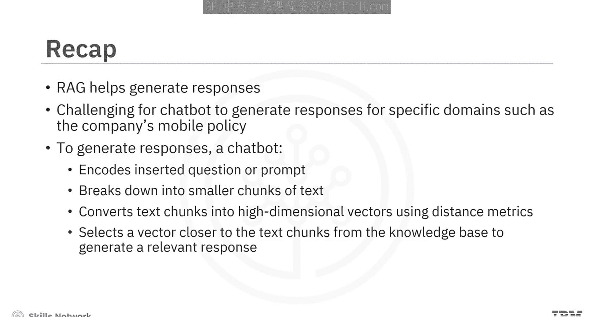

# IBM《生成式人工智能工程｜Falsk、生成式AI应用、数据分析、机器学习、Keras、架构和数据、NLP基础、transformer、微调、高级微调、RAG》 p158 1_RAG.zh_en -BV1NAq6Y9E7z_p158-

Welcome to Retrieval Augmented Generation or RaG。After watching this video。

 you'll be able to explain the Ra process。 You'll also be able to describe various steps in the Rag process to receive efficient responses to questions or prompts you enter。

 Let's first understand what RaG is。 Rag is an AI framework that helps optimize the output of large language models or LLMs。

😊，RAG uses the capabilities of LLMs and specific domains or the internal database of an organization without retraining the model。

Pre traineded LLMs may face challenges with specific domain knowledge that they are not trained in。

While they perform well on general tasks， they may provide inaccurate responses to specialized queries。

 therefore， adding external relevant knowledge sources helps ensure more accurate responses。

Consider an example of a company's mobile policy if you ask a chatbot about the company's mobile policy。

 the chatbot will provide answers from its knowledge base because the company's policy contains confidential information。

Therefore， to generate domain specific responses， the RAG process is helpful。

Let's explore how ragG helps in generating responses。

Based on the inserted content or prompt， RAG combines retrieved information and generates natural language to create responses。

 RaG uses various content from its knowledge base， including data from the trained chatbot。

 company policies unavailable on the internet， and large documents。

RAG consists of two main components， the retriever， the core of RAG， and the generator。

 which functions as a chatbot。In the RAG process， the first step is text embedding。

The inserted prompt or question is converted into a high dimensional vector using a question encoder。

Knowledgebased documents are separately converted into highdimenal vectors and embedded using a content encoder。

 the next step is retrieval， where the system matches the similar vectors in the inserted prompt or content with the vectors in the knowledge base to retrieve information。

 however， in the augmented query creation， the system creates an augmented query by combining the text associated with the retrieve vectors and the original prompt or content。

😡，Lastly， in the model generation step， the language model uses the created augmented query to generate a response using the content from the knowledge base。

 the encoders convert the prompt and knowledge base into embeddings that represent the information。

Then the context and question embeddings can be generated from the same encoder。

This approach is easy to understand as it involves converting text to embeddings。

 even though it may not work as effectively。Now let's understand prompt encoding。

The inserted prompts use token embedding and vector averaging to encode the prompts and convert them into a vector representation。

In the token embedding， each token such as a word or subword。

 inserted in the prompt uses a pre-trained token embedding model。

 such as bidirectional encoder representations from a transformer or BRT。

 and a generative pre-train transformer or GPT to transform into a high dimensional vector。

Once all the tokens are embedded， the system takes the average of all token vectors to create a single vector representation for the prompt This means that the averaged vector representation captures the meaning of the inserted prompt in a concise manner。

 Next， let's understand how to convert the contextual data from the knowledge base into vectors。

Consider the company's mobile policy displayed on the screen。

 you can see that the company's mobile policy is large and inserting it into the chatbot may be challenging。

Therefore， the original policy documents should be broken down into smaller。

 manageable chunks of text to achieve targeted and efficient retrieval。Next。

 embed each text chunk into vectors and index them into a knowledge base。

Now encode the text chunks for vector representations by transforming them into a high dimensional vector using a pretrained token embedding model。

Once all the tokens are embedded， the system averages each token vector to create a single vector representation for the entire text chunk。

Combining text chunks and embedded vectors represents the knowledge base。

 which captures the information for each chunk， insert these embeddings into a vector database to represent the knowledge base with the chunk ID that serves as the key The distance operations on these embeddings use chunk ID to find relevant information The next step in the RA process is to search for relevant context for the inserted prompt from the knowledge base。

😡，To do so， the system compares the prompt vector with the vectors representing the text chunks in the knowledge base。

 Let's ask a question about a company's mobile policy。

 The knowledge base and question are converted into vector representations。 Further。

 the system calculates the distance between the prompt vector and each context vector using distance metric to identify the similarities between the prompt vector and the context vector。

 Next， it selects3 to5 context vectors close to the prompt vector to present more relevant information to augment the inserted input using distance metrics Let's take query embeddings Q and embeddings from the knowledge base as C1 and C2。

The selected distance metrics affect the retrieval results if you take a dot product considering vector's directions and magnitude by prioritizing overall alignment。

 you will find knowledge based embedding C2 slightly closer to the context vector。

Now consider the cosine direction， which focuses on the direction to measure the angular difference。

 therefore the knowledge based embedding C2 is a good option。It means that for the vector magnitude。

 the dot product is preferable and for the direction vector， the cosine distance is preferable。

To select the most relevant top K context where K is the hyperparameter， choose the chunk IDs 6，2。

 and0 using the company's mobile policy with seven chunks。

The real dataset uses the library of chunks to speed up the process this means you should select the text chunk IDs similar to the query and related to the company's mobile or general company policies。

 finally， the selected text from the knowledge base and the query are inserted into the chatbot to generate an appropriate response。

This means that with the help of RAG， the chatbot can provide an efficient response in this video。

 you learn to leverage RaG to generate a response when the model is not pretrained。

The chat bot generates responses based on the questions， however。

 it is challenging to generate responses for specific domains such as the company's mobile policy to generate a response for the company's mobile policy。

 the inserted prompts are encoded using token embedding and vector averaging where the prompt is broken down into smaller and possible chunks of text these chunks are embedded and converted into high dimensional vectors to search for the relevant context using distance metrics The vector closest to the text chunk is selected from the knowledge base to generate an appropriate response。

