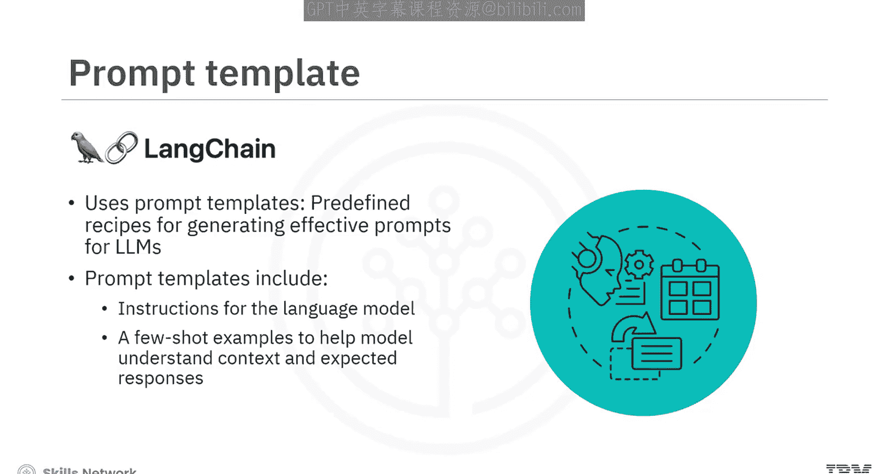
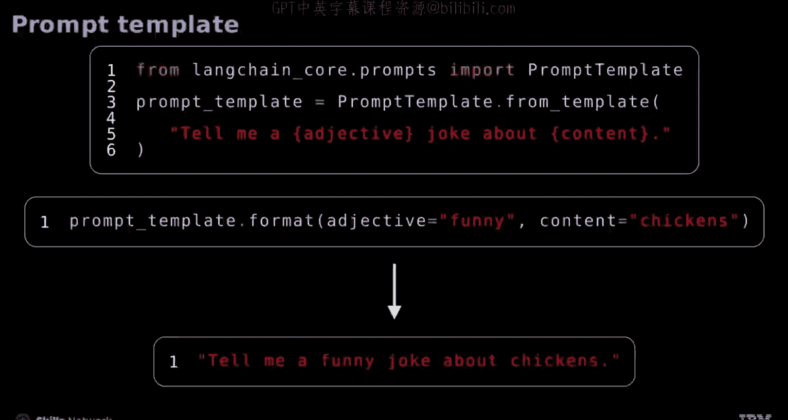
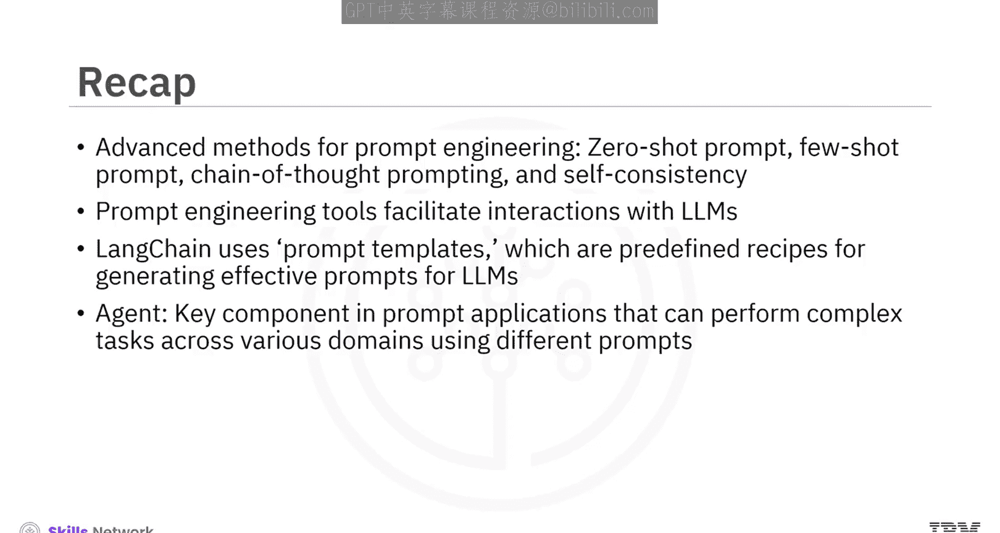

# IBM《生成式人工智能工程｜Falsk、生成式AI应用、数据分析、机器学习、Keras、架构和数据、NLP基础、transformer、微调、高级微调、RAG》 p162 5_提示工程的高级方法.zh_en -BV1NAq6Y9E7z_p162-

Welcome to Adv methods of prompt engineering After watching this video you'll be able to apply advanced methods of prompt engineering to enhance prompt design you will also be able to discuss the effective implementation of the tools and applications of prompt engineering to realor scenarios In this example。

 you will learn about a zero shot prompt This type of prompt instructs an LLM to perform a task without any prior specific training or examples。

Here， the L L M is asked to classify a statement as true or false。

 The Eiffel Tower is located in Berlin。 Then the motto gives the response。

 This task requires the LLM to understand the context and information without any previous tuning for the specific query。

 A one shot prompt gives the LLM a single example to help it perform a similar task。 For example。

 how is the weather today。 The LL M shows how to translate a sentence from English to French。

 This serves as a template。 Then it's given a new sentence。

 Where is the nearest supermarket and is expected to translate it into French using the learned format。

 The AI uses the initial example to correctly perform the new translation。

 Another method is few shot prompting。 where the AI learns from a small set of examples before tackling a similar task。

 This helps the AI generalized from a few instances to new data。 For example。

 the LLM is shown three statements， Each labeled with an emotion。

Ex teach the LLM to classify emotions based on context。 Then it classifies a new statement。

 That movie was so scary。 I had to cover my eyes。 The LLM will output the emotion chain of thought or CO prompting is a technique used to guide LLM through complex reasoning step by step。

 This method is highly effective for problems requiring multiple intermediate steps or reasoning that mimics human thought processes The example shows how CO prompting is applied to an arithmetic problem The prompt asks the model to consider the problem of a store that initially had 22 apples sold 15 and then received a new delivery of8 apples the task is to determine how many apples there are now you can view the model output for the CO prompt query by breaking down the calculation into clear sequential steps the model arrives at the correct answer and provides a transparent explanation Self-consist as a technique for enhancing the reliability and accuracy of outputs It involves。

Inating multiple independent answers to the same question and then evaluating these to determine the most consistent result。

 In this example， you see a problem involving age calculation。 The query is， when I was6。

 my sister was half my age。 Now I am 70。 What age is my sister。

 The model is prompted to produce three independent calculations and explanations to ensure accuracy。

 You can view the model outputs with three different ways of calculation and determine a consistent answer。

 This approach demonstrates how selfcon can verify the reliability of the responses from LLms by cross verifying multiple paths to the same answer。

 Next， let's explore the tools and applications used in prompt engineering。

Certain tools can facilitate interactions with LLMs such as open AI's playground L chain。

 hugging faces model hub and IBM's AI classroom。 They allow you to develop experiment with evaluate and deploy prompt。

 They enable real time tweaking and testing a prompt。😊，immediatemmediate effect on outputs Moreover。

 they provide access to various pretrain models suitable for different tasks and languages。

 They also facilitate the sharing and collaborative editing a prompts among teams or communities Finally。

 they offer tools to track changes， analyze results and optimize prompt based on performance metrics Let's learn more about L chain。

 a tool for prompt engineering Langcha uses prompt templates。

 predefined recipes for generating effective prompt for LLms These templates include instructions for the language model a few shot examples to help the model understand context and expected responses and a specific question directed at the language model Here is a code snippet to apply a prompt template from L chain First import the prompt template from L chain core prompts then define a joke prompt template tell me a joke about this template has placeholders for an adjective and the content to use the template call prompt template format。

Specific values funny for the adjective and chickens for the content。 This generates the prompt。

 Tell me a funny joke about chickens。This approach simplifies prompt creation。

 making prompt consistent and adaptable to different contexts in prompt applications。

 an agent is a crucial concept， powered by LLMs and integrated tools like Langchain。

 agents perform complex tasks across various domains using different prompts。

Transformative applications include Q&A agents with sources。

 content agents for creation and summarization， analytic agents for data analysis and business intelligence and multilingual agents for seamless context toware translation and communication Let's recap in this video you learned that Adv methods for prompt engineering include zero shot prompt。

 few shot prompt chain of thought prompting and self consistency To can facilitate interactions with LLMs Lang chain uses prompt templates to generate effective prompts in prompt applications and agent can perform complex tasks across domains using different prompts。

