# IBM《生成式人工智能工程｜Falsk、生成式AI应用、数据分析、机器学习、Keras、架构和数据、NLP基础、transformer、微调、高级微调、RAG》 p165 8_构建应用的LangChain链和代理.zh_en -BV1NAq6Y9E7z_p165-

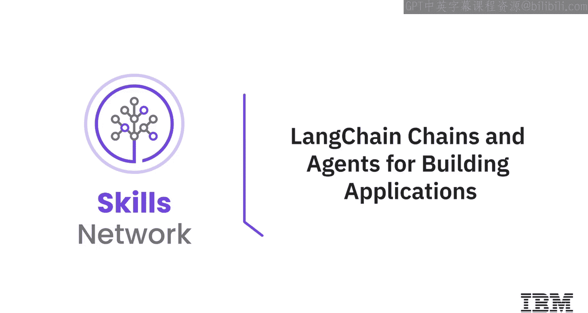

Welcome to Langchain Chains and Age for Building applications。

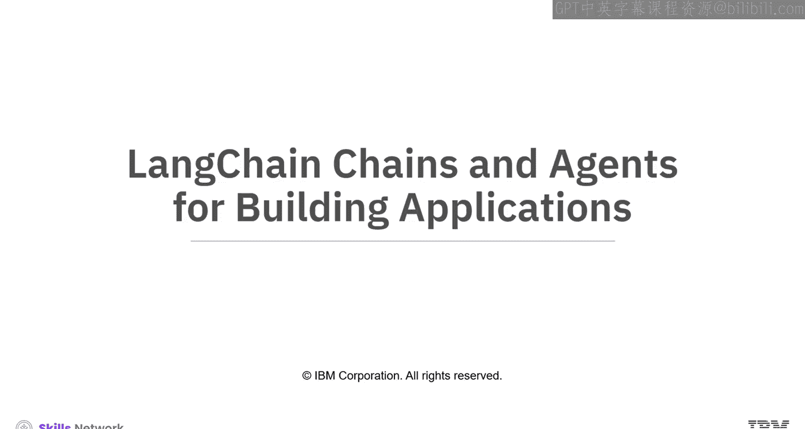

After watching this video， you'll be able to describe chains in Langcha for generating responses and how Langchain stores memory You'll also be able to define agents used Langcha Langcha is a platform embedded with APIs to develop applications。

 empowering them to infuse language processing capabilities。

 Therefore developers find Lang chain suitable for building applications Langchain uses certain tools including documents。

 chains and agents for building applications。

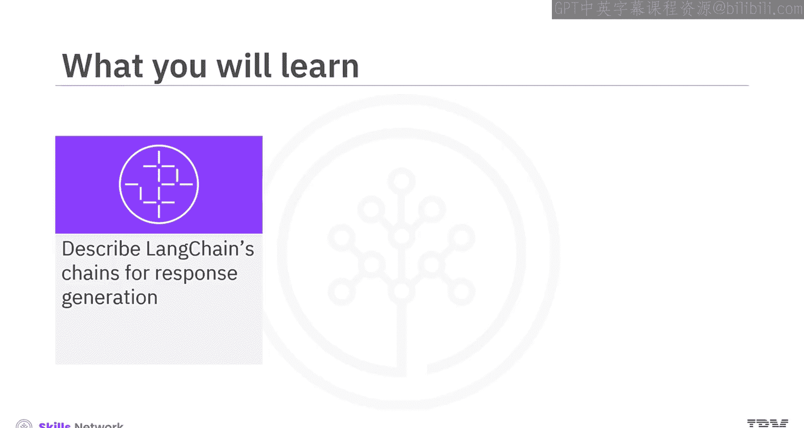

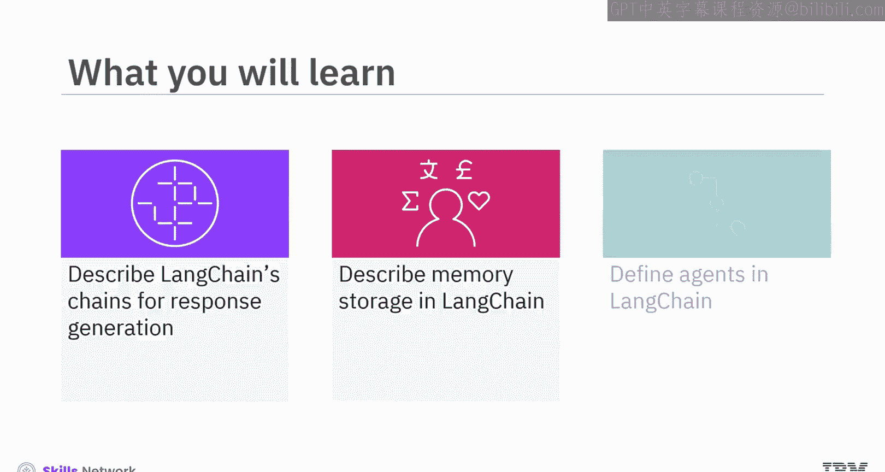

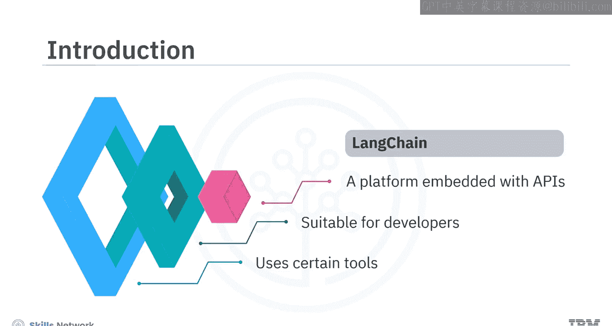

Let's explore chains for building applications In L chain， chains are a sequence of calls。

 a sequential chain consists of basic steps where each step takes one input to generate one output to create one seamless flow of information The output from step1 becomes the input for step2。

Let's look at the creation of a sequential chain of three individual chains。

 The aim of this chain is to identify the recipe and the estimated cooking time for the famous dish available in the inserted location。

The users leverage chain1 for selecting the geographic region to get the famous dish in that location。

 chain 2 for providing the recipe and chain3 for estimating the cooking time。

 Cha 1 in the sequence uses a user's prompt as input for a specific dish based on the user specified location。

 for example， China。Therefore， the output for chain1 should be a famous dish in China Peing duck。

 Let's see how to use the code to create this chain。 First， define a template string for the prompt。

 ask for a specific dish from a specified location。

 createate a prompt template object using the defined template。

 specifying the input variable as location， then create an LLM chain object named location chain using LLM based language model。

 such as mixture LLM。 It means that before running this code。

 assume that chat model object is available。Therefore， the output will be stored under the key meal。

 let's look at chain2。

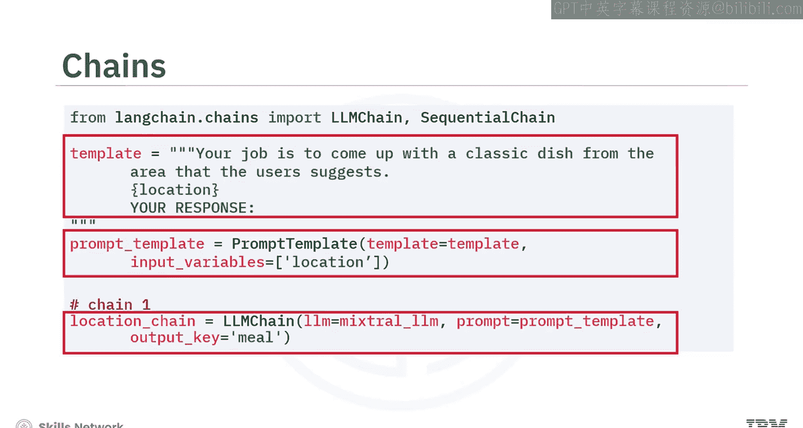

In the second chain of our sequential setup， use the output from the first chain that is the name of the dish is the input。

The output from this chain will be the recipe itself。Let's look at the code first。

 define the template before asking for a simple recipe for a given meal。 Next。

 create a prompt template with meal as the input variable。Finally。

 create an LLM chain named D chain using Miural LLM and Pro template with the output key recipe。

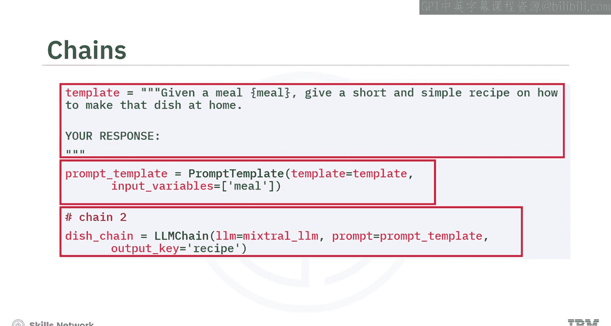

Next is chain3 take the recipe obtained from the second chain as the input。

This chain is designed to estimate the cooking time for the meal based on the recipe Like chain2。

 define a template to estimate the cooking time for a given recipe Next。

 create a prompts template with recipe as the input variable。

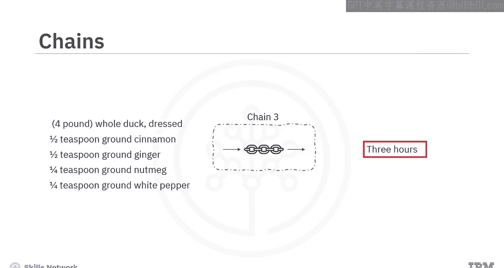

Lastly， create an LLM chain named recipe chain using Mial LLM and Pro template with the output key time Now using three chains。

 the overall setup is a sequential chain that wraps all the individual chains together。

 creating a unified process。

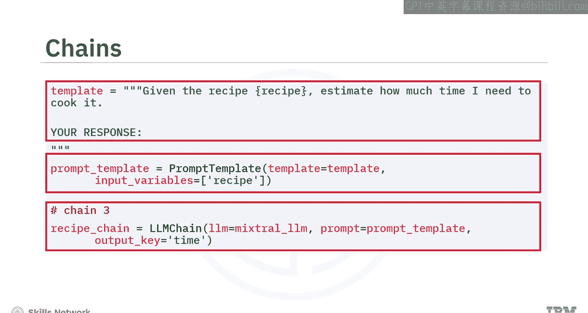

By invoking the query through this combined chain， you can trace the flow of information from start to end。

You can set the verbose option to truee to view the overall output This provides a clear and detailed view of how each input is transformed through chain into the final output。

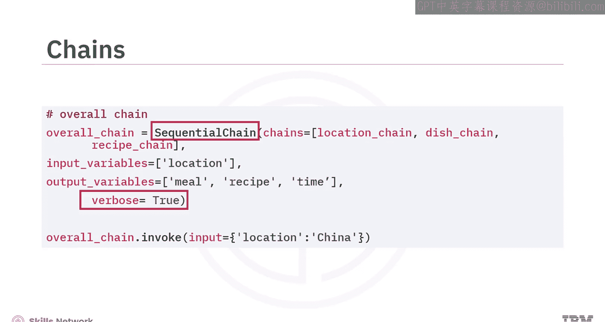

Here is an example of the output Do you know how memory is stored in the LLN applications in L chain。

 memory storage is important for reading and writing historical data Each chain relies on specific input such as user and memory。

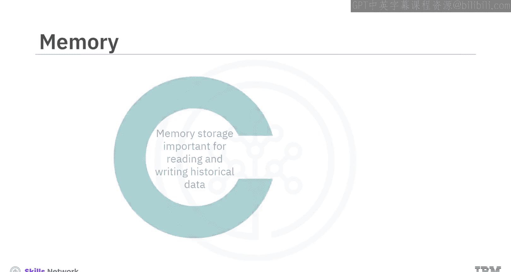

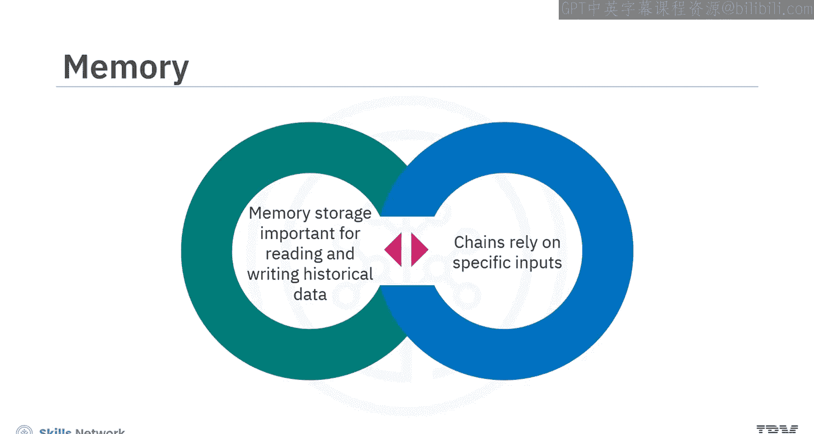

Chain reads from memory to enhance user inputs before executing its core logic and writes the current runs' inputs and outputs back to the memory after execution。

This ensures continuity and context preservation across interactions。

 The chat message history class and L chain is designed to manage and store conversation histories effectively。

 including human messages and AI messages。 This allows adding messages from the AI and users to the history In this example。

 call a chat message history class and add AI message high into the memory。

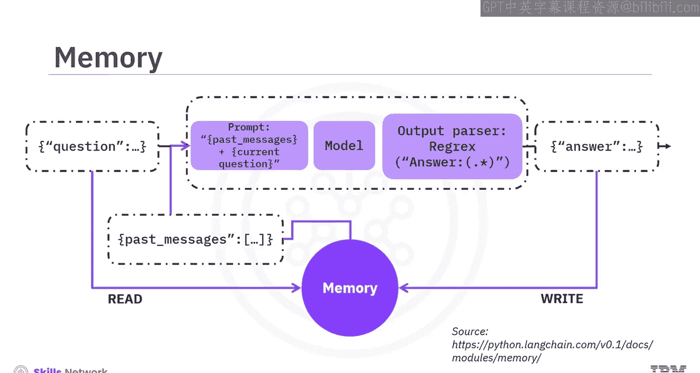

The memory will append this AI message as input。Now， add the user's message。

 what is the capital of France and the memory will append this as human message input。

 you would receive responses based on the stored memory Now let's understand agents in Lang chain agentss in Lang chainin are dynamic systems where a language model determines and sequences actions such as predefined chains。

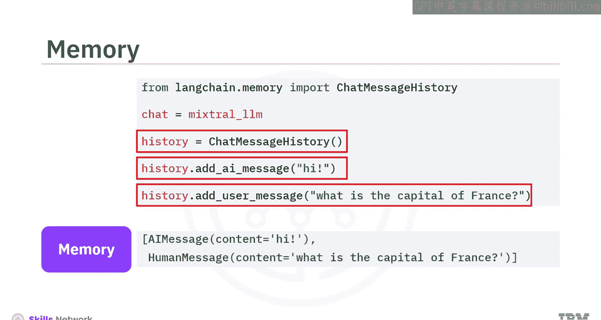

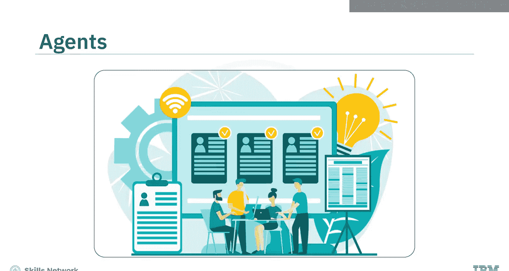

The model generates text outputs to guide actions but does not execute them directly。 However。

 agents integrate with tools such as search engines， databases and websites to fulfill user requests。

 For example， if a user asks for the population of Italy。

 the agent uses the language model to find options。

 query a database for details and return a curated list。

 This shows the agent's ability to autonomously leverage LLM reasoning with external tools。

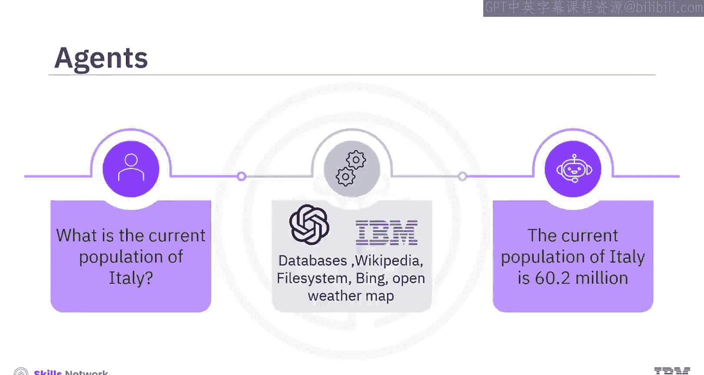

In this example， let's create a panda's data frame agent using Laangchain。😡。

This agent allows users to query and visualize data with natural language。To set it up。

 instantiate the Create pannda's data frame agent class。In this class。

 pass the LLM chat model in the data frame， next， set the verbos to true to see how the LLM thinks。

Finally， use the Invoke code to execute the query how many rows in the data frame。

The LLM transforms queries into Python code， executed in the background。

 enabling precise answers to the number of rows of the data frame。For example。

The response shows there are 139 rows in the data frame。Let's recap in this video。

 you learned that Langchain is a platform that embeds APIs for developing applications。😡。

Chains is the sequence of calls in chains， the output from one step becomes the input for the next step。

In Lang chain， chains first define the template string for the prompt。

 then creates a prompt template using the defined template and creates an LLM chain object name。

In Lang chain， memory storage is important for reading and writing historical data。

Agents in Laang chain are dynamic systems where a language model determines and sequences actions such as predefined chains Ages integrate with tools such as search engines。

 databases and websites to fulfill user requests。

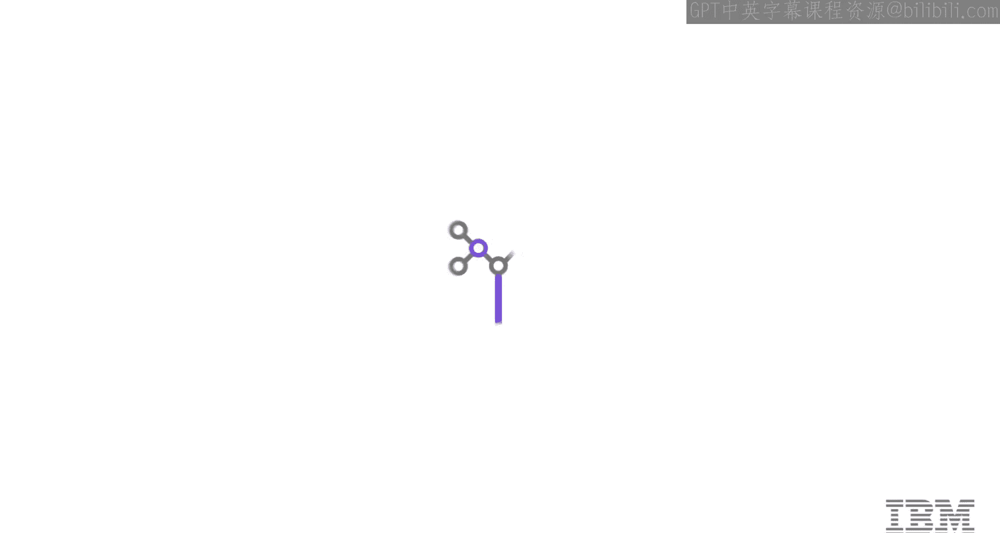