# IBM《生成式人工智能工程｜Falsk、生成式AI应用、数据分析、机器学习、Keras、架构和数据、NLP基础、transformer、微调、高级微调、RAG》 p167 1_从不同来源加载文档.zh_en -BV1NAq6Y9E7z_p167-

Welcome to load your document from different sources After watching this video。

 you'll be able to describe how Langchain uses document loaders to simplify data integration by allowing you to import data from various sources efficiently you will also be able to explain how to load different types of files including text。

 PDF， markdown， JSON， CSV and DocX Finally， you will be able to discuss how to load content directly from websites and handle unstructured files Laangchain uses document loaders to gather information from several sources such as websites。

 files and databases and then prepares it for further use。

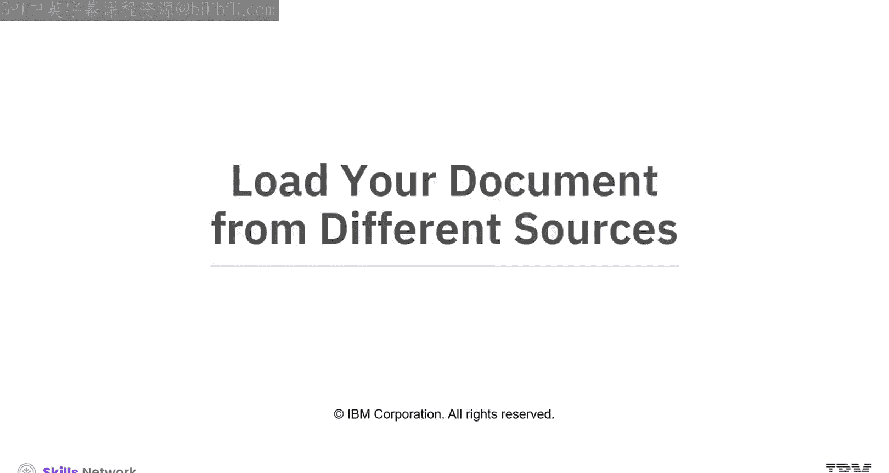

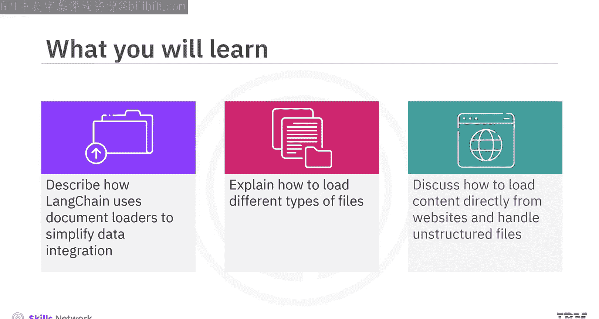

Document loaders act as connectors， pulling in data and converting it into a format L chain can work with Collecting the necessary information is the first step in creating a retrieval augmented generation or RA application once you have the data。

 you can start processing it to find relevant answers based on user queries。

This process helps your application access and use a wide range of information efficiently If you're working with plain text files。

 you can utilize the text loader class and L chain to load them efficiently L chain features a load method explicitly designed for loading data as documents from configured sources the code here demonstrates how to use this method to load text data After loading each document object which includes metadata and page content attributes is stored in a list here is an example where the content from a text file is printed to illustrate how document objects are structured and access for PDF files。

 the pi PDF loader class and L chain is your goto tool This class can load a PDF into an array of document objects with each document capturing the content of a page along with metadata and page number you can see here that the P file of an academic paper has been loaded This is the content of the first page you can also use the piu P loader the fastest PDF parsing tool and lane chain。

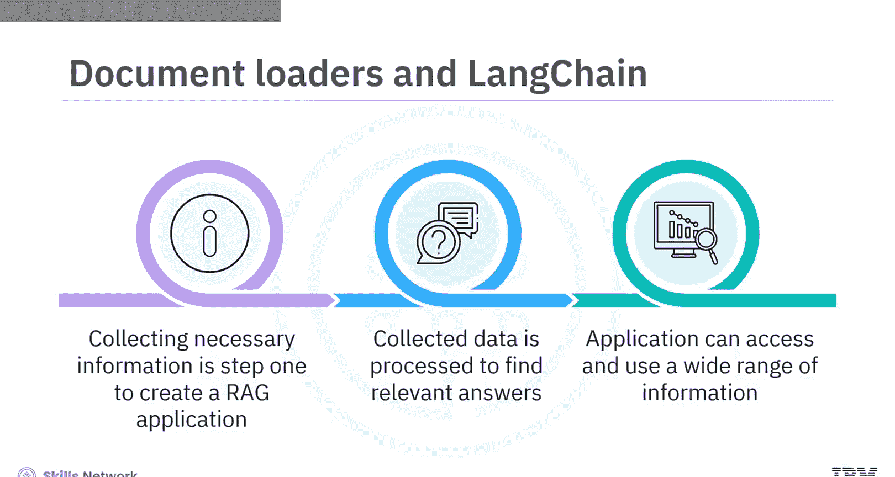

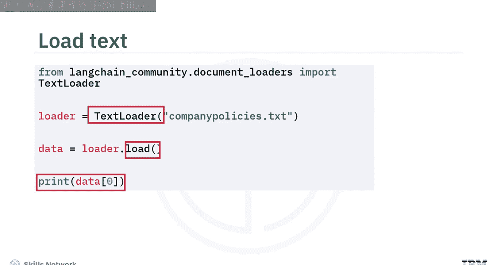

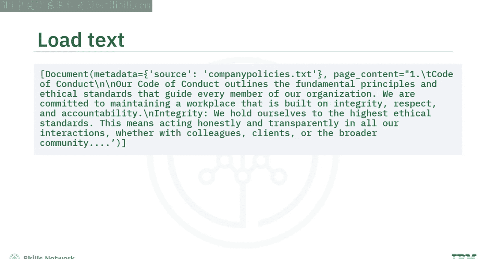

This loader processes each page quickly and provides detailed metadata about the PDF and its pages。

 returning one document object per page。 Let's revisit the paper loaded in the previous slide using this loader。

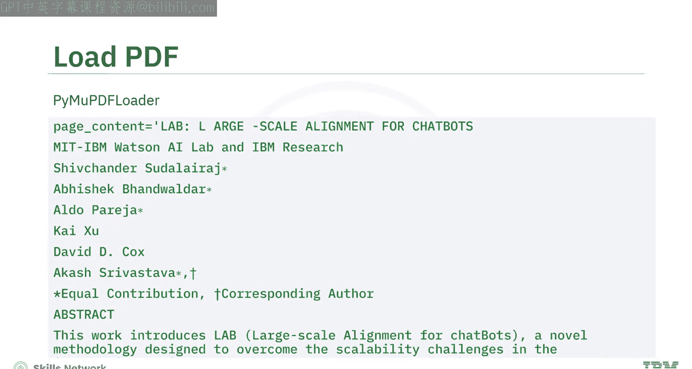

The critical difference between PU PDF loader and P PDF loader is that it includes more comprehensive metadata。

If you are working with a markdown file， Lang chainin offers unstructured markdown loader class to load it。

Note that the content can include a lot of line break characters。

When working with JSON files consider their unique key value pair structures， let's see an example。

 let's use this code to load and display a JSON file。😡。

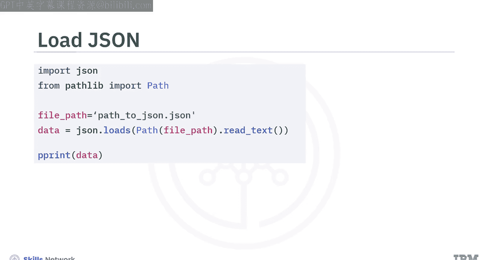

Here is the file。 It is structured with various fields。

 and you specifically want to extract the content field from messages for further processing in L chain。

 How will you do it， Langcha offers the JSsonN loader class specifically designed to load JSsonN files。

 This loader utilizes a JQ schema to parse JsonN files according to specific needs。 For example。

 if you want to extract values from the content field under the message key in your JSsonN data。

 you should define an appropriate JQ schema for content。 One set。

 the loader will extract these values and load them into an array of document objects where each document represents one piece of message content。

 When dealing with data in CV files， the CV loader and Lang chain is the ideal tool。

 This loader is designed to handle CSV files by converting each row of data into a separate document object。

 Here is an example。

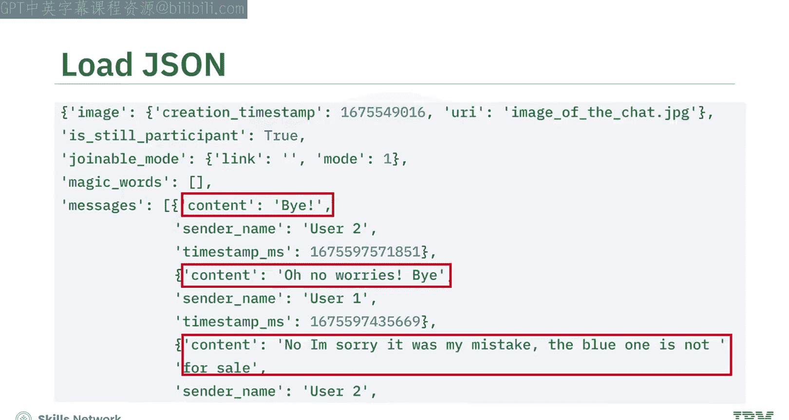

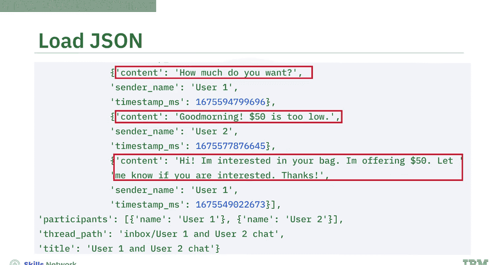

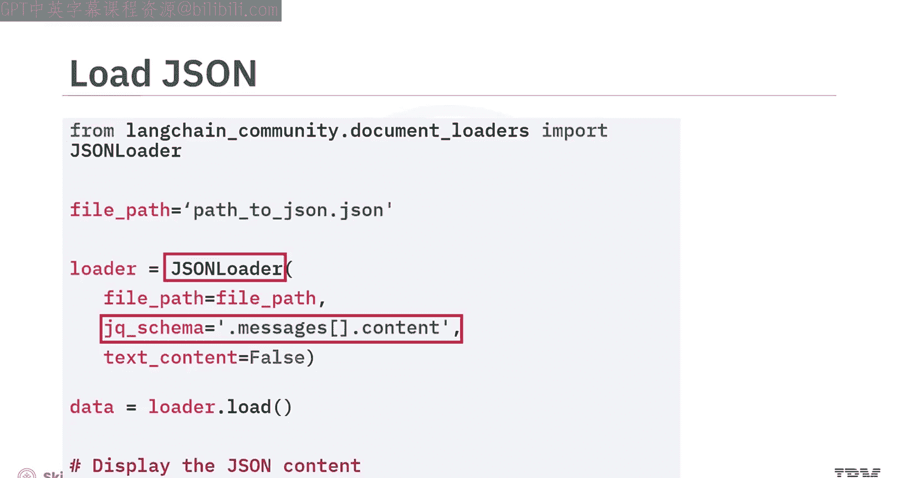

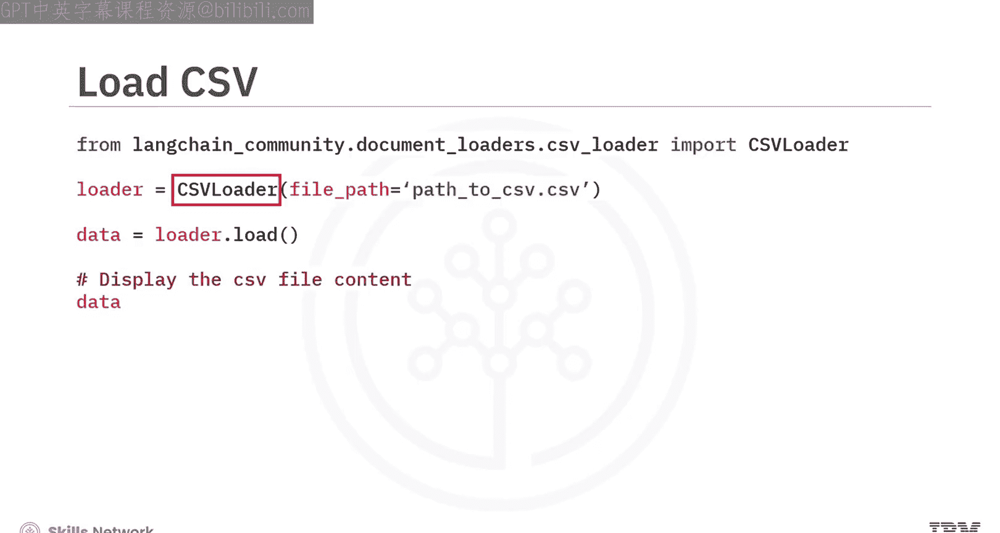

If you want to load the data all in one document object， you can use unstructured CSV loader。

 unlike CSV loader， which treats each row as a separate document with headers defining the data。

 unstructured CSV loader's entire CSV file is considered a single unstructured table element。

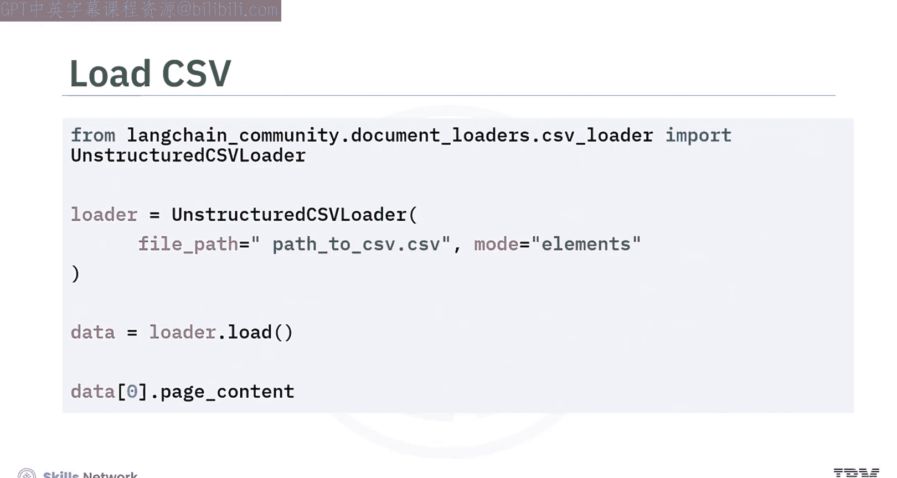

This is useful when analyzing the data as a table rather than individual entries。

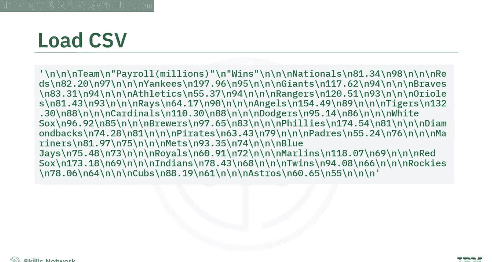

If you need to load and parse an online webage， the standard method is to use a Python package called Beautful soup。

😡，For example， here is a website you want to load。 Here is the web URL and a screenshot of a part of the web。

😡，You can use the code shown here to load and parse it using beautiful soup。

 Let's look at its performance。 Here is a screenshot of part of the loading response。

 You can see that beautiful soup loads the Web content and includes several H tags and external links。

 which are unnecessary and even a burden if you want to load the web's text content。😊。

Beautiful soup has its limitations。 Is there a better method， Yes。

 the web based loader and L chain is designed to efficiently extract all text from HTML web pages and convert it into a document format suitable for downstream processing。

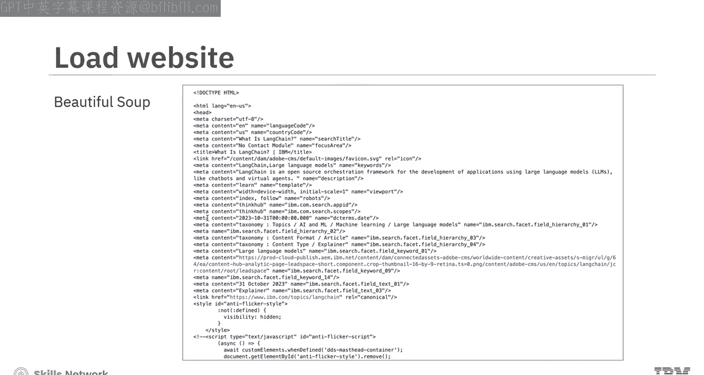

Let's load the same URL using webb loader again here Once loaded observed at the loader only captures all text from the webp page。

 avoiding HTML tags and links， and just including line break characters What do you do when multiple websites need to load You can create a list of these websites and pass it on to the web based loader The loader will load all the content of each website into a document object and format them into an array Langchain also provides doc X to text loader to help load a word dot X file to document content similar to text loader Here is an example of how to load a word document。

😡。

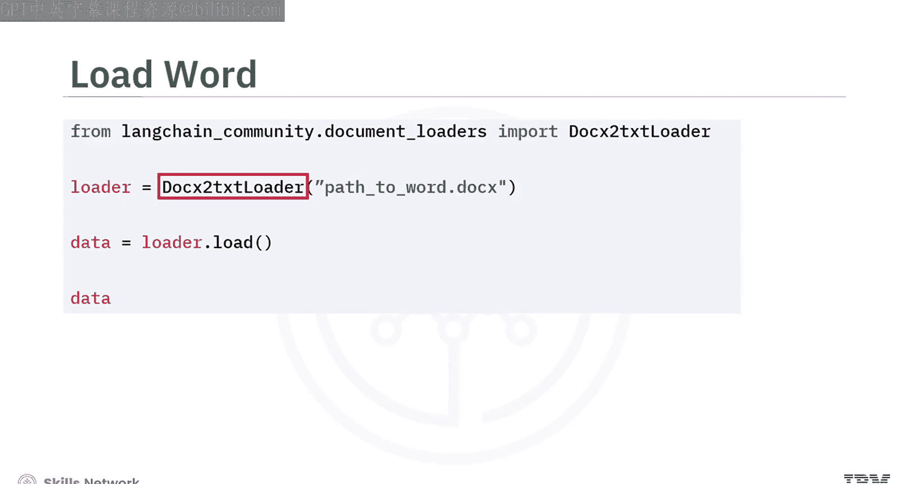

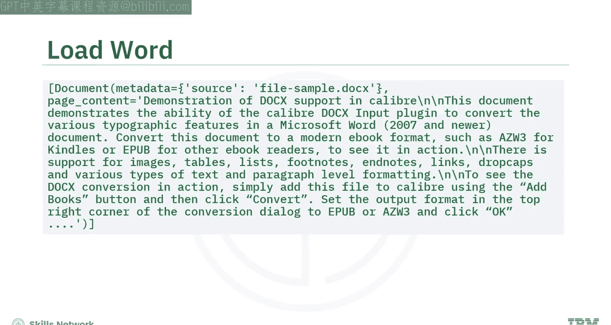

For projects requiring flexibility due to unknown or varied file formats。

 the unstructured file loader and Lang chain works perfectly。

This loader is designed for general purpose use and supports many file types， including text files。

 PowerPoint presentations， HTML pages， PDFs， images， and more。😡，For instance。

 if you have a markdown file and a text file to load， you can use just this one loader。😡。

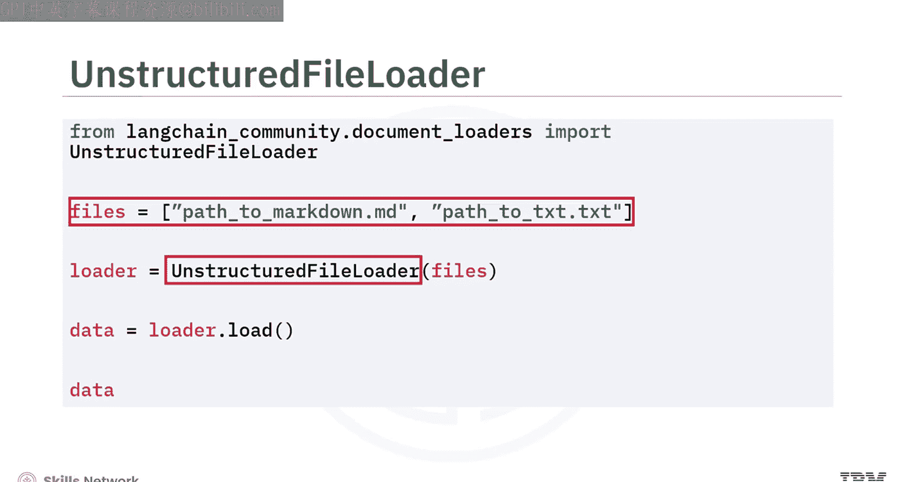

The unstructured file loader efficiently converts the content of these diverse files into a single document object。

In this video， you learned that Langchain uses document loaders that are connectors that gather data and convert it into a compatible format。

😡，You can use the text loader class in Lang chain to load plain text files。😡。

The P PDF loader class in Langchain or the P Mu PDF loader is ideal for PDF files for a markdown file。

 Lang chainin offers unstructured markdown loader。Langchain offers the JSON loader class。

 which is designed to load JSON files the CSV loader and Langcha is the ideal tool for dealing with data and CSV files。

To load and parse an online web page， use the Python package Beautiful soup or the webbase loader and Langcha to load multiple websites use webbase loader Finally。

 you learned that the unstructured file loader in Lang chain is an ideal solution for projects with unknown or varied file formats。

😡。

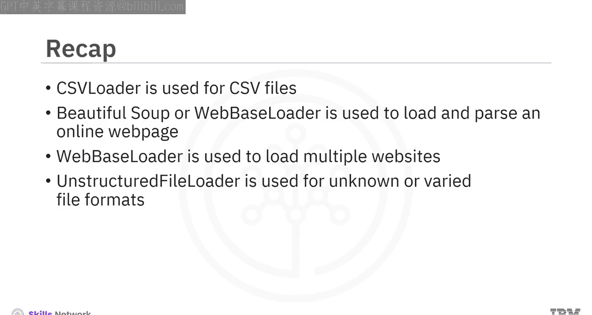