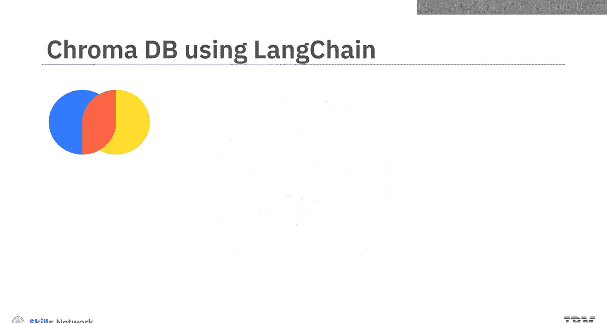
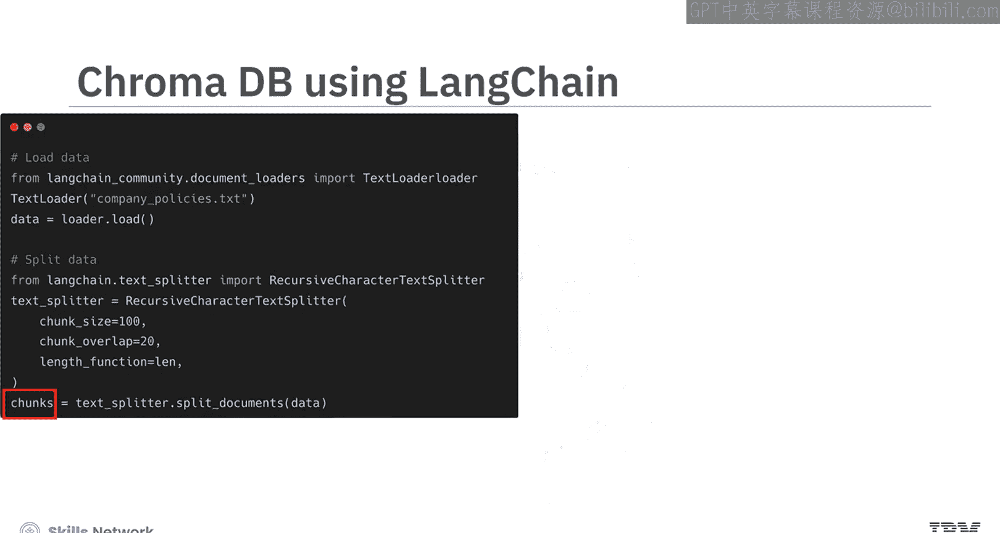
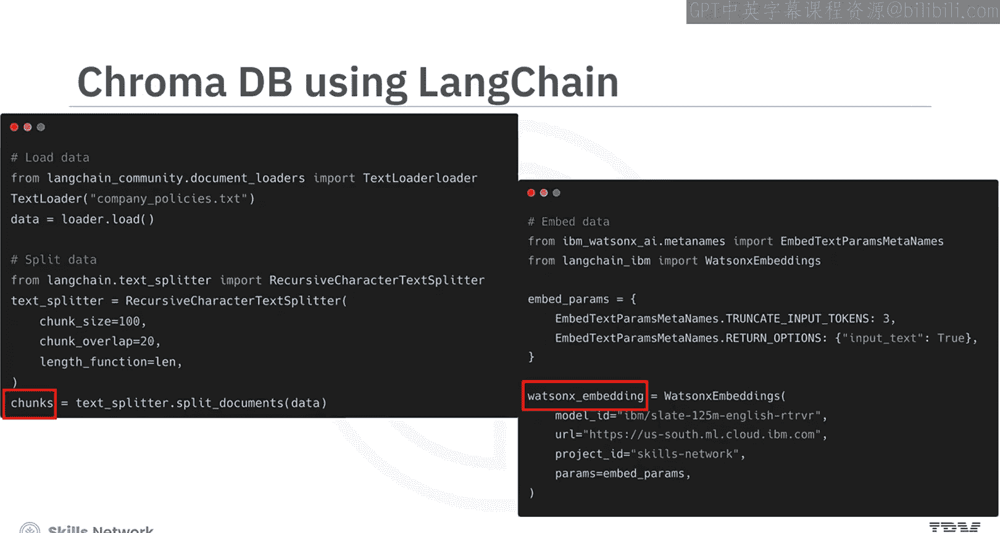
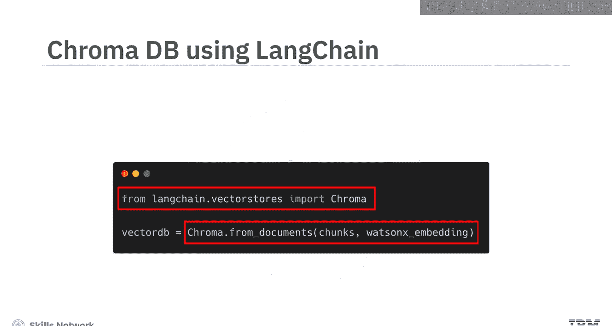
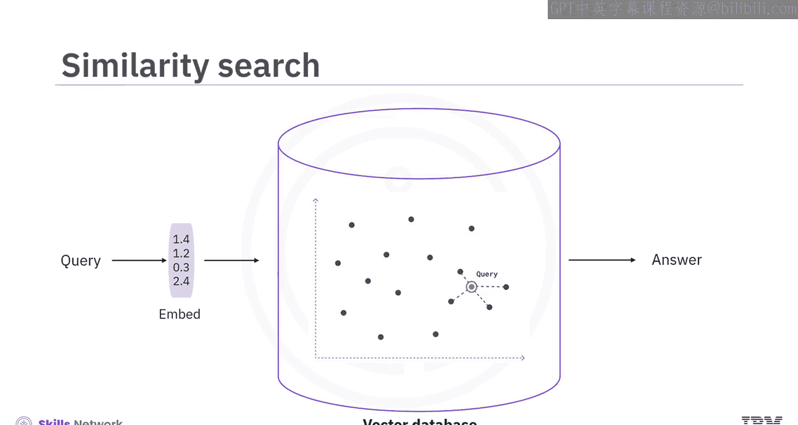
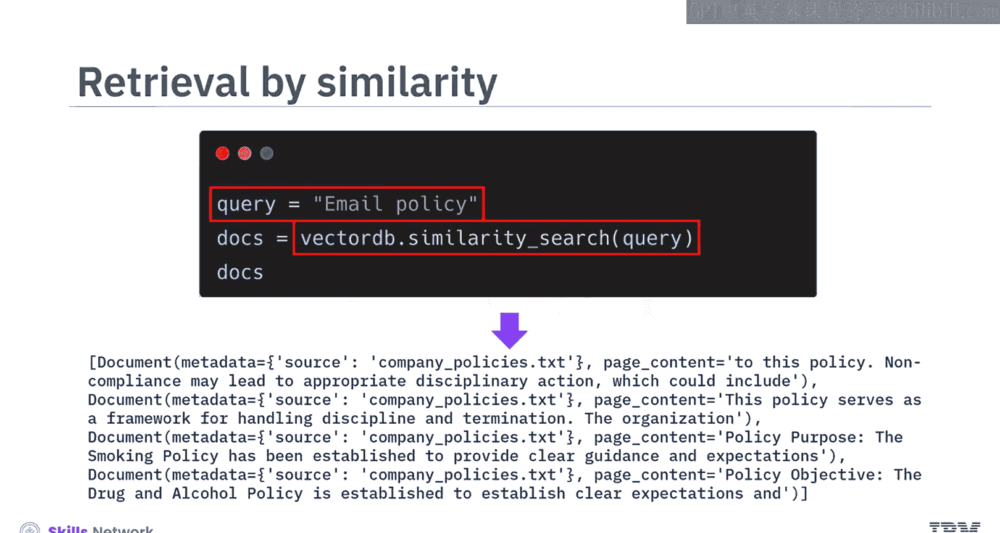
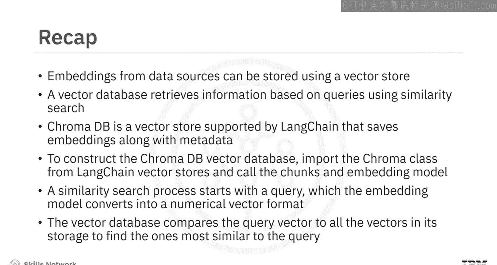

# IBM《生成式人工智能工程｜Falsk、生成式AI应用、数据分析、机器学习、Keras、架构和数据、NLP基础、transformer、微调、高级微调、RAG》 p169 3_向量数据库简介：存储嵌入.zh_en -BV1NAq6Y9E7z_p169-

Welcome to Introuction to Ve Databas for Storing embeddings。After watching this video。

 you'll be able to describe how to store embeddings using a vector store。

You will also be able to explain how Chroma DB， a vector database supported by Lngcha can be used to save embeddings Finally。

 you'll be able to discuss how to conduct a similarity search within a vector database to retrieve the most relevant content that matches the query。

Once you know how to load， split and embed data from various sources to prepare it for downstream tasks。

 and have the embeddings of your data sources， the next crucial step is storing them。

You can achieve this using a vector store specifically designed to store embeddings。

A vector database does more than just store data； it also retrieves the required information based on queries using a similarity search。

Here's how it works。 The query is first converted into embeddings and then input into the vector database。

 the database performs similarity calculations to search for and retrieve the most relevant content that matches the query。

Vectctor databases are essential because embeddings convert data。

 often unstructured data like text into numerical vector formats within a highdial space Trad databases like SQL are not optimized for storing and querying extensive vectoring data and often struggle with effectively storing and searching for these vector representations Ve stores on the other hand。

 can index and quickly search for similar vectors using sophisticated similarity algorithms。

This capability allows applications to find related vectors based on a target vector query enabling efficient and effective information retrieval。

Let's explore a vector database supported by Langchain called ChroaDB ChromaDB is an open source vector store for storing and retrieving vector embeddings It primary use is to save embeddings and metadata which large language models can utilize later Additionally it's a powerful tool for semantic search engines over text data Let's take a look at how to implement ChromaDb using code before constructing a vector database assume you have loaded and split your target data into chunks Additionally it would be the best to have an embedding model object ready In this example an embedding model has been constructed using Watson X Coning the ChromaDb vector database as straightforward First you import the Chroma class from Langchain vector stores Then using this Chrome class you called the chunks and embedding model ChromaDb will handle the rest automatically making the process seamless and efficient。

Here you can see a similarity search within a vector database。 The process starts with a query。

 which could be any question text you're interested in。

 The embedding model converts this query into a numerical vector format。

 transforming it to a high dimensional vector that the vector database can process。

The vector database contains numerous pre stored vectors related to the source data。

When the embedded query enters the database， the system performs similarity calculations。

 These similarity calculations can be based on Euclidean distance， cosine similarity。

 Manhattan distance and so on。Essential， it compares the query vector to all the vectors in its storage to find ones most similar to the query。

 the result of the similarity search is the retrieval of the most relevant content that matches the query。

 This output is depicted as the answer。

Here you can see the code for performing the similarity search。

 The query can be any text you were interested in about the source data。

 Then you called the previously constructed vector and performed the similarity search based on the search。

 The search will return the top four most similar content from the vector database by default。

 For example， here the query is regarding email policy， and the search returns the content shown。😡。

In this video， you learned that you can store the embeddings from your data sources using a vector store。

 A vector database retrieves information based on queries using similarity search。

 enabling relevant dancers。ChromeDb is a vector store that saves embeddings along with metadata；

 it is a powerful tool for semantic search。To construct the Chroa Db vector database using Lngcha。

 you import the Chroma class from Lng chain vector stores and called a chunks and embedding model。

 Then it can form a vector database automatically。 a similarity search process starts with a query。

 which the embedding model converts into a numerical format。

 The vector database compares the query vector to all the vectors in its storage to find the ones most similar to the query。

。