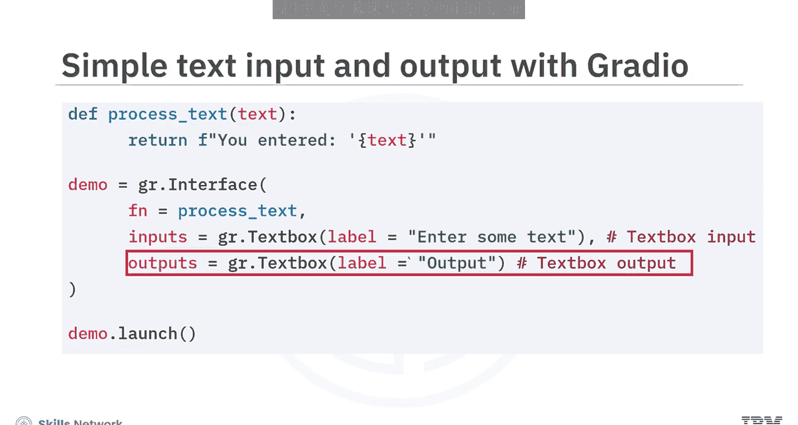
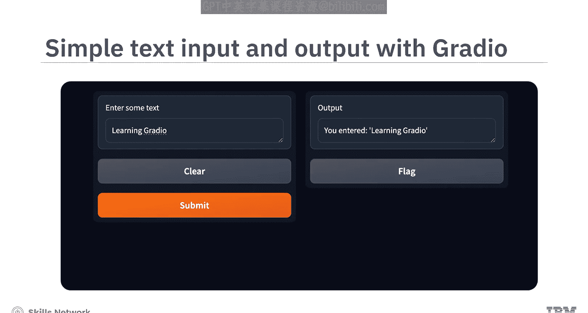
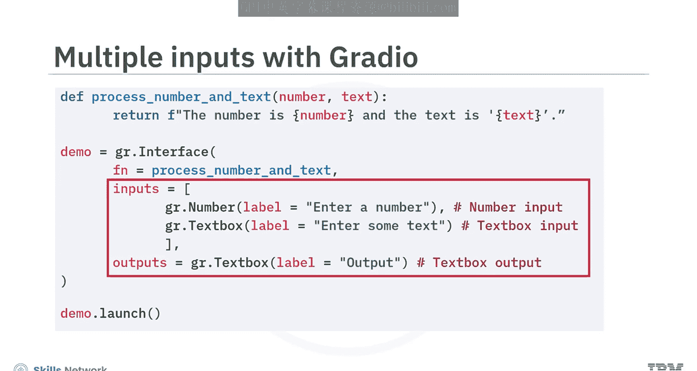
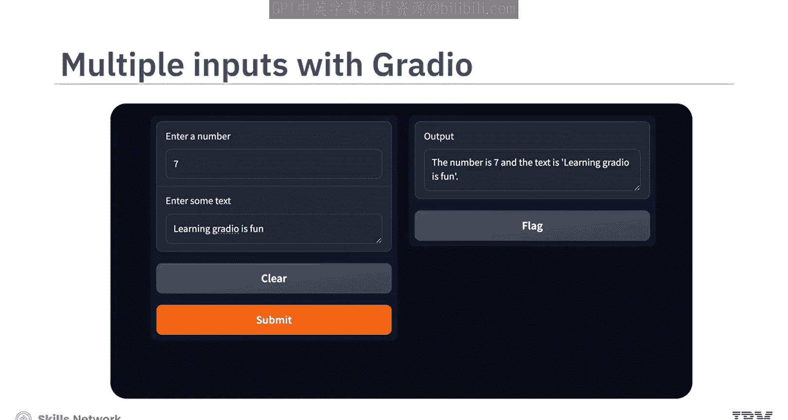
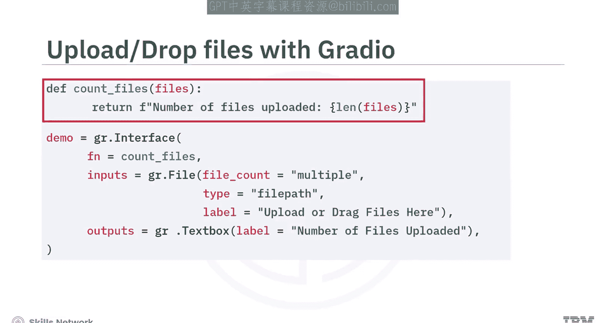
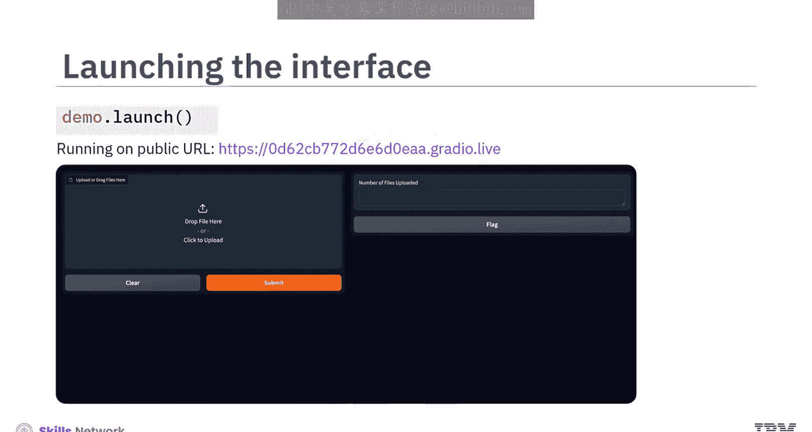
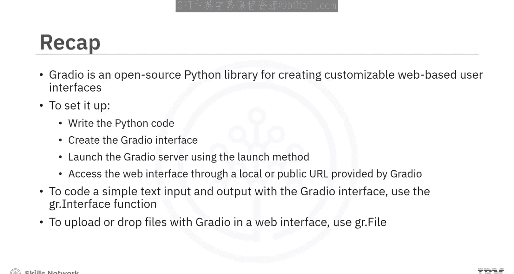

# IBM《生成式人工智能工程｜Falsk、生成式AI应用、数据分析、机器学习、Keras、架构和数据、NLP基础、transformer、微调、高级微调、RAG》 p172 6_开始使用Gradio.zh_en -BV1NAq6Y9E7z_p172-

Welcome to Getting started with Gdio。After watching this video。

 you'll be able to describe what radioio is and explain how to set up a radio interface for model interaction。

 Grdio is an open source Python library for creating customizable web based user interfaces。😊。

It is designed for ease of use， especially for machine learning models and computational tools let's take a step by step look at how it works。

 First you write the Python code to define the functions and logic for your application Next you use radio to create an interface for these functions here you use radio's interface class to specify the inputs and outputs for your functions then configure the interface to define how users will interact with your application。

😡，The next step is launching the radio server using the launch method。

 This starts a local server on your machine， creating a web interface for your application。

As the final step， you have access to the web interface through a local or public URL provided by radioio。

 Use can interact with the interface， providing inputs and receiving outputs in real time。 First。

 you need to install the radio package using PIip。Once installed， you can import radioio as G。 Now。

 let's code a simple radio interface that has a text input field and then displays the enter text as output。

 The G R interface function is a core component of the radioio library。😡。

It creates interactive web interfaces for Python functions with customizable input and output components。

😡，You then define the function to be executed once the user enters the query。😡。

Here you can define any functionality according to the use case。

 in this case you are just returning the enter text。😡。

GR text box is used to create a text box wherein you can also define a custom label for the text box。

Similarly， you create a text box for the output。

Using launch， you can then run the interface。Here is the radio interface you get from the code。

 As you can see here， there are two text boxes。😡，One for input and one for output。

Let's see how you can have multiple inputs in the radio interface。

 just like GR textbook is used to create a text field in the same way。

 GR number is used to create a numeric field。😡，You can pass GR number and GR textbook as a list of inputs。

 Similarlyly， if you want to add more inputs， you can add them here in the input list。😡。

Now， let's see the output from the generated code。 You can observe that you now have two types of inputs。

 one for text and one for numeric values。

You can also create an option to upload or drop files with radio。😡。

Here is a code to count the number of files uploaded by a user。

GR file allows users to upload files in a web interface。

 It supports multiple file uploads and provides paths to uploaded files for further processing in the back end function。

 You then define the count files to calculate the number of files uploaded by the user。

Once you launch the code， it generates a unique web interface link which can be used from anywhere until the session is running。

 you now have the option to upload or drop the files through a web interface。😡。

Let's recap in this video， you learned that Radio is an open source Python library for creating customizable web based user interfaces。

😡，To set it up， you have to write the Python code， create the radio interface。

 La the radioio server using the launch method and access the web interface through a local or public URL provided by Grio。

 You learned that to code ass simple text input and output with the radioio interface。

 you can use the radio interface function。 Finally。

 you learned that to upload or drop files with radioio in a web interface， you can use the GR file。😡。

