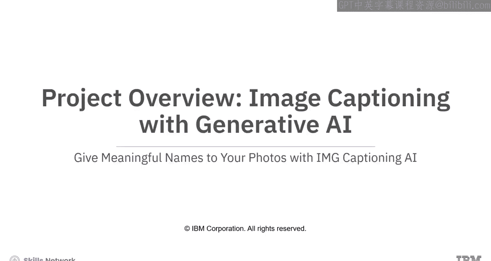
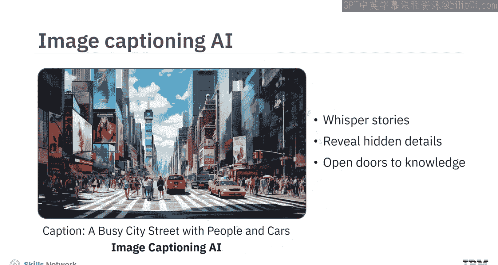
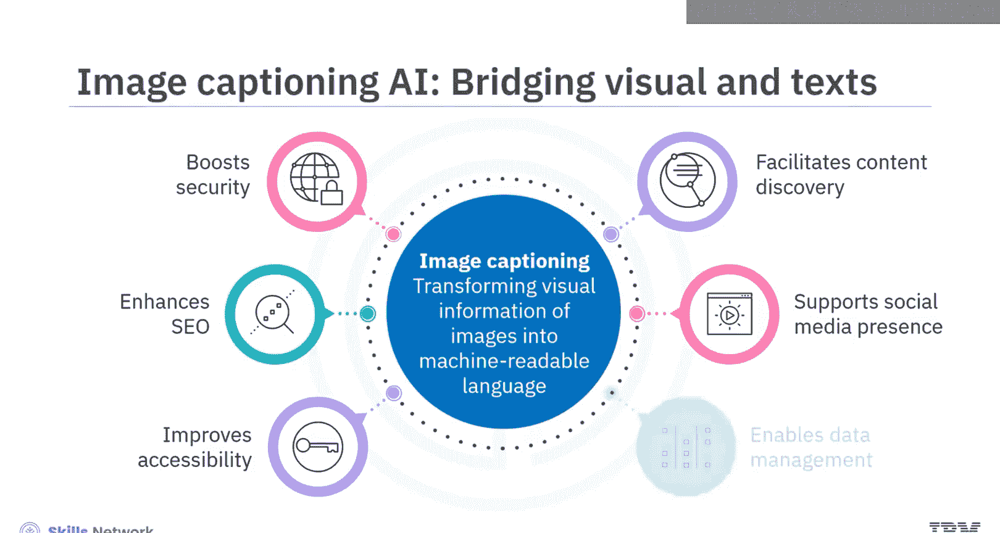
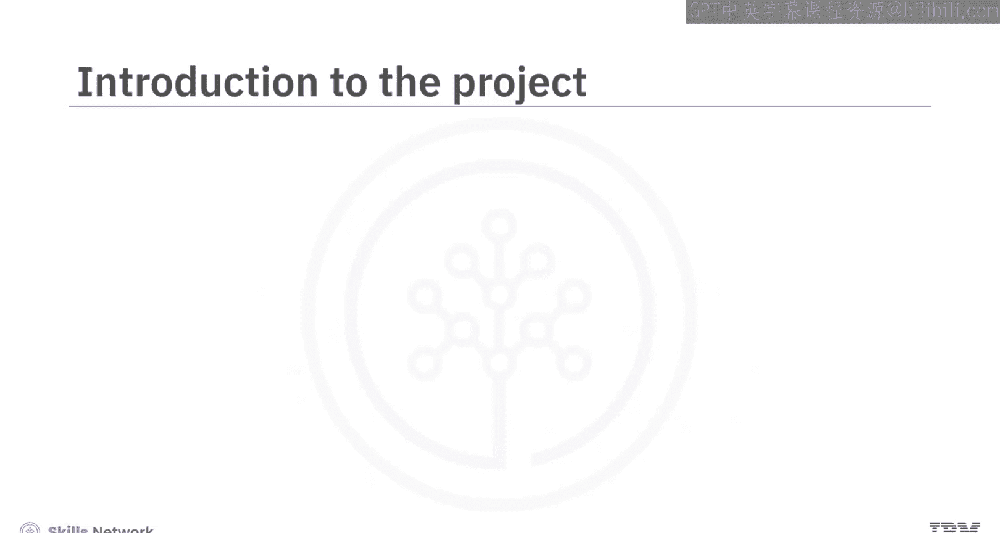
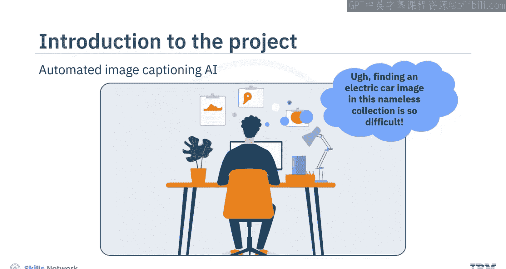
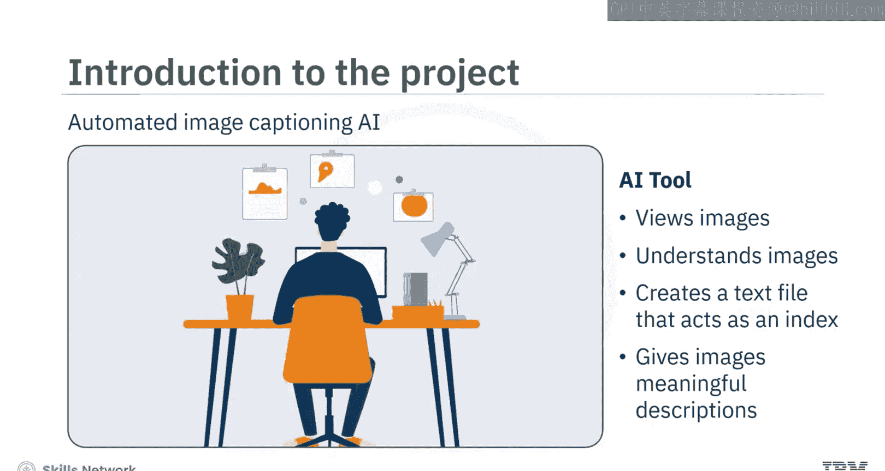
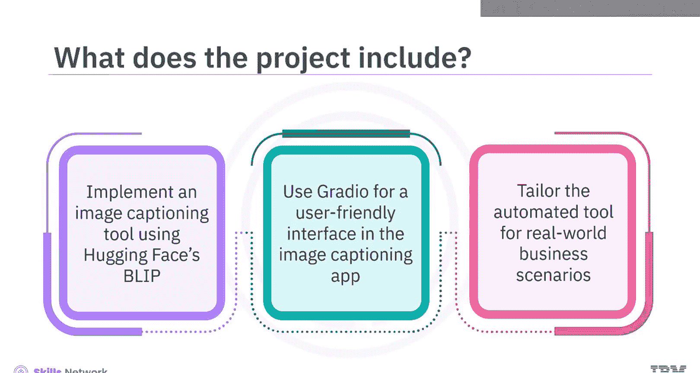
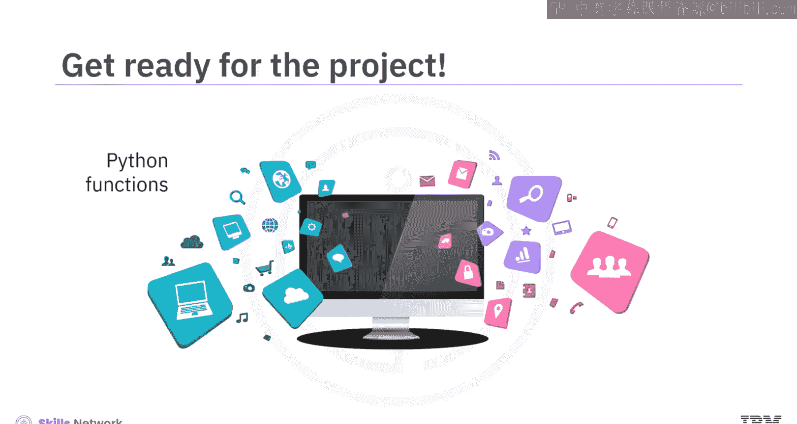
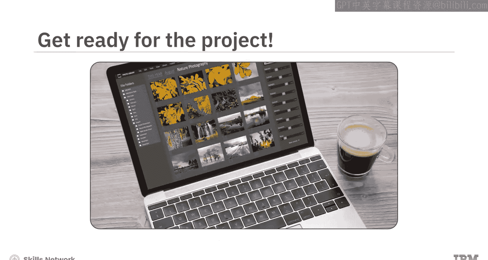

# IBM《生成式人工智能工程｜Falsk、生成式AI应用、数据分析、机器学习、Keras、架构和数据、NLP基础、transformer、微调、高级微调、RAG》 p18 3_项目概述：使用生成式AI进行图像描述.zh_en -BV1NAq6Y9E7z_p18-

Welcome to the overview video for the project givinging Meingful Na to your photos with IMG captioning AI。

Imagine a world where images are not silent， they whisper stories， reveal hidden details。

 and open doors to knowledge， all thanks to image captioning AI。

Image captioning AI enables transforming the visual information of images into machine readable language。

This technology significantly impact various aspects from improving accessibility for visually impaired individuals to enhancing search results and boosting security。

 by transforming visual data into text， image captioning AI paves the way for deeper content discovery。

 engaging social media presence and efficient data management across various fields。

In this project， you will be introduced to an automated image captioning AI。

 Imagine you were a graphic artist surrounded by thousands of unnamed pictures。

 Find the right picture feels like searching for a needle in a haystack。

 So let's work for a solution to this In this project。

 you will work to build an AI tool that does not just look at images。 It understands them。

 And then it creates a text file that acts as an index。

 giving images meaningful descriptions about what's inside。

This makes finding the right picture simple， enhancing efficiency， and easing your workload。

The project includes step by step instructions on how to implement and tailor the image captioning tool for real world application。

For this project， you will perform three main activities Firstly。

 you will implement an image captioning tool utilizing the Blip model from Huging Faces transformformer。

😡，Blip or bootstrapping language image pretraining can perform various multimodal tasks。

 including image text retrieval and image captioning。Next。

 you will employ radiodio to provide a user friendly interface for your image captioning application。

😡，Graio is an open source Python package that allows you to build a demo or web application for your machine learning model or a Python function。

Finally， you will tailor the automated tool for real world business scenarios。

 demonstrating its practical applications by extracting images from URLs and generating captions。

To complete this project， you should have a working knowledge of Python and familiarity with utilizing an integrated development environment IDE。

 no prior experience with hugging face transformers or radio as necessary。

 as you will gain acquaintance with them during the project。By the end of this project。

 you'll be able to attain the following objectives， describe the basics of generative AI models。

 implement an image captioning tool using Python and the Bllip model。😡。

And utilize radioio to create a user friendly interface for the image captioning application。

This project provides an opportunity to acquire skills in harnessing Python functions and exploring the multimodal capabilities of generative AI model。

So get ready to build and implement an AI tool for transforming your photo library by replacing those useless image names with meaningful ones。

😡。

。

