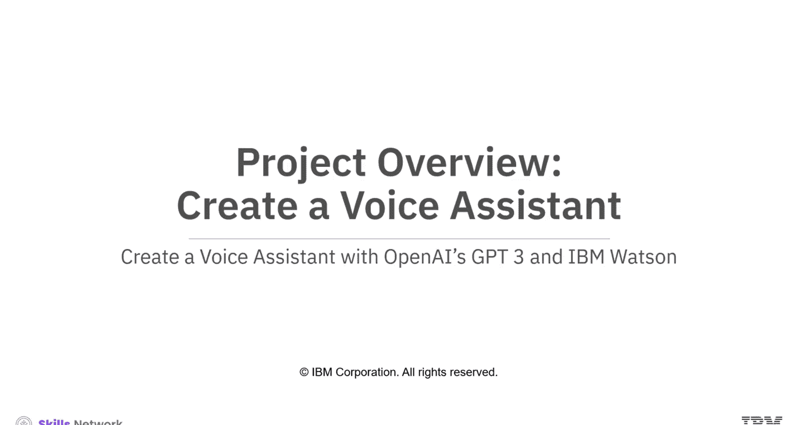
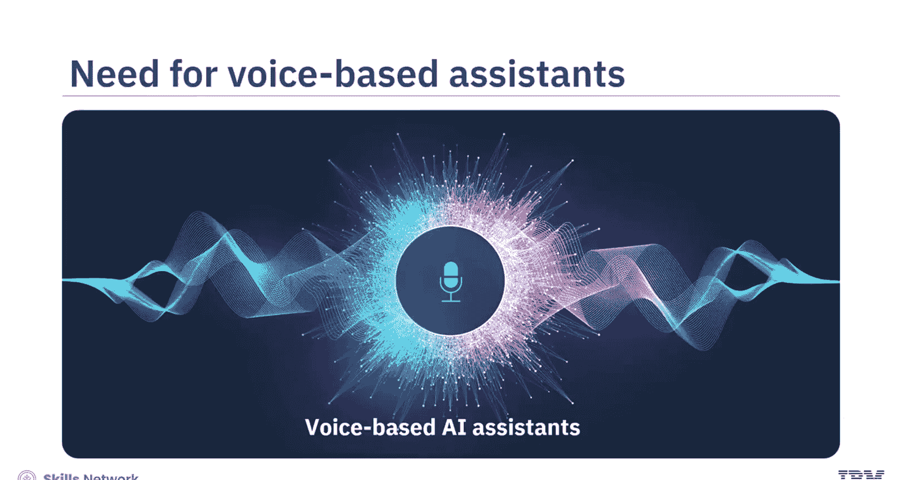
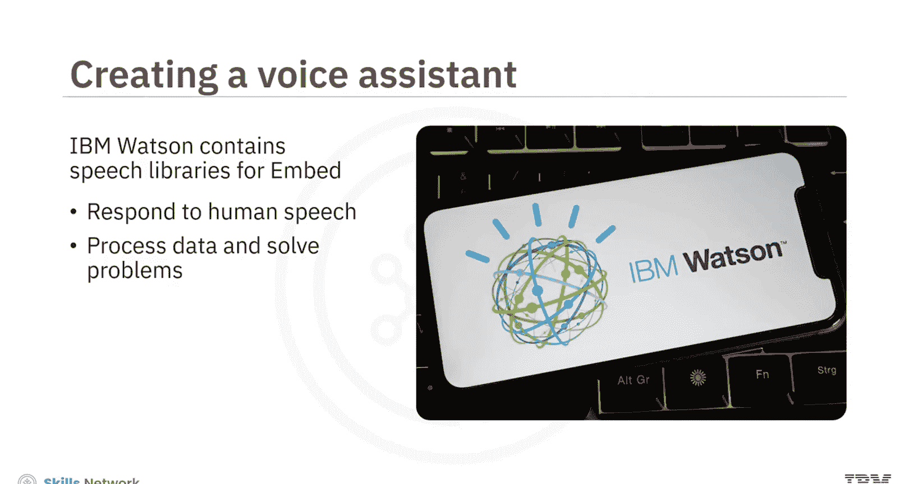
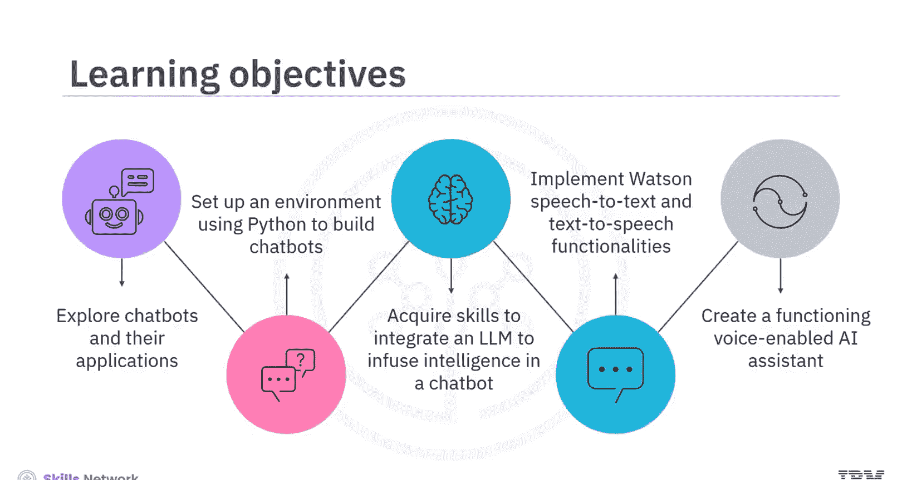
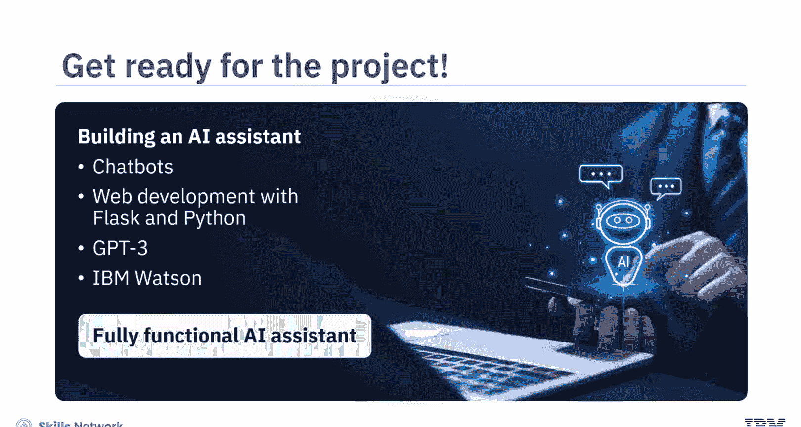
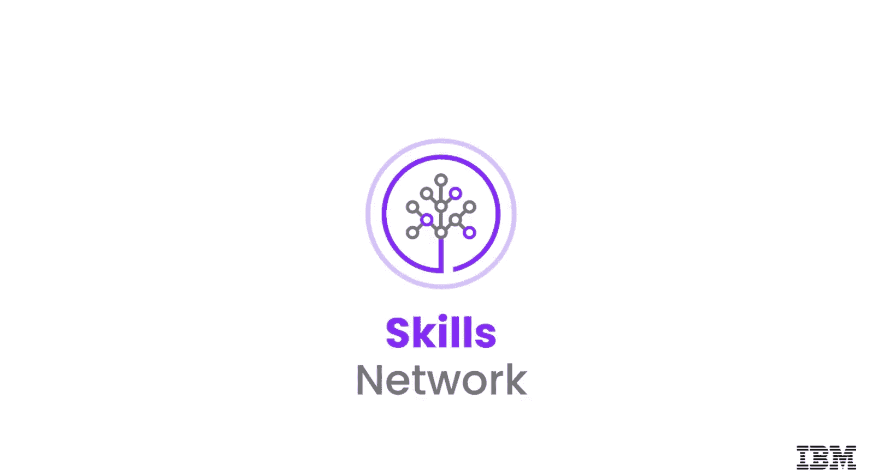

# IBM《生成式人工智能工程｜Falsk、生成式AI应用、数据分析、机器学习、Keras、架构和数据、NLP基础、transformer、微调、高级微调、RAG》 p21 6_项目概述：创建一个语音助手.zh_en -BV1NAq6Y9E7z_p21-

Welcome to the overview video for the project。 Create a voice assistant with Open AIs G 3 and IVM Watson。

 The domain of voice based AI is rapidly transforming how we interact with the technology。

 One particular promising application lies in intelligent voice assistance。😊。

Consider a busy professional rushing to design a presentation with their hands occupied。

 they can't access their computer for a quick search。 However。

 a voice query to the AI assistant summarize the key trends of use of AI in electric cars allows them to stay informed and productive。

 voice AI based assistances enable you to seamlessly engage in natural conversations。

 access information and find answers， all do the power of your voice。

In this project， we will create a voice assistant using OpenaiI's GT3 model and IBM Watson embedable AI the GT3 model will enable the assistant to understand and respond to user input The Watson speech to text or STT empowers the assistant to hear and understand a user's response and Watson text to speech or TtS enables the assistant to read the answers back to the user IBM Watson contains speech libraries for embed a set of containerized text to speech and speech to text libraries that help to respond to human speech process data and answer questions that help individuals and companies respond to their problems This project explores chatbots and their applications You will create a functioning assistant with a high intelligence level that will take voice input and provide a spoken response。

😡。

In this project， you will begin by developing an environment for building an assistant using Python。

 then build your own assistant using G3， and finally。

 implement IBM Watson to enable speech detect functionality。

 You will also learn to deploy the assistant to a public server。

Let's check out a demo of the voice assistant you'll develop in this project。

 The interface of the assistant displays the title voiceice assistant。

It provides a feature to toggle between light and dark modes。

 This assistant works with both text and voice， prompt your questions by typing in the message field or by clicking the recorder icon to speak。

 For example， what are Shakespeare's tragedies， The assistant provides a detailed response。

 displaying the text and playing an audio response， showcasing the text to speech integration。

 Con the conversation by typing or using the recorder option。😡，To include prompts like no。

 and thank you。 help wrap up interactions with your assistant to build the voice assistant。

 you will construct the interface using Hm， CS and jascript that communicates with the assistant。

 for building the backend， you will use Python and flask。

 Flask is a web framework for building web applications In the project。

 Flask is supported by Docker to create containers that manage the dependencies。

 This is followed by integrating IBM Watson speech to text functionality to enable the chatbot to understand voice input from a user。

 Next， you will integrate G3 for infusing intelligence into the chatbot。 Further。

 you will integrate Watson text to speech to give the chatbot a voice for spoken responses。😡。

Once all components are combined， you will develop a functioning voice assistant that can take both text and voice input and provide both text and spoken responses to work on this project。

 you should be familiar with Python and flask。 Also， it is recommended。

 but not essential to have a basic knowledge of HM CS and jascript。

 The project provides step by step instructions on how to work with the code and the different activities required to build the chatbots using AI tools。

 By the end of this project， you'll be able to obtain the following objectives。

 Exp chatbots in their applications， set up an environment using Python to build chatbots。

 acquire skills to integrate an LLM to infuse intelligence in a chatbot。

 Imment Watson speech to text and text to speech functionalities and create a functioning voice enabled AI assistant。

 This project will dive deep into building a powerful assistant。

 You'll learn about chatbots and web development with flask and Python。

 You will also integrate G3 and IBM Watson capability。😊。

To build an assistant with speech recognition By the end。

 you will have created a fully functional AI assistant that showcases your newfo expertise working with LLms using APIs。

