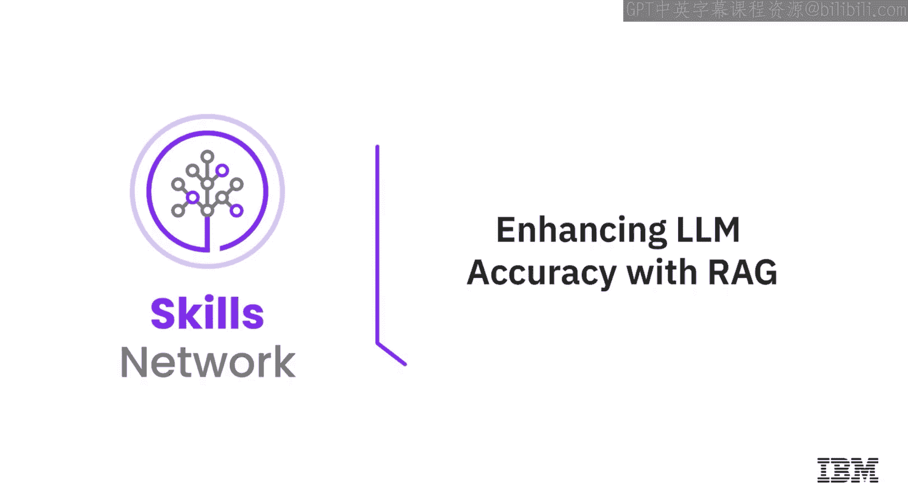
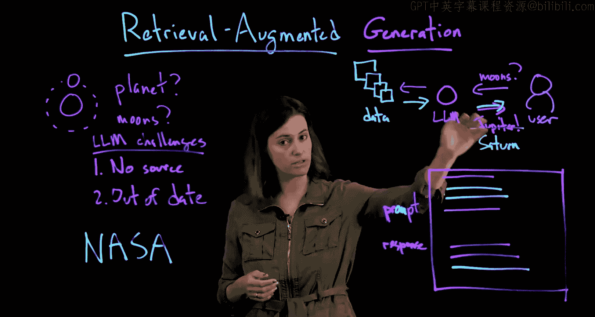

# IBM《生成式人工智能工程｜Falsk、生成式AI应用、数据分析、机器学习、Keras、架构和数据、NLP基础、transformer、微调、高级微调、RAG》 p27 12_通过RAG增强LLM准确性.zh_en -BV1NAq6Y9E7z_p27-

Largely English models， they are everywhere， they get some things amazingly right and other things very interestingly wrong。

My name is Marina Donelevsky， I am a senior research scientist here at IBM Research and I want to tell you about a framework to help large language models be more accurate and more up to date。

 retrieval augmented generation or RaG。Let's just talk about the generation part for a minute so forget the retrieval augmented。

 so the generation， this refers to large language models or LLMs that generate text in response to a user query referred to as a prompt。

😊，These models can have some undesirable behavior。 I want to tell you an anecdote to illustrate this。

 So my kids， they recently asked me this question in our solar system。

 What planet has the most moves。And my response was， oh。

 that's really great that you're asking me this question I loved space when I was your age。

 of course that was like 30 years ago， but I know this I ran an article and the article said that it was Jupiter and 88 moon。

 so that's the answer Now actually there's a couple of things wrong with my answer。First of all。

 I have no source to support what I'm saying， so even though I confidently said I read an article。

 I know the answer， I'm not sourcing it， I'm giving the answer off the top of my head and also I actually haven't kept up with this for a while and my answer is out of date。

So we have two problems here， one is no source。And the second problem is that I am out of date。

And these， in fact， are two behaviors that are often observed as problematic when interacting with large language models。

There are LLM challenges Now， what would have happened if I'd taken a beat and first gone and looked up the answer on a reputable source like NASA？

Well， then I would have been able to say， okay， so。The answer is Saturn with 146 moons， and in fact。

 this keeps changing because scientists keep on discovering more and more mos。

 so I have now grounded my answer in something more believable。

 I have not hallucinated or made up an answer， oh and by the way I didn't leak personal information about how long ago it's been since I was obsessed with space。

All right， so what does this have to do with large language models Well。

 how would a large language model have answered this question so let's say that I have a user。😊。

Asking this question about nose。A large language model。Would。Confidently say， okay？

I have been trained， and from what I know in my parameters during my training， the answer is Jupiter。

The answer is wrong， but？You know， we don't know the large language model is very confident in what it answered。

 Now， what happens when you add thisr retrieval augmented part here， what does that mean。

 that means that now， instead of just relying on what the LLM knows， we are adding a content store。

This could be open like the internet， this could be closed， like some collection of documents。

 collection of policies， whatever， the point though now is that the LLM first goes and talks。

To the content store and says， hey， can you retrieve from me？

Information that is relevant to what the user's query was。 and now。

Wake this retriever augmented answer， It's not Jupiter any more。 We know that it is Sader。

What does this look like？Well。First。User prompts the LLM with。Their question。

They say this is what my question was， and originally， if we're just talking to a generative model。

The Drative model says， oh， okay， I know the response here it is， here's my response。

But now in the RAG framework， the geneative model actually has an instruction that says no no no。

 first， go and retrieve relevant content。Combine that with the user's question and only then generate the answer。

 so the prompt now has three parts， the instruction。To pay attention to the retrieved content。

 together with the user's question， now give a response and in fact。

 now you can give evidence for why your response was what it was。

So now hopefully you can see how does RAD help the2LM challenges that I had mentioned before？

So first of all， I'll start with the out of date part。 Now， instead of having to retrain your model。

 if new information comes up like， hey， we found some more moves。 now it's a Jupiter again。

 maybe it'll be sadturn again in the future。 All you have to do is you augment your data store with new information。

 update information。 So now the next time that a user comes and asks the question。 We're ready。

 we just go ahead and retrieve the most up to date information。😊，The second problem source。 Well。

 the large language model is now being instructed to pay attention to primary source data before giving its response and。

 in fact， now being able to give evidence。This makes it less likely to hallucinate or to leak data because it is less likely to rely only on information that it learned during training。

 It also allows us to get the model to have a behavior that can be very positive。

 which is knowing when to say I don't know if the user's question cannot be reliably answered based on your data store。

 the model should say I don't know instead of making up something that is believable and may mislead the user。

This can have a negative effect as well though， because if the retriever is not sufficiently good to give the large language model the best most highest quality grounding information。

 then maybe the user's query that is answerable doesn't get an answer。

 So this is actually why lots of folks， including many of us here IBM are working the problem in both sides。

 we are both working to improve the retriever to give the large language model the best quality God data on which to ground its response and also the generative parts so that the LOM can give the richest best response finally to the user when it generates the answer。

 Thank you for learning more about Ra Thank you。

