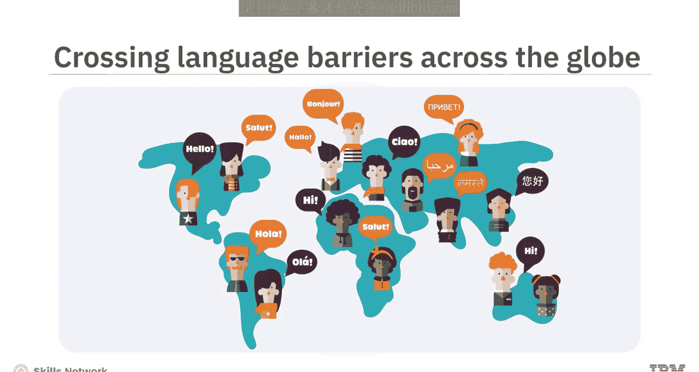
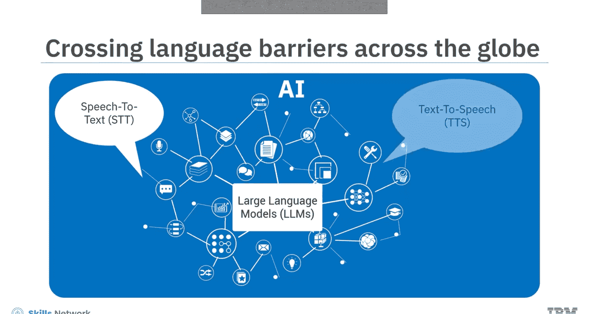
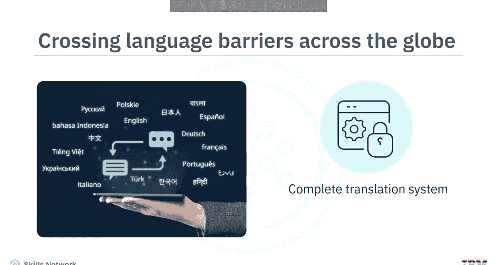
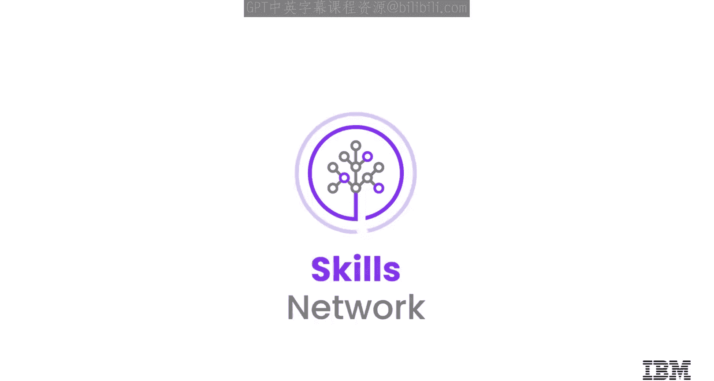

# IBM《生成式人工智能工程｜Falsk、生成式AI应用、数据分析、机器学习、Keras、架构和数据、NLP基础、transformer、微调、高级微调、RAG》 p28 13_项目Babel Fish简介：使用LLM和STT-TTS.zh_en -BV1NAq6Y9E7z_p28-

Welcome to the overview video for the project， Babble Fish with LLM and STT TTS。

A global workforce and business environment requires multilingual communication with coworkers。

 business partners， and customers across the world。

 the evolution of AI has made this easy using speech to text or STT。

 large language models or LLMs and textex to speech or TTS technologies。

With the help of these technologies， you can build a complete translation system that translates your speech into multiple languages。

In this project， you will create a voice enabled AI translator assistant leveraging FulL2 model hosted on IBMWattsonex。

aiI and embedible Watsonspeeech librariesraries， the translator will convert the recorded speech input to text and send the text to the FanUL2 LLM to have it translated Next it receives a text response and the translated language from the LLM and converts it to speech using text to speech technology。

 which gets played back to the user。Let's check out a demo of the voice assistant that you will be developing in this project。

The voice assistant interface includes a feature to toggle between light and dark mode。

 an input box to type your message， and a microphone icon。Type a message in the input box。

 for example， say hello in French。The response will be demonstrated。Next。

 try out the microphone to speak a message about translating into Spanish。 For example。

 Good morning in Spanish。 The assistant will respond with a text and speech message。

Users will be able to interact with the voice assistant through a web interface that's built using HTML。

 CSS， and JavaScript。To build the back end of your voice assistant。

 you'll be using Python and Flask to integrate the FlNUL2 model in the application。

 you will work with IBM Watson X， which is an AI and data platform。😡。

IBM Watson speech Lib for Embed Technologies allow the assistant to communicate with others through the voice input and output。

By combining all of these components， you will create an AI assistant that can take voice input and provide a spoken response。

To work on this project， you should be familiar with Python and Flask， also。

 it is recommended but not essential to have basic knowledge of HTML， CSS， and JavaScript。

The project provides step by step instructions on how to work with the code and the different activities required to build the voice assistant using AI tools。

By the end of this module， you'll be able to attain the following objectives。😡。

Explore the basics of voice assistance and their various applications。

 explore and implement the capabilities of generative AI models for multilingual translation。

Implement speech to text and text speech functionalities to enable an AI assistant to communicate with users through voice。

Set up at a relevant environment for building an AI assistant using Python， Flask， HTML。

 CSS and JavaScript。And create a functioning voice enabled AI assistant。By working on this project。

 you will have the skills to create your own AI power translation assistant capable of receiving voice input and providing translations in various languages。

You will also have a solid foundation in web development using Python， Flask， HTML， CSS。

 and JavaScript， along with a fully functional full stack application that will prove useful to all who interact with it。

