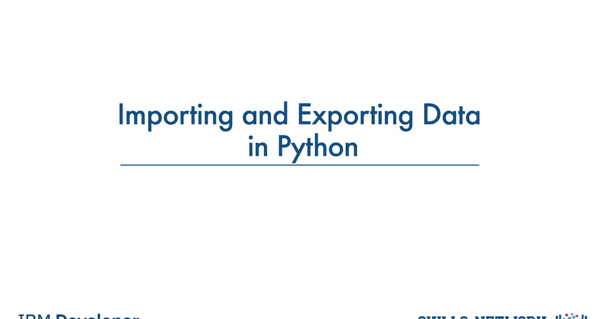
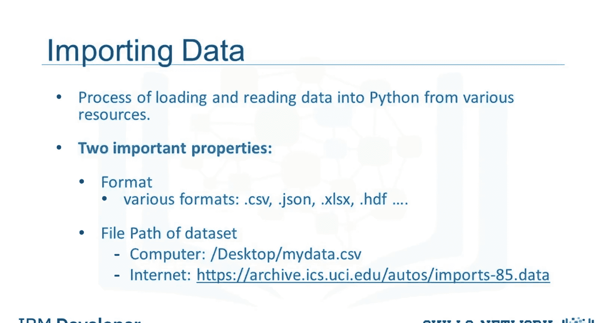
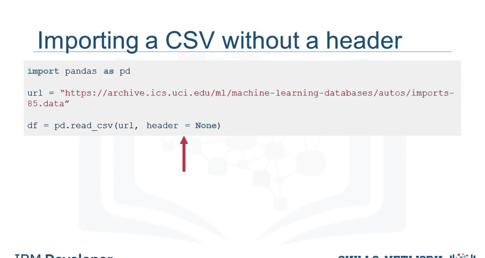
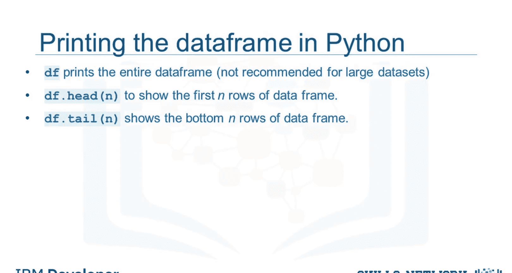
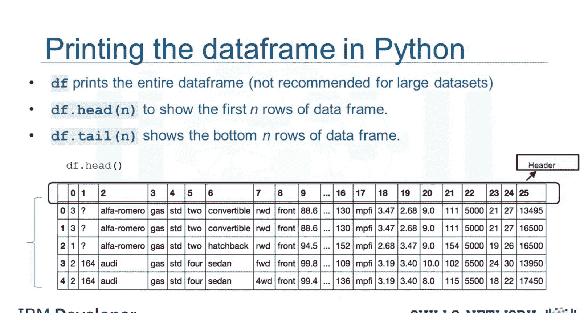
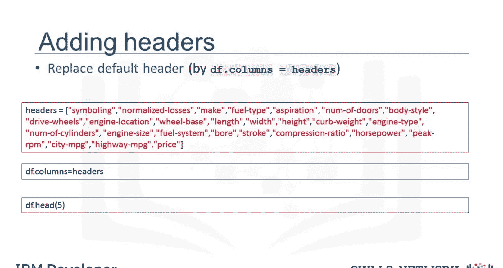
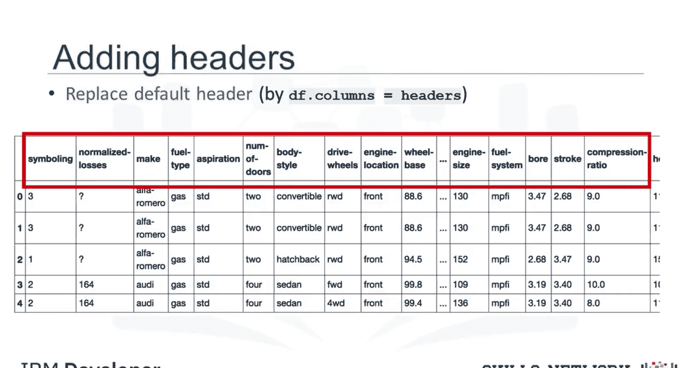
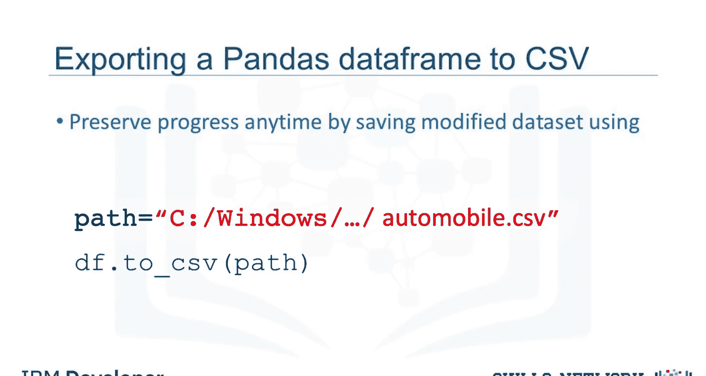
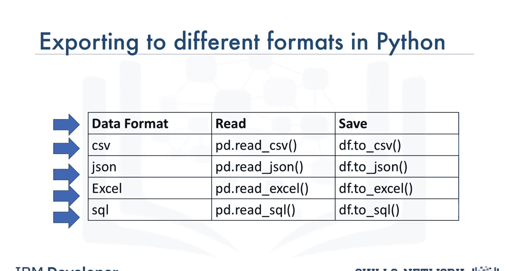

# IBM《生成式人工智能工程｜Falsk、生成式AI应用、数据分析、机器学习、Keras、架构和数据、NLP基础、transformer、微调、高级微调、RAG》 p33 3_在Python中导入和导出数据.zh_en -BV1NAq6Y9E7z_p33-

In this video， we'll look at how to read in data using Python's panda's package。

 Once we have our data in Python， then we can perform all the subsequent data analysis procedures we need。

Data acquisition is a process of loading and reading data into notebook from various sources to read any data using Python's Pada's package。

 there are two important factors to consider format and failpath。Format is the way data is encoded。

 We can usually tell different encoding schemes by looking at the ending of the file name。

 Some common encodings are CS V， Jason， X， L， S X， H F， and so forth。

The path tells us where the data is stored， Usually it is stored either on the computer we are using or online on the Internet。

In our case， we found a data set of used cars which was obtained from the web address shown on the slide。

When Jerry entered the web address in his web browser， he saw something like this。

Each row is one data point， a large number of properties are associated with each data point。

Because the properties are separated from each other by comms， we can guess the data format is CSV。

 which stands for comma separated values。At this point。

 these are just numbers and don't mean much to humans。 But once we read in this data。

 we can try to make more sense out of it。In panndadas。

 the RECSV method can read in files with columns separated by comms into a panda's data frame。

Reading data in pandas can be done quickly in three lines， First， import pandas。

Then define a variable with a file path。And then use the Read CSV method to import the data。However。

 Read CSV assumes that the data contains a header。Our data on used cars has no column headers。

 so we need to specify Read CSV to not assign headers by setting header to none。

After reading the data set， it is a good idea to look at the data frame to get a better intuition and to ensure that everything occurred the way you expected。

Since printing the entire data set may take up too much time and resources to save time。

 we can just use data frame dot head to show the first N rows of the data frame。Similarly。

 data frame dot tail shows the bottom N rows of data frame。

Here we printed out the first five rows of data。 It seems that the data set was read successfully。

 We can see that pandas automatically set the column header as a list of integers because we set header equals none when we read the data。

😊。

It is difficult to work with the data frame without having meaningful column names， however。

 we can assign column names in pandas。In our present case。

 it turned out that we have the column names in a separate file online。

We first put the column names in a list called headers。

 Then we set D F dot columns equals headers to replace the default integer headers by the list。

 If we use the head method introduced in the last slide to check the data set。

 we see the correct headers inserted at the top of each column。

At some point in time， after you've done operations on your data frame。

 you may want to export your panda's data frame to a new CSV file。

You can do this using the method to underscore CSV to do this， specify the file path。

 which includes the file name that you want to write to。For example。

 if you would like to save the data frame D as automobile。 CSv to your own computer。

 you can use the syntax D。2 underscore CSV。

For this course， we will only read and save CSV files， however。

 PAndas also supports importing and exporting of most data file types with different data set formats。

The code syntax for reading and saving other data formats is very similar to read or save CSV file。

 Each column shows a different method to read and save files into a different format。

