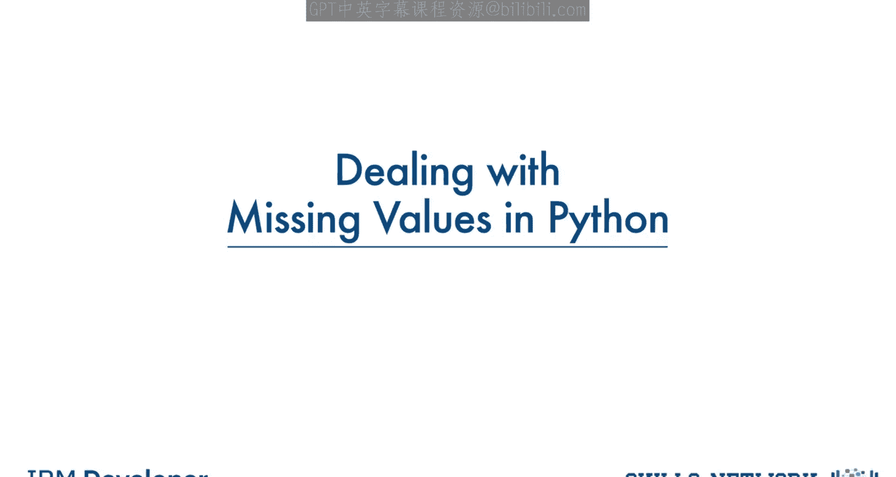
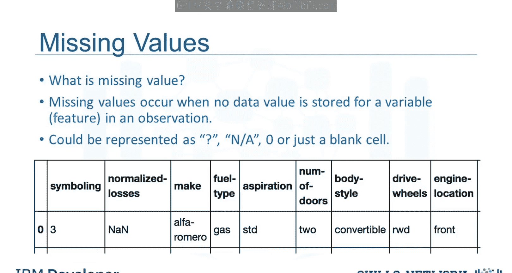
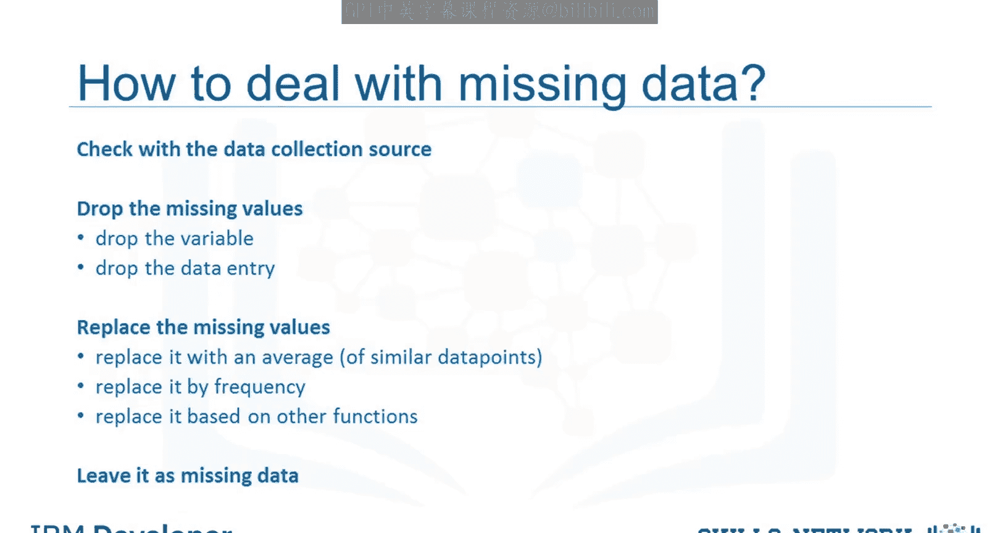
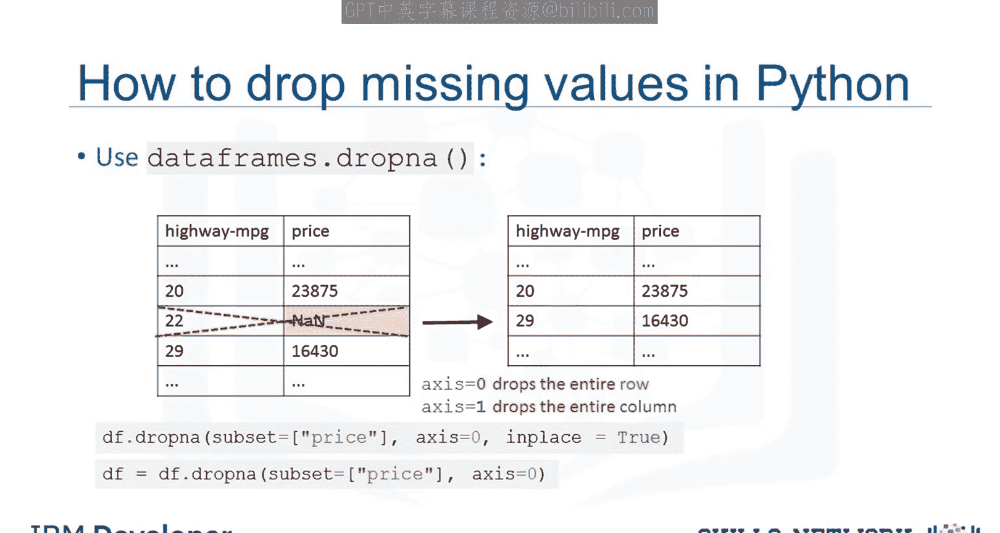
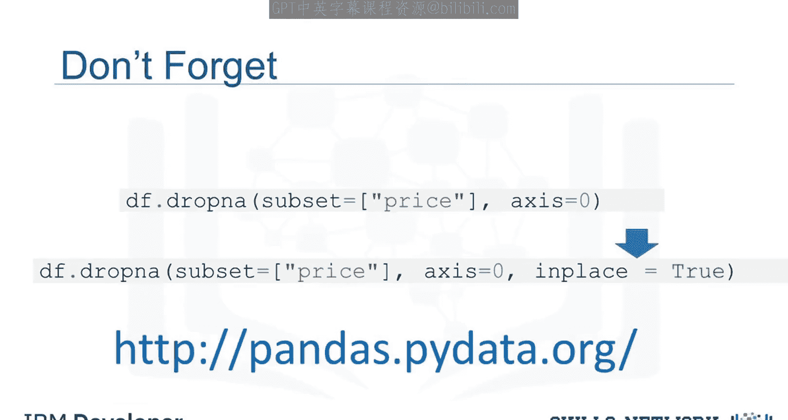
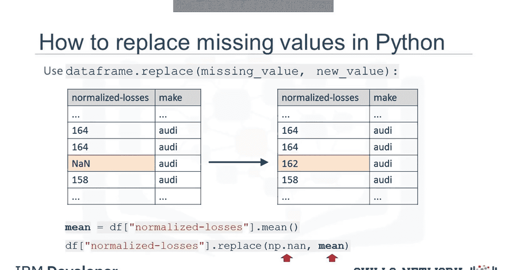
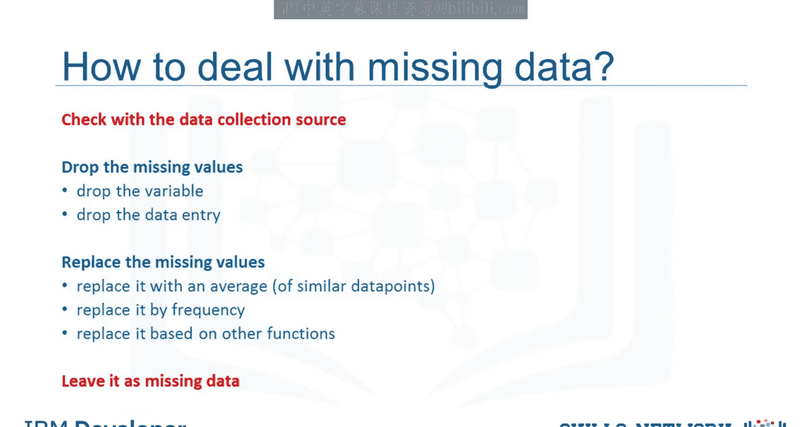

# IBM《生成式人工智能工程｜Falsk、生成式AI应用、数据分析、机器学习、Keras、架构和数据、NLP基础、transformer、微调、高级微调、RAG》 p37 7_在Python中处理缺失值.zh_en -BV1NAq6Y9E7z_p37-

In this video， we will introduce the pervasive problem of missing values。

 as well as strategies on what to do when you encounter missing values in your data。

When no data value is stored for feature for a particular observation。

 we say this feature has a missing value。Usually missing value in dataset set appears as question mark and a0 or just a blank cell。

In the example here， the normalized losses feature has a missing value。

 which is represented with NAN。

But how can you deal with missing data。There are many ways to deal with missing values。

 and this is regardless of Python， R or whatever tool you use。Of course。

 each situation is different and should be judged differently。 However。

 these are the typical options you can consider。The first is to check if the person or group that collected the data can go back and find what the actual value should be。

Another possibility is just to remove the data where that missing value is found。When you drop data。

 you could either drop the whole variable or just the single data entry with the missing value。

If you don't have a lot of observations with missing data。

 usually dropping the particular entry is the best。If you're removing data。

 you want to look to do something that has the least amount of impact。

Replacing data is better since no data is wasted， however。

 it is less accurate since we need to replace missing data with a guess of what the data should be。

One standard replacement technique is to replace missing values by the average value of the entire variable。

 As an example， suppose we have some entries that have missing values for the normalized losses column。

 and the column average for entries with data is 4500。

While there is no way for us to get an accurate guess of what the missing values under the normalized losses column should have been。

 you can approximate their values using the average value of the column 4500。

But what if the values cannot be averaged as with categorical variables？For a variable。

 like fuel type， there isn't an average fuel type， since the variable values are not numbers。

 In this case， one possibility is to try using the mode the most common， like gasoline。Finally。

 sometimes we may find another way to guess the missing data。

This is usually because the data gatherer knows something additional about the missing data。

For example， he may know that the missing values tend to be old cars and the normalized losses of old cars are significantly higher than the average vehicle。

 And， of course， finally， in some cases， you may simply want to leave the missing data as missing data。

For one reason or another， it may be useful to keep that observation。

 even if some features are missing。

Now let's go into how to drop missing values or replace missing values in Python。

To remove data that contains missing values， Panda's library has a built in method called Drop NA。

Essentially， with the drop NA method， you can choose to drop rows or columns that contain missing values like NAN。

So you'll need to specify axis equals0 to drop the rows or axis equals 1 to drop the columns that contain the missing values。

In this example， there is a missing value in the price column。

Since the price of used cars is what we're trying to predict in our upcoming analysis。

 we'd have to remove the cars， the rows that don't have a listed price。

It can simply be done in one line of code using data frame， dot drop， N。

Setting the argument in place to true allows the modification to be done on the data set directly。

In place equals true， just writes the result back into the data frame。

This is equivalent to this line of code。

Don't forget that this line of code does not change the data frame。

 but it is a good way to make sure that you are performing the correct operation。

To modify the data frame， you have to set the parameter in place equal to true。

 You should always check the documentation if you are not familiar with a function or method。

The panndadas webpage has lots of useful resources。

To replace missing values like NANs with actual values。

 Panda's library has a built in method called replace。

 which can be used to fill in the missing values with the newly calculated values。

As an example， assume that we want to replace the missing values of the variable normalized losses by the mean value of the variable。

Therefore， the missing value should be replaced by the average of the entries within that column。

In Python， first we calculate the mean of the column。

Then we use the method replace to specify the value we would like to be replaced as the first parameter。

 In this case， N A N。 The second parameter is the value we would like to replace it with。 I。e。

 the mean in this example。This is a fairly simplified way of replacing missing values。 There are。

 of course， other techniques， such as replacing missing values for the average of the group instead of the entire data set。

So we've gone through two ways in Python to deal with missing data。

 We learned to drop problematic rows or columns containing missing values。

 And then we learned how to replace missing values with other values。

 But don't forget the other ways to deal with missing data。

 You can always check for a higher quality data set or source。Or in some cases。

 you may want to leave the missing data as missing data。

