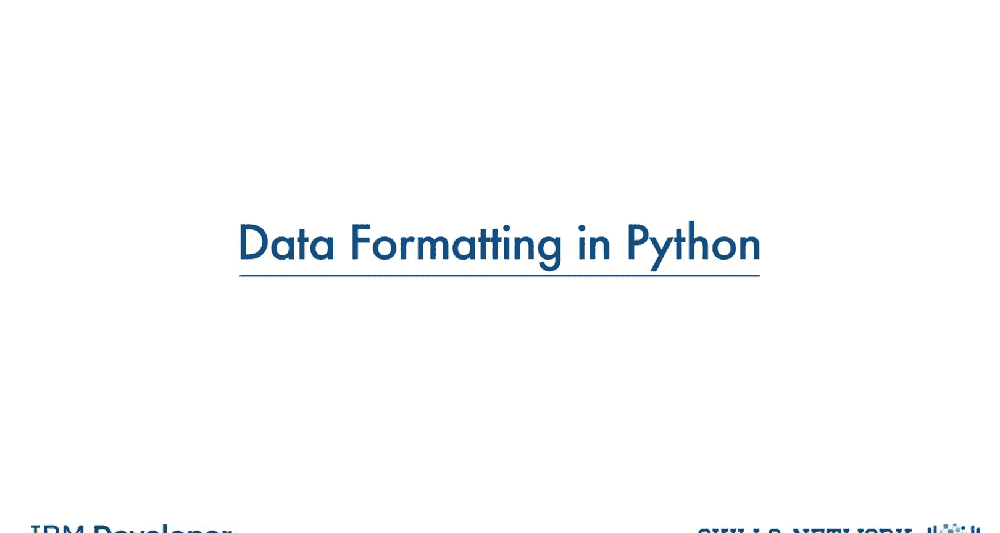
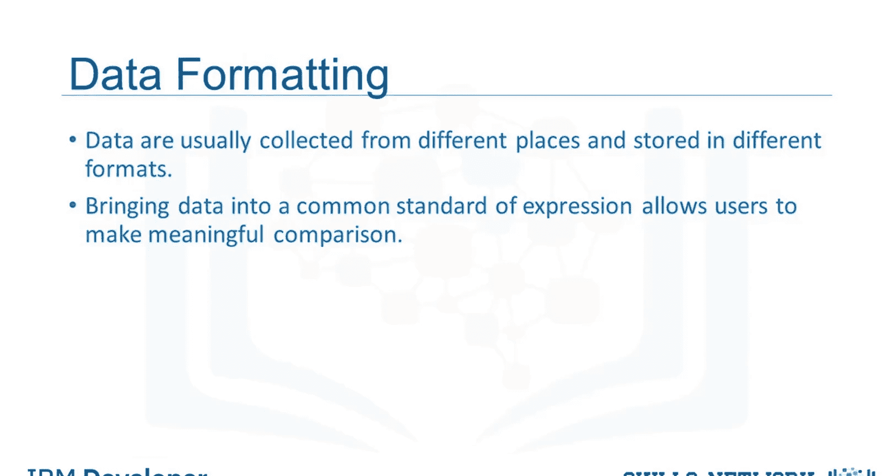
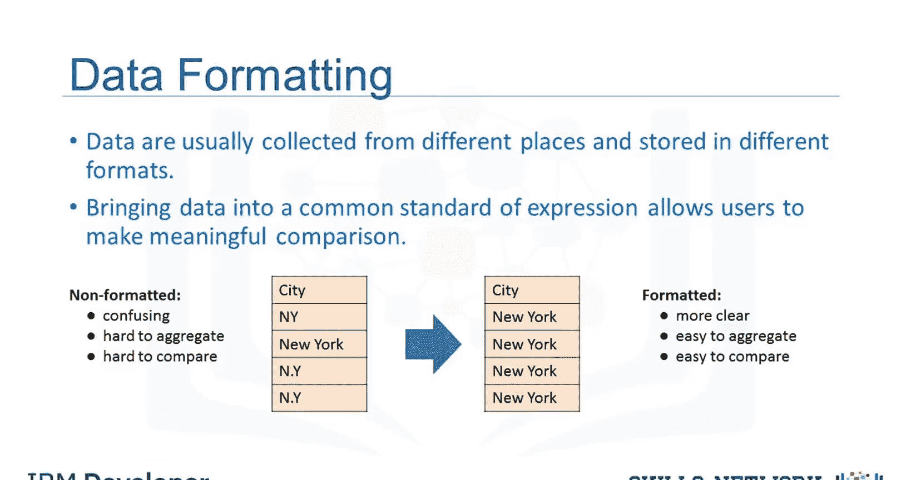
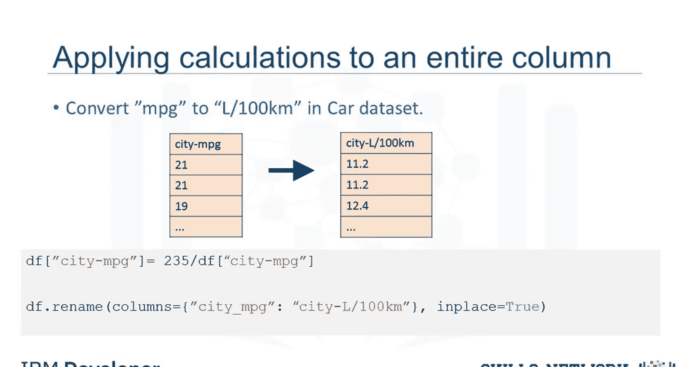
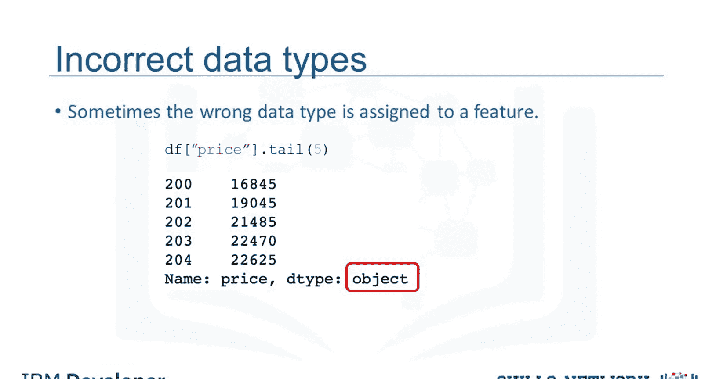
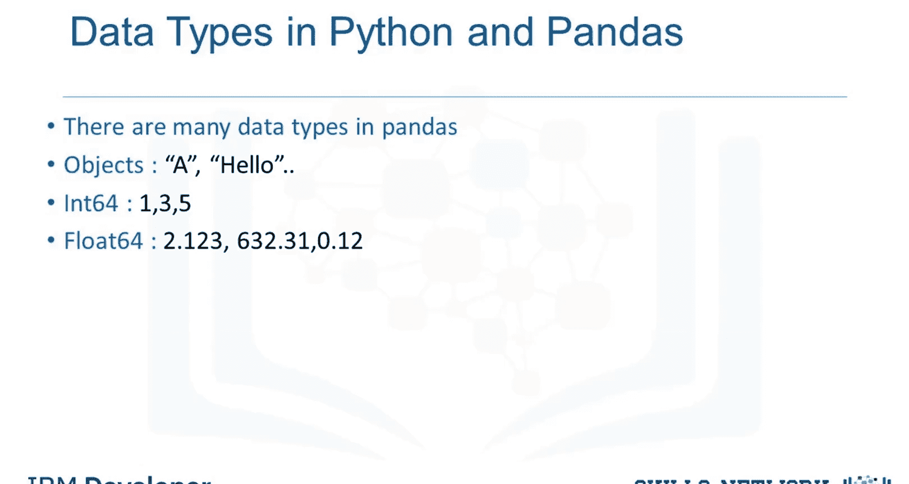
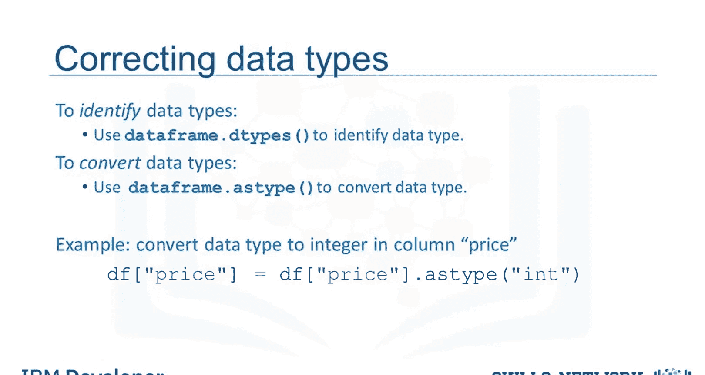

# IBM《生成式人工智能工程｜Falsk、生成式AI应用、数据分析、机器学习、Keras、架构和数据、NLP基础、transformer、微调、高级微调、RAG》 p38 8_在Python中数据格式化.zh_en -BV1NAq6Y9E7z_p38-

In this video， we'll look at the problem of data with different formats。

 units and conventions and the pandas methods that help us deal with these issues。

Data is usually collected from different places by different people。

 which may be stored in different formats。 Data formatting means bringing data into a common standard of expression that allows users to make meaningful comparisons。

As a part of data set cleaning， data formatting ensures that data is consistent and easily understandable。

For example， people may use different expressions to represent New York City， such as uppercase N。

 uppercase Y， uppercase N， lowercase Y， uppercase N， uppercase Y and New York。

Sometimes this unclean data is a good thing to see。For example。

 if you're looking at the different ways people tend to write New York。

 then this is exactly the data that you want。 or if you're looking for ways to spot fraud。

 perhaps writing n dot Y dot is more likely to predict an anomaly than if someone one wrote out New York in full。

 but perhaps more often than not。 We just simply want to treat them all as the same entity or format to make statistical analyses easier down the road。

Referring to our used car data set， there's a feature named City mileses per gallon in the data set。

 which refers to a car fuel consumption in miles per gallon unit。However。

 you may be someone who lives in a country that uses metric units。

 so you would want to convert those values to liters per00 km， the metric version。

To transform miles per gallon to liters per100 kilometers。

 we need to divide 235 by each value in the city miles per gallon column。In Python。

 this can easily be done in one line of code。 You take the column and set it to equal to 235 divided by the entire column In the second line of code。

 Rename column name from city miles per gallon to city liters per00 k using the data frame rename method。

 for a number of reasons， including when you import a data set into Python。

 the data type may be incorrectly established。 For example， here。

 we notice that the assigned data type to the price feature is object。

 Although the expected data type should really be an integer or float type。

It is important for later analysis to explore the features data type and convert them to the correct data types。

 Otherwise， the developed models later on may behave strangely and totally valid data may end up being treated like missing data。

There are many data types in pandas。 Objects can be letters or words。

 Int 64 are integers and floats arereal numbers。 There are many others that we will not discuss。

To identify a features data type in Python we can use the data frame dot D types method and check the data type of each variable in a data frame in the case of wrong data types。

 the method data frame dot as type can be used to convert a data type from one format to another。

For example， using as type int for the price column。

 you can convert the object column into an integer type variable。

