# IBM《生成式人工智能工程｜Falsk、生成式AI应用、数据分析、机器学习、Keras、架构和数据、NLP基础、transformer、微调、高级微调、RAG》 p50 20_使用可视化进行模型评估.zh_en -BV1NAq6Y9E7z_p50-

In this video， we'll look at model evaluation using visualization。

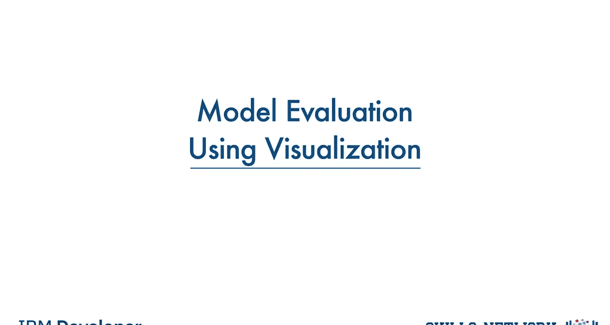

Regression plots are a good estimate of the relationship between two variables。

 the strength of the correlation and the direction of the relationship， positive or negative。

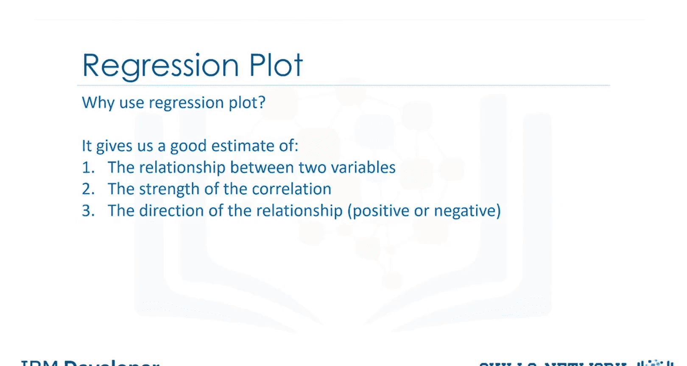

The horizontal axis is the independent variable。 The vertical axis is the dependent variable。

Each point represents a different target point。 The fitted line represents the predicted value。

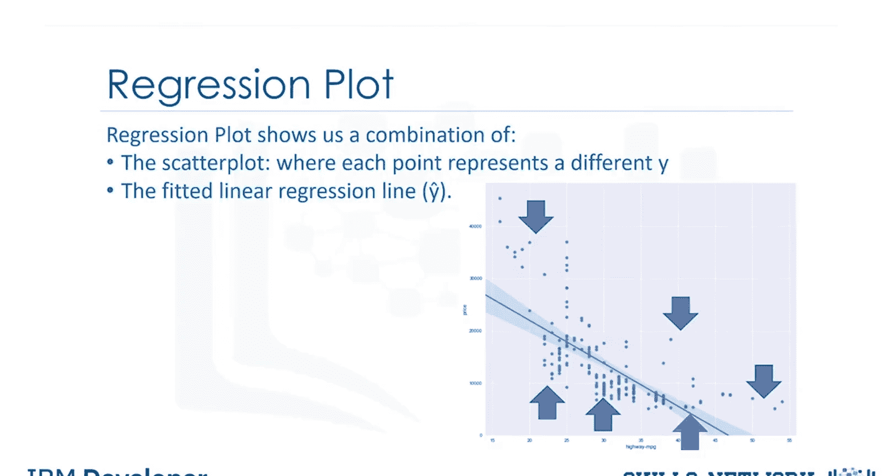

There are several ways to plot a regression plot。 A simple ways to use redge plot from the Seabornour Library。

First， import seaborn， then use the reddge plot function。

 The parameter X is the name of the column that contains the independent variable or feature。

The parameter Y contains the name of the column that contains the name of the dependent variable or target。

 The parameter data is the name of the data frame。 The result is given by the plot。

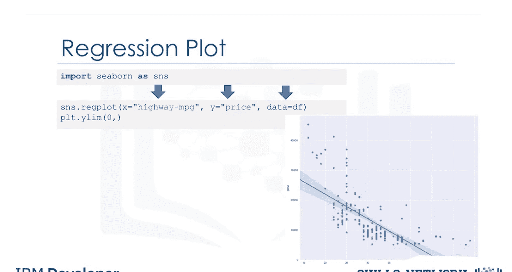

The residual plot represents the error between the actual value。

Examining the predicted value and actual value， we see a difference。

 We obtained that value by subtracting the predicted value and the actual target value。

We then plot that value on the vertical axis with an independent variable as the horizontal axis。

 Similarly， for the second sample， we repeat the process。

Subtracting the target value from the predicted value。Then， plotting the value accordingly。

Looking at the plot gives us some insight into our data。

 We expect to see the results to have0 mean distributed evenly around the X axis with similar variance。

 There is no curvature。

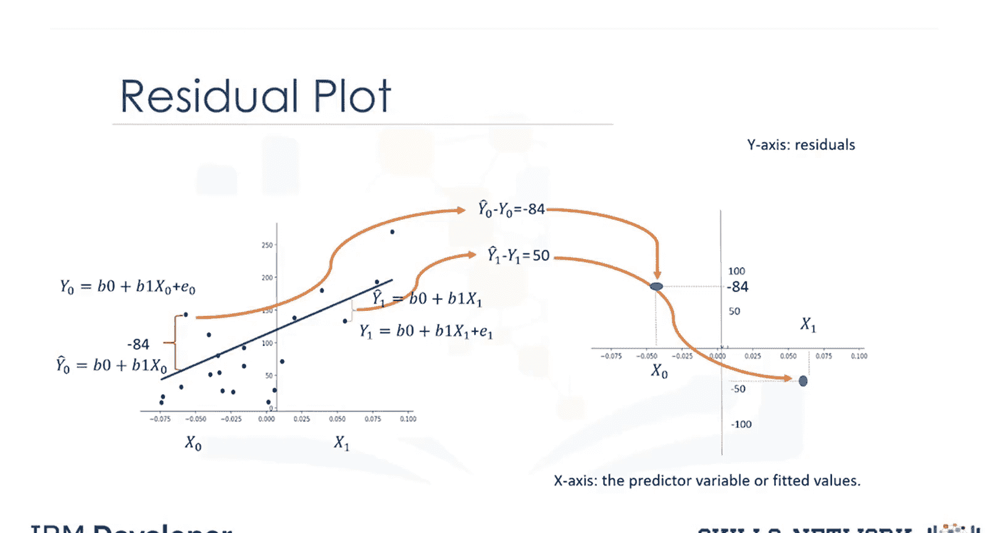

This type of residual plot suggests a linear plot is appropriate。In this residual plot。

 there is a curvature。 The values of the error change with X。 For example， in the region。

 all the residual errors are positive。In this area， the residuals are negative。In the final location。

 the error is large。The residuals are not randomly separated。

This suggests the linear assumption is incorrect。This plot suggests a non linear function。

 We will deal with this in the next section。In this plot。

 we see that variance of the residuals increases with X。 Therefore， our model is incorrect。

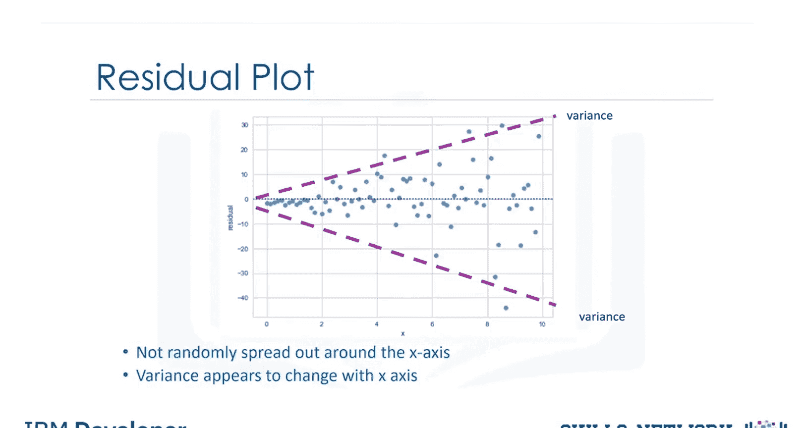

We can use seaborne to create a residual plot。 First， import seabornne。

We use the resid plot function。The first parameter is a series of dependent variable or feature。

 The second parameter is a series of dependent variable， or target。We see in this case。

 the residuals have a curvature。

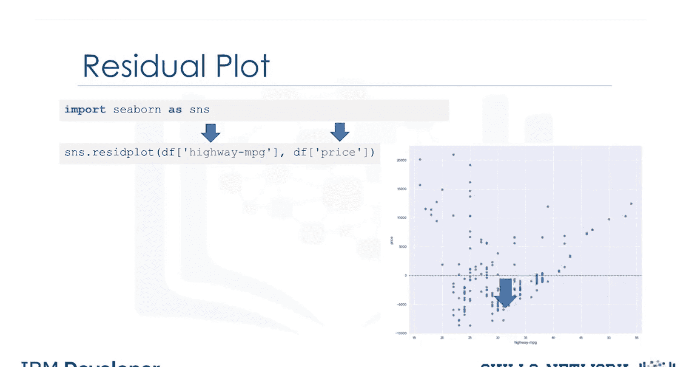

A distribution plot counts the predicted value versus the actual value。

These plots are extremely useful for visualizing models with more than one independent variable or feature。

Let's look at a simplified example。We examine the vertical axis。

 We then count and plot the number of predicted points that are approximately equal to one。

We then count and plot the number of predicted points that are approximately equal to 2。

We repeat the process for predicted points that are approximately equal to 3。

Then we repeat the process for the target values。 In this case。

 all the target values are approximately equal to 2。

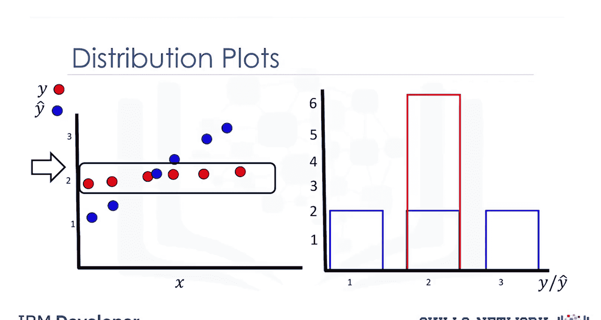

The values of the targets and predicted values are continuous。A histogram is for discrete values。

 Therefore， pandas。Will convert them to a distribution。

The vertical axis is scaled to make the area under the distribution equal to one。

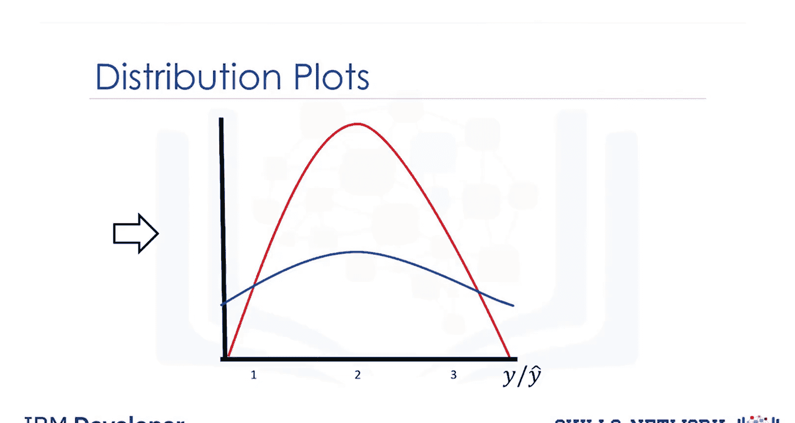

This is an example of using a distribution plot。 The dependent variable or feature is price。

 The fitted values that result from the model are in blue。 The actual values are in red。

We see the predicted values for prices in the range from 40，000 to 50，000 are inaccurate。

The prices in the region from 10000 to 20000 are much closer to the target value。 In this example。

 we use multiple features or independent variables， comparing it to the plot on the last slide。

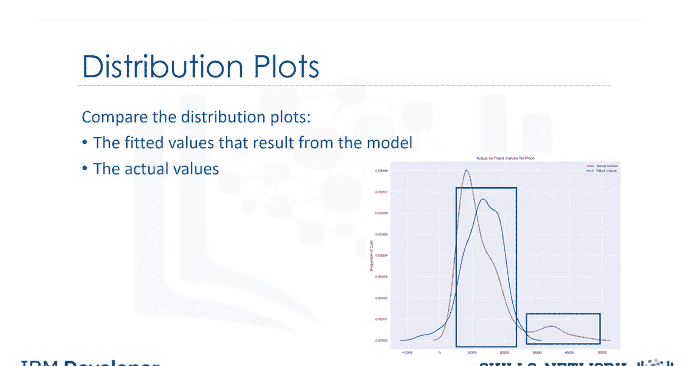

We see predicted values are much closer to the target values。

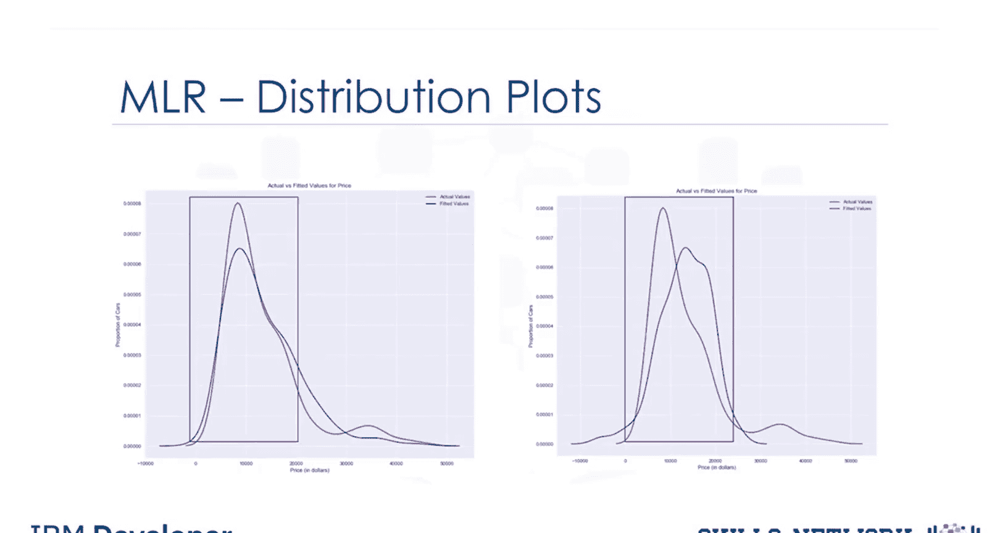

Here is the code to create a distribution plot。 The actual values are used as parameter。

 We want a distribution instead of a histogram， so we want the hist parameter set to false。

 The color is red。 The label is also included。 The predicted values are included for the second plot。

 The rest of the parameters are set accordingly。

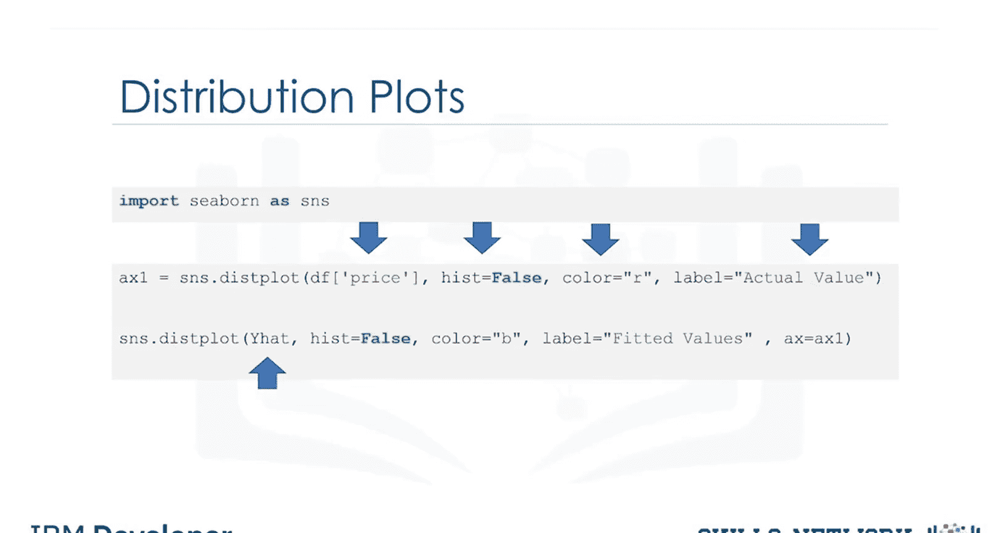