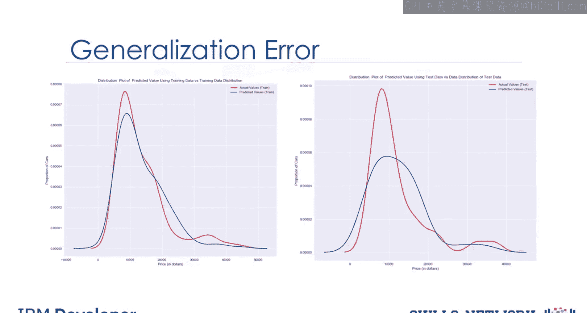
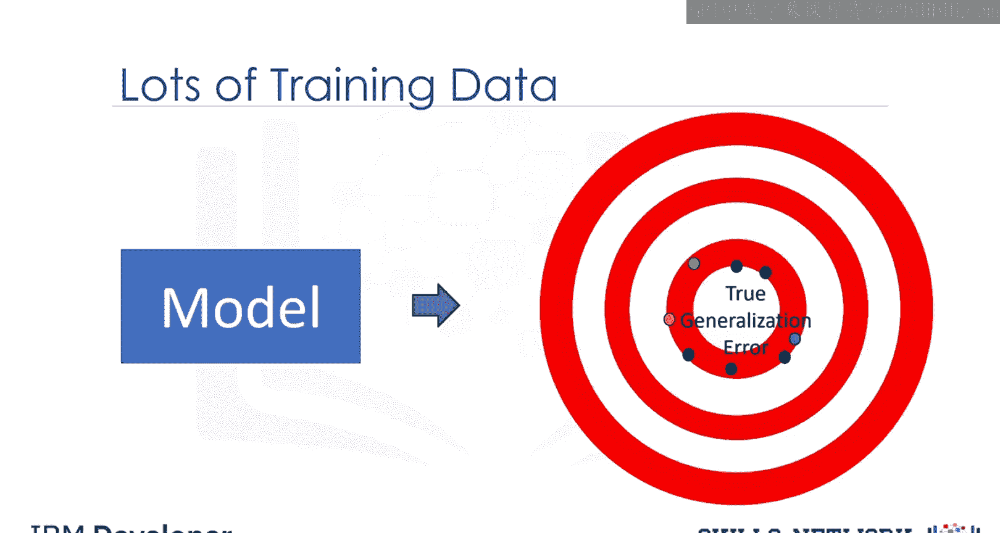
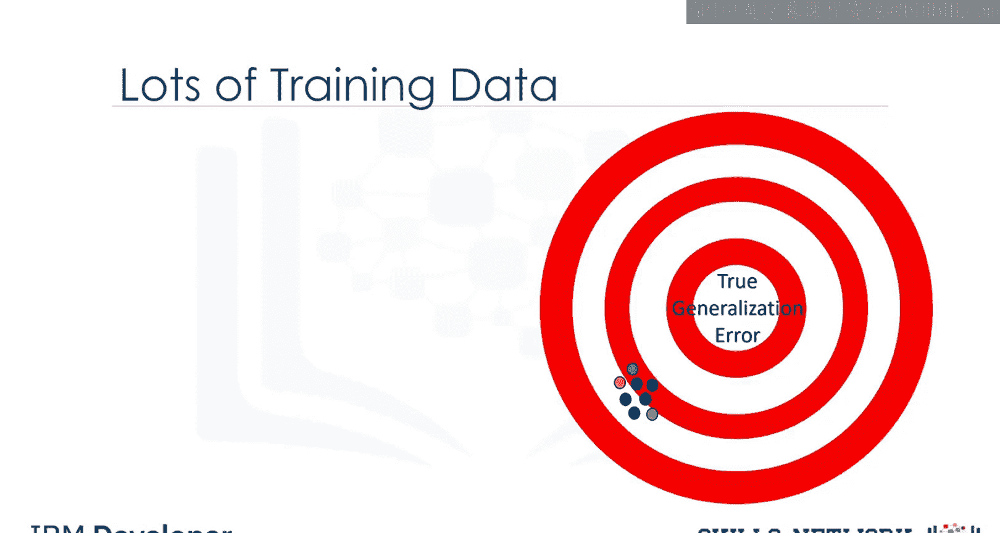
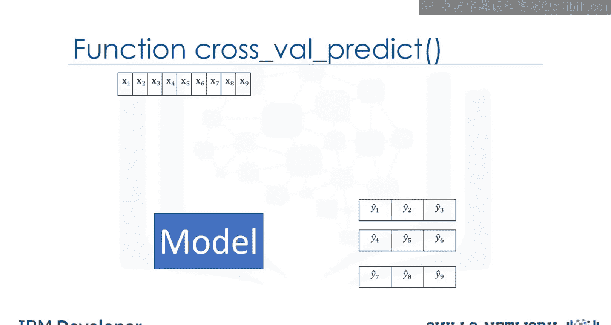

# IBM《生成式人工智能工程｜Falsk、生成式AI应用、数据分析、机器学习、Keras、架构和数据、NLP基础、transformer、微调、高级微调、RAG》 p54 24_模型评估和优化.zh_en -BV1NAq6Y9E7z_p54-

Model evaluation tells us how our model performs in the real world。 In the previous module。

 we talked about in sample evaluation。 In sample evaluation tells us how well our model fits the data already given to training it。

 It does not give us an estimate of how well the trained model can predict new data。

 The solution is to split our data up， use the in sample data or training data to train the model。

 The rest of the data called test data is used as out of sample data。

 This data is then used to approximate how the model performs in the real world。

 Separating data into training and testing sets is an important part of model evaluation。

 We use the test data to get an idea how our model will perform in the real world。

 When we split a data set。 Usually the larger portion of data is used for training。

 and a smaller part is used for testing。 For example， we can use 70% of the data for training。

 We then use 30% for testing。😊，We use training set to build a model and discover predictive relationships。

 We then use a testing set to evaluate model performance。 When we have completed testing our model。

 we should use all the data to train the model。A popular function in the Pi kit learn package for splitting data sets is the train test split function。

 This function randomly splits a dataset set into training and testing subsets。

 from the example code snippet。 This method is imported from S， K learn dot cross validation。

 The input parameters Y underscore data is the target variable。 in the car appraisal example。

 it would be the price。 An X underscore data， the list of predictor variables。 In this case。

 it would be all the other variables in the car data set that we are using to try to predict the price。

 The output is an array。😊，X underscore train and Y underscore train。 The subsets for training。

 X underscore test and Y underscore test。 The subsets for testing。 In this case。

 the test size is a percentage of the data for the testing set here it is 30%。

 The random state is a random seed for random data set splitting。

 Generalization error is a measure of how well our data does at predicting previously unseen data。

 The error we obtain using our testing data is an approximation of this error。

 This figure shows the distribution of the actual values in red compared to the predicted values from a linear regression in blue。

 We see the distributions are somewhat similar。 If we generate the same plot using the test data。

 We see the distributions are relatively different。

 The difference is due to a generalization error and represents what we see in the real world。

Using a lot of data for training gives us an accurate means of determining how well our model will perform in the real world。

But the precision of the performance will be low。Let's clarify this with an example。

 The center of this bullsey represents the correct generalization error。

 Let's say we take a random sample of the data using 90% of the data for training and 10% for testing。

The first time we experiment， we get a good estimate of the training data。If we experiment again。

 training the model with a different combination of samples， we also get a good result。

 but the results will be different relative to the first time we run the experiment。

Repeating the experiment again with a different combination of training and testing samples。

 the results are relatively close to the generalization error， but distinct from each other。

 Reing the process， we get good approximation of the generalization error， but the precision is poor。

 i。e。 All the results are extremely different from one another。

If we use fewer data points to train the model and more to test the model。

 the accuracy of the generalization performance will be less， but the model will have good precision。

The figure above demonstrates this。All our error estimates are relatively close together。

 but they are further away from the true generalization performance。

To overcome this problem， we use cross validation。 One of the most common out of sample evaluation metrics is cross validation。

In this method， the data set is split into K equal groups。 Each group is referred to as a fold。

For example， four folds。Some of the folds can be used as a training set。

 which we use to train the model， and the remaining parts are used as a test set。

 which we use to test the model。For example， we can use three folds for training。

Then use one fold for testing。This is repeated until each partition is used for both training and testing。

 At the end， we use the average results as the estimate of out of sample error。

 The evaluation metric depends on the model。 For example， the R squared。

 The simplest way to apply cross validation， is to call the cross underscore vow underscore score function。

 which performs multiple out of sample evaluations。

This method is imported from SK Learnn's model selection package。We then use the function。

 cross underscore vow， underscore score。The first input parameters is the type of model we are using to do the cross validation。

 In this example， we initialize a linear regression model or object L R。

 which we passed the cross underscore v underscore score function。

 The other parameters are X underscore data。 The predictor variable data and y underscore data。

 the target variable data。 We can manage the number of partitions with the C V parameter。 Here。

 C V equals 3， which means the data set is split into three equal partitions。

 The function returns an array of scores。 One for each partition that was chosen as the testing set。

 We can average the result together to estimate out of sample R squared using the mean function in nu Pi。

 Let's see an animation。 Let's see the result of the score array in the last slide。😊，First。

 we split the data into three folds。 We use two folds for training。 The remaining fold for testing。

 The model will produce an output。 We will use the output to calculate a score In the case of the R squared I。

e。 coefficient of determination。 We will store that value in an array。

 We will repeat the process using two folds for training and one fold for testing。Save the score。

 then use a different combination for training and the remaining fold for testing。

We store the final result。The cross Val score function returns a score value to tell us the cross validation result。

What if we want a little more information， What if we want to know the actual predicted values supplied by our model before the R squared values are calculated。

To do this， we use the cross， underscore vow， underscore predict function。

 The input parameters are exactly the same as the cross vow underscore score function。

 but the output is a prediction。 Let's illustrate the process。First。

 we split the data into three folds。 We use two folds for training， the remaining fold for testing。

The model will produce an output， and we will store it in an array。

We will repeat the process using two folds for training， one for testing。

The model produces an output， again。Finally， we use the last two folds for training。

Then we use the testing data。This final testing fold produces an output。

These predictions are stored in an array。

