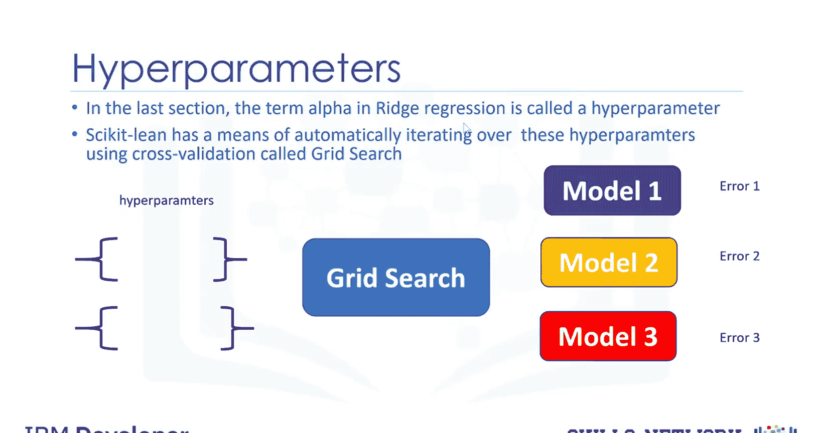
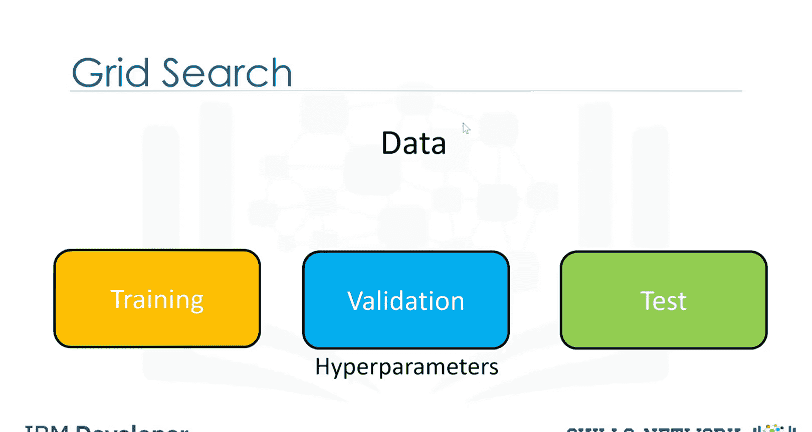
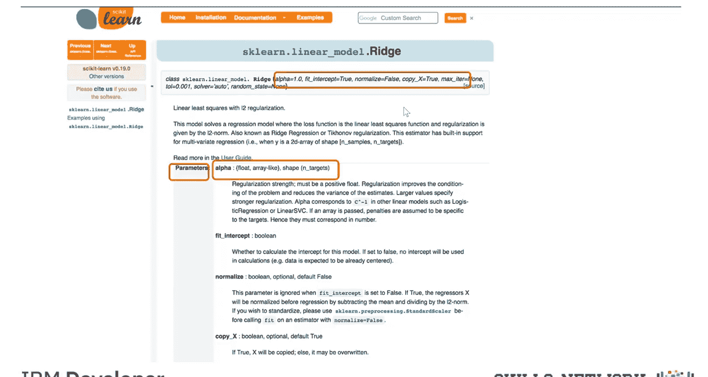
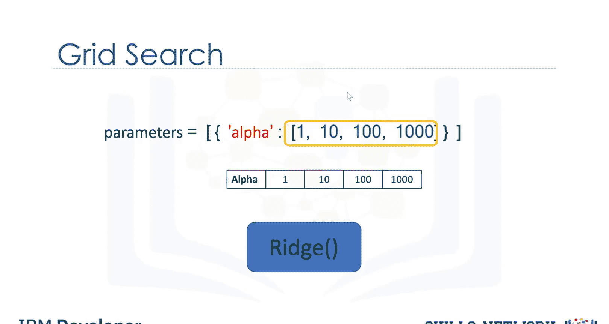
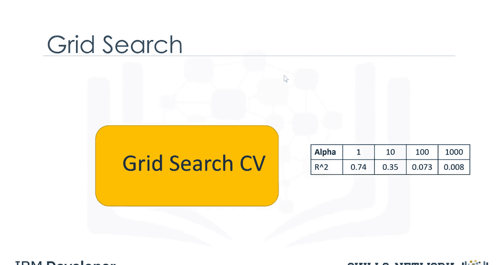
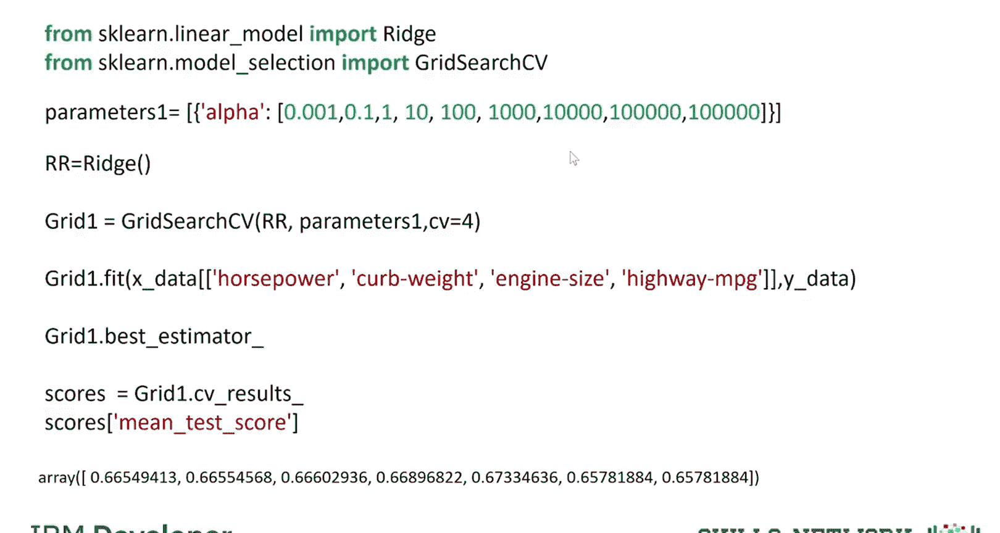
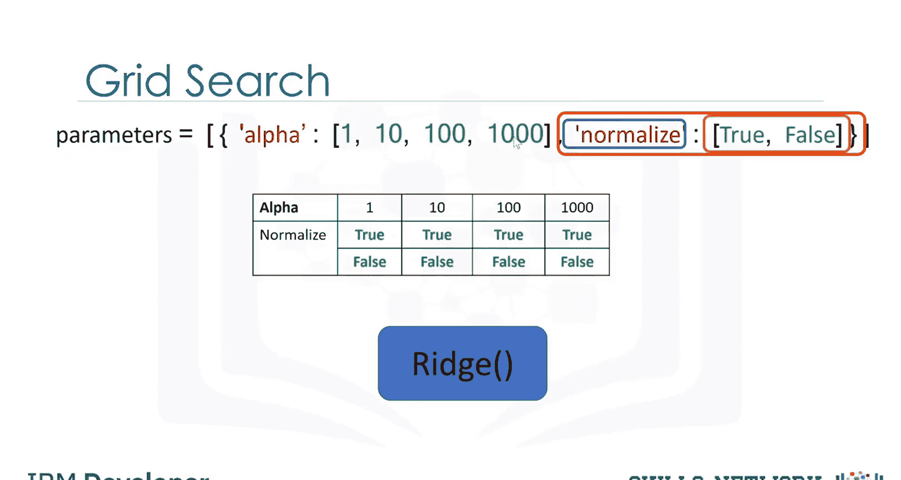
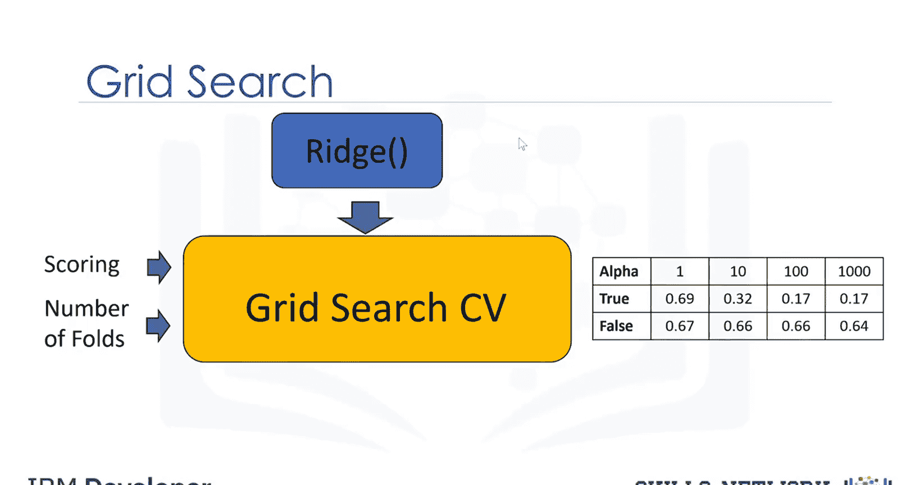
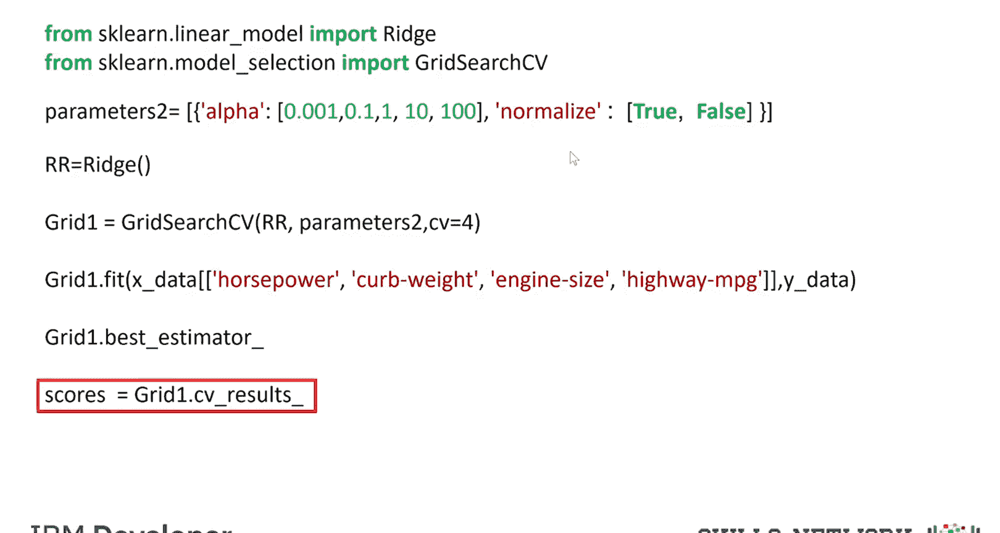

# IBM《生成式人工智能工程｜Falsk、生成式AI应用、数据分析、机器学习、Keras、架构和数据、NLP基础、transformer、微调、高级微调、RAG》 p57 27_网格搜索.zh_en -BV1NAq6Y9E7z_p57-

Grid search allows us to scan through multiple free parameters with few lines of code。

Parameterters like the alpha term discussed in the previous video are not part of the fitting or training process。

These values are called hyperparameters。si Ki learn has a means of automatically iterating over these hyperparameter using cross validation。

 This method is called grid search。 grid search takes the model or objects you would like to train and different values of the hyperparameter。

 It then calculates the mean square error or R squared for various hyperparameter values。

 Allow you to choose the best values。 Let the small circles represent different hyperparameter。

 We start off with one value for hyperparameter and train the model。

 We use different hyperparameters to train the model。😊。

We continue the process until we have exhausted the different free parameter values。

Each model produces an error。 We select the hyperparameter that minimizes the error to select the hyperparameter。

 We split our data set into three parts。 the training set， validation set and test set。

 We train the model for different hyperparameters。

We use the R squared or mean square error for each model。

 We select the hyperparameter that minimizes the mean squared error or maximizes the R squared on the validation set。

😊，We finally test our model performance using the test data。

 This is the S Ki Learn web page where the object constructor parameters are given。😊。

It should be noted that the attributes of an object are also called parameters。

 We will not make the distinction， even though some of the options are not hyperpar per se。

In this module， we will focus on the hyperparameter alpha and the normalization parameter。

The value of your grid search is a Python list that contains a Python dictionary。

 The key is the name of the free parameter。 The value of the dictionary is the different values of the free parameter。

This can be viewed as a table with various free parameter values。 We also have the object， or model。

The grid search takes on the scoring method。 In this case， R squared the number of folds。

 the model or object， and the free parameter values。😊。

Some of the outputs include the different scores for different free parameter values。 In this case。

 the R squared， along with the free parameter values that have the best score。

First， we import the libraries we need， including grid search， CV。

 the dictionary of parameter values。We create a ridge regression， object or model。

We then create a grid search CV object。The inputs are the Rige regression object。

The parameter values and the number of folds。We will use R squared。

 This is the default scoring method。 We fit the object。

We can find the best values for the free parameters， using the attribute， best estimator。

We can also get information like the mean score on the validation data using the attribute CV result。

One of the advantages of grid search is how quickly we can test multiple parameters。

For example， rich regression has the option to normalize the data to see how to standardize。

 see module 4。 The term alpha is the first element in the dictionary。

The second element is the normalized option。The key is the name of the parameter。

The value is the different options in this case， because we can either normalize the data or not。

 The values are true or false， respectively。The dictionary is a table or grid that contains two different values。

 As before， we need the ridge regression， object or model。

The procedure is similar， except that we have a table or grid of different parameter values。

 The output is the score for all the different combinations of parameter values。

The code is also similar。 The dictionary contains the different free parameter values。

 We can find the best value for the free parameters。

 The resulting scores of the different free parameters are stored in this dictionary。 Gr 1 dot C V。

 underscore results， underscore。

We can print out the score for the different free parameter values。

 The parameter values are stored as shown here。 See the course labs， for more examples。

