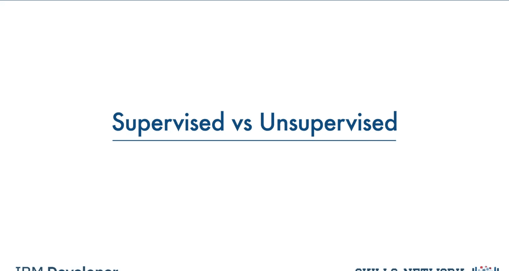
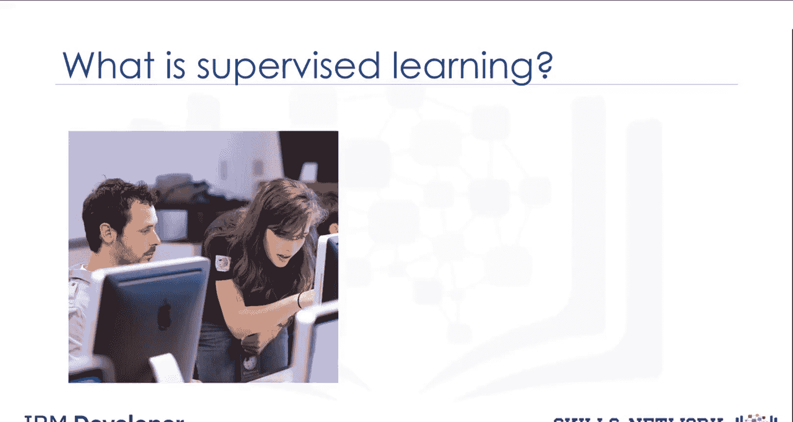
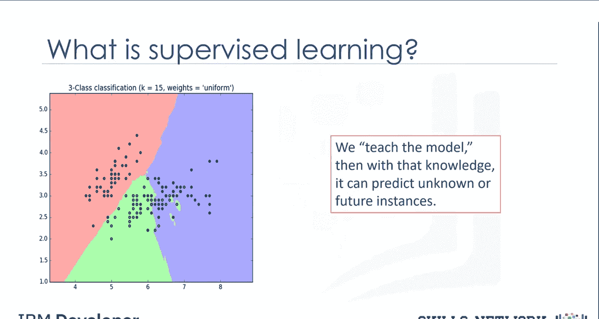
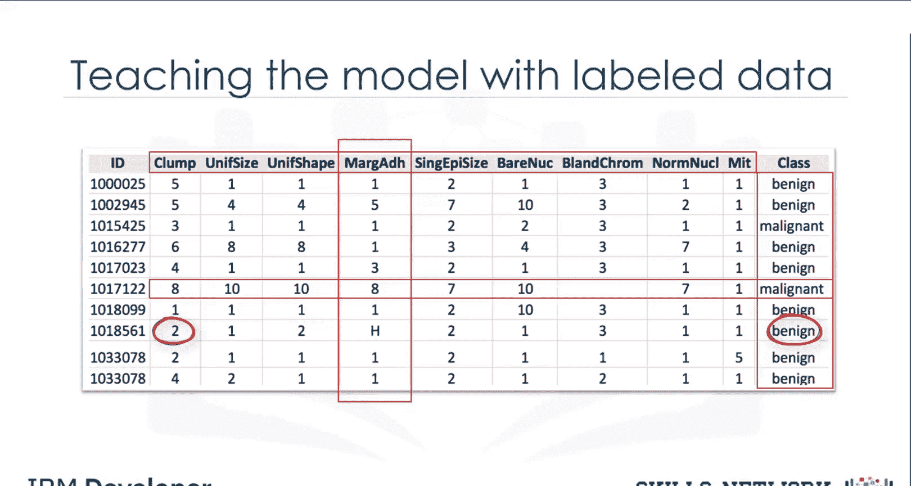
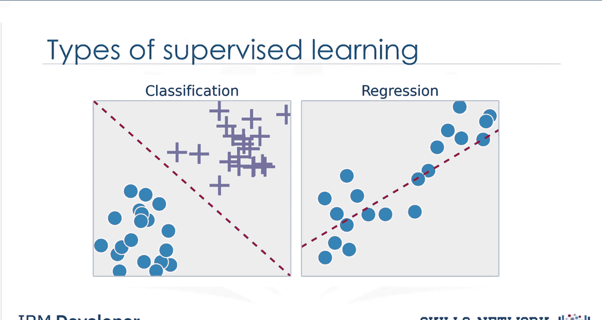
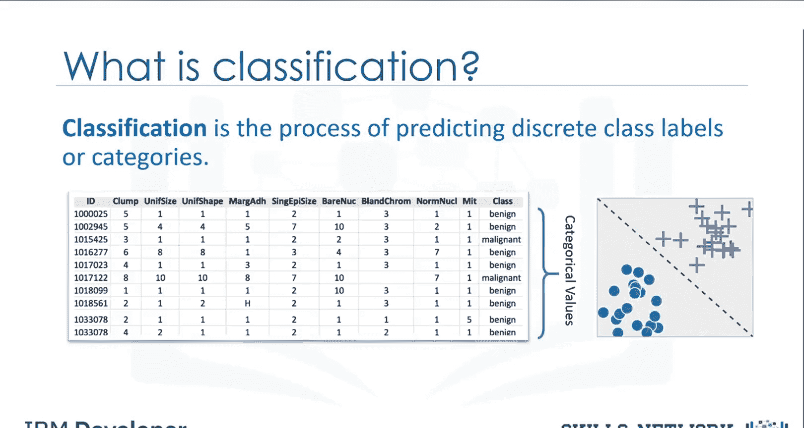
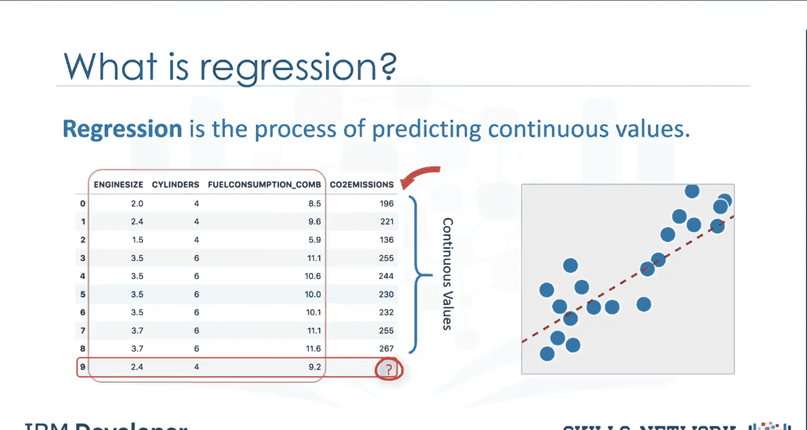
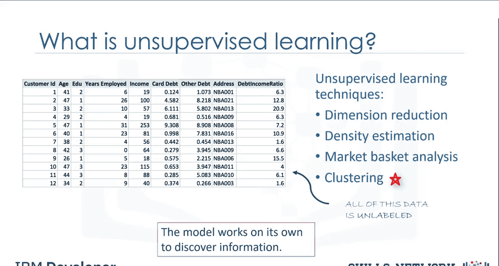
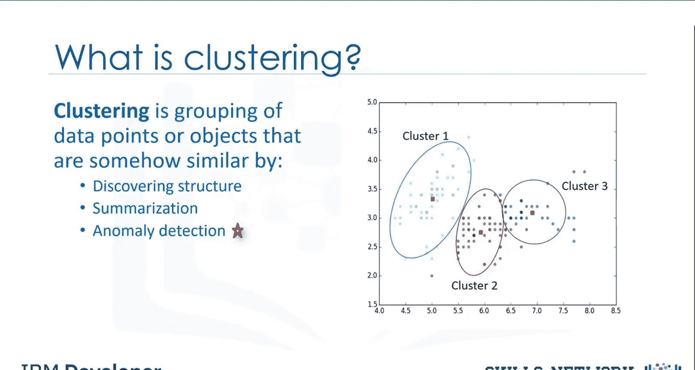
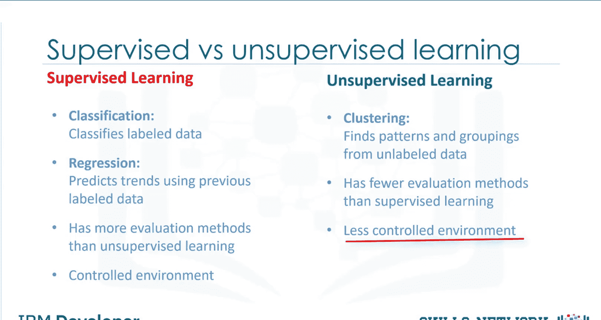

# IBM《生成式人工智能工程｜Falsk、生成式AI应用、数据分析、机器学习、Keras、架构和数据、NLP基础、transformer、微调、高级微调、RAG》 p62 4_监督学习与无监督学习.zh_en -BV1NAq6Y9E7z_p62-

Hello and welcome In this video， we'll introduce supervised algorithms versus unsupervised algorithms。

 so let's get started。

An easy way to begin grasping the concept of supervised learning is by looking directly at the words that make it up。

Supervise means to observe and direct the execution of a task， project， or activity。

Obviously， we aren't going to be supervising a person。Instead。

 we'll be supervising a machine learning model that might be able to produce classification regions like we see here。

So how do we supervise a machine learning model？We do this by teaching the model。

 that is we load the model with knowledge so that we can have it predict future instances。

But this leads to the next question， which is， how exactly do we teach a model。

We teach the model by training it with some data from a labeled data set。

It's important to note that the data is labeled。And what does a labeled data set look like？Well。

 it could look something like this。This example is taken from the cancer data set。As you can see。

 we have some historical data for patients， and we already know the class of each row。

Let's start by introducing some components of this table。The names appear here。

 which are called clump thickness， uniformity of cell size， uniformity of cell shape。

 marginal adhesion， and so on are called attributes。The columns are called features。

 which include the data。If you plot this data and look at a single data point on a plot。

 it'll have all of these attributes。That would make a row on this chart。

 also referred to as an observation。Looking directly at the value of the data。

 you can have two kinds。The first is numerical。 When dealing with machine learning。

 the most commonly used data is numeric。The second is categorical。 That is。

 it's non numeric because it contains characters rather than numbers。 In this case。

 it's categorical because this data set is made for classification。

There are two types of supervised learning techniques。 They are classification and regression。

Classification is the process of predicting a discrete class label or category。

Regression is the process of predicting a continuous value as opposed to predicting a categorical value in classification。

Look at this data set。 It is related to CO2 emissions of different cars。 It includes engine size。

 cylinders， fuel consumption and CO2 emission of various models of automobiles。Given this data set。

 you can use regression to predict the CO2 emission of a new car by using other fields such as engine size or number of cylinders。

Since we know the meaning of supervised learning， what do you think unsupervised learning means？Yes。

 unsupervised learning is exactly as it sounds。 We do not supervise the model。

 but we let the model work on its own to discover information that may not be visible to the human eye。

It means the unsupervised algorithm trains on the data set and draws conclusions on unlabeled data。

Generally speaking， unsupervised learning has more difficult algorithms than supervised learning。

 since we know little to know information about the data or the outcomes that are to be expected。

Dimenssion reduction。Density estimation， market basket analysis and clustering are the most widely used unsupervised machine learning techniques。

Dimenssionionalality reduction and or feature selection play a large role in this by reducing redundant features to make the classification easier。

Market basket analysis is a modeling technique based upon the theory that if you buy a certain group of items。

 you're more likely to buy another group of items。Density estimation is a very simple concept that is mostly used to explore the data to find some structure within it。

And finally， clustering。

Clustering is considered to be one of the most popular unsupervised machine learning techniques used for grouping data points or objects that are somehow similar。

Cluster analysis has many applications in different domains。

 whether it be a bank's desire to segment its customers based on certain characteristics or helping an individual to organize and group his or her favorite types of music。

Generally speaking， though， clustering is used mostly for discovering structure， summarization。

 and anomaly detection。

So to recap， the biggest difference between supervised and unsupervised learning is that supervised learning deals with labeled data。

 while unsupervised learning deals with unlabeled data。In supervised learning。

 we have machine learning algorithms for classification and regression。In unsupervised learning。

 we have methods such as clustering。In comparison to supervise learning。

Unsupervised learning has fewer models and fewer evaluation methods that can be used to ensure that the outcome of the model is accurate。

As such， unsupervised learning creates a less controllable environment as the machine is creating outcomes for us。

Thanks for watching。