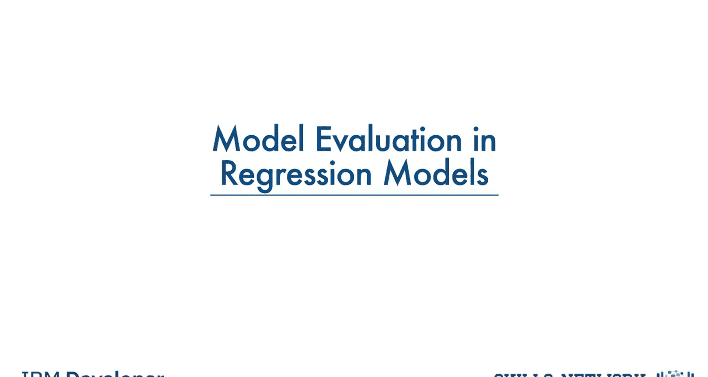
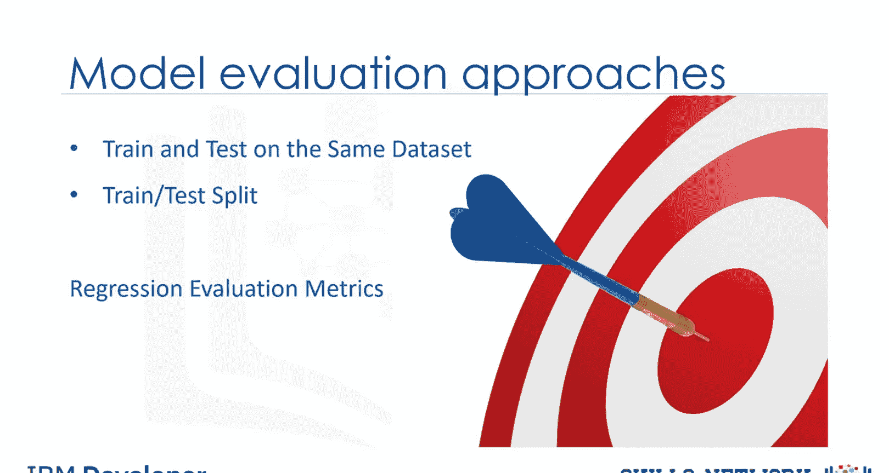
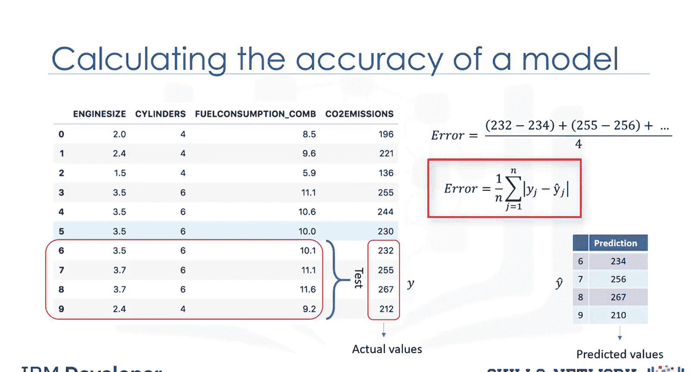
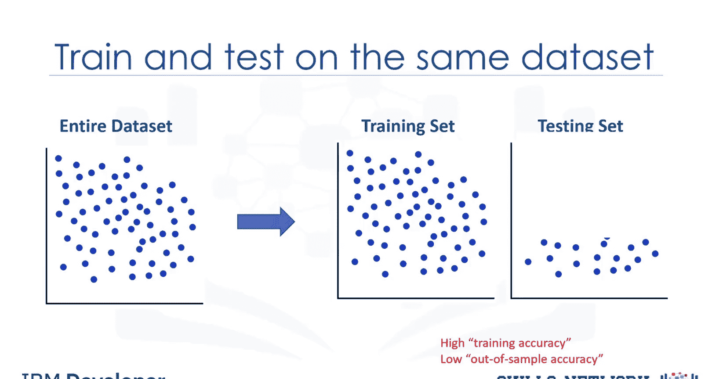
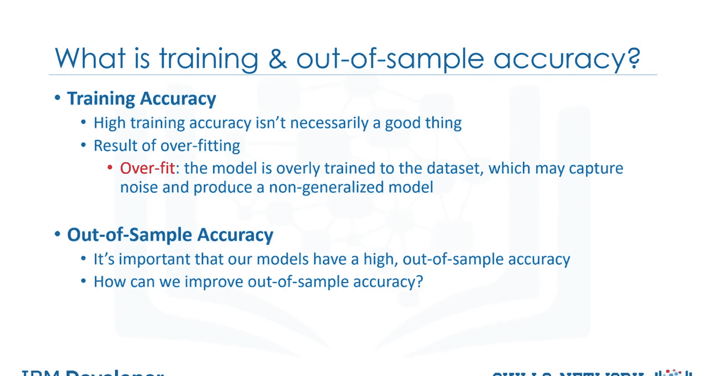
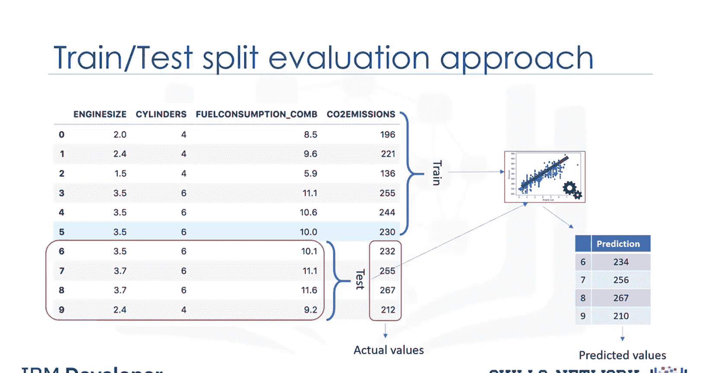
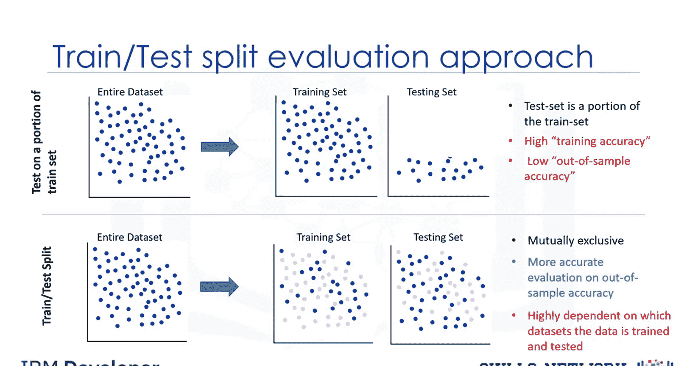
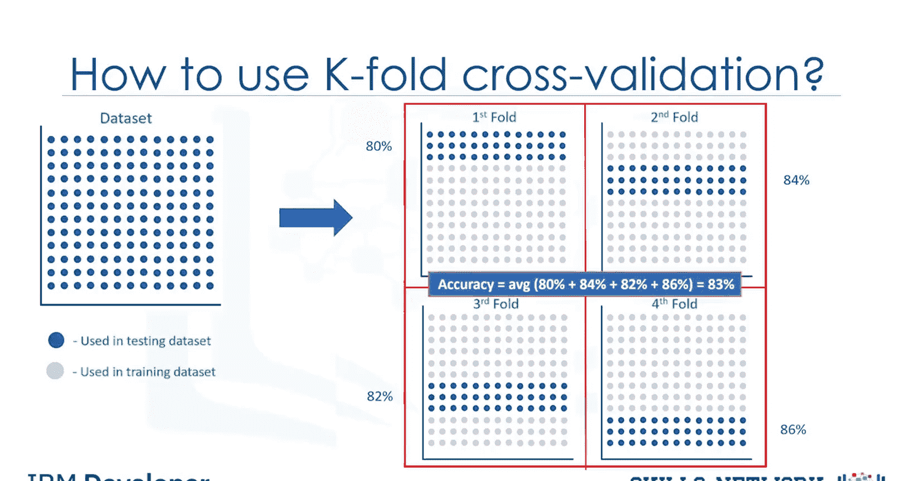

# IBM《生成式人工智能工程｜Falsk、生成式AI应用、数据分析、机器学习、Keras、架构和数据、NLP基础、transformer、微调、高级微调、RAG》 p65 7_回归模型中的模型评估.zh_en -BV1NAq6Y9E7z_p65-

Hello and welcome in this video we'll be covering model evaluation， so let's get started。

The goal of regression is to build a model to accurately predict an unknown case。 To this end。

 we have to perform regression evaluation after building the model。In this video。

 we'll introduce and discuss two types of evaluation approaches that can be used to achieve this goal。

 These approaches are train and test on the same data set and train test split。

We'll talk about what each of these are， as well as the pros and cons of using each of these models。

Also， we'll introduce some metrics for accuracy of regression models。

Let's look at the first approach。When considering evaluation models。

 we clearly want to choose the one that will give us the most accurate results。 So the question is。

 how can we calculate the accuracy of our model， In other words。

 how much can we trust this model for prediction of an unknown sample using a given data set and having built a model such as linear regression。

One of the solutions is to select a portion of our data set for testing。For instance。

 assume that we have 10 records in our data set。We use the entire data set for training。

 and we build a model using this training set。Now， we select a small portion of the dataset set。

 such as row number 6 to9， but without the labels， this set is called a test set which has the labels。

 but the labels are not used for prediction and is used only as ground truth。

The labels are called actual values of the test set。

Now we pass the feature set of the testing portion to our built model and predict the target values。

Finally， we compare the predicted values by our model with the actual values in the test set。

This indicates how accurate our model actually is。There are different metrics to report the accuracy of the model。

 but most of them work generally based on the similarity of the predicted and actual values。

Let's look at one of the simplest metrics to calculate the accuracy of our regression model。

As mentioned， we just compare the actual values Y with the predicted values。

 which is noted as Y had for the testing set。The error of the model is calculated as the average difference between the predicted and actual values for all the rows。

 We can write this error as an equation。 So the first evaluation approach we just talked about is the simplest one。

 train and test on the same data set。

Essentially， the name of this approach says it all， you train the model on the entire data set。

 then you test it using a portion of the same data set。In a general sense。

 when you test with a data set in which you know the target value for each data point。

 you're able to obtain a percentage of accurate predictions for the model。

This evaluation approach would most likely have a high training accuracy and a low out of sample accuracy。

 since the model knows all of the testing data points from the training。

What is training accuracy and out of sample accuracy？

We said that training and testing on the same data set produces a high training accuracy。

 but what exactly is training accuracy？Training accuracy is the percentage of correct predictions that the model makes when using the test data set。

However， a high training accuracy isn't necessarily a good thing。 For instance。

 having a high training accuracy may result in an overfit of the data。

 This means that the model is overly trained to the data set。

 which may capture noise and produce a non generalized model。

Out of sample accuracy is the percentage of correct predictions that the model makes on data that the model has not been trained on。

Doing a train and test on the same data set will most likely have low out of sample accuracy due to the likelihood of being overfit。

It's important that our models have high out of sample accuracy because the purpose of our model is。

 of course， to make correct predictions on unknown data。

 So how can we improve out of sample accuracy， One way is to use another evaluation approach called train test split。

In this approach， we select a portion of our data set for training， for example， rows 0 to5。

 and the rest is used for testing， for example， rows6 to9。The model is built on the training set。

Then the test feature set is passed to the model for prediction。And finally。

 the predicted values for the test set are compared with the actual values of the testing set。

This second evaluation approach is called Tra Test split。

Train test split involves splitting the data set into training and testing sets respectively。

 which are mutually exclusive， after which you train with the training set and test with the testing set。

This will provide a more accurate evaluation on out of sample accuracy。

 because the testing data set is not part of the dataset set that has been used to train the data。

 It is more realistic for real world problems。This means that we know the outcome of each data point in the data set。

 making it great to test with。And since this data has not been used to train the model。

 the model has no knowledge of the outcome of these data points， so in essence。

 it's truly out of sample testing。 however， please ensure that you train your model with the testing set afterwards as you don't want to lose potentially valuable data。

The issue with trained tests split is that it's highly dependent on the data sets on which the data was trained and tested。

The variation of this causes trained test split to have a better out of sample prediction than training and testing on the same data set。

 but it still has some problems due to this dependency。

Another evaluation model called Kfold cross validation resolves most of these issues。

How do you fix a high variation that results from a dependency？ Well， you average it。

Let me explain the basic concept of Kfold cross validation to see how we can solve this problem。

The entire data set is represented by the points in the image at the top left。

If we have K equals four folds， then we split up this data set as shown here。In the first fold。

 for example， we use the first 25% of the data set for testing and the rest for training。

The model is built using the training set and is evaluated using the test set。

Then in the next round or in the second fold， the second 25% of the data set is used for testing and the rest for training the model。

 again， the accuracy of the model is calculated。We continue for all folds。Finally。

 the result of all four evaluations are averaged； That is the accuracy of each fold is then averaged。

 keeping in mind that each fold is distinct， where no training data in one fold is used in another。

Kfold cross validation in its simplest form performs multiple trained test splits using the same data set where each split is different。

Then the result is average to produce a more consistent out of sample accuracy。

We wanted to show you an evaluation model that addressed some of the issues we've described in the previous approaches。

 however， going in depth with Kfold cross validation model is out of the scope for this course。

Thanks for watching。