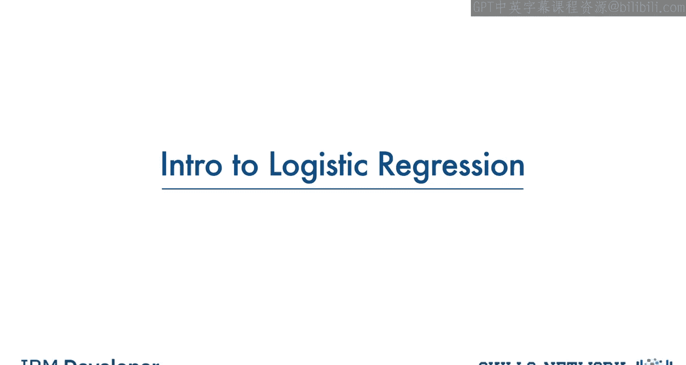
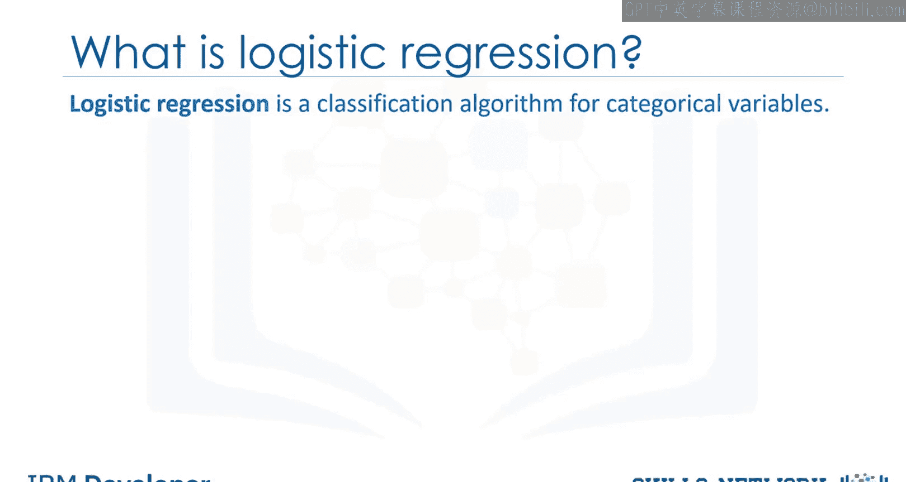
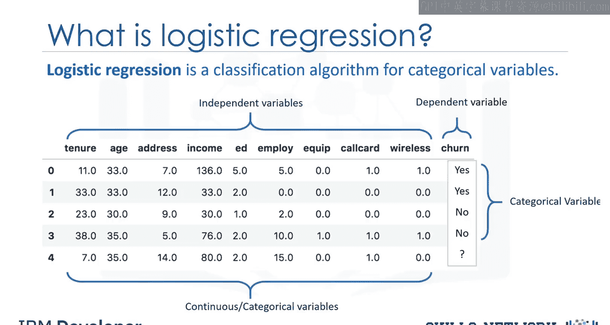
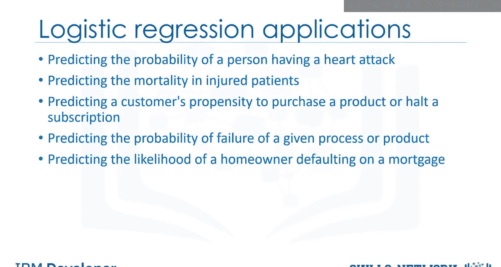
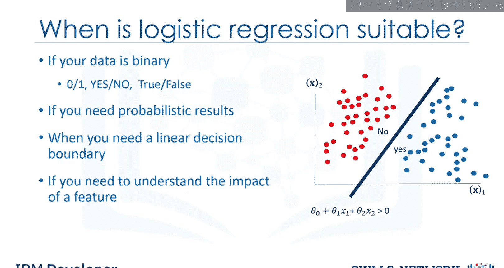
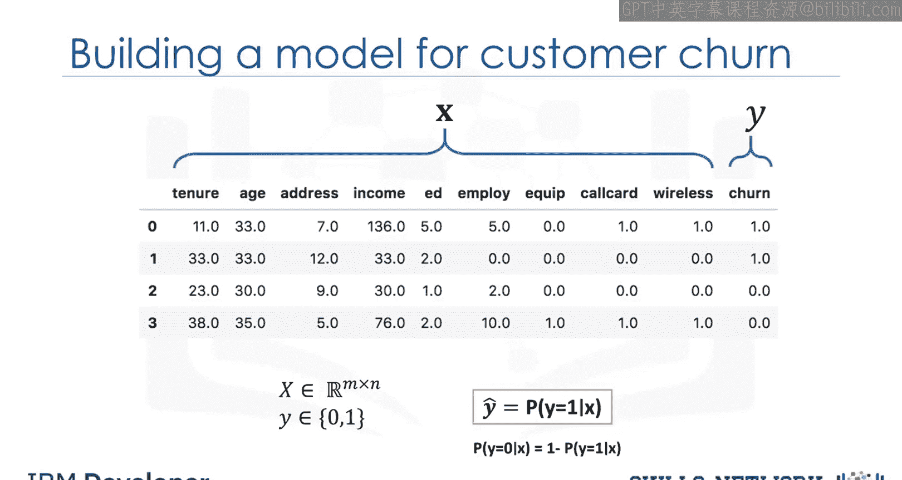

# IBM《生成式人工智能工程｜Falsk、生成式AI应用、数据分析、机器学习、Keras、架构和数据、NLP基础、transformer、微调、高级微调、RAG》 p73 15_逻辑回归简介.zh_en -BV1NAq6Y9E7z_p73-

Hello and welcome In this video， we'll learn a machine learning method called logistic regression。

 which is used for classification。 In examining this method we'll specifically answer these three questions。

 What is logistic regression。 What kind of problems can be solved by logistic regression。

 and in which situations do we use logistic regression。 So let's get started。😊。

Logistic regression is a statistical and machine learning technique for classifying records of a data set based on the values of the input fields。

Let's say we have a telecommunication data set that we'd like to analyze in order to understand which customers might leave us next month。

 This is historical customer data where each row represents one customer。

Imagine that you're an analyst at this company and you have to find out who is leaving and why。

You'll use the data set to build a model based on historical records and use it to predict the future churn within the customer group。

The data includes information about services that each customer has signed up for。

 customer account information， demographic information about customers like gender and age range。

 and also customers who've left the company within the last month。The column is called churn。

We can use logistic regression to build a model for predicting customer churn using the given features。

In logistic regression， we use one or more independent variables such as tenure。

 age and income to predict an outcome such as churn。

 which we call a dependent variable representing whether or not customers will stop using the service。

Logistic regression is analogous to linear regression。

 but tries to predict a categorical or discrete target field instead of a numeric one。

In linear regression， we might try to predict a continuous value of variables such as the price of a house。

 blood pressure of a patient， or fuel consumption of a car。But in logistic regression。

 we predict a variable which is binary， such as yes， no， true false， successful or not successful。

 pregnant， not pregnant， and so on， all of which can be coded as0 or one。In logistic regression。

 independent variables should be continuous。 If categorical， they should be dummy or indicator coded。

 This means we have to transform them to some continuous value。

Please note that logistic regression can be used for both binary classification and multiclass classification。

 but first simplicity in this video we'll focus on binary classification。

Let's examine some applications of logistic regression before we explain how they work。As mentioned。

 logistic regression is a type of classification algorithm。

 so it can be used in different situations， for example。

 to predict the probability of a person having a heart attack within a specified time period based on our knowledge of the person's age。

 sex， and body mass index。Or to predict the chance of mortality in an injured patient。

 or to predict whether a patient has a given disease。

 such as diabetes based on observed characteristics of that patient， such as weight， height。

 blood pressure， and results of various blood tests and so on。In a marketing context。

 we can use it to predict the likelihood of a customer purchasing a product or halting a subscription。

 as we've done in our churn example。We can also use logistic regression to predict the probability of failure of a given process。

 system or product。We can even use it to predict the likelihood of a homeowner defaulting on a mortgage。

These are all good examples of problems that can be solved using logistic regression。

Notice that in all these examples， not only do we predict the class of each case。

 we also measure the probability of a case belonging to a specific class。

There are different machine algorithms which can classify or estimate a variable。The question is。

 when should we use logistic regression， Here are four situations in which logistic regression is a good candidate。

 First， when the target field in your data is categorical or specifically is binary， such as 0，1。

 Yes， no， churn or no churn， positive negative and so on。Second。

 you need the probability of your prediction for example。

 if you want to know what the probability is of a customer buying a product。

Logistic regression returns a probability score between 0 and1 for a given sample of data。 In fact。

 logistic regression predicts the probability of that sample。

 and we map the cases to a discrete class based on that probability。Third。

 if your data is linearly separable， the decision boundary of logistic regression is a line or a plane or a hyperplane。

A classifier will classify all the points on one side of the decision boundary as belonging to one class and all those on the other side as belonging to the other class。

 For example， if we have just two features and are not applying any polynomial processing。

 we can obtain an inequality like theta 0 plus theta 1 x1 plus theta2 x2 is greater than0。

 which is a half plane easily plotable， please note that in using logistic regression。

 we can also achieve a complex decision boundary using polynomial processing as well。

 which is out of scope here。You'll get more insight from decision boundaries when you understand how logistic regression works。

Fourth， you need to understand the impact of a feature。

You can select the best features based on the statistical significance of the logistic regression model。

 coefficients or parameters。That is， after finding the optimum parameters。

 a feature x with the weight theta 1 close to 0 has a smaller effect on the prediction than features with large。

 absolute values of theta 1。 Indeed， it allows us to understand the impact an independent variable has on the dependent variable while controlling other independent variables。

Let's look at our data set again。 We define the independent variables as x and dependent variable as y。

Notice that for the sake of simplicity， we can code the target or dependent values to 0 or 1。

The goal of logistic regression is to build a model to predict the class of each sample。

 which in this case is a customer， as well as the probability of each sample belonging to a class。

Given that， let's start to formalize the problem。X is our data set in the space of real numbers of M by N。

 That is of M dimensions or features and n records。 And y is the class that we want to predict。

 which can be either 0 or 1。Ideally， a logistic regression model so called Y hatt can predict that the class of the customer is one given its features X。

It can also be shown quite easily that the probability of a customer being in class 0 can be calculated as1 minus the probability that the class of the customer is one。

Thanks for watching this video。

