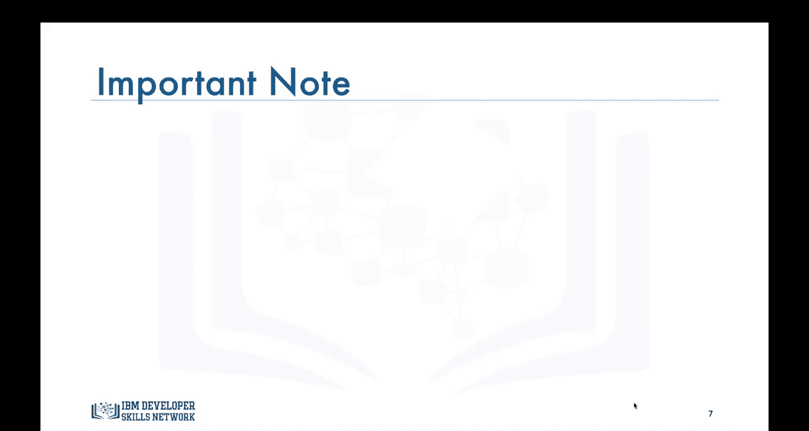
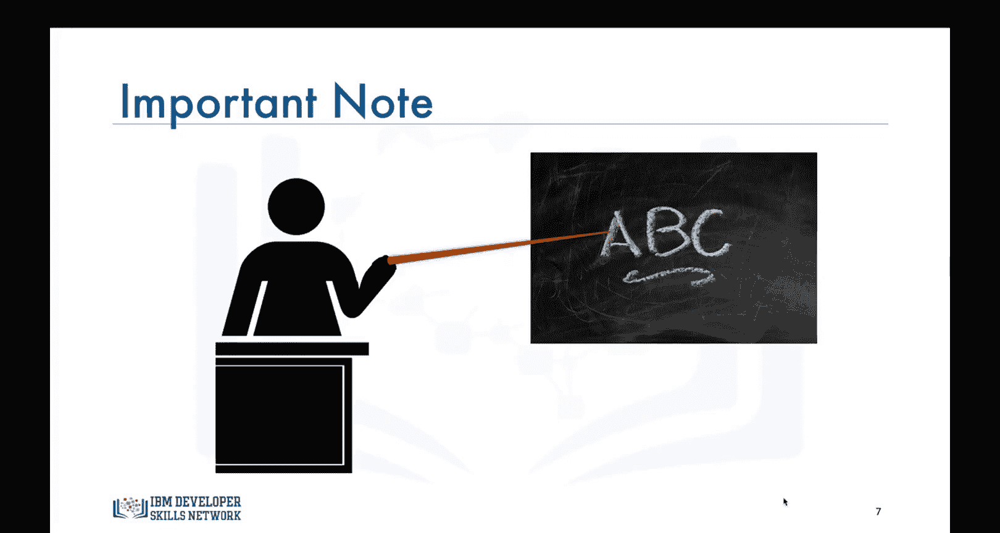
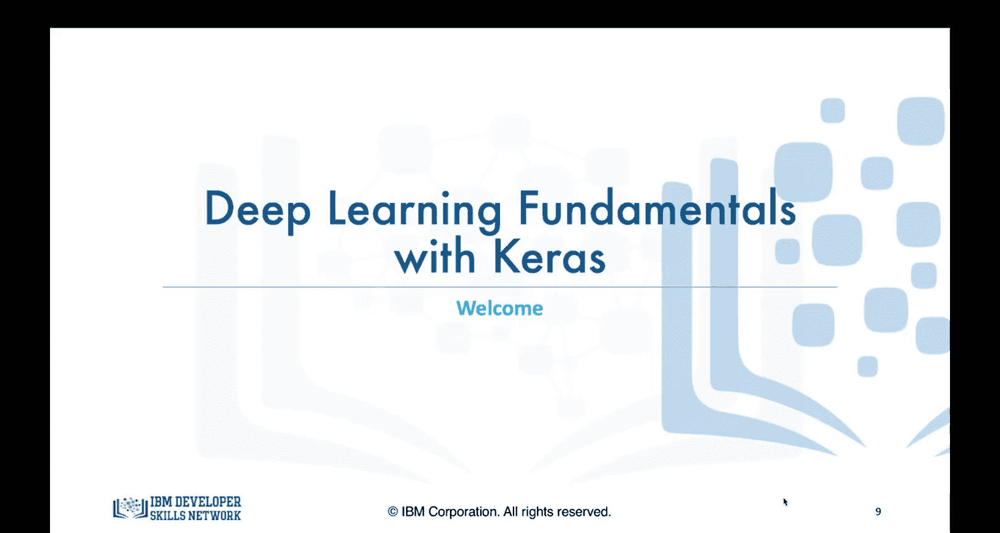

# IBM《生成式人工智能工程｜Falsk、生成式AI应用、数据分析、机器学习、Keras、架构和数据、NLP基础、transformer、微调、高级微调、RAG》 p80 0_欢迎.zh_en -BV1NAq6Y9E7z_p80-

Hello everyone and welcome to the Deep Learning fundamentalmentals with CAS Co。I'm Alex Eelson。

 your course instructor in this introductory course I will try to teach you the basics of one of the hottest topics in the field of data science。

 which is deep learning。This course will consist of four modules which you should be able to complete in four weeks。

In module1， I will try to motivate you about this field。I know that the fact that you're here。

 you must be already motivated to learn about deep learning。

 but I will share with you some very exciting applications of deep learning that will hopefully motivate you even more and demonstrate to you that there is almost no limit to what can be done using in deep learning。

We will also briefly cover neurons and neural networks in the brain so you can appreciate how they inspire artificial neural networks。

 then we will start learning about the different topics associated with artificial neural networks and in this module we will focus on the process of forward propagation。

In module 2， we will continue learning about artificial neural networks and focus on how an artificial neural network learns。

What is grid and descent？And what are activation functions？In module3。

 we will learn about some of the most popular deep learning libraries， namely Car。

Plytorch and Tensorflow。And we will learn how to use the K Library to build models for regression and classification problems。

In module 4， we will learn about supervised and unsupervised deep neural networks。

 namely convolutional neural networks， recurrent neural networks， and autoenrs。

We will also learn how to use the Curris Library to build a convolutional neural network。

Before I conclude this video， I would like to make an important note。

In this course， I decided to focus on the fundamentals of deep learning。

Deep learning is a vast field now and is continuously evolving at a fast pace。 Therefore。

 the field can be intimidating to many people。 So I have tailored this course to those who really know nothing about deep learning or neural networks。

😊，If you have worked a lot with artificial neural networks and deep learning models。

 then maybe this course is not for you。 You're more than welcome to still take it as a refresher。

 but maybe you won't learn a lot。 While I will introduce you to some advanced topics in deep learning。

 But I'm just going to give you a simplified version of them。 I just wanted to make this point clear。

😊，In order to set the expectations right at the beginning of the course。

And now with that， welcome again and let's get started。

