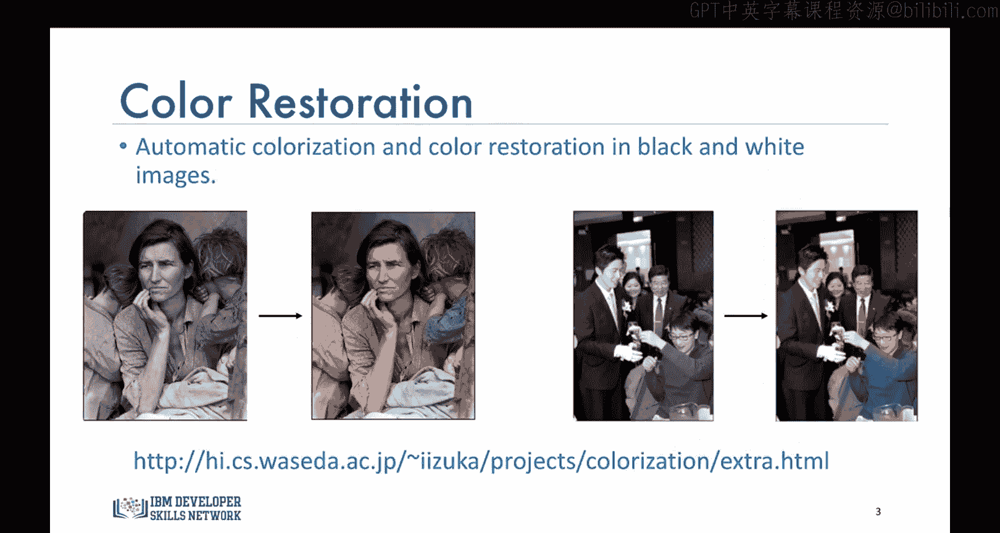
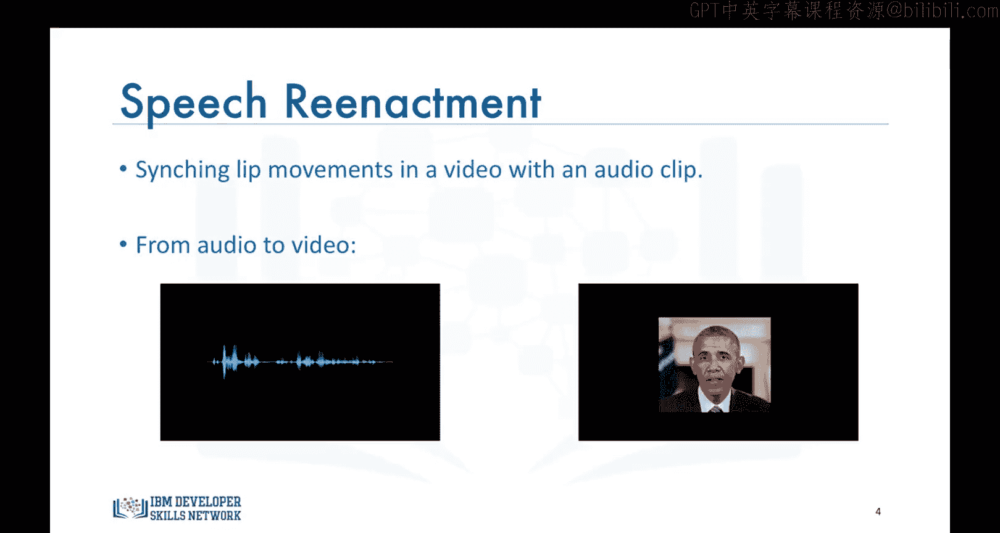
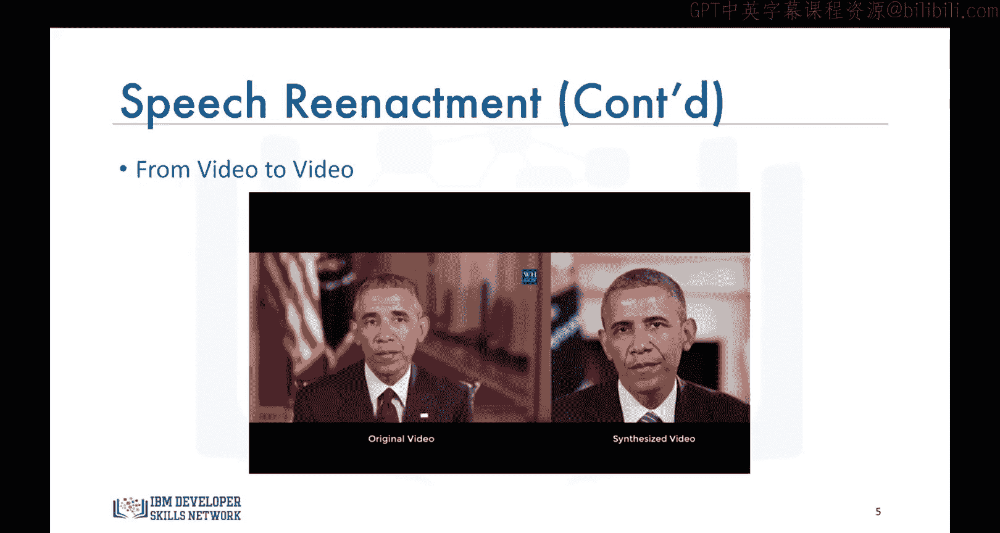
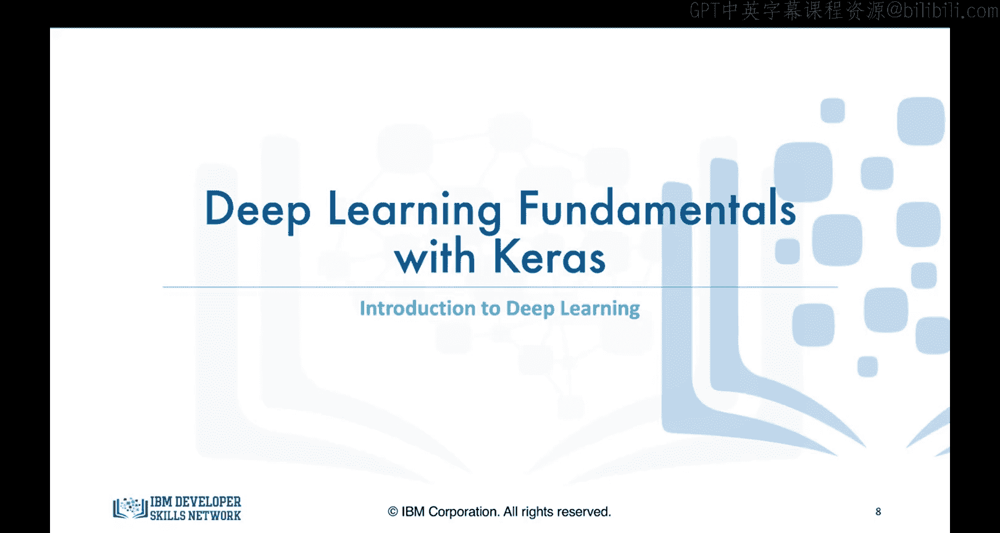

# IBM《生成式人工智能工程｜Falsk、生成式AI应用、数据分析、机器学习、Keras、架构和数据、NLP基础、transformer、微调、高级微调、RAG》 p81 1_深度学习简介.zh_en -BV1NAq6Y9E7z_p81-

In this video， we will start talking about deep learning and how the recent advances in the field have led to amazing and mind blowing applications。

I'm sure that you're aware that deep learning is one of the hottest subjects in data science。

 if not the hottest， especially with the tremendous amount of fascinating projects that are surfacing with the help of deep learning。

Projects which people deemed almost impossible just a little over a decade ago。 Therefore。

 there is a lot of excitement about deep learning In this video。

 I will share with you some amazing and recent applications of deep learning that will hopefully inspire and motivate you even more about deep learning。

😊，The first amazing application is color restoration。

 where a given image in gray scale is automatically turned into a colored one。

 A group of researchers in Japan built a system using convolutional neural networks that can take a gray scale image like these ones。

😊，And add life to them by turning them into colored ones。

You can find many other awesome examples by following this link。

 which you can also find below the video。

Another really cool but double sodid application is speech enactment。

 where an audio clip is synthesized with a video and the lip movements in the video are synced with the sounds and words in the audio clip。

Many attempts have been made in the past to build such a system。

 but many of them produced results that looked uncanny。 Recently。

 a group of researchers at the University of Washington built the first system that generates realistic results by training a recurrent neural network on a large corpus of video data of a single person。

 The subject of their case study was the former president of the United States， Barack Obama。

Let's look at their example， so here's an audio clip from one of Obama's speeches。

It's been less than a week since the deadliest mass shooting in American history。

The audio clip was synthesized with a video of one of his other speeches。

 and his lip movements were synced with the words and sounds in the audio clip。😊，Let's take a look。

It's been less than a week since the deadliest mass shooting in American history。

And he when watching the video can't really tell that the video was synthesized。

Not only that， but their system is also capable of extracting an audio from a video and syncing the lip movements in another video with the audio from the first video。

 Let's look at an example of this。😊，Especially our friends who were lesbian， gay。

 bisexual or transgender。I visited with the families of many of the victims on Thursday。

 and one thing I told them is that they're not alone。Your jaw dropped yet。 Well， mine did。

 although I created this slide and I knew what was coming。😊。

Another fascinating application of deep learning is automatic handwriting Gene。

 Alex Graves at the University of Toronto used recurrent neural networks to design an algorithm that can rewrite a given message in highly realistic。

 cursive handwriting in a wide variety of styles so you can type some text。😊，In this field。

 and you can either select the style of handwriting to be generated or let the algorithm randomly selected for you。

There is a plethora of other applications such as automatic machine translation。

 where convolutional neural networks are used to translate text in an image on the fly。

Another application is automatically adding sounds to silent movies。

 where a deep learning model uses a database of prerecorded sounds to select a sound to play that best matches what's taking place in the scene。

Not to leave out the popular applications of classifying objects and images and self driving cars。

For almost all of theforementioned applications， you heard me say neural networks again and again。

So you must be asking， haven't neural networks been around for quite some time。

 how come all of a sudden they're taking off and becoming very popular with endless applications？

In order to answer this question， let's start learning the specifics of neural networks and deep learning。

