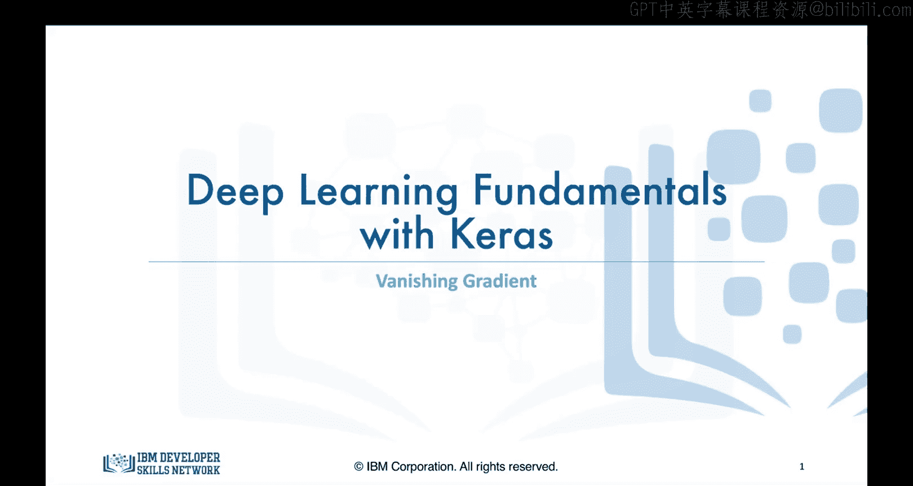
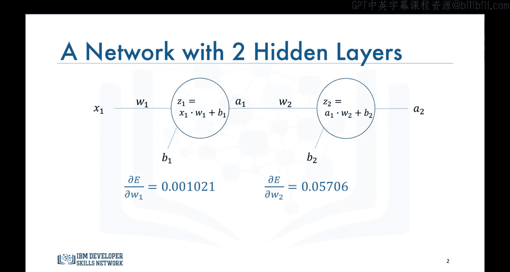
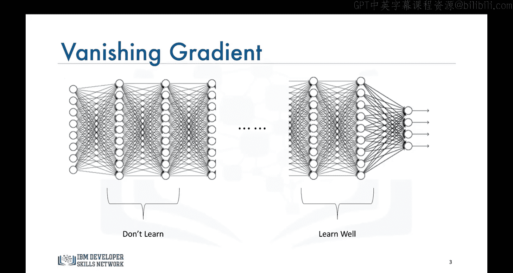

# IBM《生成式人工智能工程｜Falsk、生成式AI应用、数据分析、机器学习、Keras、架构和数据、NLP基础、transformer、微调、高级微调、RAG》 p86 6_梯度消失.zh_en -BV1NAq6Y9E7z_p86-

In this video， we will discuss a problem with the sigmoid activation function that prevented neural networks from booming sooner。

This problem is the vanish gradient problem。

Recalllled from the previous video with a very simple network of two neurons。

 only the derivatives of the error with respect to the weights were as follows。

See how small the gradients are， but more importantly。

 how small the gradient of the error with respect to W1。

Well， it turns out that because we're using the sigmoid function as the activation function。

 then all the intermediate values in the network are between zero and1。

So when we do back propagation， we keep multiplying factors that are less than one by each other。

 and so that gradients tend to get smaller and smaller as we keep on moving backward in the network。

This means that the neurons in the earlier layers learned very slowly as compared to the neurons in the later layers in the network。

The earlier layers in the network are the slowest to train。

The result is a training process that takes too long and a prediction accuracy that is compromised。

Accordingly， this is the reason why we do not use the sigmoid function or similar functions as activation functions since they're prone to the vanishing gradient problem。

Therefore， in the next video， we will learn about other activation functions that became so popular and are now the activation functions that get used almost all the time in the hidden layers since they help in overcoming the vanishing gradient problem。

