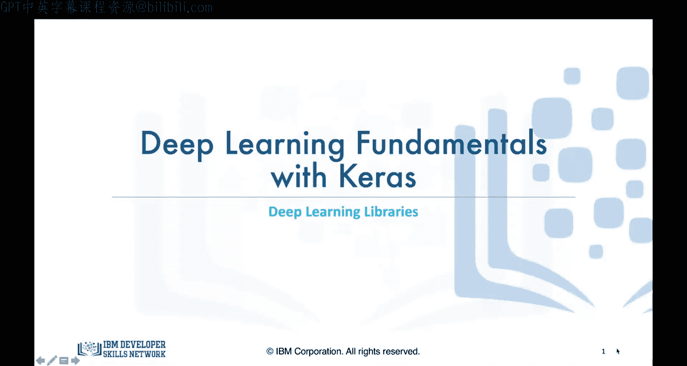
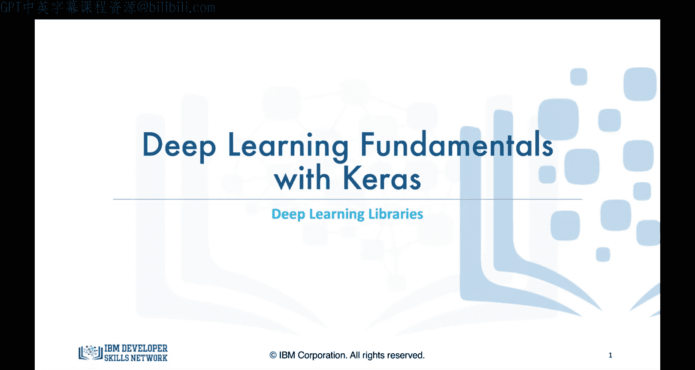
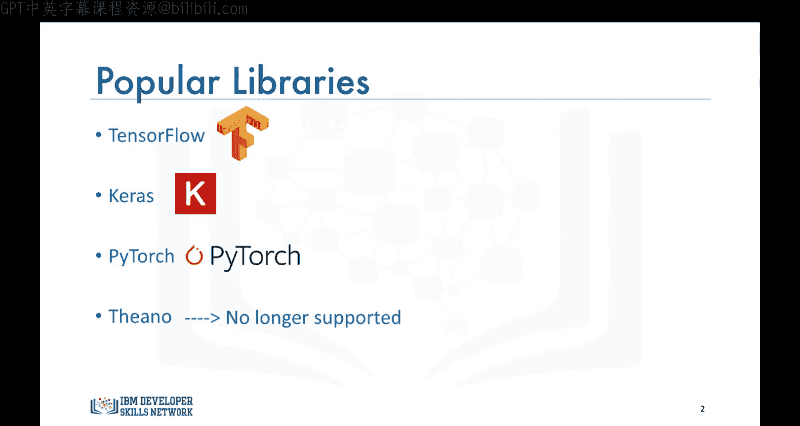
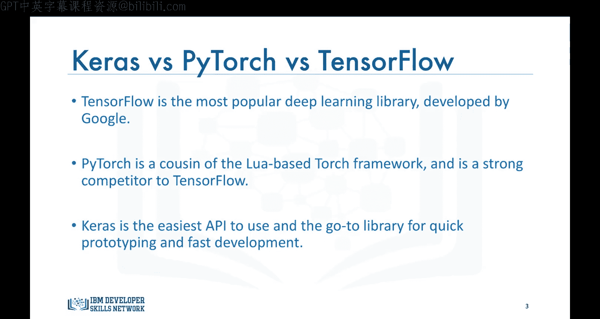

# IBM《生成式人工智能工程｜Falsk、生成式AI应用、数据分析、机器学习、Keras、架构和数据、NLP基础、transformer、微调、高级微调、RAG》 p88 8_深度学习库.zh_en -BV1NAq6Y9E7z_p88-

Before we can start building deep learning networks we will spend some time learning about the different deep learning libraries and frameworks that are out there in this video I will briefly cover the libraries that we will be teaching in this specialization。

The most popular libraries in descending order are Tensorflow， Cars and Pytorch。 There is also Tiano。

 a library developed by the Montreal Institute for Learning Alrithms。

 and was the major library for deep learning development even before TensorF and Pytorch。 However。

 the founders can't afford to continuously supported and maintained it。

 and therefore the library lost its popularity。Because of that， in this specialization。

 we will focus on the three other popular libraries。

Among the three libraries， TensorF is the most popular one。

 It's the library that's mostly used in production of deep learning models。

 It has a very large community。 just a quick look at the number of forks on the library's Github repository。

 as well as the number of commits and pull requests should suffice in giving you an idea of how popular the library is。

TensorF was developed by Google and released to the public in 2015 and is still being actively used at Google for both research and production needs。

Pytorrch， on the other hand， is the cousin of the Torch framework。

 which is in Lua and supports machine learning algorithms running on GPs in particular。However。

 being derived from the torch framework， Pytorrch isn't just a set of rappers to support a popular language like Python。

It was actually rewritten and tailored to be fast and feel native。

Pytorch was released in 2016 and has gained immense interest lately and is becoming the preferred language over Tensorflow。

 especially in academic research settings and applications of deep learning。

 requiring optimizing custom expressions。 Pytorch is supported and being actively used at Facebook。

However， despite their popularity， both Pytorch and Tensorflow are not easy to use and have a steep learning curve。

 So for people who are just starting to learn deep learning。

 there is no better library to use other than the Keis library。

Cis is a high level API for building deep learning models。

 It has gained favor for its ease of use and syntactic simplicity， Faacilitating fast development。

 As you will see in the next couple of videos，  building a very complex deep learning network can be achieved with Keis with only few lines of code。

😊，Cis normally runs on top of a low level library， such as Tensorflow。

 This means that to be able to use the Keis library， you will have to install Tensorflow first。

 and when you import Caris， it will be explicitly displayed what backend was used to install the Keis library。

Curris is also supported by Google。I won't go into more details about the different libraries。

 but the take home message here is， if you' are interested in building something quickly。

 go with the Keis library。 You won't be disappointed。 However。

 if you want to have more control over the different nodes and layers in the network and want to watch closely what happens with the network over time。

 then pytorrch or tensorflow would be the right library。

It will really boil down to your personal preference。

With that in the next videos， we will start learning how to use the CA Library to build models for regression and classification problems。

