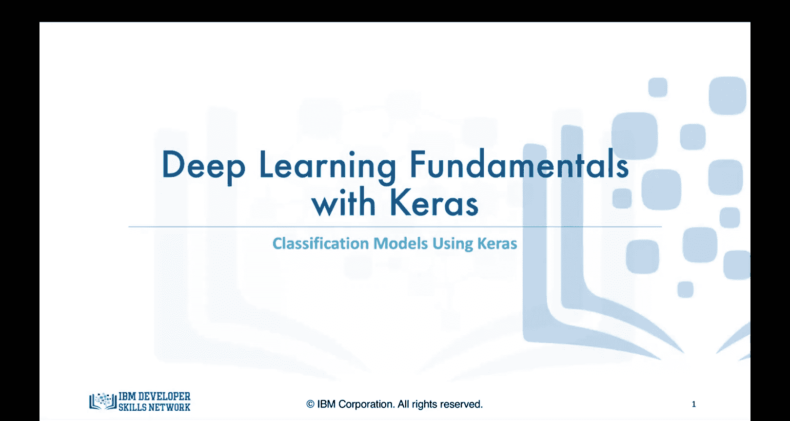
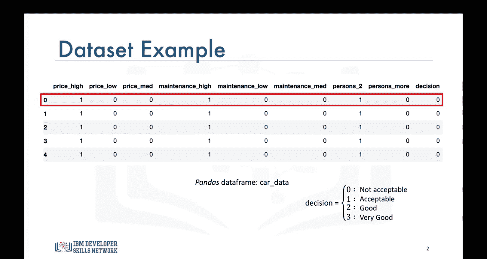
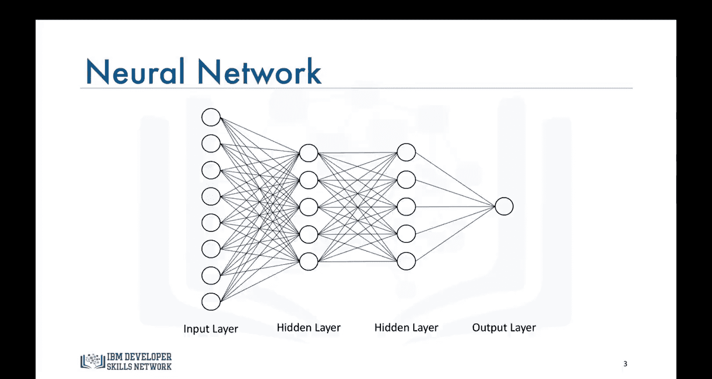
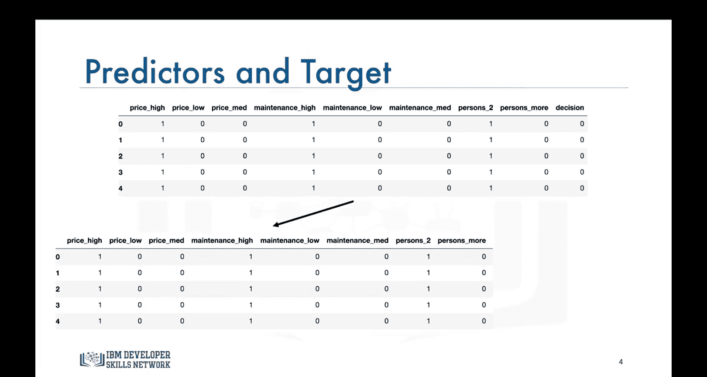
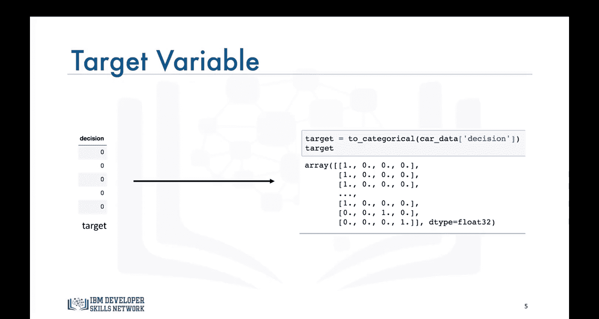
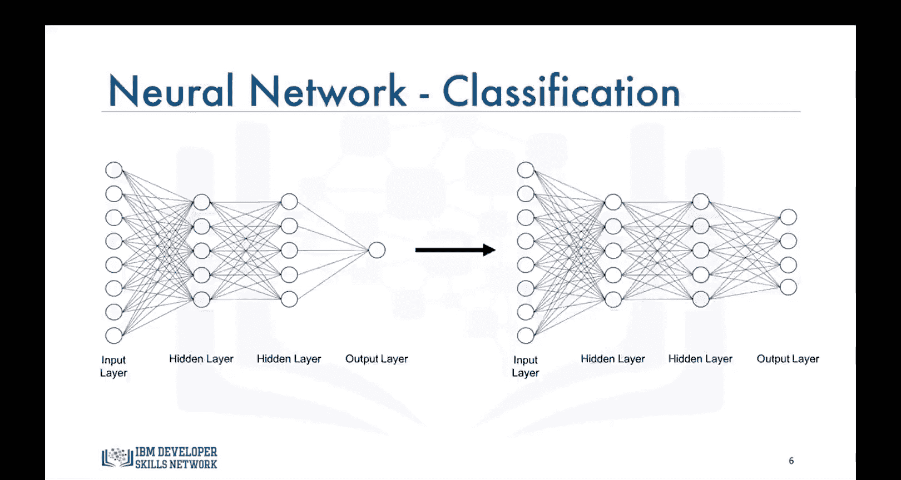
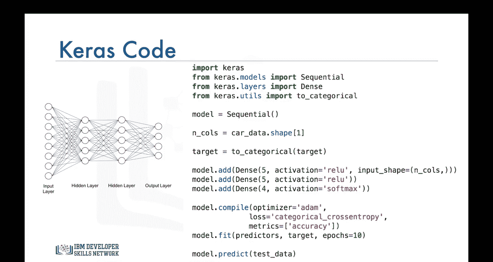
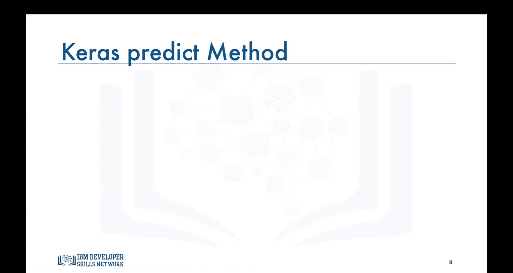
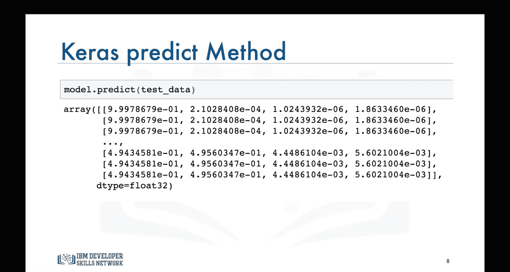
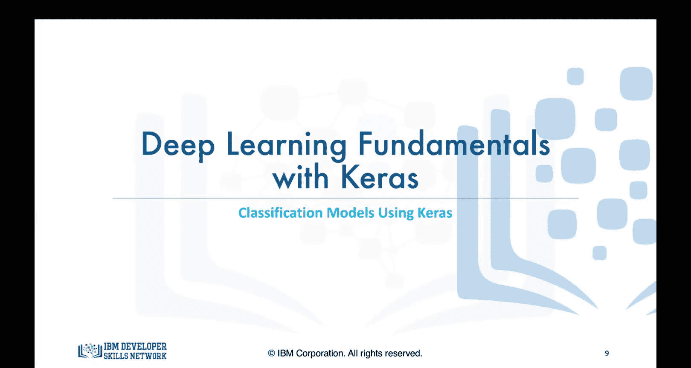

# IBM《生成式人工智能工程｜Falsk、生成式AI应用、数据分析、机器学习、Keras、架构和数据、NLP基础、transformer、微调、高级微调、RAG》 p90 10_使用Keras的分类模型.zh_en -BV1NAq6Y9E7z_p90-

In this video， we will learn how to use the CA library to build models for classification problems。

Let's say that we would like to build a mo that would inform someone whether purchasing a certain car would be a good choice based on the price of the car。

 the cost to maintain it， and whether it can accommodate two or more people。

So here's a data set that we're calling car data。I already clean the data as you can see。

 where I used one hot encoding to transform each category of price， maintenance。

 and how many people of the car can accommodate into separate columns。😡。

So the price of the car can be either high， medium or low。Similarly。

 the cost of maintaining the car can also be high， medium or low。

 and the car can either fit two people or more。If you take the first car in the data。

 it is considered an expensive car， has high maintenance cost， and can fit only two people。

The decision is zero。Meaning that buying this car would be a bad choice。

A decision of one means that buying the car is acceptable。

 a decision of two means that buying the car would be a good decision and a decision of three means that buying the car would be a very good decision。

Let's use the same neural network as the one we used for the regression problem that we discussed in the previous video。

 so a network that still takes eight inputs or predictors consists of two hidden layers。

 each of five neurons and an output layer。

Next， let's divide our data set into predictors。And target。

However， with CAis for classification problems， we can't use the target column as is。

 we actually need to transform the column into an array with binary values similar to one hot encoding。

 like the output shown here。We easily achieve that using the tool categorical function from the CA Uil package。

😊。

In other words， our model， instead of having just one neuron in the output layer。

 it would have four neurons since our target variable consists of four categories。

In terms of code， the structure of our code is pretty similar to the one we use to build the model for a regression problem。

We start by importing the Ke library and the sequential model， and we use it to construct our model。

 we also import the dense layer since we will be using it to build our network。

The additional import statement here is the two categorical function in order to transform our target column into an array of binary numbers for classification。

Then we proceed to constructing our layers， we use the add method to create two hidden layers each with five neurons。

 and the neurons are activated using the relu activation function。

Notice how here we also specify the soft Max function as the activation function for the output layer so that the sum of the predicted values from all the neurons in the output layer sum nicely to one。

Then in defining our compiler here， we will use the categorical cross entropy as our loss measure instead of the mean squared error that we use for regression。

 and we will specify the evaluation metric to be accuracy。

Accuracy is a built in evaluation metric in CAis， but you can actually define your own evaluation metric and pass it in the metrics parameter。

 then we fit the model。😊，Notice how this time we were specifying the number of epochs for training the model。

 although we didn't specify the number of epochs when we built our regression model。

 but we could have done that Finally we use the predict method to make predictions。

Now， the output of the CAis predictic method would be something like what's shown here for each data point。

 the output is the probability that the decision of purchasing a given car belongs to one of the four classes。

 for each data point， the probability should sum to 1， and the higher the probability。

 the more confident is the algorithm， that a data point belongs to the respective class。

 So for the first data point or the first car in the test set， the decision would be 0。

 meaning not acceptable， since the first probability is the highest with a value of 0。

99 or close to one in this case， Similarlyly， for the second data point。

 the decision is also 0 or not acceptable， since the probability for this class is the highest。

 again， with a value of 0。99 or almost one。For the first three data points。

 the model is very confident that purchasing these cars is not acceptable。

As for the last three data points， the decision would be one or acceptable since the probabilities for the second class are higher than the rest of the classes。

 but notice how the probabilities for decision zero and decision1 are very close。

 therefore the model is not very confident， but it would lean towards accepting purchasing these cars。

In the lab part， you will get the chance to build your own regression and classification models using the CAis library。

 so make sure to complete this module's lab components。

