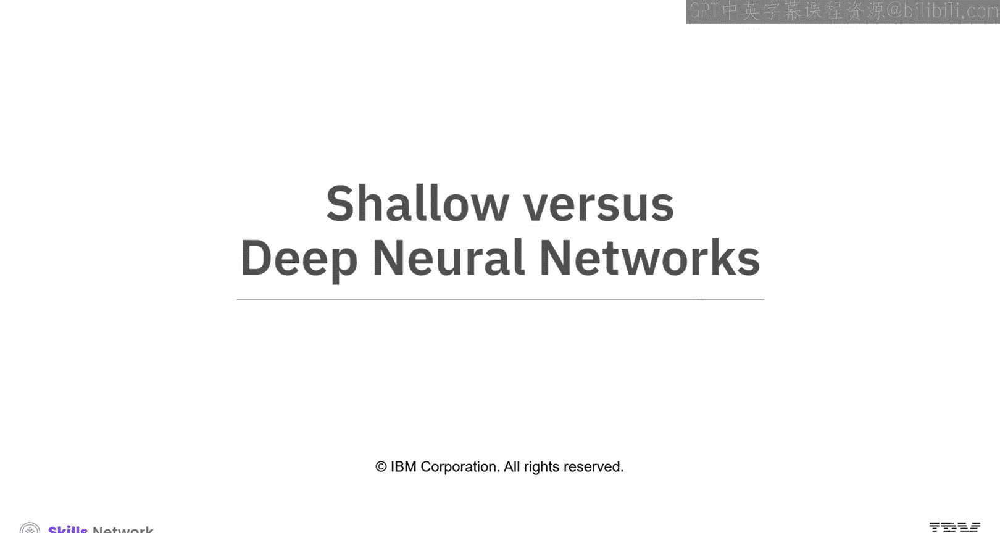
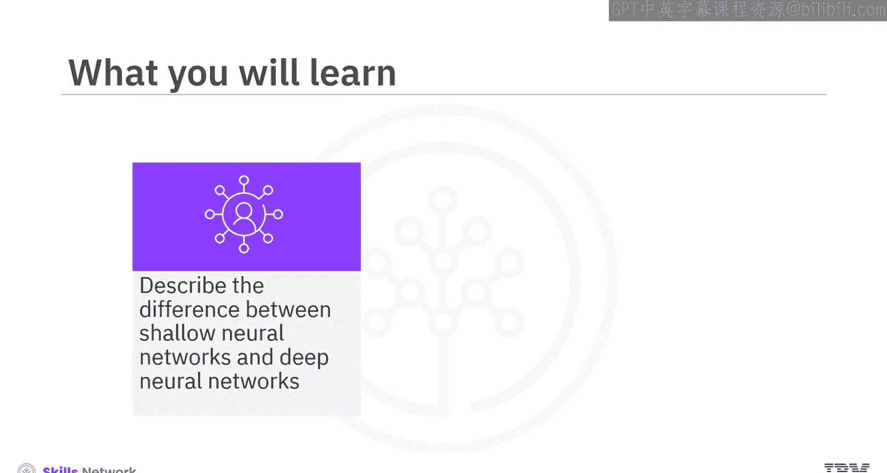
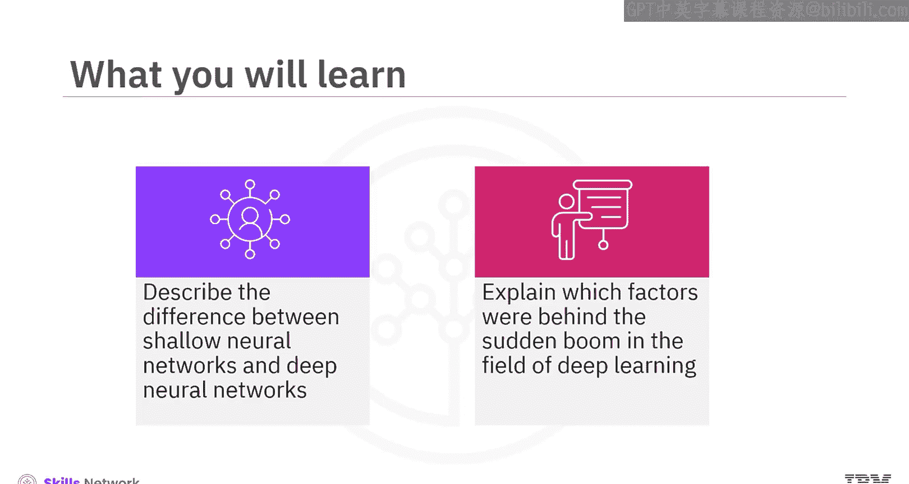
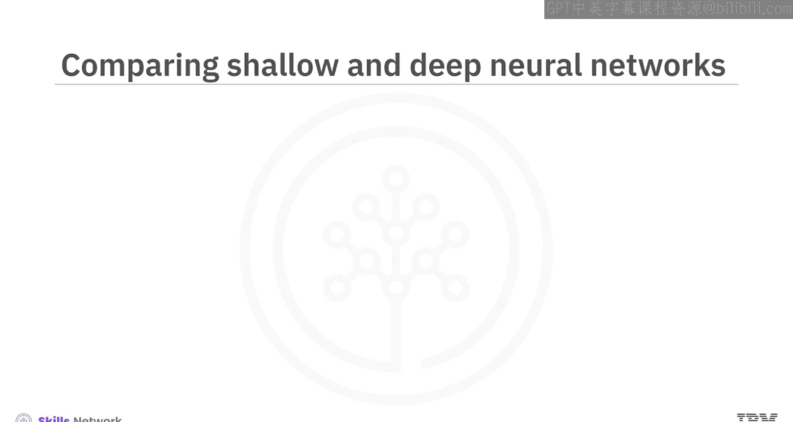
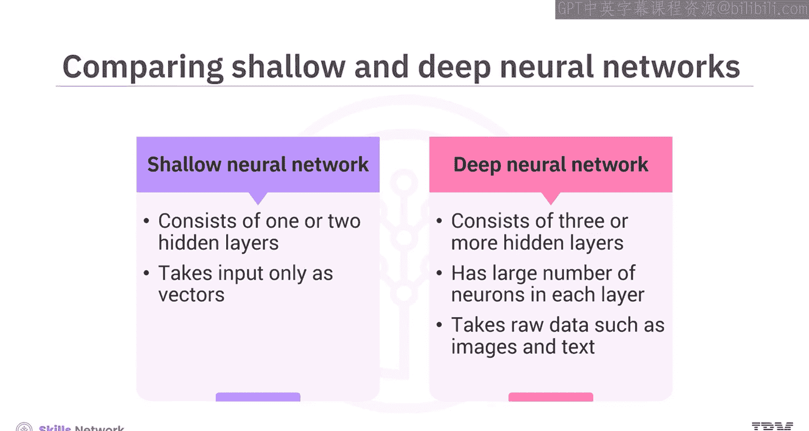
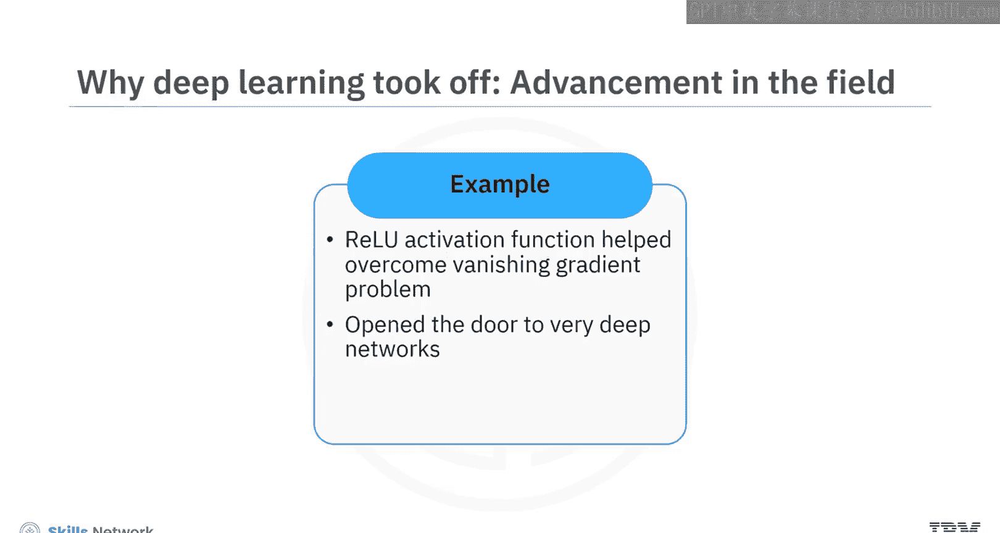
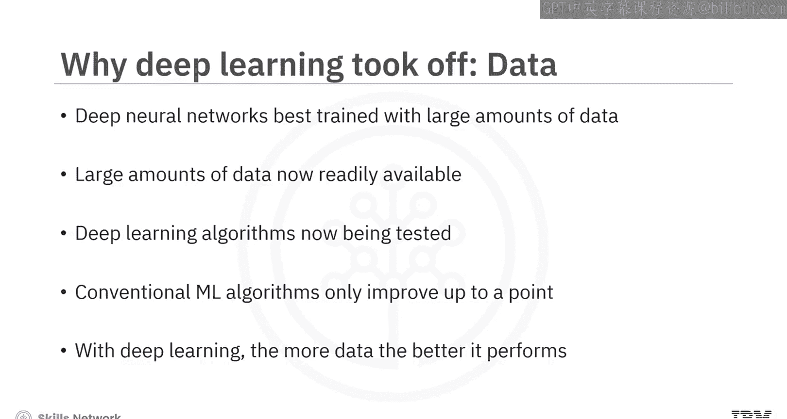
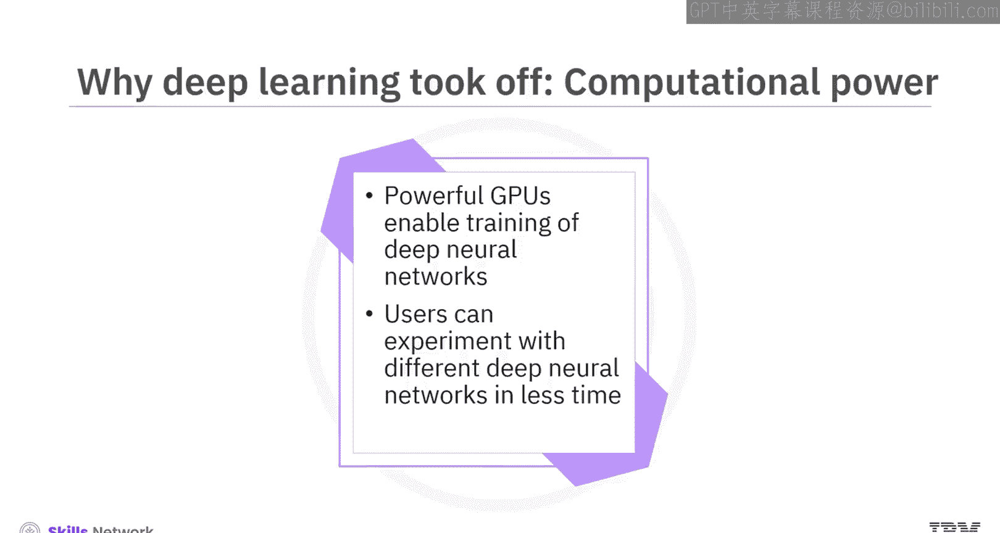
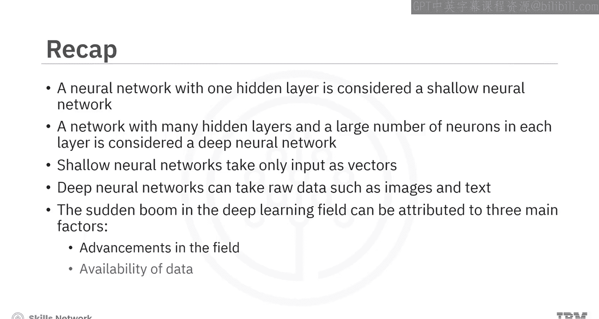

# IBM《生成式人工智能工程｜Falsk、生成式AI应用、数据分析、机器学习、Keras、架构和数据、NLP基础、transformer、微调、高级微调、RAG》 p91 11_浅层与深层神经网络.zh_en -BV1NAq6Y9E7z_p91-

Welcome to shallowlow v Deep neural networks After watching this video you'll be able to describe the difference between shallow neural networks and deep neural networks and explain which factors were behind the sudden boom in the field of deep learning。

So far， we've covered only neural networks that aren't particularly deep or shallow。

 This is because understanding these networks is the building block of understanding deep neural networks。

 being easier to understand due to their simplicity。

 There isn't a consensus on the definition of a shallow neural network。

 But a neural network with only one or two hidden layers is considered a shallow neural network。

 whereas a network with three or more hidden layers and a large number of neurons in each layer is considered a deep neural network。

 Also， unlike a shallow neural network， which only takes and put as vectors。

 Deep neural networks are able to take raw data， such as images in text。

 and automatically extract the necessary features to learn the data better。

 neural networks have been around for some time。 So why did they only recently become deep and start taking off。

 resulting in so many cool and exciting applications。

 The sudden boom in the deep learning field can be attributed to three main factors。

 Numb one is advancement in the field itself。 We talked about this briefly in the activation functions video where we mentioned。

Relo activation function helped overcome the challenges of the vanishing gradient problem and therefore opened the door to the creation of very deep networks。

 Another main reason is the availability of data。 Deep neural networks work best when trained with large amounts of data Since neural networks learn the training data so well large amounts of data have to be used to avoid overfitting the training data。

 Now that large amounts of data are readily available and easy to acquire like never before。

 deep learning algorithms are being tried and tested like never before。

 Other conventional machine learning algorithms while they do improve with more data only do so up to a certain point。

 After that， no significant improvement would be observed with more data。

 That is definitely not the case with deep learning。 The more data you feed it。

 the better it performs。 Finally， this goes hand in hand with point number two It's computational power with super powerful GPus we can now train very deep neural networks on tremendous amounts of data in a matter of hours instead of days or weeks which is how long it used to。

Take to train very deep neural networks。 Therefore。

 users can experiment with different deep neural networks and test different prototypes in much shorter periods of time。

 These three factors are the main reasons behind the deep learning boom。 In this video。

 you learned that a neural network with one hidden layer is considered a shallow neural network。

 a network with many hidden layers and many neurons in each layer is considered a deep neural network。

 shallow neural networks take only input as vectors。

 Deep neural networks can take raw data such as images and text and the sudden boom in the deep learning field can be attributed to three main factorss。

 Advments in the field。 The availability of data and greater computational power。

