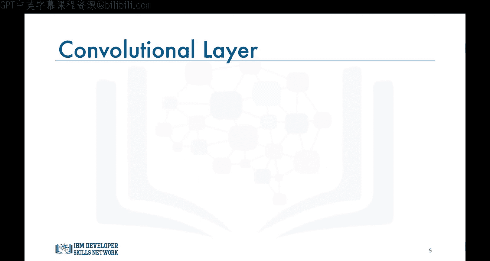
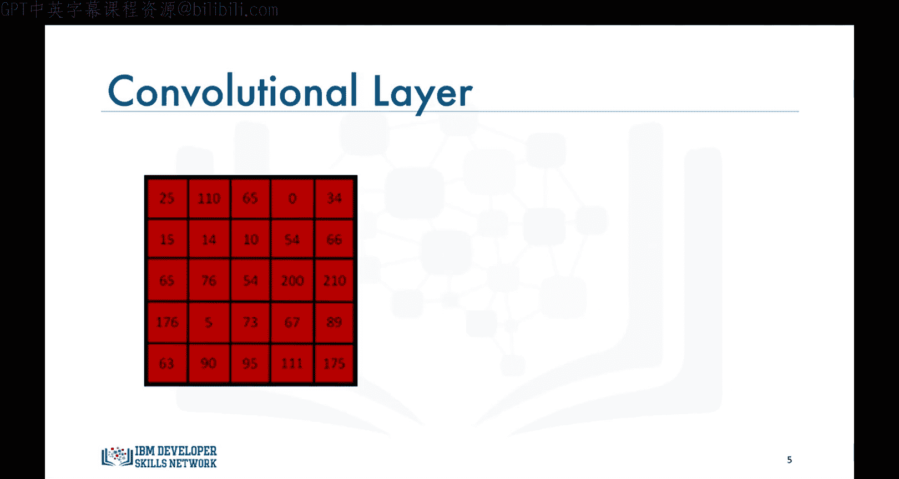
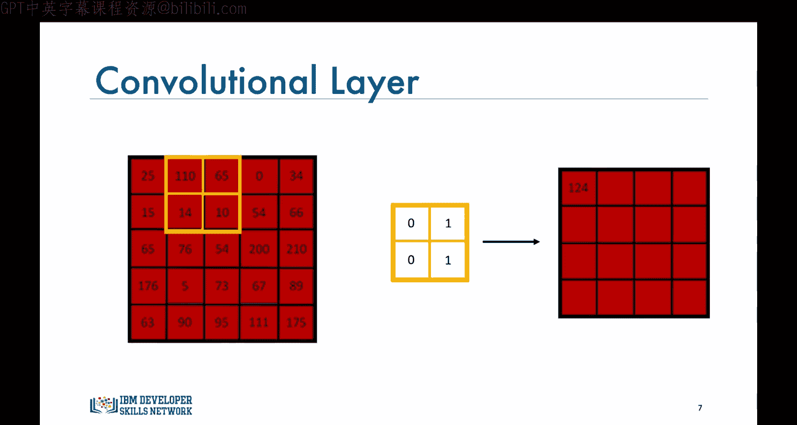
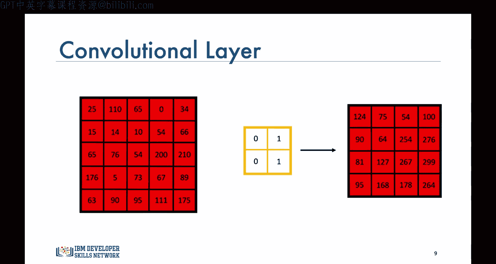
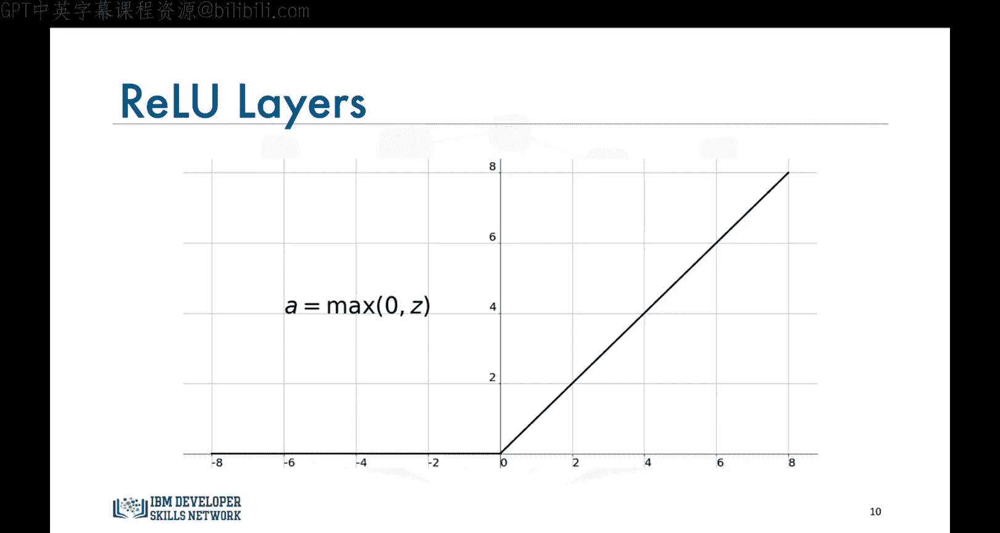
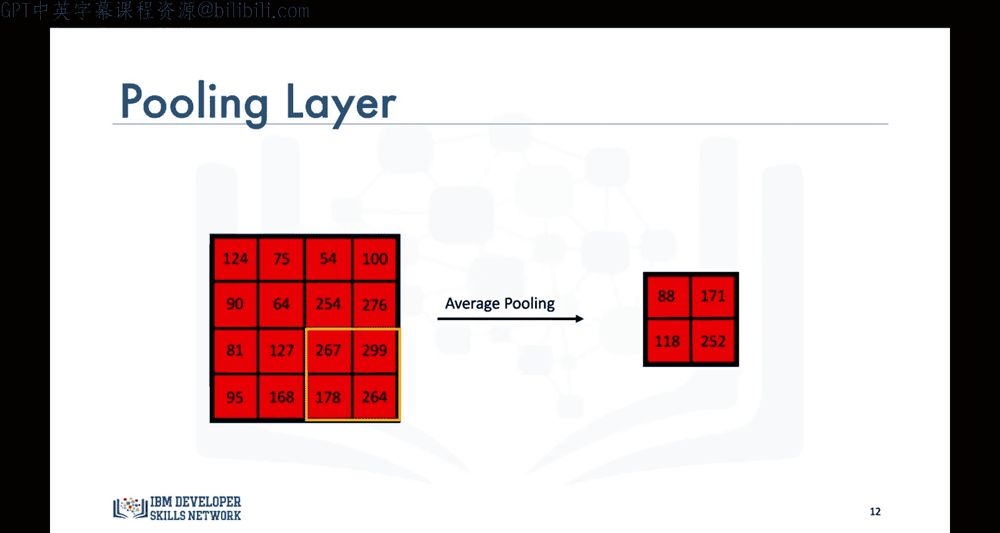
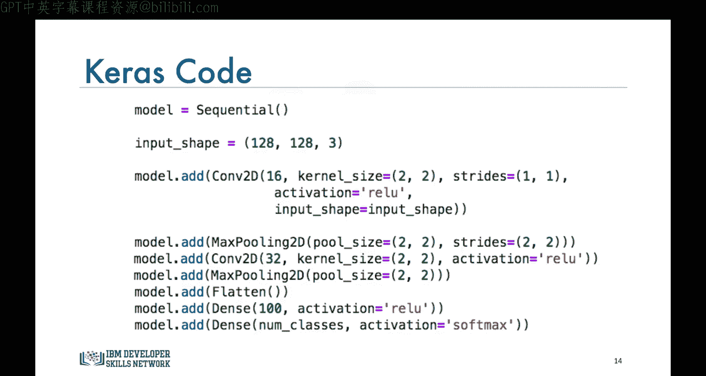
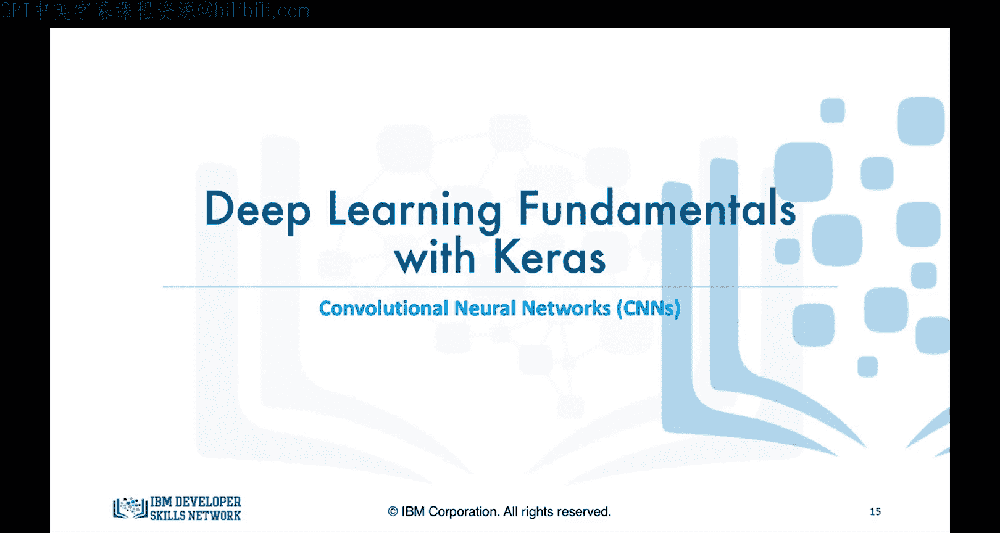

# IBM《生成式人工智能工程｜Falsk、生成式AI应用、数据分析、机器学习、Keras、架构和数据、NLP基础、transformer、微调、高级微调、RAG》 p92 12_卷积神经网络.zh_en -BV1NAq6Y9E7z_p92-

In this video we will learn about deep learning algorithms。

 you will start with supervised deep learning algorithms。

 and in this video we will learn about convolutional neural networks。

Convolutional neural networks are very similar to the neural networks that we have seen so far in this course。

 they're made up of neurons which need to have their weights and biases optimized。

 Each neuron combines the inputs that it receives by computing the dot product between each input and the corresponding weight before it feeds the resulting total input into an activation function at relo most likely。

So then what is different with these networks and why are they called convolutional neural networks？

Well， convolutional neural networks or CNNNs for short make the explicit assumption that the inputs are images。

 which allows us to incorporate certain properties into their architecture。

These properties make the forward propagation step much more efficient and vastly reduces the amount of parameters in the network。

Therefore， CNNNs are best for solving problems related to image recognition， object detection。

 and other computer vision applications。Here is a typical architecture of a convolutional neural network。

 as you can see， the network consists of a series of convolutional reul and pooling layers。

 as well as a number of fully connected layers which are necessary before the output is generated。

Now let's study what happens in each layer。So far， we've dealt only with conventional neural networks that take an n by one vector as their input。

The input to a convolutional neural network on the other hand。

 is mostly an n by m by one for grayscale images or an n by m by 3 for colored images where the number three represents the red。

 green and blue components of each pixel in the image。In the convolutional layer。

 we basically define filters and we compute the convolution between the defined filters and each of the three images。

If we take the red image for example， let's assume these are the pixel values。

Now， for a two by two filter with these values， let's create an empty matrix to save the results of the convolution process。

We start by sliding the filter over the image and computing the dot product between the filter and the overlapping pixel values and storing the result in the empty matrix。

We repeat this step。😡，Moving our filter one cell or one stride is the proper terminology at a time。

And we repeat this until we cover the entire image and fill the empty matrix。Here。

 I just showed one filter and only one of the three images。

 the same thing would be applied to the green and blue images。

 and you can apply more than one filter， the more filters we use。

 the more we're able to preserve the spatial dimensions better。😡。

But one question you must be asking yourself at this point is why would we need to use convolution。

 Why not flatten the input image into an by M by one vector and use that as our input， Well。

 if we do that， we will end up with a massive number of parameters that will need to be optimized and it will be super computationally expensive。

😡，Also， decreasing the number of parameters would definitely help in preventing the model from overfitting the training data。

 It's worth mentioning that a convolutional layer also consists of relo。

 which filter the output of the convolutional step。

 Pass only positive values and turning any negative values to0。

 The next layer in our convolutional neural network is the pooling layer。

 The pooling layer's main objective， is to reduce the special dimensions of the data propagating through the network。

 There are two types of pooling that are widely used in convolutional neural networks。

 Max pooling and average pooling。 In max pooling， which is the most common of the two for each section of the image we scan。

 We keep the highest value。 like so here， our filter is moving two strides at a time。😊。

Similarly， with average pooling， we compute the average of each area we scan。

In addition to reducing the dimension of the data， or max pooling in particular provides spatial variants which enables the neural network to recognize objects in an image。

 even if the object does not exactly resemble the original object。😡。

Finally， in the fully connected layer， we flatten the output of the last convolutional layer and connect every node of the current layer with every other node of the next layer This layer basically takes as input the output from the preceding layer。

 whether it is a convolutional layer relo or pooling layer and outputs an ndimensional vector where n is the number of classes pertaining to the problem at hand。

 For example， if you're building a network to classify images of digits。

 the dimension n would be 10 since there are 10 digits。😊。

You will be covering convolutional neural networks in much more details in the other courses in this specialization。

 but this information is more than enough to give you a general understanding of convolutional neural networks Now let's see how we can use the CA library to build a convolutional neural network here I will show you how you can use the CA library to build a convolutional neural network。

Training and testing of a convolution neural network are the same as what we have seen so far。

 so to begin with， we use a sequential constructor to create our model。

 then we define our input to be the size of the input images。

Assuming the input images are 128 by 128 color images。

 we define the input shape to be a twoole of 128 by 128 by 3。Next。

 we start adding layers to the network。😡，We start with a convolutional layer with 16 filters。

 each filter being of size2 by2 and slides through the image with a stride of magnitude 1 in the horizontal direction and of magnitude 1 in the vertical direction。

 and the layer uses the realulu activation function。

Then we add a pooling layer and we're using max pooling here with a filter or pulling size of two。

 and the filter slides through the image with a stride of magnitude2 Next we add another set of convolutional and pulling layers The only difference here is we're using more filters in the convolutional layer actually twice as many filters as the first convolutional layer。

Finally， we flatten the output from these layers so that the data can proceed to the fully connected layers。

We add another dense layer with 100 nodes and an output layer that has nodes equal to the number of classes in the problem at hand。

 and we use the softmax activation function in order to convert the outputs into probabilities with this we conclude this video on convolutional neural networks in the lab we will implement a complete convolutional neural network where we will use the Cur library to build the network。

 train it and then validate it to make sure to complete this modules lab on convolutional neural networks。

