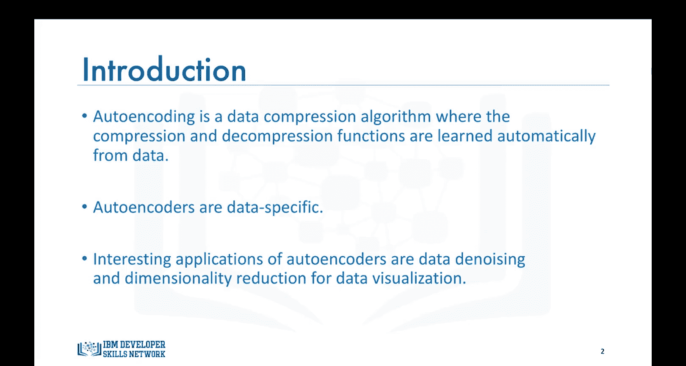
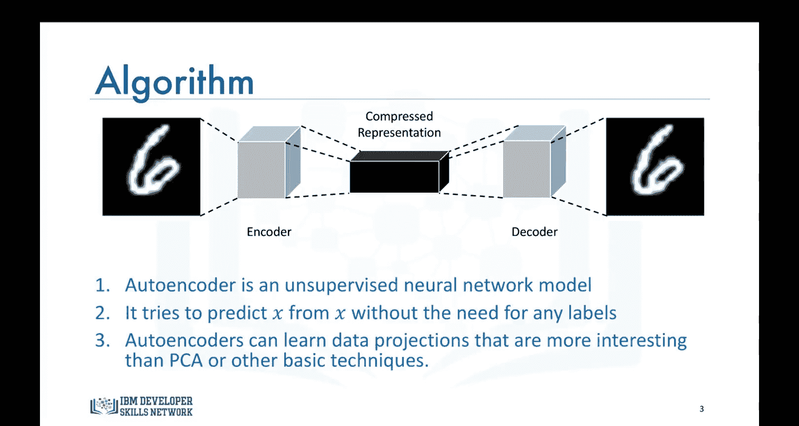
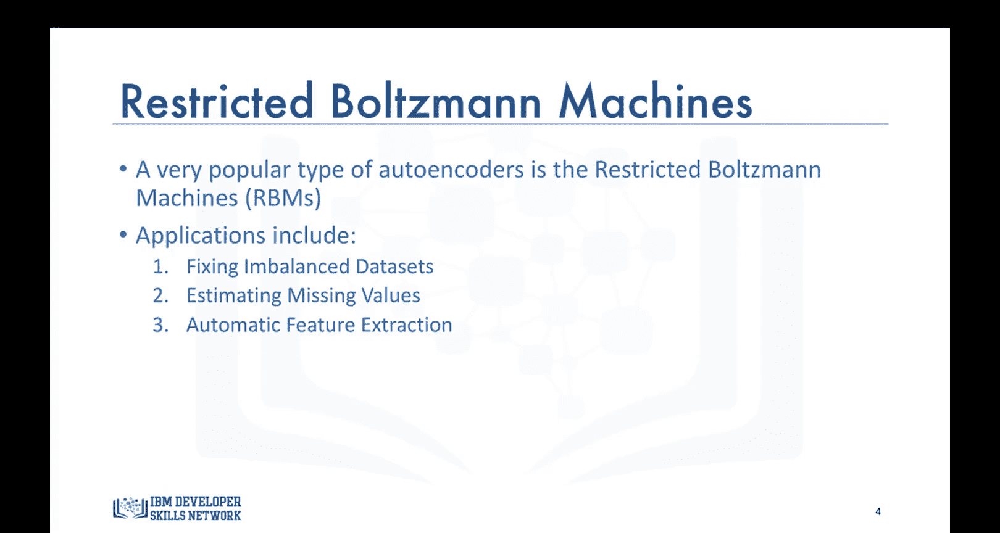
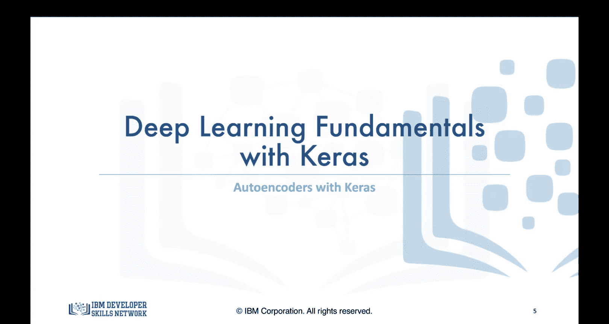

# IBM《生成式人工智能工程｜Falsk、生成式AI应用、数据分析、机器学习、Keras、架构和数据、NLP基础、transformer、微调、高级微调、RAG》 p94 14_自编码器.zh_en -BV1NAq6Y9E7z_p94-

So far we discussed two supervised deep learning models which are the convolutional neuralural network and their current neural network In this video we will switch to an unsupervised deep learning model。

 which is the auto encodecoder。So what are auto encoders？

Auto encoding is a data compression algorithm where the compression and the decompression functions are learned automatically from data instead of being engineered by a human。

 such autoenderrs are built using neural networks。Autoens are data specific。

 which means that they will only be able to compress data similar to what they have been trained on。

 therefore an autoencoder trained on pictures of cars would do a rather poor job of compressing pictures of buildings because the features it would learn would be vehicle or car specific。

Some interesting applications of auto encoders are data denoing and dimensionality reduction for data visualization。

Here is the architecture of an auto encodeder， it takes an image， for example。

 as an input and uses an encoder to find the optimal compressed representation of the input image。

Then using a decoder， the original image is restored。😡。

So an auto encodecoder is an unsupervised neural network model。

 it uses back propagation by setting the target variable to be the same as the input， in other words。

 it tries to learn an approximation of an identity function。😡。

Because of nonlinear activation functions in neural networks。

 auto encoders can learn data projections that are more interesting than principal component analysis。

 PCA， or other basic techniques， which can handle only linear transformations。

A very popular type of auto encoders is the restricted boltolsman machines or RBMs for short。

RBMs have been successfully used for various applications， including fixing imbalanced data sets。

Because RBMs learn the input in order to be able to regenerate it。

 then they can learn the distribution of the minority class in an imbalanced data set。

 and then generate more data points of that class， transforming the imbalanced data set into a balanced dataset set。

😡，Similarly， RBMs can also be used to estimate missing values in different features of a data set。

Another popular application of restricted Bolsvan machines is automatic feature extraction of especially unstructured data。

And this concludes our high level introduction to auto encodes and restricted boltolzman machines。

