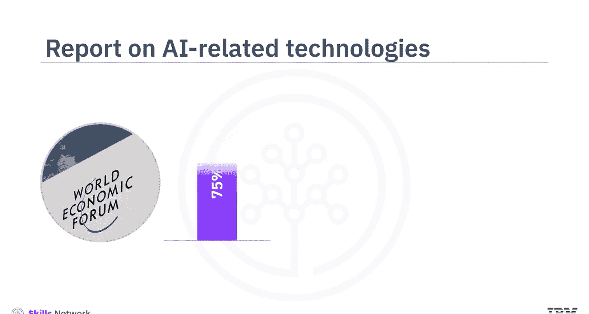
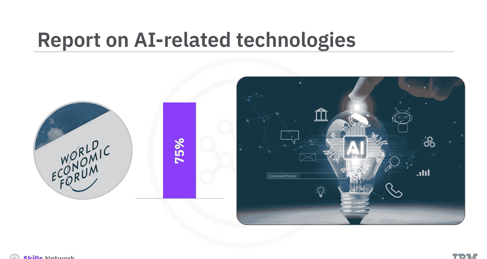
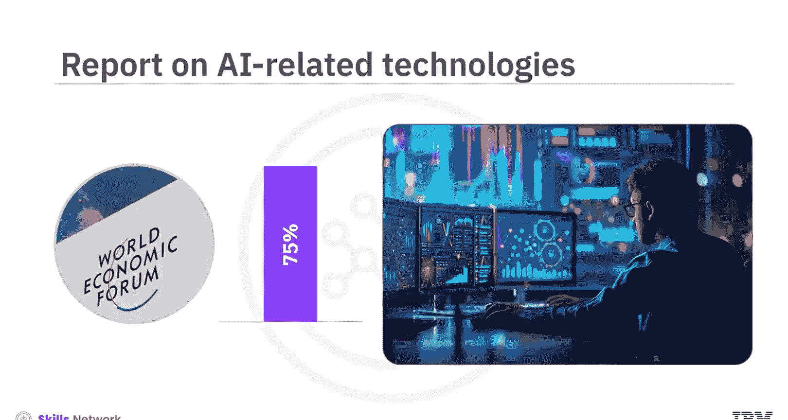
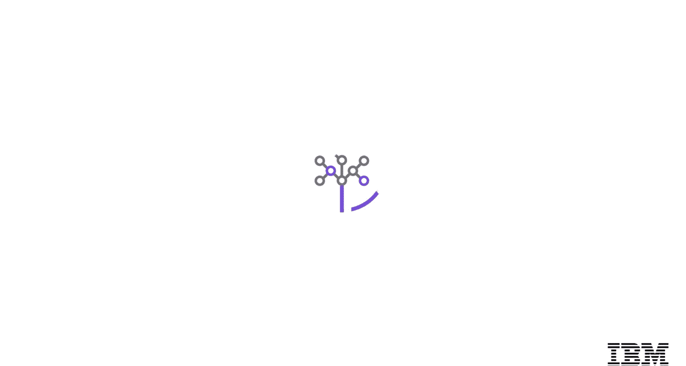

# IBM《生成式人工智能工程｜Falsk、生成式AI应用、数据分析、机器学习、Keras、架构和数据、NLP基础、transformer、微调、高级微调、RAG》 p96 0_使用LLM的AI工程概述.zh_en -BV1NAq6Y9E7z_p96-

。Welcome to the overview of AI engineering with LLMs。

 A report on the future of jobs by the World Economic Forum predicts that almost 75% of organizations are likely to adopt AI and machine learning related technologies in the future As organizations adopt this relatively new technology。

 they will need experts to help them understand how to apply new tech in the organizational context So how can you add value as a new or experienced member of the AI workforce The knowledge of generative AI architectures and models as integral to launching or advancing careers in AI Mach learning and data science。

 This program focuses on the principles， techniques and applications of generative AI and large language models or LLMs for natural language processing or NLP。

 It is best suited for professionals aspiring to be or currently working as AI engineers。

 Ma learning engineers deep learning engineers and data scientists The program requires a basic knowledge of Python。

 It is beneficial to also have knowledge of Pytorch。

Learning and neural networks the courses within the program include many practical handson labs and exercises that enable you to demonstrate your skills to potential employers In addition to gaining skills to advance your career and generative AI This program will partially cover content for their professional certificate and AI engineering This generative AI engineering with LLMs program consists of several short courses that cover generative AI and LLMs AI foundational models for NLP language modeling with transformers。

 fine tuning with transformers， Adv fine tuning for LLMs AI agents with Ra L chain and a capstone project on AI applications with Ra Lacha Each topic corresponds to an online course you can complete independently Each course consists of two to three modules completing courses covering different topics and the required project will earn you the IBM generative AI engineering with LLMs completion certificate Let's look at the content of each course You commence your generative AI engineering journey by learning。

About generative AI models and how LLms are used to build NLP based applications。

 The course also covers libraries and tools used in developing these applications。

 You will also learn to prepare data to train LLms by implementing tokenization and creating NLP data loaders language understanding and language models for NLP are the next topics in this program This intermediate level course will introduce you to various models such as Ngram Word to V and sequence to sequence models you will gain practical experience in building。

 training and integrating these models for various NLP tasks。

 The next course will introduce you to transformer based LLms for NLP here you will learn how positional encoding word embedding attention mechanisms and multihead attention are used within LLms The course will also discuss decoder based models such as generative pretrain transformer or G and encoder based models such as bidirectal encoder representations from transformers or BRT and how they're used for language translation the following course。

Take your transformer's journey a step ahead by providing you with knowledge about a general framework for optimizing transformerbased LLMs and fine tuning generative AI models。

 although understanding the fundamentals of training transformers from scratch is important from a theoretical perspective。

 most practical applications focus on finetning pre-train models and prompt engineering In this course。

 you'll also learn about model frameworks and platforms like hugging face and Pytorch。

 concepts and techniques related to fine tuning such as parameter efficient fine tuning or PEft。

 lowRnk adaptation or LoRA and quantize lowRnk adaptation or QLra are also a part of this course you'll also practice loading models and inferenceprints and training models with hugging face and Pytorch adapters。

The next course will help you advance your fine tuning skills by introducing you to techniques that allow the model to learn from human feedback you'll be first introduced to fine tuning approaches like instruction tuning and reward modeling you'll then learn about proximal policy optimization or PPO LLMs as policies and reinforcement learning from human feedback or RLHF This course will further delve into direct performance optimization or DO using the partition function and explain how to find the optimal solution Next you will learn about rag and L chain frameworks you'll learn about the Rag process。

 context and question encoders and Fas or Facebook AI similarity search library Further you will be introduced to in context learning。

 Lcha and advanced methods of prompt engineering then you will deep dive into the Lcha tools。

 components chat models and agents for developing applications Handon labs have been strategically placed in the course to help you acquire job ready skills with these tools and technologies Finally。

 there is the capstone。😡，Project where you will apply all the skills learned as a part of the program with your understanding of the principles of LLMs through Pytorch and hugging face。

 you can now leverage this knowledge to build real worldl applications using Langcha Langcha enables seamless integration and deployment of sophisticated language models making it easier to create powerful scalable solutions whether you are developing chatbots automated content generators or advanced analytics tools。

 Langchain provides the framework to bring your AI projects to life efficiently this project will be a good addition your portfolio and will take you closer to the completion certificate for generative AI engineering with LLMs As you review the content。

 you will be presented with quizzes and projects to evaluate your learning The graded quizzes carry a weightage that contributes to the courses completion Most projects will be AI or peer graded and carry a certain weightage contributing to the course and program completion requirements Finally after you have successfully completed all the content。

 you will be awarded the completion certificate for IBM generative AI engineering with LLMs。

A credential valued by many employers， we wish you the very best and hope you enjoy this journey。

