# 003：IBM《生成式人工智能工程｜Falsk、生成式AI应用、数据分析、机器学习、Keras、架构和数据、NLP基础、transformer、微调、高级微调、RAG》 p03 2_Web应用程序和API简介.zh_en -BV1NAq6Y9E7z_p3-

。Welcome to Introduction to Web App and APIs。

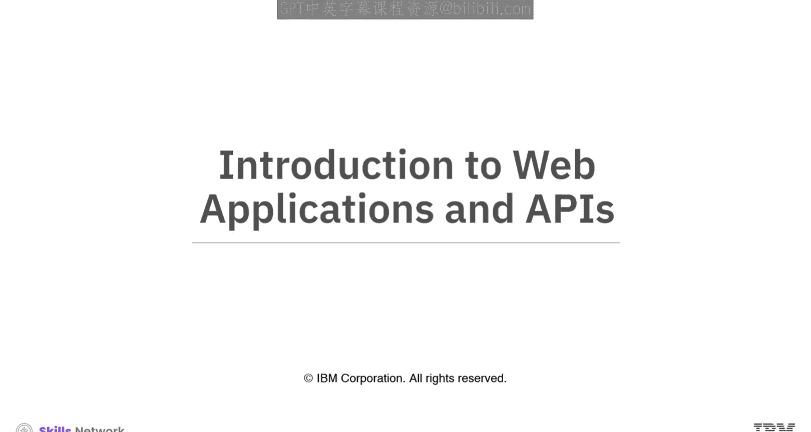

After watching this video， you will be able to describe web applications or web apps。

 describe an application programming interface or API， compareare and contrast web apps and APIs。😊。

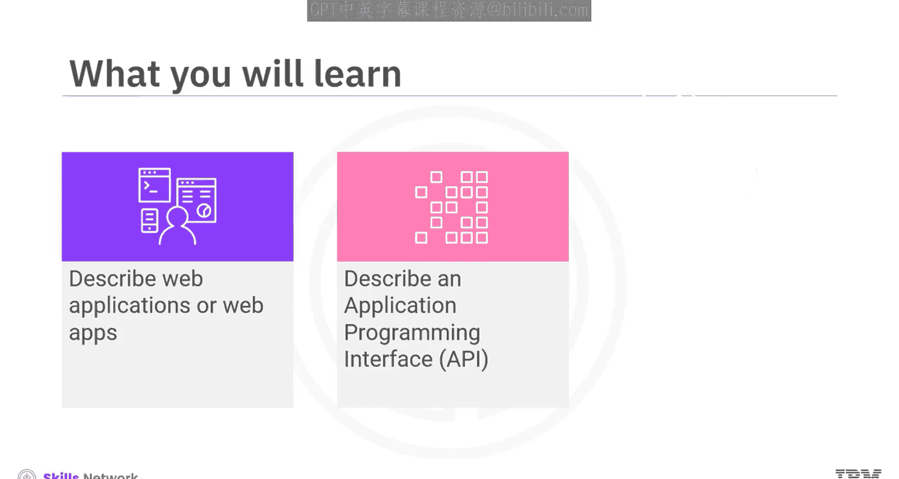

Let's start by defining a web app。 A web app is a program stored on a remote server and delivered over the Internet。

A user interacts with the app using a browser。 Web services like ecommerce-commerce sites。

 webmail and so on， are all web apps。 While some apps may depend on the kind of browser being used。

 most web apps work on all modern web browsers。

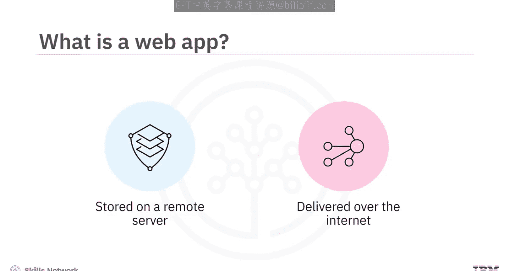

A web app requires three components to process a client request。

 a web server to manage raised requests， an app server to execute the requested task and a database to store the information needed to complete the task。

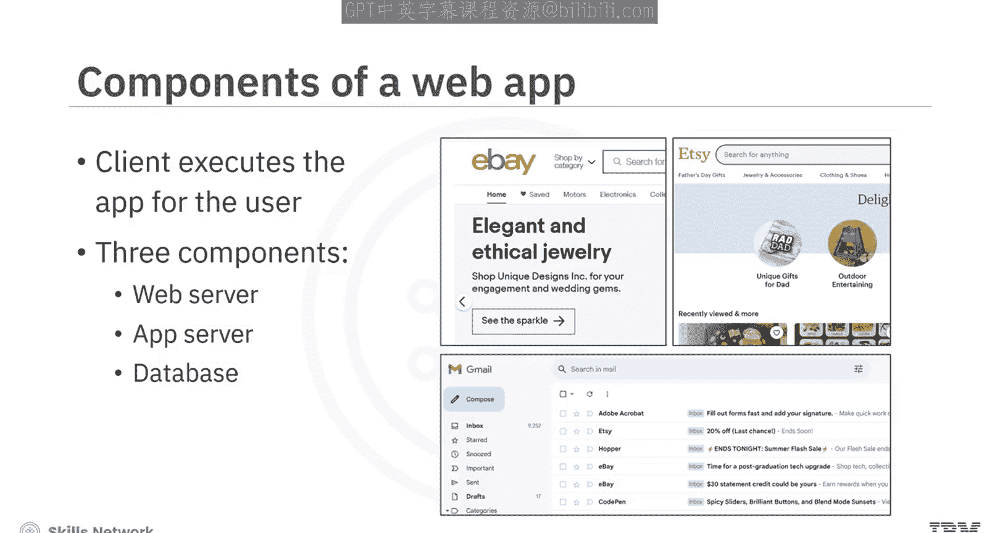

When programming web apps， you will write code for the user end or the front end using JavaScript。

 HTML or CSS。 you will also code for the server end or back end using Python， Java or Ruby。

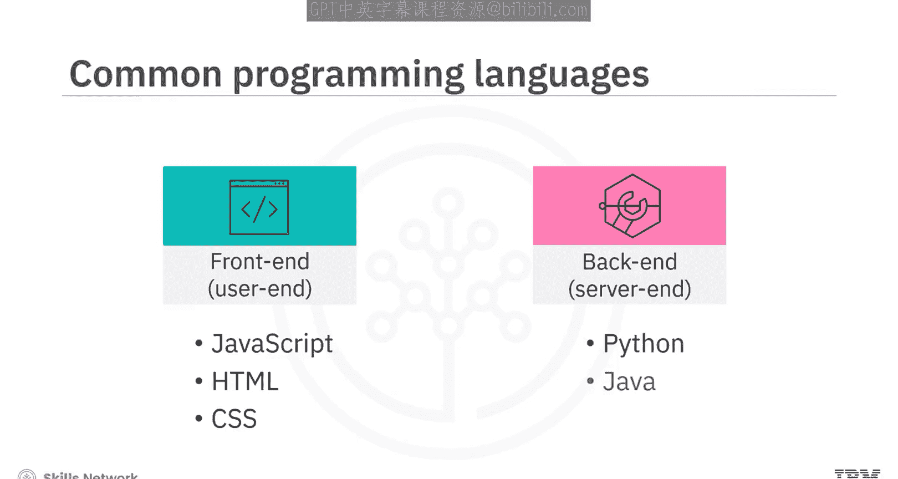

There are several advantages to using web apps over apps that strictly run locally on a user system。

 The advantages include developers can make the same version of the app available to multiple users at the same time。

Users have the flexibility of using the app from their platform of choice， such as desktop。

 laptop or mobile device。 Users can access the app through the browser of their choice。

Users do not need to install the app on their local systems。

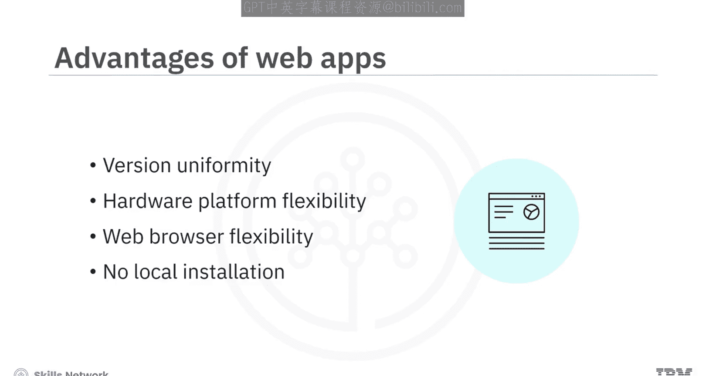

An API is a software component that enables two apps that are not connected with each other to communicate。

ApiIs help create more flexibility for programmers and enable them to request data from otherwise closed off apps。

As a result， As have standardized rules and functions that determine what data can be taken or modified within an app and how that process occurs。

 For example， the apps on your phone require you to grant permission to different features of your phone。

 like location， camera， audio and recorder。

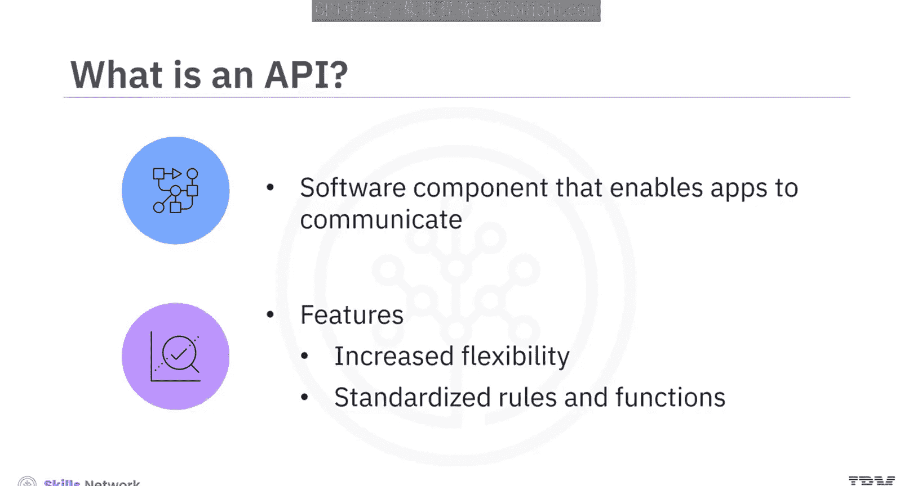

An example of an app that uses an API is a weather app。

Your weather app does not generate weather data itself。 Instead。

 it simply requests information from a weather API。

The API connects the software that gathers and stores weather data with the app on your mobile device。

The device， in turn， provides you with a detailed forecast for the next day。

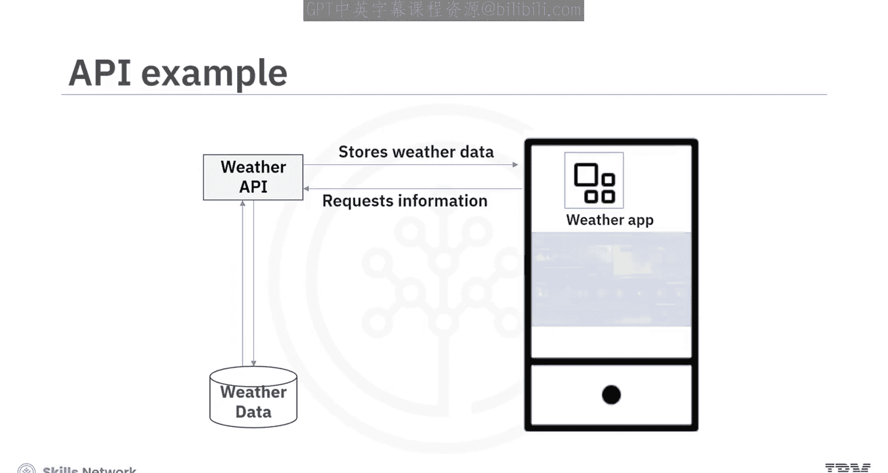

There are several architecture software developers follow to create an API。

 but the most popular is representational state transfer or RE or simpleple object access protocol or soap。

 these architectures will be discussed in another video。An API can be beneficial for many reasons。

 including it improves connectivity between apps。 It supports traditional， create， read， update。

 delete or crud actions。😊，It works with HTTP verbs， including put， post， delete and get。

 It is based on HTTP， making it customizable。A PI is a more generic term given to all forms of apps that create a link between any two parts of a system。

 Web apps are a form of API that communicate between the front end and the back end。

To clarify the distinction between web apps and APIs。

 let's consider the example of an e-commerce shopping service。

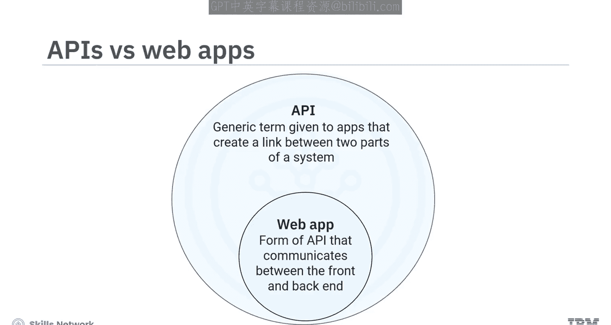

When you access the E-commerce Shop service from a browser。

 the browser acts as the API that connects you to the web app。When you select a product。

 the Web app checks the availability of the product and if available， displays its price。

If you try to access the E-commerce Shop service using a mobile device。

 the app on your device acts as the API that connects to the E-Commerce Shop service。

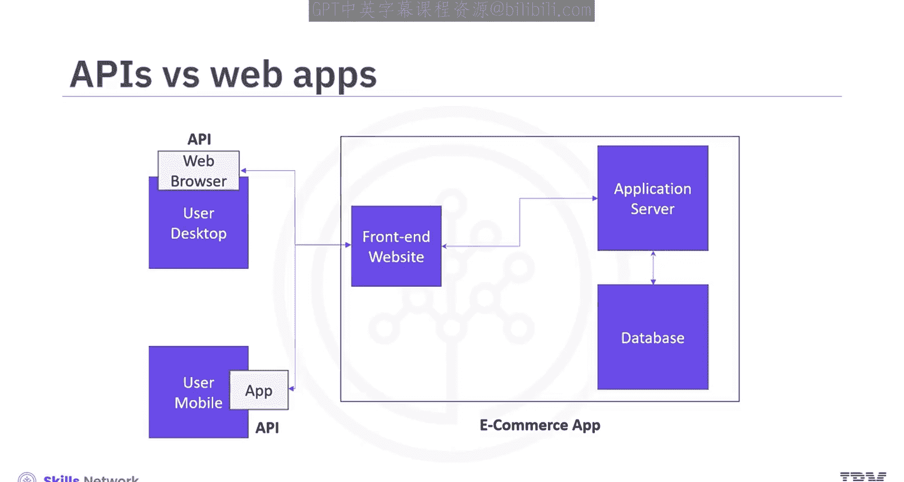

The nature of all web apps is to share data with other apps。Essentially。

 all web apps may be considered APIs。 However， API is a generic term and includes both online or web based and offline apps。

 to summarize all web apps are APIs， but not all APIs are web apps。😊。

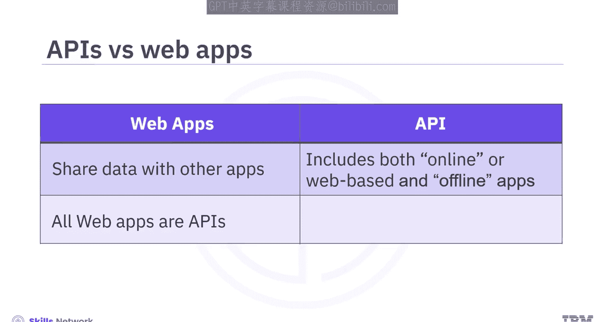

In this video， you learn that web apps are programs stored on a remote server and delivered over the internet through a browser。

 you can run web apps on different platforms and browsers without having to install new software。

An application programming interface or API is a software component that enables two unconnected apps to communicate。

Web apps are APIs， but not all APIs are web apps， both share data between apps。

 but not all APIs require networks like web apps do。

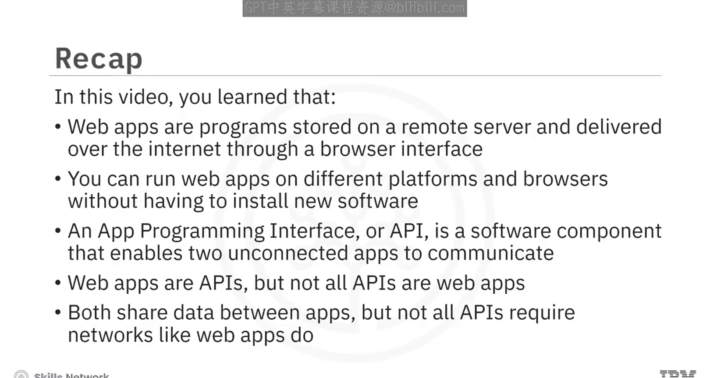

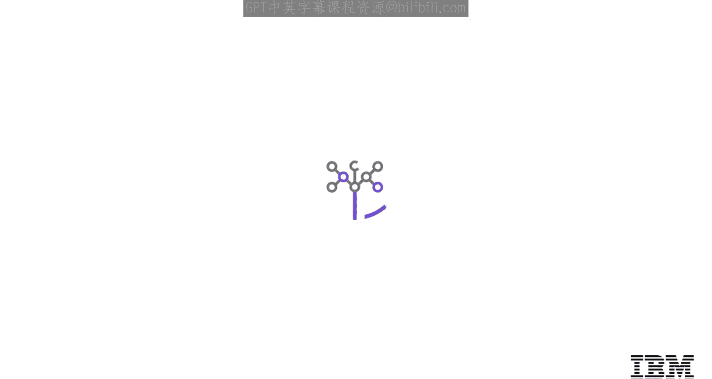