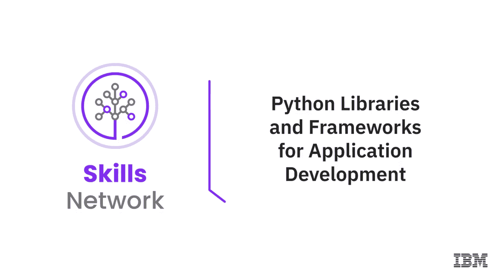
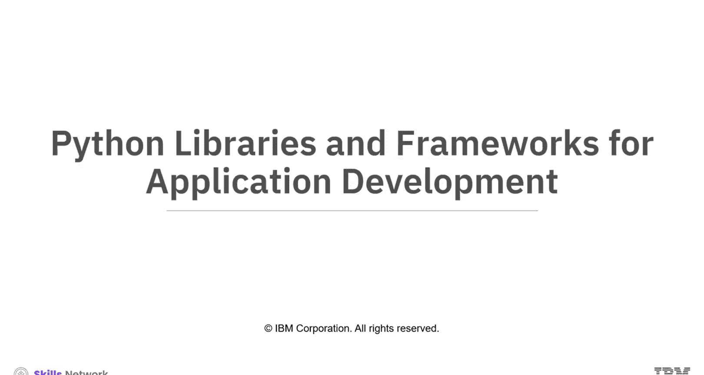
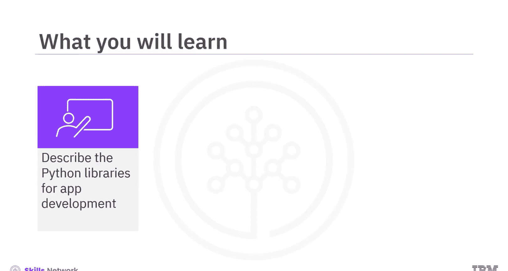
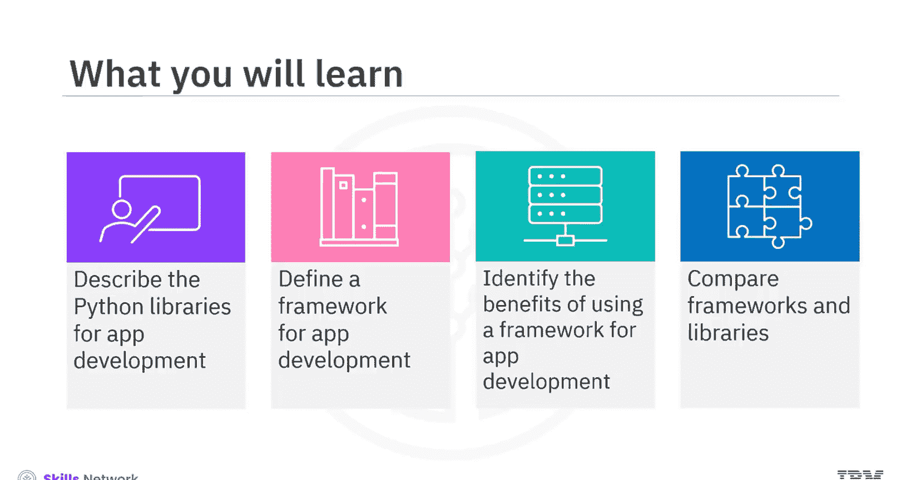
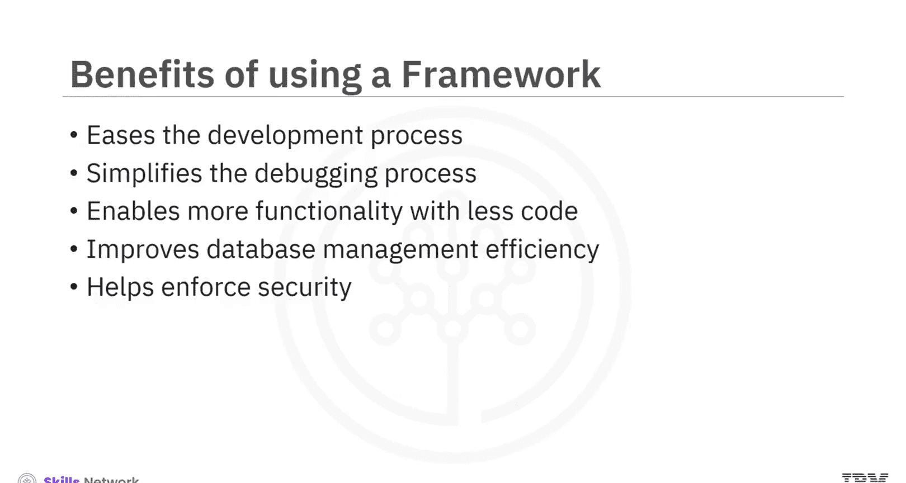
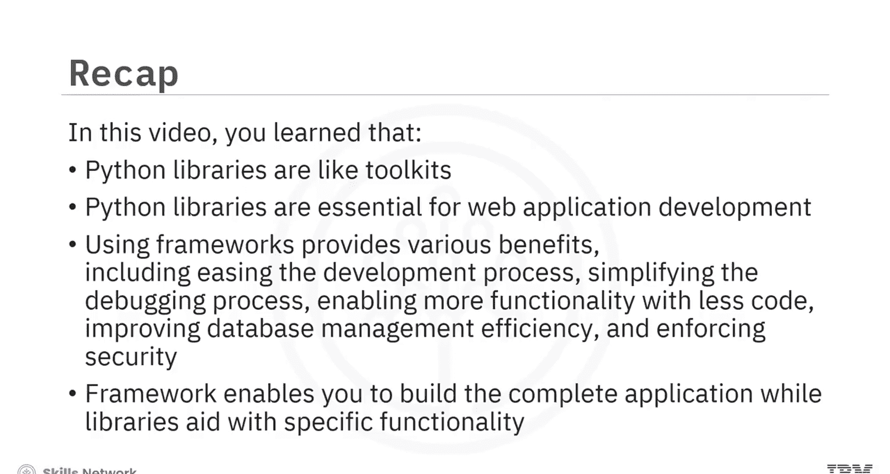
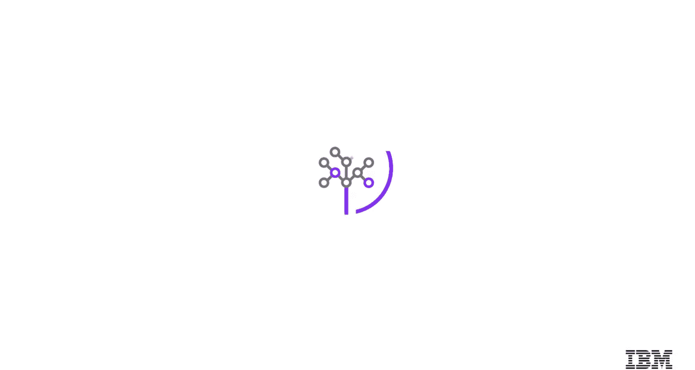

# 008：IBM《生成式人工智能工程｜Falsk、生成式AI应用、数据分析、机器学习、Keras、架构和数据、NLP基础、transformer、微调、高级微调、RAG》 p08 7_应用程序开发的Python库和框架.zh_en -BV1NAq6Y9E7z_p8-

Welcome to Python Libraries and Frameworks for application development After watching this video。

 you will be able to describe the Python libraries for app development。

 define a framework for app development， identify the benefits of using a framework for app development。

 compare frameworks and libraries。

Python libraries are like toolkits， Each library has specific tools to simplify and expedite certain programming tasks libraries like NMPI facilitate advanced mathematical calculations。

Paands offer data manipulation and analysis capabilities。

Mapplloot Libb simplifies data visualization These libraries save developers significant time and effort in creating these functions。

For web application development， some Python libraries are essential；

 the requests library simplifies the process of sending HTTP requests。

Beautiful soup makes it easy to scrape information from webp pages for iterating， searching。

 and modifying the parse tree。SQL Alchemy is an SQL toolkit and object relationlational mapping or ORM tool。

It is a system that gives application developers the full power and flexibility of SQL。

PIT is a testing framework that allows users to create small， simple tests easily。

 yet scales to support complex functional testing for applications and libraries Frameworks are predefined structures for application development。

 In addition， frameworkworks provide a set of guidelines for application development Frameworks facilitate good coding practices by offering a well definedfined structure for writing and organizing code and enabling the reuse of code libraries for added features。

😊，Some examples of frameworks include Django， Flask， and Web Pi。

There are several benefits of using a framework for app development。

 one of the benefits of using a framework is that it eases the development process with the prewritten code libraries。

 modules， and developer guidelines。With prebuilt debugging tools。

 web frameworks simplify the process of debugging web applications for the developers。

Another benefit of using frameworks is that developers can add more functionality using less code How a framework is equipped with several pre builtilt libraries and modules。

 which a developer can leverage when creating their code。

A developer does not need to create all required functionalities from scratch。

Using frameworks improves database management efficiency。

 the frameworks come with built in database integration tools。

 which help seamless integration of database endpoints for transferring data。

With security being a key concern for application users。

 a benefit of using frameworks is that developers can leverage the built in security features and guidelines to enforce security。

Let's briefly look at how frameworks and libraries differ from each other。

The framework contains the basic flow and the architecture of an application。

 which enables you to build the complete application a Python library is a set of packages that perform only specific functionality。

In this video， you learn that Python libraries are like toolkits。

 each library has specific tools to simplify and expedite certain programming tasks。

Frameworks are predefined structures for application development Uing frameworks provides various benefits。

 including easing the development process， simplifying the debugging process。

 enabling more functionality with less code， improving database management efficiency。

 and enforcing security。Framework enables you to build the complete application while libraries aid with specific functionality。

