# 010：IBM《生成式人工智能工程｜Falsk、生成式AI应用、数据分析、机器学习、Keras、架构和数据、NLP基础、transformer、微调、高级微调、RAG》 p10 9_Flask基本应用程序和路由.zh_en -BV1NAq6Y9E7z_p10-

Welcome to basicsic Ap and Ros。After watching this video。

 you will be able to create and run a flask application with basic routes in place。

 explain how to return a J response from the server to clients。

 and describe various configuration options available in Flask。

Before you create your first flask application， ensure that you have installed flask Next。

 create a Python file that will be your server and let's name this file app。t PY。

Now let's write the code in this file。First， import the capital FF flask class from the small F flask module Next。

 instantiate an object on the flask class as your app。

 The constructor takes a single argument of class scaffold。

 use set the name in the scaffold by passing the name of the app module in the built in name variable。

 This name is used to find the resources on the file system and by extensions to provide debugging information。

Okay， now that you have defined your server， let's add the first route。

 You want to return a message to the client when you call your server without adding a path。

 So you need to use the a app decorator to define a route and the decorator takes the path as an argument。

 Finally， you can return text or HTML from the method。 Let's look at the code。

 The a app decorator is defined on the hellello world method。

 It takes in the argument of slash and returns the HTML message。

 My first flashask application in action in bold。The next step is to run your application。

The first step is to create a few system environment variables Now you need a variable flask app containing the name of the main server file In addition。

 you need a flask ENV variable that will define the development or production environment This variable will be deprecated in flask 2。

3。As you can see you have defined the Flask app environment variable as the file name that contains the central server and flask ENV of development finally。

 to run the application pass the run argument to the flask framework by executing Flask run。

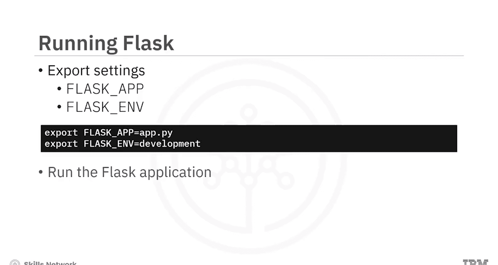

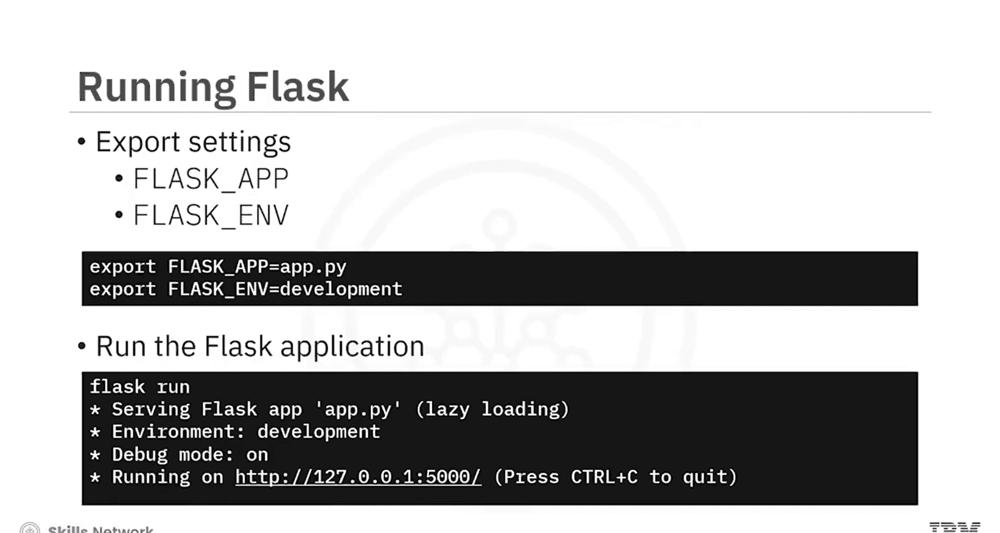

The flask application is run by default on port 5000。 You can browse to HttP local hosts 50，0。

0 to see your message。 Let's also use the browser development tools to see what information comes back from your server。

 The requested URL is HttP local host 5000。 The request method is HttP get。

 The response has a status of 200， which indicates a successful response。

 The content type in the response header is text slash h。

 and the server is workzg running with a Python version of 3。6。15。

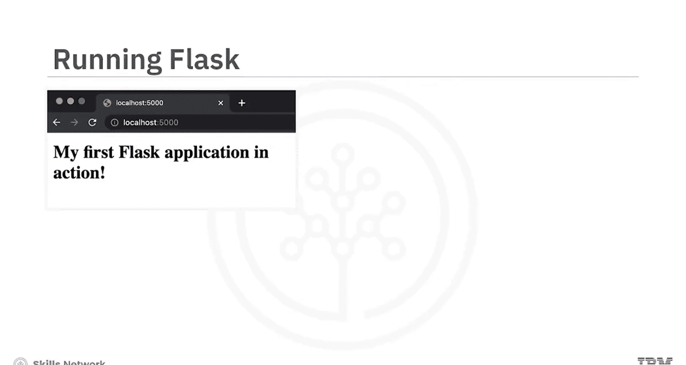

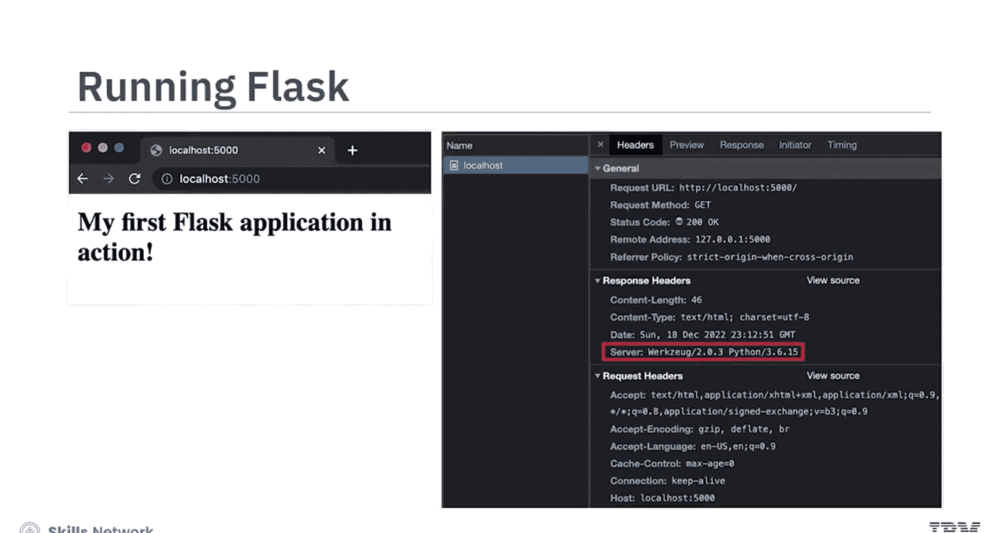

Congratulations on running your first Flask application。

Now you need to set environment variables for each application before running your application。

 you can pass configuration to the flask command by using hyphenhen app to identify the Python file to run an add hyphen hyphen and debug to enable the development mode。

 the debug flag also enables automatically restart when source files are changed and is useful when you develop applications and want to see your changes instantaneously。

 In your case， the app is stored in a file called app dot Py。

 So you could have skippped this argument as flask will look for app dot Py in the current directory by default。

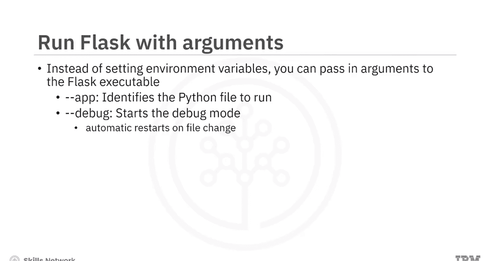

Now the output should look something like this， the screen shows the flask application running in development mode as before。

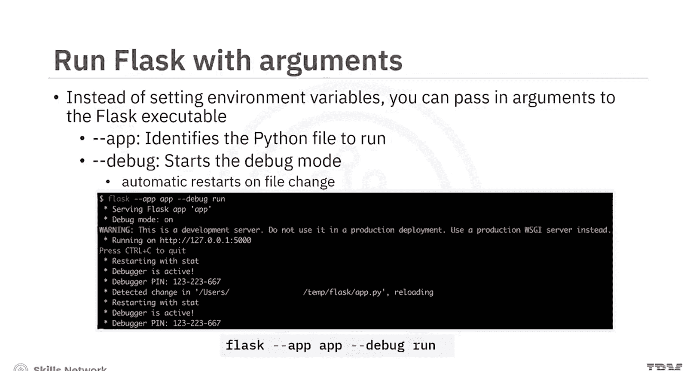

There are multiple ways to return J from your flask application。

 one method is to return a serializable object like a dictionary or a list in the given code you return a Python dictionary and Flask will use the Python J module to return Jason to the client。

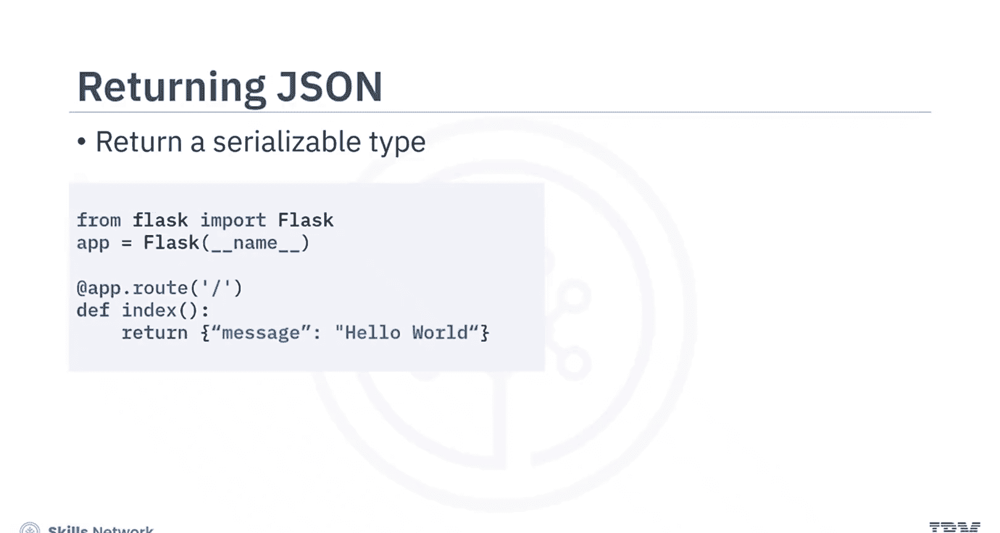

Let's test if this works using the curl command。 You will make a get request to local host 5000。

 and you can see a response status of 200 okay。 instead of HTML。

 you can also see the application slash J content type。Finally， you can see the JSN that is returned。

 but note， if you return a more complex object like a class， ensure that it can be serialized。

The second way is to use the Jsonify method provided by flask。

 This method takes in key value pairs add input and returns the appropriate J。

 Let's look at an example。 You first import Jsonify from flask。

 and next you pass in key value pairs to Jsonify。 You should get the same result as before in the browser and the developer tools should look the same with a status code of 200 O and return the content type of application slash J。

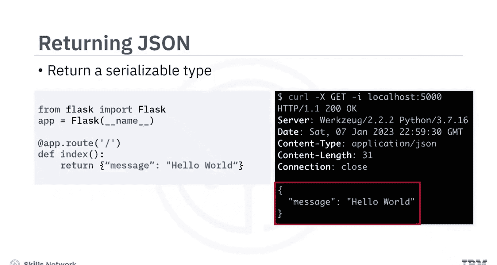

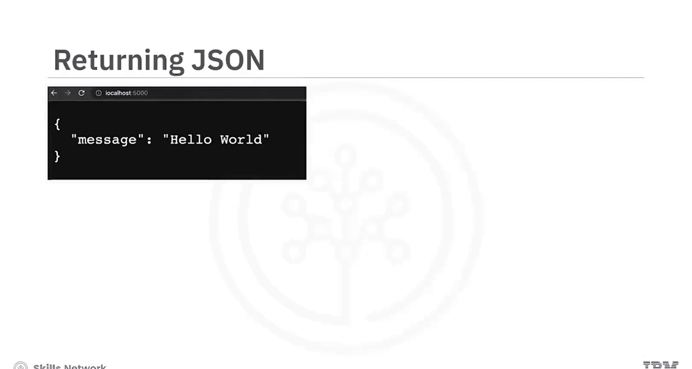

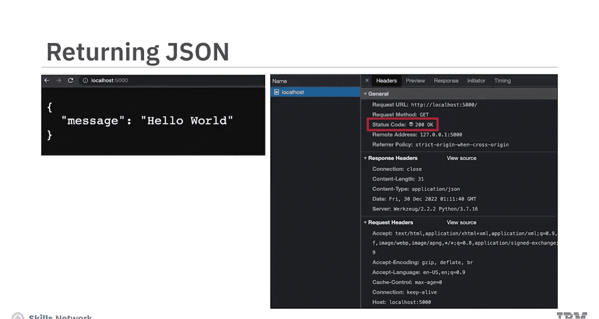

Now you looked at two configurations with Flask， ENV and Flask app variables Flask provides various other configuration options that you might use in your application。

E N V indicates the environment production or development。 the app is running in。

 Debug enables the debug mode。 Testing enables the testing mode。

 Se key used to sign the session cookie Session cookie name is the name of the session cookie Ser name binds the host and port and justsonify defaults to application slash Jason。

In addition， there are other ways you can provide configuration options to flask。

 Flask provides a config object， and you can insert configuration options into this object。

 If you already have environment variables， you can load them into the config object。 Finally。

 you can keep the configuration options in a separate JN file and load them using the from file method provided by the config object。

Now， as your app grows， you should create a directory structure instead of using a single Python file and there are many ways to structure your application here is one example。

 store the main source code in its module directory and store all configurations in its file。

 store all static assets like image， JavaScript and CSS files separately。

 store all dynamic content in a template directory and place all test files in a test directory and have a virtual environment that can be activated to install the right version of dependencies。

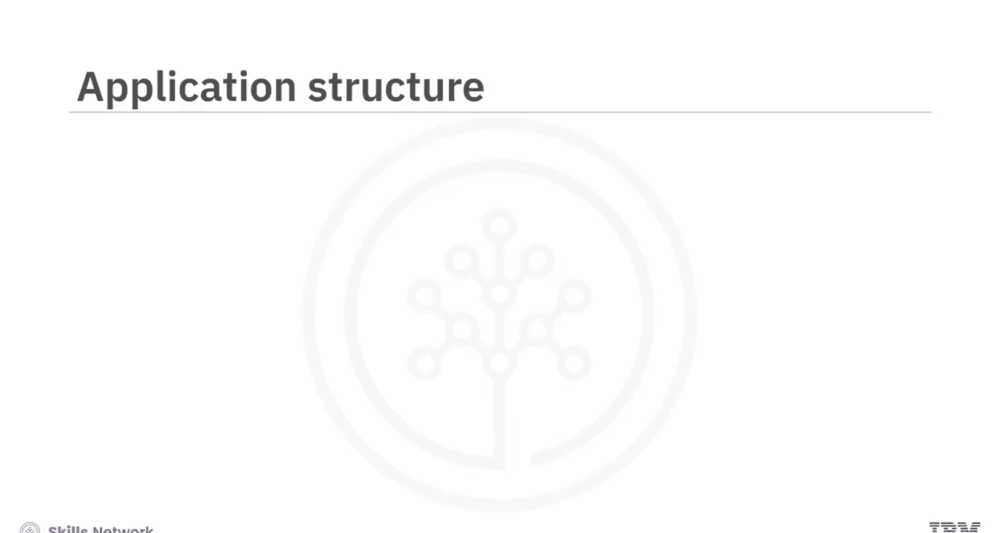

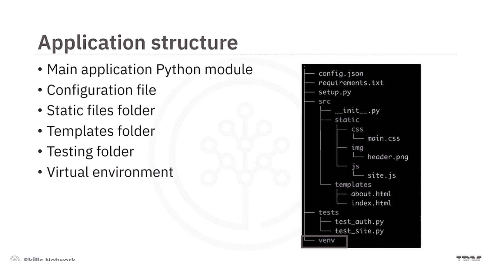

In this video， you learned that you can create a server by instantiating the flask class。

 use the@ app decorator to create URL handlers， return string messages or use the Jsonify method to return JSON objects。

 and you can set application configuration from En variables。

 Python files and app dot Config object directly。

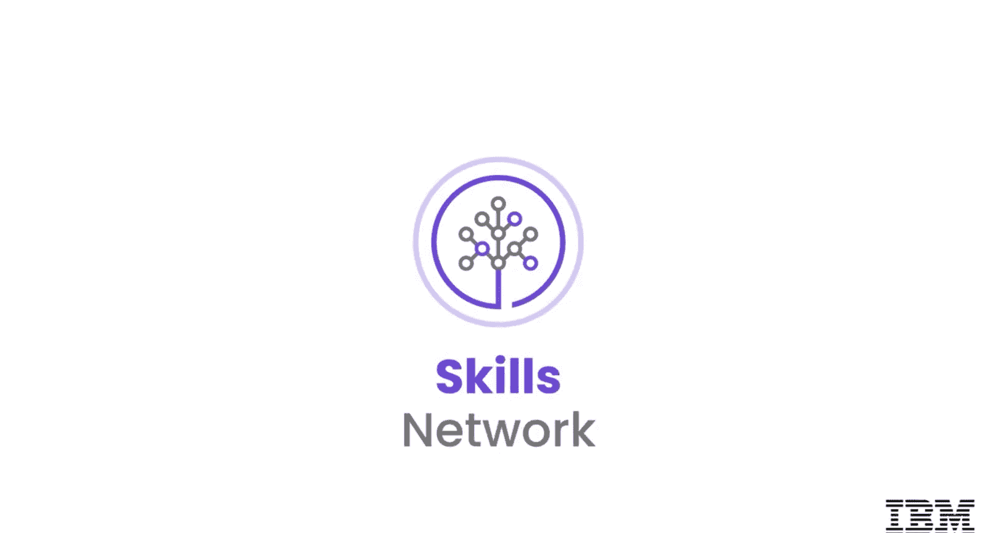