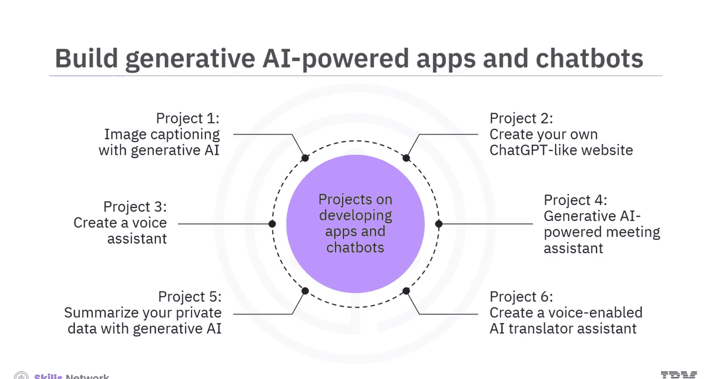
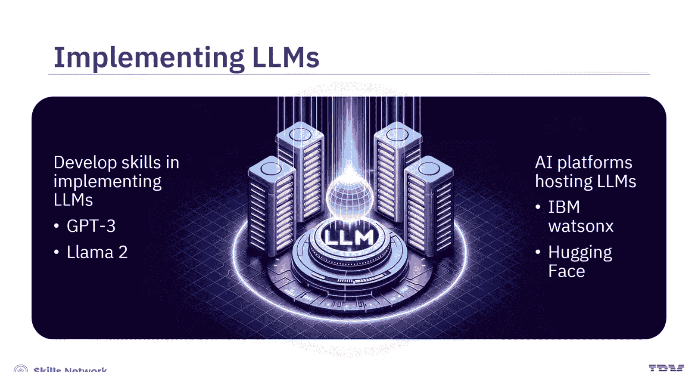
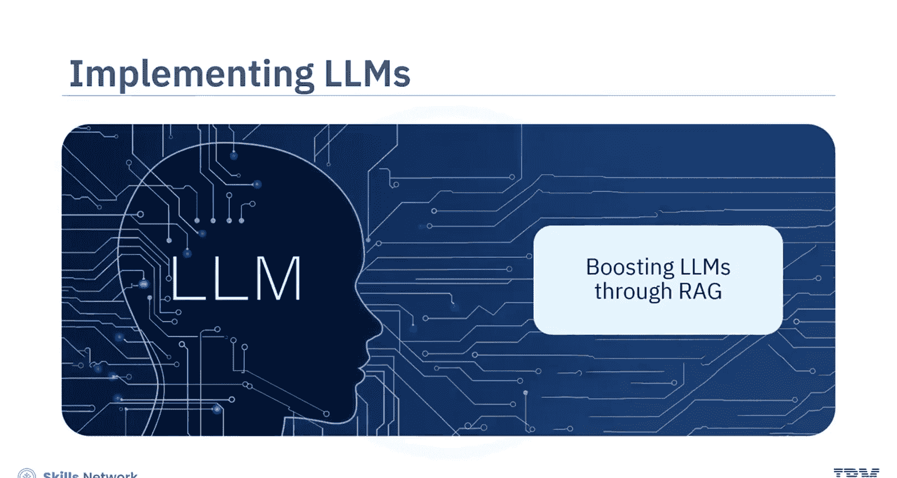
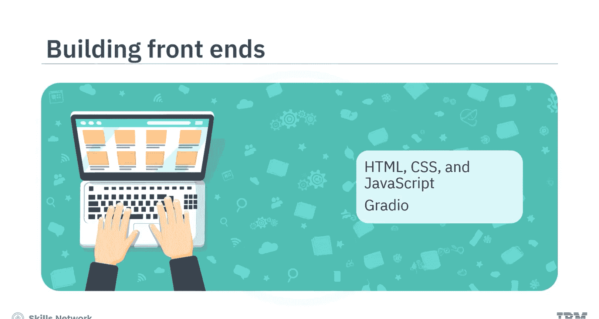
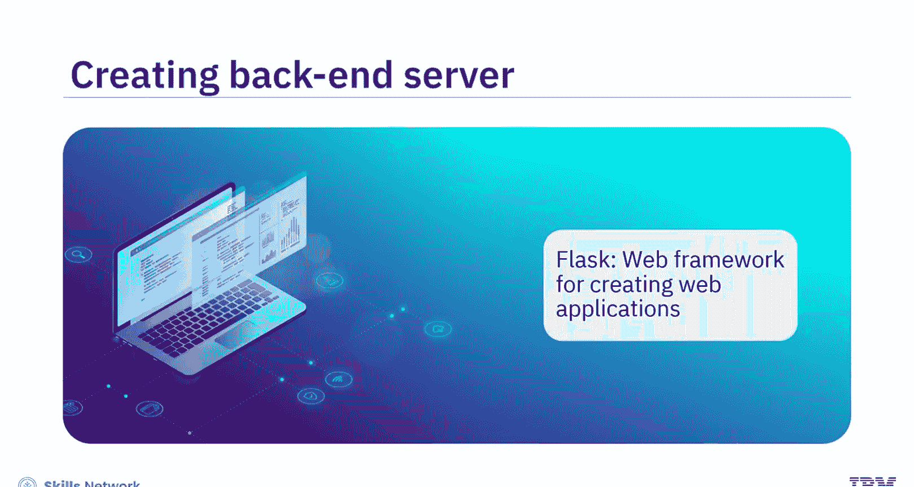
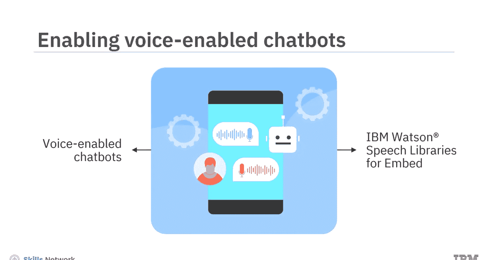
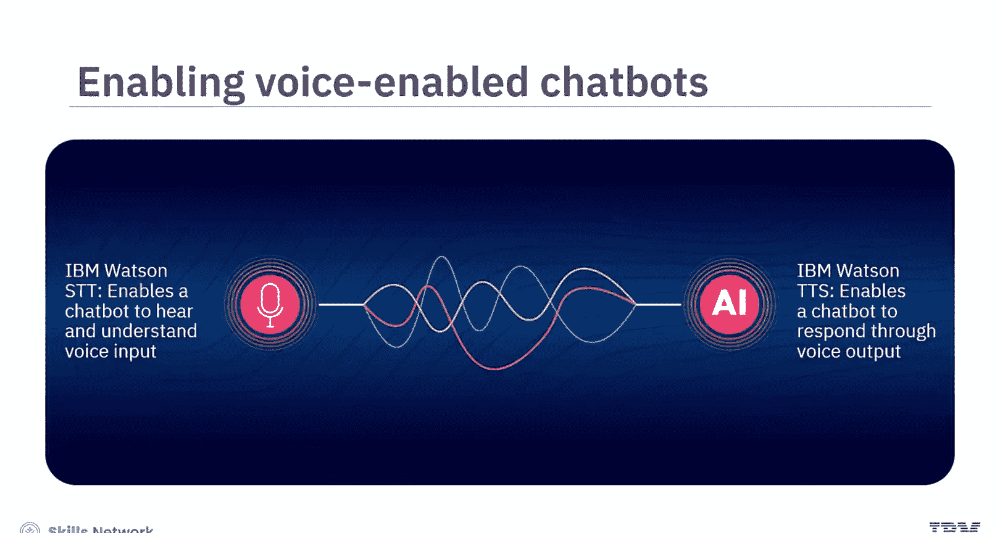
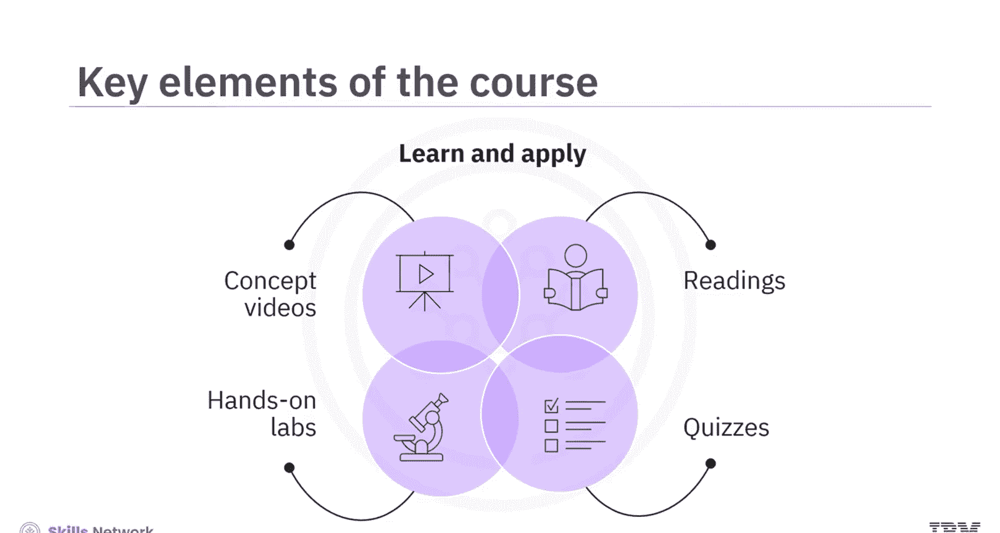
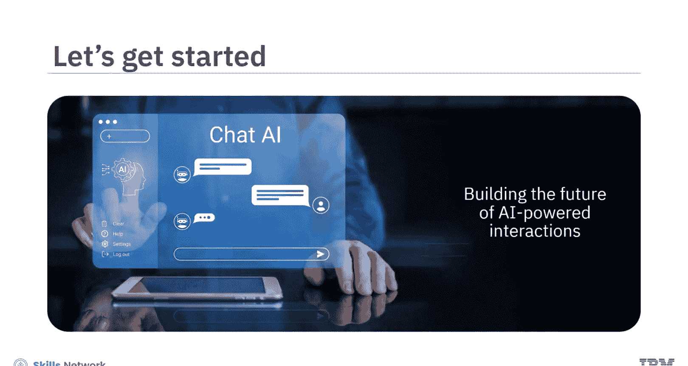

# 015：IBM《生成式人工智能工程｜Falsk、生成式AI应用、数据分析、机器学习、Keras、架构和数据、NLP基础、transformer、微调、高级微调、RAG》 p15 0_课程介绍.zh_en -BV1NAq6Y9E7z_p15-

Welcome to the generative AI powered applications video。

 Let's get started working on generative AI projects。

 Have you ever chatted with a virtual assistant or received helpful recommendations from AI powered apps or chatbots Have you ever wondered how chatbots hold conversations or how apps seem to know what you need and more interestingly。

 how can some even converse naturally through voice。

 It is the combined power of generative AI models and other AI technologies behind these intelligent and interactive chatbots and applications。

 This course will take you behind the scenes and equip you with the skills to build generative AI powered apps and chatbots In this course。

 you will work on six projects。 Each focused on developing a chatbot or an app for a specific use case Project 1 is about creating an AI tool for image captioning which you can use to give meaningful descriptions to your photos In project 2。

 you will create and integrate a chatbot into a web interface like chat GT this chatbot can access information and find answers to your queries。

In Project3， you will develop a voice-based assistant that listens to your questions and responds using voiceice Next in Project4。

 you will build an app to transcribe the meeting discussions and then provide a concise summary focusing on the key points Project 5 involves developing a chatbot that allows you to upload a PDF and ask questions to extract specific information from its contents Finally in Project6。

 you will create a voice enabledable AI translator assistant that converts speech input into text and then vocalizes in the specified language the project in the course will help you develop strong skills in implementing large language models or LLMs to enhance intelligence in your chatbots and applications。

You'll work with popular LLMs like G3 and Lama 2 hosted on platforms like IBM Watson X and Hugingface Additionally。

 you'll learn about retrieval augmented generation or ragG technology which boosts LLMs by incorporating external information beyond their training data some of these projects will teach you how to create frontend applications using HTML CSS and JavaScriptscript others will show you how to utilize open source Python libraries such as radio to develop interactive and visually appealing webbased user interfaces you also need a backend server to create a website or an application Some of these projects will teach you to build the apps backend using flask a web framework for creating web applications In the course the project based on developing voice enabled chatbots or apps demonstrate the use and integration of IBM Watson speech libraries for embed the IBM Watson speech to text or STT enables a chatbot to hear and understand voice。

put from users and the IBM Waattson text to speech or TTS facilitates the chatbot and communicating with users through voice output。

 The projects will also introduce additional tools for building applications with LLMs For instance Langchain simplifies the creation of smarter LLM applications by offering pre-built components and context to where reasoning you will develop these projects using Python so a basic understanding of Python is essential While basic knowledge of HTML CSS and ja is beneficial It's not mandatory supporting videos and readings are provided to establish a foundational understanding of frameworks and technologies used in the project By the end of the course。

 you will be able to accomplish the following objectives Ex the core concepts of generative AI models。

 describe LLM capabilities and integrate them to add intelligence to apps or chatbots。

 implement diverse AI technologies and data frameworks for the development of AI powered applications and build AI powered。

chat bots with Python programming This course is curated with a focus on both learning and practical application The mix of concept videos and supporting readings helps you to build a foundation of models。

 technologies and tools used in the projects The projects are designed as handson labs and provide stepby step instructions on how to work with code and the different activities In addition。

 graded quizzes are included to test your understanding of the core concepts and technologies Watch all the videos complete all readings and actively engage in the handson labs to develop skills for creating generative AIdriven applications using Python programming This course is your gateway to building the future of AI powered interactions Let's get started。

