# 017：IBM《生成式人工智能工程｜Falsk、生成式AI应用、数据分析、机器学习、Keras、架构和数据、NLP基础、transformer、微调、高级微调、RAG》 p17 2_基础模型.zh_en -BV1NAq6Y9E7z_p17-

Welcome to foundation models After watching this video you'll be able to to the term foundation model。

 explain key characteristics of foundation models， identify the capabilities of foundation models and explore examples of foundation models Stanford University Center for research on foundation models defines a foundation model as a new successful paradigm for building AI systems Tra one model on a huge amount of data and adapt it to many applications。

 we call such a model of foundation model。 Let's explore this definition more closely。

 The first part of this definition says train one model on a huge amount of data。

 How does this work a foundation model is a large general purposepo self-supervised model that is pretrained on vast amounts of unlabeled data establishing billions of parameters Pretraining is a technique during which unsupervised algorithms are repeatedly given the liberty to make connections between diverse pieces of information This allows foundation models to develop multi。

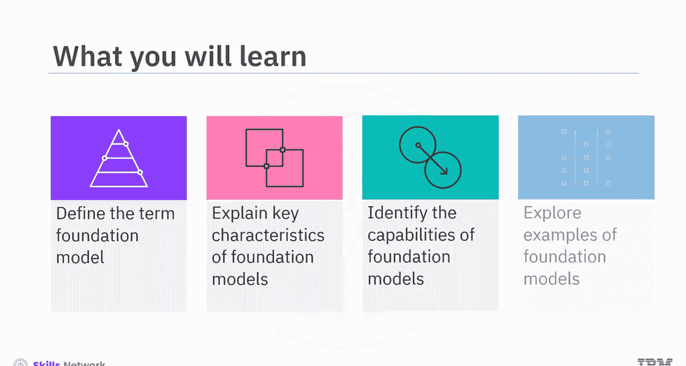

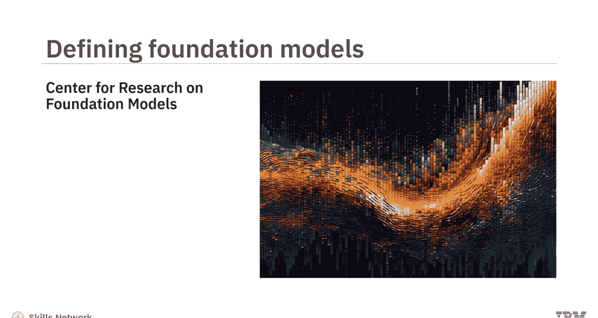

Mul domainomain capabilities such that they can accept input prompts in multiple modalities such as text。

 image， audio or video formats and perform complex and creative tasks。

 such as answering questions summarizing documents writing essays solving equations。

 extracting information from images， even developing code this broad skillet makes these models relevant to multiple domains。

 This is in contrast to smaller generative AI models。

 which are trained on restricted domain data and requested to perform limited tasks。 For instance。

 open AIs dolly family of models are considered foundation models because they can perform many imagerelated tasks。

 In contrast， AlexNet is not classified as a foundational model。

 as it only performs image classification tasks。 therefore we can clarify that while all foundation models have generative AI capabilities。

 not all generative AI models are foundation models when foundation models are trained on vast natural language processing databases they are called large language models or。

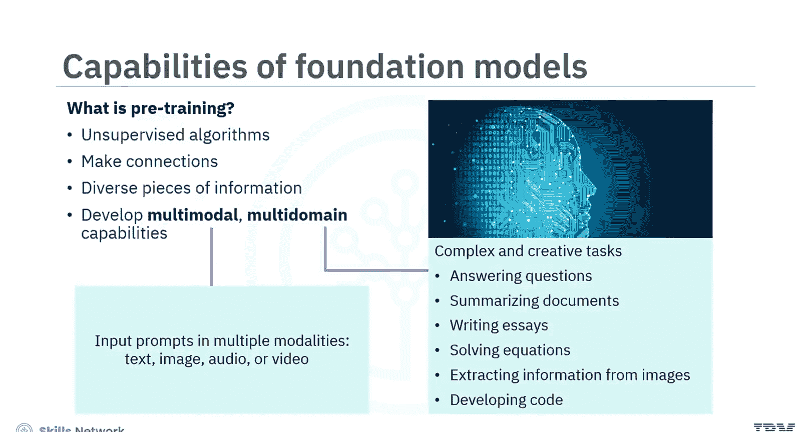

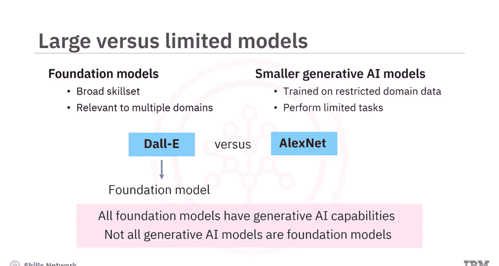

LLLLMs develop independent reasoning， allowing them to respond to queries uniquely For example。

 open AI's G and class of models， including G3， which is pretrained on 175 plus billion parameters and G4 which is pretrained on an estimated 180 plus trillion parameters other examples of large language models include Google's pathway language model pretrained on 540 billion parameters Meta's large language model MeI pretrained on 65 billion parameters Google's Bt pretrained on 340 million plus parameters。

 Metas Galactica and LLM for scientists pretrained on 48 million papers， lectures。

 textbooks and websites Technology In Institutestit's Falcon7 pretrained on 1 and5 trillion tokens and Microsoft's orRCca pretrained on 13 billion parameters and small enough to run off a laptop It's likely that these parameters may change as generative AI。

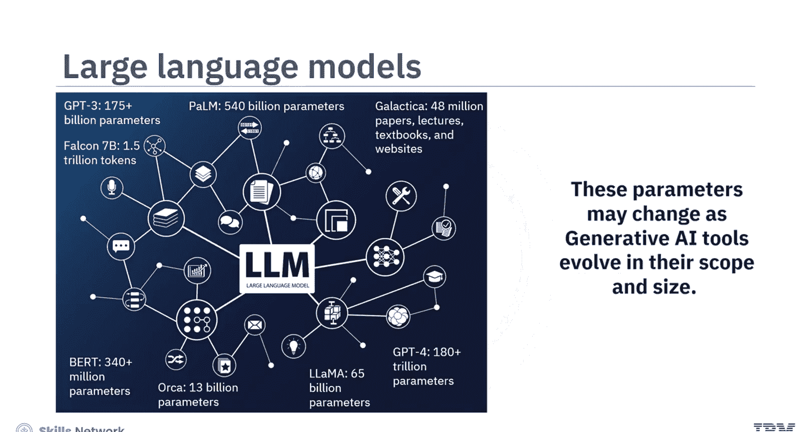

Tools evolve in their scope and size Another aspect of models evolving is their ability to adapt The definition also suggests that we can adapt a foundation model to many applications。

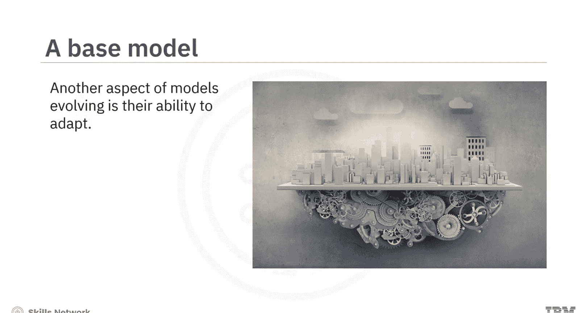

This is possible because of the broadbased training of foundation models。

 which allows them to learn new things and adapt to new situations small businesses can leverage this capability to create customized more efficient generative AI models at an affordable cost This is why foundation models are also called base models they help make AI systems more accessible to businesses and individuals who do not have the resources to train their models from scratch In this way foundation models enable enterprises to shrink time to value from months to weeks Take。

 for example， the evolution of chatbots Open AI's G3 and G4 foundation models that power the chat GT chatbot Google's Po powers the Google bard chatbot these are today's unreasonably clever chatbots。

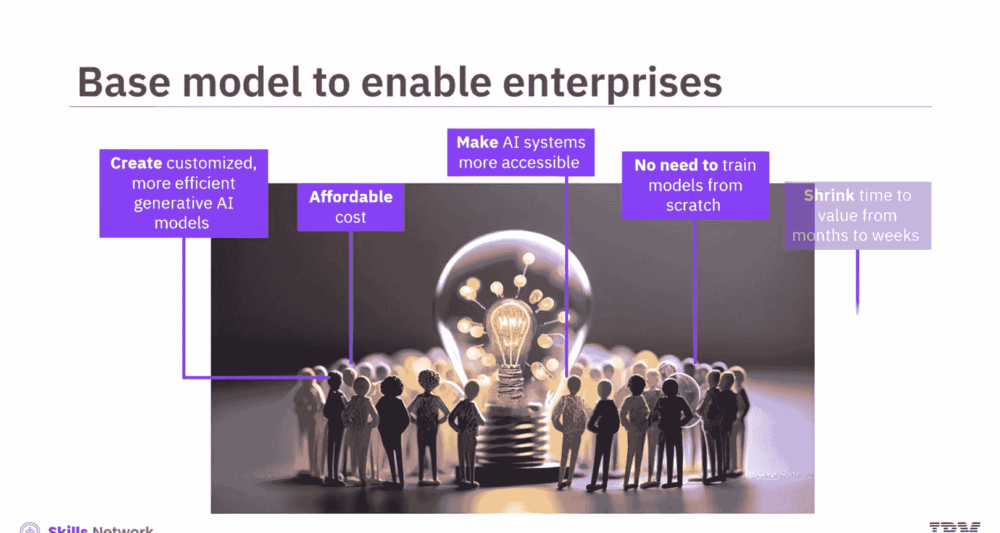

However， if we think back to how early chatbots functioned。

 we realized that they were trained on smaller dataset sets which can their generative capabilities while they could predict responses based on keywords。

 they could only provide a predetermined response In contrast。

 chatbots today are pre-trained multiple times on extensive dataset sets they are therefore able to increase their word prediction accuracy and respond in a more helpful and creative manner Try this will you if you type a single sentence prompt in chat GT you'll likely get more than a basic response depending on what you're prompt requested。

 the chatbot may write a comparative essay， create an infographic。

 design a checklist or a script a short story OpenAI's G3 is also the foundation model for Dolly an image generation tool that responds to text prompts for a single text prompt Dolly generates four highre images in multiple styles。

 including photorealistic images and paintings another clarification to note here while all large language models are foundation models。

 not all foundation models or large language models。

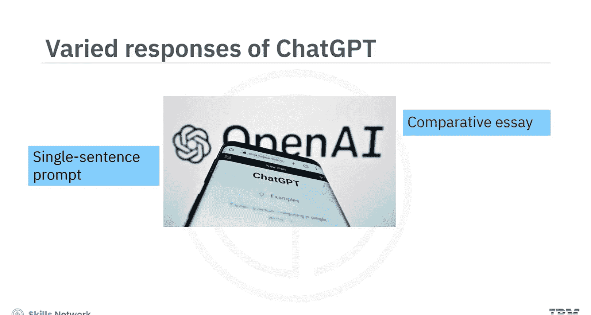

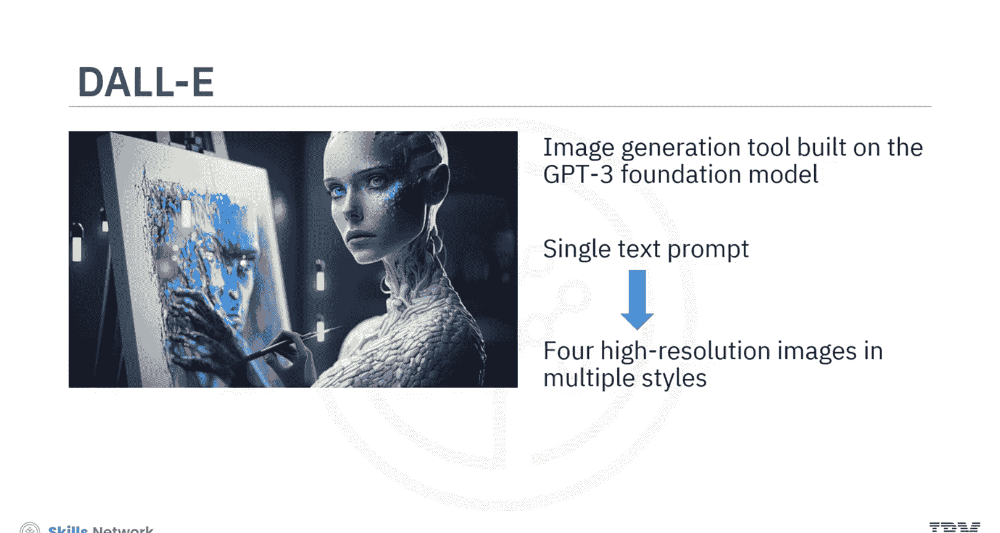

Some foundation models use diffusion architecture capabilities to improve the scale and scope of their image generation capabilities。

 For instance， Dolly uses transformer architecture。

 but the latest version of Doli uses sound diffusion to generate images from text。

 Stability AI stable diffusion uses diffusion architecture to generate high resolution images in realistic cartoony and abstract styles based on the user's description Google's imagingmogen uses a cascaded diffusion model built on an LLM to generate images from text prompts as foundation models evolve in their strengths and applications。

 we have seen some limitations Firstly， the desired output may be biased if the data on which the foundation model is trained is biased。

 Secondly， LLMs can hallucinate responses that means they generate false information because they misinterpret the context of data parameters within a data set。

 Therefore you must verify the accuracy of the output produced by a generative AI chatbot with a little caution you can enjoy the many benefits foundation models offer。

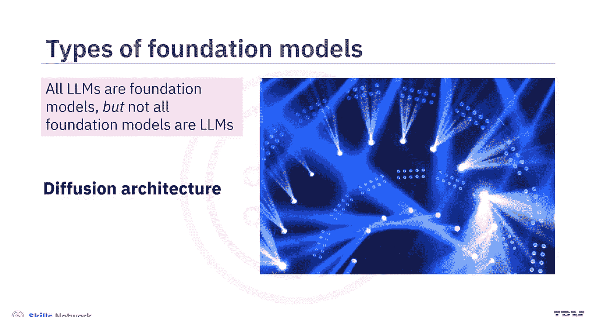

In this video， you explored the concepts of foundation models。

 these models are pretrained on billions of parameters。

 which allows them to develop independent reasoning and execute a large variety of complex tasks。

 given their multimodal multi domainomain capabilities they can serve as the foundation or base for generative AI applications。

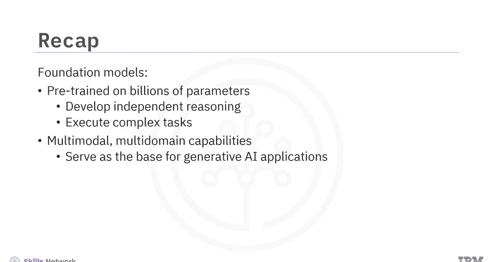